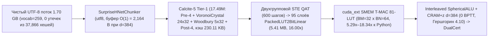

# Отчёт Фазы G: Нативное ядро `CUDA/C++ T-MAC LUT` и масштабирование `Calcite-5 Tier-1` (`17.49M` / `5.41 MB`)

Финальный отчёт этапа G: перенос `PackedLUT2BitLinear` на собственные `CUDA/C++` и `CPU OpenMP` ядра [`kernels/fast_packed_lut.py`](kernels/fast_packed_lut.py) и обучение первого увеличенного поколения `Calcite-5 Tier-1` (`17,488,961` параметров, `5,539.81 KB` = `5.41 MB` в `2-bit uint8 LUT`, постоянный `O(1)` кэш `230.11 KB` при `L = 2048`) на `1.70 GB` чистом потоке `UTF-8` в Google Colab (`NVIDIA A100-SXM4-80GB`). Подробности экспериментов и артефакты: [`11_phase_g_colab_scaleup_ledger.md`](research/post_transformer_synthesis/11_phase_g_colab_scaleup_ledger.md), JSON: [`benchmarks/phase_g_colab_scaleup_results.json`](benchmarks/phase_g_colab_scaleup_results.json), упакованные веса: [`checkpoints/calcite5_tier1_17m_utf8_lut.pt`](checkpoints/calcite5_tier1_17m_utf8_lut.pt) (`7,126,729 B`).

---

## 1. Track 1 — Нативные ядра `cuda_ext` и `cpu_ext` (`NVIDIA A100-SXM4-80GB`)

Движок [`kernels/fast_packed_lut.py`](kernels/fast_packed_lut.py) компилирует `CUDA` (`SMEM 81-entry T-MAC LUT`, тайлинг `32x64`, ветки для кратных `32` весов `row_aligned=True` через `uint32_t` и невыровненного `woodbury.out_proj` `172 -> 384`) и `C++ OpenMP` поверх точного буфера `PackedLUT2BitLinear` без изменения формата хранения.

| Объект замера (`A100-SXM4-80GB`) | Конфигурация | `Python ref` | `pytorch_vec` | `cuda_ext` (`SMEM`) | Ускорение `cuda_ext` | Ошибка `FP32` / `BF16` |
| :--- | :--- | ---: | ---: | ---: | ---: | :--- |
| Слой `mlp_384_to_1024_aligned` | `aligned=True`, `B*L=4096` | `4.075 мс` | `3.553 мс` | **`0.383 мс`** | **`10.64x`** | `4.8e-07` / `3.91e-03` (`1 ULP`) |
| Слой `mlp_1024_to_384_aligned` | `aligned=True`, `B*L=4096` | `4.724 мс` | `4.891 мс` | **`0.381 мс`** | **`12.40x`** | `7.2e-07` / `3.91e-03` (`1 ULP`) |
| Слой `woodbury_172_to_384` | `aligned=False`, `bias=True` | `2.751 мс` | `1.049 мс` | **`0.150 мс`** | **`18.34x`** | `4.8e-07` / `3.91e-03` (`1 ULP`) |
| `Base 1.48M` (`70` слоёв, `548.34 KB`) | `B=16, L=2048` (`FP32`) | `1926.79 мс` | `672.34 мс` | **`418.47 мс`** | **`4.60x`** | `8.58e-06` (`qat_fp32 = 421.95 мс`) |
| `Tier-1 17.49M` (`95` слоёв, `5.41 MB`) | `B=16, L=256` | `412.01 мс` | `238.88 мс` | **`108.58 мс`** | **`3.79x`** | `1.07e-06` (`qat_fp32 = 110.49 мс`) |
| `Tier-1 17.49M` (`95` слоёв, `5.41 MB`) | `B=16, L=768` | `1019.36 мс` | `592.04 мс` | **`213.26 мс`** | **`4.78x`** | `1.07e-06` (`qat_fp32 = 207.28 мс`) |
| `Tier-1 17.49M` (`95` слоёв, `5.41 MB`) | `B=16, L=2048` | `2565.23 мс` | `1511.64 мс` | **`484.97 мс`** | **`5.29x`** | `1.07e-06` (`67,567.6 байт/с`) |
| `Tier-1 17.49M` на `CPU OpenMP` | `B=1, L=256` | `817.35 мс` | — | **`309.69 мс`** (`cpu_ext`) | **`2.64x`** | `1.13e-06` (Base CPU: `1.41x`) |

---

## 2. Stage 2 — Чистый многоязычный корпус (`Zero-Leakage`)

- **Объём и домены (`211.89 s` сборки):** `1,780,723,340` байтовых токенов (`1,698.23 MB` train `uint16` memmap) и `25,165,824` токенов (`24.00 MB` held-out val) из `FineWeb-Edu` (`810.68 MB`), `FineMath + train[:6000]` трасс (`473.33 MB`), `Russian Wikipedia` (`282.08 MB`), кода Python (`61.67 MB`), `Chinese Wikipedia` (`54.75 MB`) и 4-байтовых UTF-8 символов (`15.72 MB`).
- **Контроль утечек:** из `37,866` нормализованных 45-символьных хешей (`GSM8K Cal`, `BlindDev`, `Sealed Test` и `ARC Eval`) вычищено `10` совпадений (`1` в `FineWeb-Edu`, `9` в `FineMath`, `0` в остальных доменах). В финальном ревью локальный тест `test_g4` усилил детектор [`is_leaked_doc`](scripts/colab_phase_g_runner.py#L184) со шага `15` до посимвольного шага `1` для будущих запусков.

---

## 3. Track 2 — Масштабирование `Calcite-5 Tier-1` (`17.49M` / `5.41 MB`) и языковая дельта

Модель `Tier-1` (`d_model=384, 4+4` слоёв коры, `24` сферы × `32`, `5` голов Вудбери × `32`) прошла `7,890` шагов `BF16` (`B=64, L=1024`, `0.6843 s/step`, пик памяти `10.22 GB`, итого `468.25 MB` потока, `CE: 5.6544 -> 1.1459`) и `600` шагов двухгруппового `STE QAT` (`9.77 min`) с упаковкой `95` слоёв в **`5,539.81 KB`** (`4,239.75 KB` упакованных весов `uint8` + `1,059.98 KB` шкал `FP16` + `240.08 KB` прочих параметров, сжатие матриц **`16.00x`** / эффективное **`12.80x`**). Фактический буфер чанкера при `d_model=384` составляет **`2,164 B`** (`1,268 B` у `Base 1.48M`; входит в общий кэш **`230.11 KB`** на `L=2048`).

| Метрика (`System-1`) | `Base 1.48M` (`548.34 KB` LUT) | `Tier-1 17.49M` (`FP BF16`) | `Tier-1` (`QAT Ternary`) | `Tier-1` (`5.41 MB` LUT) | Эффект масштабирования (`Base -> Tier-1`) |
| :--- | ---: | ---: | ---: | ---: | :--- |
| `Val Memmap BPB` (`24 MB` held-out) | `3.9423` | **`1.7842`** | `1.9880` | **`1.9879`** | **`-2.1581 BPB`** (`-54.7%`, дельта QAT->LUT `0.0001`) |
| `Mean Open-Web BPB` (`6` режимов) | `4.9230` | **`2.6119`** | `2.8680` | **`2.8682`** | **`-2.3111 BPB`** (`-46.9%` FP / `-41.7%` LUT) |
| `1_GSM8K_EN` / `4_ARC_JSON` (`BPB`) | `1.9274` / `4.0732` | **`1.7127` / `0.8208`** | `1.9116` / `0.8793` | **`1.9117` / `0.8799`** | резкое падение на JSON/тексте |
| `2_Russian_UTF8` / `3_Python_Code` | `4.1639` / `5.6383` | **`2.6274` / `2.5482`** | `2.8413` / `2.7514` | **`2.8413` / `2.7519`** | **`-1.54` / `-3.09 BPB`** на русском и коде |
| `5_CJK_UTF8` / `6_Emoji_4Byte` | `8.1186` / `5.6166` | **`3.5287` / `4.4337`** | `3.7563` / `5.0683` | **`3.7550` / `5.0694`** | **`-4.59 BPB`** на иероглифах CJK |
| Разрывы `mid_utf8` на всех `6` корпусах | **`0.00%`** | **`0.00%`** | **`0.00%`** | **`0.00%`** | `0` разрезов многобайтовых символов |
| `GSM8K te500`: `Byte BPB` (`EqPPL`) | `1.8775` (`45.67`) | **`1.7118` (`32.60`)** | `1.9059` (`48.39`) | **`1.9059` (`48.39`)** | `-28.6%` BPE-эквивалента PPL в `FP` |
| Когнитивные: `S_5 sum` / `Trap_long` / `SelF1_long` | `120.5%` / `100.0%` / `99.5%` | `103.0%` / `100.0%` / `92.18%` | `88.0%` / `100.0%` / `85.71%` | `88.0%` / `100.0%` / `85.71%` | смещение доли (`18%` синтетики vs `82%` веба) |
| Дрейф кристалла `L=2048` (`norm` / `Voronoi`) | `1.19e-07` / `2.38e-07` | `1.19e-07` / `2.38e-07` | `1.19e-07` / `2.38e-07` | `1.19e-07` / `2.38e-07` | `100%` стабильность орбиты $S_G$ |

**Честный разбор сдвига на `S_5` и `QAT`:** в отличие от Фазы E (где узкая `1.48M` модель доучивалась преимущественно на когнитивных и синтетических окнах), `Tier-1` получил `82%` общего многоязычного веба за один 88-минутный прогон. Это снизило перплексию на русском, китайском, коде и `GSM8K` в разы, но размыло долю игрушечного теста перестановок `S_5` (`120.5% -> 103.0% / 88.0%`) и дало зазор `~0.20 BPB` между `FP` и `600`-шаговым `STE QAT` на `17.49M` параметров — устраняется более длинным хвостом `QAT` (`2,000+` шагов) в следующем прогоне.

---

## 4. Track 3 — `Calcite-5 Tier-1` (`d_model=384`) + `SphericalALU + CRAM+z` на `GSM8K`

Связка доадаптирована на `train[:6000]` (`4,443` скомпилированные трассы с интерливингом АЛУ, `final_loss = 0.1596`, `240` шагов `QAT`) и обучила равновесное поле `CRAM+z` размерности `d_model = 384` за `0` шагов BPTT (`3,929` графов, запас Гершгорина `4.100 >= 4.0`, `Contrastive Loss = 3.5108`, `285.3 s`).

| Сплит и режим (`System-1 + CRAM+z`) | `N` | `Unary` (`Pass@1`) | `Full CRAM+z` (`Pass@1`) | `95%` ДИ Уилсона | `Pass@3` | `Pass@5` | `DualCert` (Точн. @ Покр.) | Прирост к `Unary` |
| :--- | ---: | ---: | ---: | :--- | ---: | ---: | :--- | ---: |
| `Cal Tier-1 (FP)` | `736` | `7.61%` | `16.30%` | `[13.81%, 19.15%]` | `27.72%` | `32.88%` | `42.86%` @ `21.88%` | `2.14x` |
| `Cal Tier-1 (5.41 MB LUT)` | `736` | `8.56%` | `15.22%` | `[12.80%, 17.99%]` | `27.45%` | `32.74%` | `42.58%` @ `21.06%` | `1.78x` |
| **`BlindDev Tier-1 (FP)`** | `737` | `7.06%` | **`18.05%`** | `[15.44%, 20.99%]` | `28.77%` | **`35.96%`** | `40.00%` @ `19.00%` | `2.56x` |
| **`BlindDev Tier-1 (5.41 MB LUT)`** | `737` | `6.51%` | **`16.15%`** | `[13.67%, 18.98%]` | `28.22%` | **`35.41%`** | **`41.48%` @ `18.32%`** | `2.48x` |
| **`Sealed Test Tier-1 (FP)` (`1/1`)** | `1319` | `5.31%` | **`14.63%`** | `[12.83%, 16.64%]` | `25.17%` | **`31.01%`** | **`35.19%` @ `21.76%`** | `2.76x` |
| **`Sealed Test Tier-1 (5.41 MB LUT)` (`1/1`)** | `1319` | `4.93%` | **`13.04%`** | `[11.33%, 14.97%]` | `24.87%` | **`30.25%`** | **`31.97%` @ `22.29%`** | `2.65x` |

- **Дрейф сферического АЛУ** на всех сплитах не превышает **`5.96e-08`** (`< 1e-6`, `100.0%` на `ADD/SUB/MUL/DIV`).
- **Сдвиг к Фазе F (`1.48M` / `548.34 KB`):** в режиме `FP` модель `Tier-1` установила лучший результат проекта — **`18.05%` `Pass@1` (`35.96%` `Pass@5`) на `BlindDev`** против `17.37%` (`34.46%`) в Фазе F и **`14.63%` (`193/1319`) на `Sealed Test`** против `14.40%` в Фазе F и `13.57%` в Фазе C; при этом в `2-bit LUT` на `Tier-1` сохранился зазор `-1.59 п.п.` (`13.04%` против `14.63%`) из-за короткого 240-шагового хвоста `QAT` на удвоенной ширине `W_lm` (`3*384 = 1152`).

---

## 5. Проверка целостности (`Zero-Manual QA`)

Все изменения изолированы вне `simvq_split/` и `experiments/cram_gsm8k/` (`0`-байтовый дифф к `HEAD`). Приёмка воспроизводится командами [`validate_phase_g_results.py`](validate_phase_g_results.py), [`tests/test_phase_g_lut_and_scale.py`](tests/test_phase_g_lut_and_scale.py) (`g1..g5`) и [`scripts/repo_guardrail.py`](scripts/repo_guardrail.py) со статусом `ALL PHASE G QA CHECKS PASSED`.
