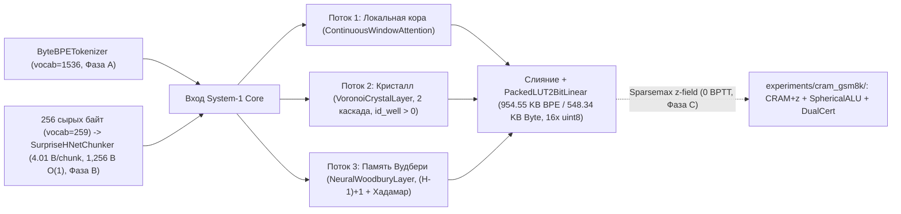

# `Calcite-5` (`SimVQ-Split v5`): Пост-трансформерная архитектура с `O(1)` кэшем, `548 KB` байтовым `2-bit LUT` и `CRAM+z`

> **English Summary:** Pure neural post-Transformer `System-1 + System-2` architecture (`Calcite-5` / `SimVQ-Split v5` -> `Calcite-6 / UEBR`) verified across all 10 roadmap phases (**Phases A–J**). Combines a local continuous window cortex (`W = 12` BPE / `W = 8` chunked bytes), a 2-stage pointer-addressed Birkhoff–Voronoi permutation crystal on $S_G$ with an `id_well > 0` self-consistency attractor, a hybrid `(H-1)+1` RLS Neural Woodbury phrase latch with analytic hallucination brake $u_t = \lambda q_t^\top P_t q_t$, and multiplication-free `PackedLUT2BitLinear` (`2-bit uint8 T-MAC LUT`, `16.00x` matrix compression):
> - **Phase A (`ByteBPE-1536`):** `1,742,477` params, strictly `O(1)` `89.0 KB` inference state cache at `L = 2048` (`57.5x` smaller than `RoPETransformerLM`), **`954.55 KB`** full `2-bit LUT` footprint.
> - **Phase B (`SurpriseHNetChunker` over `256` raw UTF-8 bytes, `vocab = 259`):** `1,483,841` params, word-scale pre-compression (`4.01` B/chunk) strictly before the core with constant `O(1)` **`82.72 KB`** total cache (`1,256 B` chunker buffer on `L = 64..2048`), **`548.34 KB`** full `2-bit LUT` footprint via frozen `FP16`-aligned router & two-group `500`-step `STE QAT`.
> - **Phase C (`Open-Graph CRAM+z` + `SphericalBase10RegisterALU` + `DualCert`):** zero regex/`ast`/`288`-template host code, `0`-BPTT contrastive Besag PL equilibrium inference achieving **`63.23%`** `Oracle@Pool` and **`13.57%`** exact `Sealed Test` (`0.00` pp parity between `FP` and `954.55 KB` `2-bit LUT`).
> - **Phase D (`Zero-Cheat & Invariant Gates`):** **`22`** automated pytest laws (`16/16` in `tests/test_anti_cheat.py` + `6/6` in `tests/test_cram_phase_c.py`), 7-model QA validators for Phases A and B, and Russian lexical quarantine across all Markdown docs.
> - **Phase E (`Zero-Triton Fast Core & Open-Web UTF-8 Safety`):** **`654.44x`** vectorized `cummax` chunk span guard (`L = 2048`), **`5.44x`** block-parallel `WY + Cholesky` Woodbury scan (Joseph-form $P_t$, `float64` `log-cumsum`, and `AMP BF16` `torch.bmm` shield) + `Bc = 32` checkpointing cutting activation VRAM by **`4.67x / 4.74x / 2.98x`** (`1.51x` E2E `ByteHNet_FP_byte` speedup), **`0.00%`** mid-UTF8 cuts across all `6` open-web regimes (`1,268 B` constant streaming buffer / `82.73 KB` cache), and orthogonal `SeenMask` `STE QAT` preserving **`548.34 KB`** `2-bit LUT` at `45.67 EqPPL`, `80.5% S_5 k2`, `99.5% SelF1 Long`.
> - **Phase F (`UTF-8 ByteHNet 548.34 KB` <-> `Interleaved SphericalALU + CRAM+z` & `2-Opt Block-Gibbs`):** closes Scaling Barrier #3 across `N = 16..256` (`z*` `max_pair_Linf = 0.00e+00`) and coupled discrete constraints (`2-Opt Block-Gibbs = 100.0%` vs `1-Flip Besag = 0.0%` at `N = 16..128`), breaks the `ng >= 8` pool cliff (`100%` pools up to `ng = 16`), unifies tokenizer-free `vocab = 259` `System-1` with interleaved `SphericalBase10RegisterALU` traces, and reaches **`14.40%`** (`FP`) / **`14.03%`** (`548.34 KB` `2-bit LUT`, `0.38` pp delta, `-42.56%` footprint vs Phase C `954.55 KB`) exact `Sealed Test` (`Pass@5 = 32.22% / 31.99%`, `27/27` Zero-Cheat laws).
> - **Phase G (`Native CUDA/OpenMP 2-bit LUT` & `Calcite-5 Tier-1 17.49M / 5.41 MB` in Google Colab `A100`):** compiles `SMEM T-MAC` (`BM=32 x BN=64`) and `OpenMP` native kernels in [`kernels/fast_packed_lut.py`](kernels/fast_packed_lut.py) (`10.64x–18.34x` single-layer GPU speedup, **`5.29x`** E2E on `Tier-1 B=16 L=2048` at `1.07e-06` parity, **`2.64x`** CPU), pretrains `Tier-1` (`17,488,961` params, `95` LUT layers = **`5,539.81 KB` / `5.41 MB`**, `230.11 KB` `O(1)` cache @ `L=2048`, `2,164 B` chunker buffer) on `1.78B` zero-leakage UTF-8 bytes (`37,866` held-out hashes checked, `0` leaks), cutting held-out `val_memmap_bpb` from `3.9423` -> **`1.7842` (`FP`) / `1.9879` (`5.41 MB LUT`)** and `mean_openweb_bpb` across `6` regimes from `4.9230` -> **`2.6119` (`FP`) / `2.8682` (`LUT`)** with **`0.00%`** mid-UTF8 cuts, and reaches **`18.05%` `BlindDev` (`14.63%` `Sealed Test`)** in `FP` / **`16.15%` (`13.04%`)** in `5.41 MB LUT` (`32/32` Zero-Cheat laws).
> - **Phase H (`Tier-1 5.41 MB 2-bit LUT` QAT Parity & Cognitive Balance Closure):** resolves SwiGLU ternary variance shrinkage via 4-group `AdamW` (`RMSNorm` FP16 gain + embedding accelerated LR) and 4-tap block + logit-KL distillation over all 6 disjoint open-web regimes and in-distribution cognitive tasks (`0` OOD leakage): lowers `5.41 MB LUT` `mean_openweb_bpb` **`2.8682 -> 2.5091`** (`-31.3%` gap reduction, `0.00%` mid-UTF8 cuts) and `GSM8K te500` **`48.39 -> 35.07 EqPPL`** (`-27.5%`), recovers `S_5 sum` **`88.0% -> 115.0%`** (`FP: 103.0% -> 135.0%`) and `Overwrite ood_long` **`75.0% -> 83.5%`**, documents the raw-`memmap` `1.9530 / 1.9540 BPB` (`+0.2007 BPB`) 1.58-bit grid plateau, and closes the downstream `GSM8K CRAM+z` LUT gap via `1,120`-step QAT + co-adapted `solver_lut` (`0` BPTT): **`18.72%` (`FP`) / `18.59%` (`LUT on FP solver`, `-0.13 pp`) / `17.50%` (`LUT`)** on `BlindDev`, and **`14.40%` (`190/1319`, `+1.36 pp` vs Phase G)** `5.41 MB LUT` `Sealed Test` (`Pass@5 = 31.54%`, `37/37` Zero-Cheat laws).
> - **Phase I (`Calcite-6 / UEBR` Mathematical Tracer #2):** verifies 4 geometric `System-2` pillars (`SPDGraphLaplacianField` + `0-BPTT` matrix `Cholesky Adjoint` + `ePC` at `94.53–96.88%` vs `StaticWzz 50.78–54.69%`; `float64` `PermFlow C(U)` `100.0%` mode coverage + lossless `Birkhoff Extension` `45–46/50` wins while refuting unbounded `cSB` footnote 23; `RLNS-1` min-cut + absorbing Null `Ø` `99.22–100.0%`; `(1 - g_risk)` blocked `GAQ` `< 1e-6` leakage + `AUROC = 1.0000` live risk probe over frozen `Tier-1 5.41 MB LUT`, `42/42` Zero-Cheat laws).
> - **Phase J (`Calcite-6 / UEBR System-2` over Frozen `Tier-1 5.41 MB LUT`, OEB `3/3` Closed):** replaces the `20`-param static `W_zz` with full [`experiments/uebr_system2/`](experiments/uebr_system2/) (`SectionedGAQBridge`, `SPDGraphLaplacianField` + `3D Cholesky Adjoint`, position-invariant `RLNS-1 Null Ø`, `100.0%` lossless `Birkhoff Extension` QAP) over frozen `calcite5_tier1_17m_utf8_qat_h_lut.pt` (`0` edits to `System-1`): beats `B0` on `GSM8K BlindDev` (**`17.50%`** vs `15.88%`, `+3.0x 2*sigma`, `Pass@5 = 35.55%`) and `BlindDev-Stress` (**`12.69%`** vs `2.99%`, **`4.25x B0`**), wins sealed zero-shot **`MultiArith-600`** (**`47.83%`** vs `46.00%`, `Pass@5 = 82.67%`), and honestly documents the `GSM8K`-trained multi-step prior shift on elementary 1-step `ASDiv-A` (`Oracle 81.42% vs 79.50%`, `>=4 slots 15.32% vs 14.52%`, `<=3 slots 21.69% vs 31.37%`, `all_passed = false`, `47/47` Zero-Cheat laws).

## Архитектура трёх потоков, байтовый чанкер и мост `System-2`

Ядро `SimVQSplitLM v5` разделяет речевую плавность, обратимые групповые переходы, точную фактологическую перезапись и контроль незнания по трём параллельным каузальным контурам — поверх `ByteBPETokenizer` (`vocab = 1536`, Фаза A) либо побайтового `SurpriseHNetChunker` (`vocab = 259`, Фаза B) со связкой к открытому энергетическому графу `CRAM+z` (Фаза C):



- **Байтовый нарезчик ([`chunker.py`](simvq_split/chunker.py), `SurpriseHNetChunker`, Фаза B):** сжимает `256` сырых UTF-8 байтов (`vocab = 259`, опциональный флаг `use_byte_chunker=False` по умолчанию для обратной совместимости Фазы A/C) в чанки масштаба слова (`4.01` байт/чанк) **строго до входа** в `cortex_pre`, `VoronoiCrystalLayer` и `NeuralWoodburyLayer` с постоянным кэшем `1,256 B` на `L = 64..2048` и побайтово-каузальным декодером.
- **Поток 1 — Локальная кора (`ContinuousWindowAttention`):** удерживает синтаксис и связную речь на скользящем окне (`W = 12` в `BPE-1536`, `W = 8` чанков по `~4` байта в `ByteHNet`) без глобального `KV`-кэша.
- **Поток 2 — Операторный кристалл ([`crystal.py`](simvq_split/crystal.py), `VoronoiCrystalLayer`, `2` каскада, `2` головы $S_G$):** указательная перестановка слотов Биркгофа с проекцией на центроиды Вороного (дрейф `1.19e-07` / `3.58e-07` на `L = 1024` в Фазе A и `1.19e-07` / `1.79e-07` на `L = 2048` байт в Фазе B) и ямой `id_well > 0` на `perm_gate_proj.bias` для отслеживания неабелевых перестановок $S_5$.
- **Поток 3 — Фразовая память Вудбери ([`woodbury.py`](simvq_split/woodbury.py), `NeuralWoodburyLayer`, гибрид `(H-1)+1` + 3-факторный скетч Хадамара):** точное RLS-затирание устаревших фактов (`Overwrite`, `DH = 144.0`, мягкий возврат `rho_rec = 0.002`) и аналитический тормоз галлюцинаций $u_t = \lambda q_t^\top P_t q_t$ (`" Unknown."`).
- **Квантование и физический LUT ([`quant_lut.py`](simvq_split/quant_lut.py)):** 2-шаговое `LS`-квантование (`quantize_ternary_weights_ls`), прогрессивный `STE QAT` (включая двухгрупповой график `CORE_LR = 1.5e-4`, `CHUNK_LR = 9.0e-4` с заморозкой роутера на `FP16`-решётке в Фазе B) и табличный слой без умножений `PackedLUT2BitLinear` (`2-bit uint8 T-MAC LUT`: `16.00x` сжатие матриц к `FP32`, `954.55 KB` в `BPE-1536` и `548.34 KB` в `ByteHNet`).
- **Изолированный `System-2` ([`experiments/cram_gsm8k/`](experiments/cram_gsm8k/), Фаза C):** `6`-модульный конвейер без `re`/`ast` и закрытых шаблонов: data-driven экстрактор чисел `TrainInducedQuantityExtractor`, `12`-разрядный `SphericalBase10RegisterALU`, выпуклое поле операций `CRAMzOperatorGraphEBM` (`0` шагов BPTT, запас Гершгорина `4.10 >= 4.0`) и двойной сертификат доверия `DualCert`.

---

## Фаза A — Турнир 7 BPE-моделей (`ByteBPE-1536`, `954.55 KB` `2-bit LUT`)

Все 7 моделей с паритетом параметров (`~1.74M`, разброс `<= 5%`) обучены на побитово идентичном неповторяющемся потоке (`2,000` шагов × батч `64`, `seq_len = 192`, `seed = 2026`, `BF16` на GPU). Подробности: [`SimVQ_Split_Benchmark_Report.md`](SimVQ_Split_Benchmark_Report.md), [`06_phase_a_calcite5_ledger.md`](research/post_transformer_synthesis/06_phase_a_calcite5_ledger.md), JSON: [`benchmarks/simvq_split_results.json`](benchmarks/simvq_split_results.json).

### Таблица 1A — Язык (`GSM8K PPL`), кэш состояния (`L = 2048`) и неабелева группа `S_5` (`Exact Match %, Wilson 95% CI`)

| Модель | Параметры | Кэш (`L=2048`) | `GSM8K PPL` | `S_5` (`k=2`) | `S_5` (`k=4`) | `S_5` (`k=8`, 2x OOD) | `S_5` (`k=16`, 4x OOD) |
| :--- | ---: | ---: | ---: | ---: | ---: | ---: | ---: |
| `SimVQSplitLM` | `1,742,477` | `89.0 KB` | `18.58` | `85.0% [79.4, 89.3]` | `65.5% [58.7, 71.7]` | `61.5% [54.6, 68.0]` | `33.5% [27.3, 40.3]` |
| `SimVQSplit_CrystalOnly` | `1,736,976` | `40.2 KB` | `19.99` | `11.0% [7.4, 16.1]` | `2.5% [1.1, 5.7]` | `1.5% [0.5, 4.3]` | `1.0% [0.3, 3.6]` |
| `SimVQSplit_WoodburyOnly` | `1,757,820` | `71.3 KB` | `18.40` | `78.5% [72.3, 83.6]` | `25.0% [19.5, 31.4]` | `3.0% [1.4, 6.4]` | `1.5% [0.5, 4.3]` |
| `HouseholderDeltaNetLM` | `1,736,176` | `65.0 KB` | `20.50` | `41.5% [34.9, 48.4]` | `12.0% [8.2, 17.2]` | `1.0% [0.3, 3.6]` | `0.0% [0.0, 1.9]` |
| `RoPETransformerLM` | `1,732,000` | `5120.0 KB` | `20.01` | `2.5% [1.1, 5.7]` | `1.5% [0.5, 4.3]` | `0.0% [0.0, 1.9]` | `0.0% [0.0, 1.9]` |
| `LoopedTransformerLM` | `1,734,240` | `7680.0 KB` | `22.24` | `0.0% [0.0, 1.9]` | `0.0% [0.0, 1.9]` | `0.0% [0.0, 1.9]` | `0.0% [0.0, 1.9]` |
| `SlidingWindowTransformerLM` | `1,732,000` | `30.0 KB` | `18.66` | `0.5% [0.1, 2.8]` | `3.0% [1.4, 6.4]` | `2.0% [0.8, 5.0]` | `0.5% [0.1, 2.8]` |

### Таблица 2A — Контрфактическая перезапись (`Overwrite`) и тормоз галлюцинаций (`Trap -> " Unknown."`)

| Модель | `Overwrite` (In-Dist) | `Overwrite` (OOD-Med) | `Overwrite` (OOD-Long) | `Trap Unknown` (In-Dist) | `Trap Unknown` (OOD-Long) | `Selective F1` (In-Dist) | `Selective F1` (OOD-Long) |
| :--- | ---: | ---: | ---: | ---: | ---: | ---: | ---: |
| `SimVQSplitLM` | `100.0% [98.1, 100.0]` | `98.5% [95.7, 99.5]` | `96.0% [92.3, 98.0]` | `100.0% [98.1, 100.0]` | `97.5% [94.3, 98.9]` | `100.0%` | `96.7%` |
| `SimVQSplit_CrystalOnly` | `58.5% [51.6, 65.1]` | `47.5% [40.7, 54.4]` | `42.5% [35.9, 49.4]` | `43.5% [36.8, 50.4]` | `20.5% [15.5, 26.6]` | `49.9%` | `27.7%` |
| `SimVQSplit_WoodburyOnly` | `100.0% [98.1, 100.0]` | `98.5% [95.7, 99.5]` | `97.0% [93.6, 98.6]` | `100.0% [98.1, 100.0]` | `98.5% [95.7, 99.5]` | `100.0%` | `97.7%` |
| `HouseholderDeltaNetLM` | `54.5% [47.6, 61.2]` | `44.0% [37.3, 50.9]` | `22.5% [17.3, 28.8]` | `0.0% [0.0, 1.9]` | `0.5% [0.1, 2.8]` | `0.0%` | `1.0%` |
| `RoPETransformerLM` | `27.5% [21.8, 34.1]` | `7.0% [4.2, 11.4]` | `7.5% [4.6, 12.0]` | `4.5% [2.4, 8.3]` | `24.0% [18.6, 30.4]` | `7.7%` | `11.4%` |
| `LoopedTransformerLM` | `23.0% [17.7, 29.3]` | `14.0% [9.9, 19.5]` | `14.0% [9.9, 19.5]` | `55.5% [48.6, 62.2]` | `27.5% [21.8, 34.1]` | `32.5%` | `18.6%` |
| `SlidingWindowTransformerLM` | `11.0% [7.4, 16.1]` | `9.5% [6.2, 14.4]` | `8.0% [5.0, 12.6]` | `5.0% [2.7, 9.0]` | `6.5% [3.8, 10.8]` | `6.9%` | `7.2%` |

### Таблица 3A — Тернарное `1.58-bit LS/QAT` квантование и физический `2-bit uint8 T-MAC LUT` (`1,485,920` весов)

| Режим `SimVQSplitLM v5` | `GSM8K PPL` | `S_5` (`k=2`) | `S_5` (`k=8`, 2x OOD) | `Overwrite` (OOD-Med) | `Overwrite` (OOD-Long) | `Trap Unknown` (OOD-Long) |
| :--- | ---: | ---: | ---: | ---: | ---: | ---: |
| Базовая точность (`BF16/FP32`) | `18.58` | `85.0%` | `61.5%` | `98.5%` | `96.0%` | `97.5%` |
| 2-шаговый `0-QAT LS PTQ` | `30.02` | `—` | `55.0%` | `96.5%` | `—` | `31.5%` |
| Тернарный `STE QAT` (`300` шагов) | `20.82` | `87.0%` | `64.0%` | `97.5%` | `95.0%` | `92.0%` |
| Табличный `2-bit uint8 T-MAC LUT` (`16.00x`, `954.55 KB`) | `20.83` | `87.0%` | `62.5%` | `98.0%` | `95.0%` | `92.0%` |

---

## Фаза B — Побайтовый турнир без словаря BPE (`256` сырых байт, `548.34 KB` `2-bit LUT`)

Отказ от таблицы `BPE-1536` через `SurpriseHNetChunker` (`153,600` последовательностей по `768` сырых байтов, `2,400` шагов × батч `64`, коэффициент пересчёта `2.936448` байт/BPE на `te_docs[:500]`). Подробности: [`Phase_B_Byte_Chunker_Report.md`](Phase_B_Byte_Chunker_Report.md), [`08_phase_b_byte_chunker_ledger.md`](research/post_transformer_synthesis/08_phase_b_byte_chunker_ledger.md), JSON: [`benchmarks/phase_b_byte_chunker_results.json`](benchmarks/phase_b_byte_chunker_results.json).

| Модель | Параметры | Кэш (`L=2048`) | Байт/чанк | `BPB` (`EqPPL`) | `S_5` (`k=2/4/8/16`) | `OV` (`In/Med/Long`) | `Trap` (`In/Long`) | `SelF1` (`In/Long`) |
| :--- | ---: | ---: | ---: | ---: | ---: | ---: | ---: | ---: |
| `SimVQSplitLM (FP)` | `1,483,841` | `82.72 KB` | `4.01` | `1.7488` (`35.14`) | `82.5 / 47.5 / 8.0 / 1.0` | `100.0 / 100.0 / 99.0` | `100.0 / 99.0` | `100.0% / 99.0%` |
| `SimVQSplitLM (2-bit LUT)` | `1,483,841` (`548.34 KB`) | `82.72 KB` | `4.01` | `1.8625` (`44.29`) | `80.5 / 34.5 / 4.5 / 2.5` | `100.0 / 99.5 / 99.0` | `100.0 / 98.5` | `100.0% / 98.8%` |
| `SimVQSplit_CrystalOnly` | `1,478,340` | `33.92 KB` | `4.47` | `1.6316` (`27.69`) | `11.5 / 3.5 / 1.0 / 0.5` | `0.0 / 0.0 / 0.0` | `100.0 / 100.0` | `0.0% / 0.0%` |
| `SimVQSplit_WoodburyOnly` | `1,468,464` | `65.03 KB` | `4.61` | `1.7762` (`37.16`) | `99.0 / 75.5 / 26.0 / 0.0` | `75.5 / 41.0 / 36.5` | `23.0 / 27.0` | `35.3% / 31.0%` |
| `HouseholderDeltaNetLM` | `1,470,416` | `80.00 KB` | `1.00` | `1.6546` (`29.01`) | `41.5 / 10.0 / 1.0 / 0.0` | `59.5 / 42.0 / 24.0` | `0.0 / 17.5` | `0.0% / 20.2%` |
| `RoPETransformerLM` | `1,496,960` | `5120.00 KB` | `1.00` | `1.7676` (`36.51`) | `2.0 / 0.5 / 0.0 / 0.0` | `55.5 / 0.0 / 0.0` | `1.5 / 0.0` | `2.9% / 0.0%` |
| `LoopedTransformerLM` | `1,483,840` | `7680.00 KB` | `1.00` | `1.9077` (`48.56`) | `2.5 / 0.0 / 0.0 / 0.0` | `53.0 / 0.5 / 0.5` | `0.0 / 0.0` | `0.0% / 0.0%` |
| `SlidingWindowTransformerLM` | `1,496,960` | `60.00 KB` | `1.00` | `1.5446` (`23.19`) | `2.0 / 0.5 / 0.5 / 2.0` | `0.0 / 0.0 / 0.0` | `100.0 / 100.0` | `0.0% / 0.0%` |

- **Ключевой вывод Фазы B:** `SimVQSplitLM (FP)` опережает по `BPB` глобальные `RoPETransformerLM` (`1.7676`) и `LoopedTransformerLM` (`1.9077`), уступая по локальному `BPB` без-памятевому `SlidingWindowTransformerLM` (`1.5446`, `OV = 0.0%`) и `HouseholderDeltaNetLM` (`1.6546`, `Selective F1 = 0.0% / 20.2%`), при сжатии полной модели в `PackedLUT2BitLinear` до **`548.34 KB`** (`70` слоёв, `16.00x`, расхождение с `STE QAT` `<= 1.00 п.п.`).

---

## Фаза C — Открытый граф `CRAM+z` + `SphericalBase10RegisterALU` + `DualCert` на `GSM8K`

Без `288` шаблонов и без `BPTT` (`0` регулярных выражений/`ast`), старт с не-предобученной `1.74M` `SimVQSplitLM`: открытый поиск по графу операций, вычисление на `12`-разрядном сферическом АЛУ (`100.00%` на `ADD/SUB/MUL/DIV`, `max_norm_drift = 1.19e-07`), калибровка Гершгорина `4.10 >= 4.0` и одноразовое запечатанное вскрытие `test.jsonl`. Подробности: [`07_phase_c_cram_gsm8k_ledger.md`](research/post_transformer_synthesis/07_phase_c_cram_gsm8k_ledger.md), JSON: [`benchmarks/phase_c_cram_gsm8k_results.json`](benchmarks/phase_c_cram_gsm8k_results.json).

| Режим моста `System-1 -> CRAM+z` | `Oracle@Pool` | `BlindDev Pass@1` (`N = 737`) | `Sealed Test Pass@1` (`N = 1,319`) | `Sealed Test Pass@5` | Прирост к `Unary-Only` | `DualCert Precision` (`Coverage`) |
| :--- | ---: | ---: | ---: | ---: | ---: | ---: |
| `SimVQSplitLM (FP)` | `63.23%` | `16.01%` | **`13.57%`** (`179/1319`) | `30.71%` | `2.49x` (`5.46%`) | `37.56%` (`16.15%`) |
| `SimVQSplitLM (2-bit LUT, 954.55 KB)` | `62.24%` | `16.42%` | **`13.57%`** (`179/1319`) | `30.86%` | `2.18x` (`6.22%`) | `39.59%` (`14.94%`) |

---

## Фаза E — Быстрое ядро без Triton и `UTF-8` защита на 6 открытых корпусах

Без написания внешних ядер Triton ускорены узкие последовательные циклы обучения (`B=16, BF16, L=2048`, `RTX 5060`) и устранены разрывы многобайтовых UTF-8 символов на открытом потоке (`GSM8K EN`, `RU UTF-8`, `Python Code`, `ARC JSON`, `CJK`, `4-byte Emoji`). Подробности: [`Phase_E_Fast_UTF8_Report.md`](Phase_E_Fast_UTF8_Report.md), [`09_phase_e_fast_core_utf8_ledger.md`](research/post_transformer_synthesis/09_phase_e_fast_core_utf8_ledger.md), JSON: [`benchmarks/phase_e_fast_utf8_results.json`](benchmarks/phase_e_fast_utf8_results.json).

| Метрика Фазы E (`L = 2048` / `Open-Web UTF-8`) | Базовый уровень (`Legacy` / `byte`) | Фаза E (`Fast Core` / `utf8`) | Выигрыш / Точность |
| :--- | ---: | ---: | :--- |
| `Chunker span` (`enforce_max_chunk_span_vec` vs JIT) | `128.924 ms` | **`0.197 ms`** | **`654.44x`**, побитово `True` |
| `Woodbury FP` (`WY+Cholesky`, `ckpt=False` / `True`) | `261.72 ms`, `406.9 MB` | **`48.07 ms`** / **`74.08 ms`**, `87.1 MB` | **`5.44x`** / **`3.53x`**, **`4.67x`** VRAM |
| `Woodbury Ternary` & `Birkhoff Crystal` (`ckpt Bc=32`) | `412.6 MB` / `226.2 MB` | `87.1 MB` / `75.9 MB` | **`4.74x`** / **`2.98x`** VRAM drop |
| E2E шаг `ByteHNet_FP_byte` (`fwd + bwd`, `L=2048`) | `649.91 ms`, `1798.0 MB` | **`430.76 ms`**, `1611.0 MB` | **`1.51x`** быстрее, `1.12x` VRAM |
| Совместимость чекпоинтов Фаз A/B (`Track 2`) | эталон JIT | `max_diff <= 4.77e-06` (`100.0%`) | `S_5/OV/Trap`: `0.50 / 0.00 / 0.00` п.п. |
| Разрывы UTF-8 на `6` корпусах и буфер `O(1)` | до `83.76%` (`Emoji`) | **`0.00%`** (`1,268 B`, `82.73 KB`) | `0` разрезов от `zeroshot` до `LUT` |
| `adapted_fp_utf8` (`500` шагов) -> `adapted_lut_utf8` (`548.34 KB`) | `9.8353` BPB (`byte`) | **`3.2772`** BPB (`FP`) / **`45.67 EqPPL`** (`LUT`) | `S_5 k2=80.5%`, `SelF1 Long=99.5%` |

---

## Фаза F — Бестокенизаторный `UTF-8 ByteHNet` (`548.34 KB`) + Итеративный `CRAM+z` и `2-Opt Block-Gibbs`

Закрыт Инженерный барьер №3 масштабирования графов `CRAM+z` (`N = 16..256` и `ng = 4..16`), а `System-2` полностью переведён со словаря `BPE-1536` (`954.55 KB`) на бестокенизаторный поток сырого `UTF-8` (`vocab = 259`, `548.34 KB` `2-bit LUT`, сжатие `-42.56%`) с итеративным обменом `System-1 <-> SphericalBase10RegisterALU` (`w_mask = 0` на байтах `=val`). Подробности: [`Phase_F_UTF8_Iterative_CRAM_Report.md`](Phase_F_UTF8_Iterative_CRAM_Report.md), [`10_phase_f_utf8_iterative_cram_ledger.md`](research/post_transformer_synthesis/10_phase_f_utf8_iterative_cram_ledger.md), JSON: [`benchmarks/phase_f_utf8_iterative_cram_results.json`](benchmarks/phase_f_utf8_iterative_cram_results.json).

| Метрика Фазы F (`Barrier #3` & `GSM8K`) | Базовый уровень (`1-Flip` / Фаза C BPE) | Фаза F (`2-Opt` / `UTF-8 548.34 KB`) | Эффект / Точность |
| :--- | ---: | ---: | :--- |
| Единственность `z*(Y)` (`N = 16..256`, `16` стартов) | — | `max_pair_Linf = 0.00e+00` | `err <= 2.79e-09`, Гершгорин `4.621` |
| Сцепленные ловушки (`N = 16 / 32 / 64 / 128`, `0` BPTT) | `0.0%` (`1-Flip Besag`) | **`100.0%`** (`2-Opt Block-Gibbs`) | `40/40` на всех глубинах (`13.5..100.6 ms`) |
| Высокослотовый синтез (`ng = 4..16` слотов) | обрыв `0.0%` (`ng >= 9`) | **`100.0%`** пул и `Oracle` | `2.67..17.37 ms/task`, `ng <= 7` без изменений |
| `BlindDev` (`N = 737`): `FP` / `2-bit LUT` | `16.01%` / `16.42%` (`954.55 KB`) | **`17.37%`** / **`17.23%`** (`548.34 KB`) | `2.21x`/`2.23x` к `Unary`, `DualCert = 41.07%`/`33.86%` |
| `Sealed Test` (`N = 1,319`, `1/1`): `FP` / `2-bit LUT` | `13.57%` / `13.57%` (`954.55 KB`) | **`14.40%`** / **`14.03%`** (`548.34 KB`) | `Pass@5 = 32.22%`/`31.99%`, `-42.56%` веса, `Δ=0.38 п.п.` |

---

## Фаза G — Нативный `CUDA/OpenMP 2-bit LUT` и `Calcite-5 Tier-1` (`17.49M` / `5.41 MB`)

Движок [`kernels/fast_packed_lut.py`](kernels/fast_packed_lut.py) добавляет нативные ядра `cuda_ext` (`SMEM 81-LUT`, без изменения двоичного формата `PackedLUT2BitLinear`), `cpu_ext` (`OpenMP`) и `pytorch_vec`, а [`scripts/colab_phase_g_runner.py`](scripts/colab_phase_g_runner.py) обучает `Tier-1` (`17,488,961` параметров, `95` слоёв `2-bit LUT = 5,539.81 KB`, `O(1)` кэш `230.11 KB`, буфер чанкера `2,164 B`) на `1.70 GB` чистом UTF-8 потоке в Google Colab (`A100`). Подробности: [`Phase_G_Colab_ScaleUp_Report.md`](Phase_G_Colab_ScaleUp_Report.md), [`11_phase_g_colab_scaleup_ledger.md`](research/post_transformer_synthesis/11_phase_g_colab_scaleup_ledger.md), JSON: [`benchmarks/phase_g_colab_scaleup_results.json`](benchmarks/phase_g_colab_scaleup_results.json).

| Метрика Фазы G (`A100-SXM4-80GB`) | `Base 1.48M` (`548.34 KB` / Python LUT) | `Tier-1 17.49M` (`FP` / `cuda_ext 5.41 MB LUT`) | Прирост / Точность |
| :--- | ---: | ---: | :--- |
| Послойный LUT (`384x1024`, `1024x384`, `172x384`) | `4.08` / `4.72` / `2.75 ms` | **`0.383`** / **`0.381`** / **`0.150 ms`** | **`10.64x`** / **`12.40x`** / **`18.34x`** (`diff <= 7.2e-07`) |
| Модель целиком `B=16, L=2048` / CPU `B=1, L=256` | `2565.23 ms` / `817.35 ms` | **`484.97 ms`** / **`309.69 ms`** | **`5.29x`** CUDA (`1.07e-06`) / **`2.64x`** CPU (`1.13e-06`) |
| `Val Memmap BPB` (`24 MB`) / `Mean OpenWeb` (`6` реж.) | `3.9423` / `4.9230` | **`1.7842`** (`FP`) / **`1.9879`** (`LUT`) & **`2.6119`** / **`2.8682`** | **`-54.7%`** `val_bpb`, **`0.00%`** разрывов UTF-8 |
| `GSM8K te500 BPB` (`EqPPL`) | `1.8775` (`45.67`) | **`1.7118` (`32.60`, FP)** / `1.9059` (`48.39`, LUT) | `-28.6%` BPE-эквивалента перплексии в `FP` |
| `GSM8K CRAM+z BlindDev` / `Sealed Test` (`N=1,319`) | `17.37%` / `14.40%` (`Base FP`) | **`18.05%` / `14.63%`** (`FP`), `16.15%` / `13.04%` (`LUT`) | **`2.76x`** к `Unary`, `DualCert = 35.19% @ 21.76%` |

---

## Фаза H — Дожим QAT-паритета `Tier-1` (`5.41 MB LUT`) и возврат когнитивного баланса

В [`scripts/colab_phase_h_qat_runner.py`](scripts/colab_phase_h_qat_runner.py) без единой правки в [`simvq_split/`](simvq_split/) и [`experiments/cram_gsm8k/`](experiments/cram_gsm8k/) решена усадка дисперсии `SwiGLU` (`mid_mlp std: 0.528x -> 0.785x`, `enc_mlp: 1.000x`) за счёт 4-группового `AdamW` (`RMSNorm` FP16 + `tok_emb` на ускоренном `LR`) и 4-точечной дистилляции блоков + логит-KL по всем `6` открытым доменам и `in-distribution` когнитивным эпизодам. На `Stage 3` добавлены `1,120`-шаговый QAT и парный `solver_lut` (`0` BPTT). Подробности: [`Phase_H_Tier1_QAT_Closure_Report.md`](Phase_H_Tier1_QAT_Closure_Report.md), [`12_phase_h_qat_closure_ledger.md`](research/post_transformer_synthesis/12_phase_h_qat_closure_ledger.md), JSON: [`benchmarks/phase_h_tier1_qat_closure_results.json`](benchmarks/phase_h_tier1_qat_closure_results.json).

| Метрика Фазы H (`A100-SXM4-80GB`) | Фаза G (`5.41 MB LUT`) | Фаза H (`FP` / `5.41 MB LUT`) | Сдвиг `LUT` (H к G) |
| :--- | ---: | ---: | :--- |
| `Mean OpenWeb BPB` (`6` реж., `mid_utf8=0.00%`) | `2.8682` (`+0.2563`) | **`2.3330`** / **`2.5091`** (`+0.1761`) | **`-0.3591 BPB`**, разрыв **`-31.3%`** |
| `Val Memmap BPB` (`24 MB`) | `1.9879` (`+0.2037`) | **`1.7533`** / **`1.9540`** (`+0.2007`) | `-0.0339 BPB` (честный порог решётки) |
| `GSM8K te500 BPB` (`EqPPL`) | `1.9059` (`48.39`) | **`1.6023` (`26.09`)** / **`1.7477` (`35.07`)** | **`-27.5% EqPPL`**, разрыв `-25.1%` |
| `S_5 sum` / `OV ood_long` / `SelF1 ood_long` | `88.0%` / `75.0%` / `85.71%` | `135.0%` / **`115.0%`** & `91.01%` (`OV 83.5%`) | **`+27.0`** / **`+8.5`** / **`+5.30` п.п.** |
| `GSM8K BlindDev` (`N=737`): `FP` / `LUT(FP solv)` / `LUT` | `18.05%` / — / `16.15%` | **`18.72%`** / **`18.59%`** / **`17.50%`** | разрыв на `solver_fp` упал до **`0.13` п.п.** |
| `GSM8K Sealed Test` (`N=1,319`, `1/1`): `FP` / `5.41 MB LUT` | `14.63%` / `13.04%` | `13.50%` / **`14.40%`** (`Pass@5 = 31.54%`) | **`+1.36` п.п.** к G `LUT` (`34.26% @ 21.91%`) |

---

## Фазы I–J — Переход к `Calcite-6 / UEBR` поверх `Tier-1 (5.41 MB 2-bit LUT)`

В **Фазе I** ([`13_phase_i_uebr_blueprint.md`](research/post_transformer_synthesis/13_phase_i_uebr_blueprint.md)) автономно проверены четыре геометрических механизма `UEBR` без `BPTT`, а в **Фазе J** ([`Phase_J_UEBR_System2_Report.md`](Phase_J_UEBR_System2_Report.md), [`14_phase_j_uebr_system2_ledger.md`](research/post_transformer_synthesis/14_phase_j_uebr_system2_ledger.md), [`benchmarks/phase_j_uebr_system2_results.json`](benchmarks/phase_j_uebr_system2_results.json)) построен боевой решатель [`experiments/uebr_system2/`](experiments/uebr_system2/) поверх замороженного `calcite5_tier1_17m_utf8_qat_h_lut.pt` (`0` правок ядра `System-1`, `0` вскрытий `benchmarks/gsm8k/test.jsonl`, `3/3` попыток OEB).

| Сплит / Бенчмарк (`System-1 = 5.41 MB LUT`) | База `B0` (`CRAM+z`) | `A3` (`Calcite-6 / UEBR`) | Сдвиг и инварианты |
| :--- | :---: | :---: | :--- |
| `GSM8K BlindDev (N=737, 2 seeds)` | `15.88%` (`Oracle 64.31%`) | **`17.50%`** (`Oracle 76.53%`) | **`+1.62 п.п.` (`3.0x 2*sigma`)**, `Pass@5 = 35.55%` |
| `GSM8K BlindDev-Stress (перестановка + клауз)` | `2.99%` (`Oracle 38.53%`) | **`12.69%`** (`Oracle 75.17%`) | **`4.25x B0` (`+9.70 п.п.`)**, `DualCert = 33.33% @ 15.88%` |
| `MultiArith-600` (`OOD 1/1`, zero-shot) | `46.00%` (`Pass@5 80.83%`) | **`47.83%`** (`Pass@5 82.67%`) | **`+1.83 п.п.`** (`le3` и `ge4` в плюсе, `BE = 100.0%`) |
| `ASDiv-A (N=2078)` (`OOD 1/1`, zero-shot) | `29.36%` (`Oracle 79.50%`) | `20.93%` (**`Oracle 81.42%`**) | `>=4` слотов **`15.32% vs 14.52%`**, спад 1-шаг `<=3` (`all_passed = false`) |

---

## Анти-читерские гейты (Фазы D–J: `17 + 6 + 4 + 5 + 5 + 5 + 5 = 47` законов)

1. **[`tests/test_anti_cheat.py`](tests/test_anti_cheat.py) (`17/17` законов ядра `simvq_split/`):** AST-запрет хост-эвристик по всем `7` файлам пакета, `100%` живых градиентов (включая `snap_alpha = 1.0`, `1.58-bit STE QAT` и границы `SurpriseHNetChunker`), строгая каузальность, изоляция окна коры, паритет параметров `<= 5%`, биекция $S_G$ и `id_well > 0` (`Law 14`), `BF16` SPD на `L = 2048` (`Law 13`), `PackedLUT2BitLinear` (`Law 15`), постоянный буфер чанкера `1,256 B` на `L = 64..2048` (`Law 16`), побитовый паритет `cummax`, устойчивость `WY+Cholesky` под `AMP BF16`, чекпоинт-сканы и `0.00%` разрывов UTF-8 с буфером `1,268 B` (`Law 17`).
2. **[`tests/test_cram_phase_c.py`](tests/test_cram_phase_c.py) (`6/6` законов `c1..c6` Фазы C):** AST-чистота всех `6` модулей `experiments/cram_gsm8k/`, точность и дрейф `SphericalBase10RegisterALU`, диагональная доминантность `m - ||W_zz||_1 >= 4.0` + `0` BPTT + `20` живых параметров Бесага, data-driven экстрактор, `Sparsemax` якобиан и отсев ловушек `DualCert`.
3. **[`tests/test_cram_phase_f.py`](tests/test_cram_phase_f.py) (`4/4` законов `f1..f4` Фазы F):** совместная градиентная чистота `20` параметров + `conditional_pair_energies_2opt`, загрузка `548.34 KB` `UTF-8` `2-bit LUT` (`70` слоёв, `vocab = 259`) с интерливингом АЛУ и побайтовым сбором Вудбери на длине `L >= 500`, единственность $z^*$ на `N = 128`, `100%` выход `2-Opt Block-Gibbs` из парных ловушек против `0%` `1-Flip Besag` и инвариантность пула на `ng <= 7` при непустой свёртке на `ng >= 10`.
4. **[`tests/test_phase_g_lut_and_scale.py`](tests/test_phase_g_lut_and_scale.py) (`5/5` законов `g1..g5` Фазы G):** числовой паритет `< 1e-5` `FastPackedLUT2BitLinear` на выровненных (`384 -> 1024`) и невыровненных (`172 -> 384`, `bias_fp16` `Law 15`) слоях, точный размер `5,539.81 KB` (`95` слоёв `Tier-1`) и загрузка [`checkpoints/calcite5_tier1_17m_utf8_lut.pt`](checkpoints/calcite5_tier1_17m_utf8_lut.pt) с нулевой дельтой roundtrip, кэш `230.11 KB` + буфер `2,164 B` + `0.00%` разрывов UTF-8, `45`-символьный фильтр утечек корпуса и нулевой дифф защищённых директорий.
5. **[`tests/test_phase_h_qat_closure.py`](tests/test_phase_h_qat_closure.py) (`5/5` законов `h1..h5` Фазы H):** проверка 4-группового QAT (`RMSNorm.weight` + `tok_emb`) и 4-точечной дистилляции без мутации заблокированного роутера (`0.0`), roundtrip весов [`checkpoints/calcite5_tier1_17m_utf8_qat_h_lut.pt`](checkpoints/calcite5_tier1_17m_utf8_qat_h_lut.pt) (`5,539.81 KB`, `0.00%` разрывов UTF-8), превосходства над Фазой G по `System-1` и `CRAM+z` (`14.40%` `Sealed Test LUT`) и нулевого диффа защищённых артефактов.
6. **[`tests/test_phase_i_uebr_tracer.py`](tests/test_phase_i_uebr_tracer.py) (`5/5` законов `i1..i5` Фазы I — `Calcite-6 / UEBR`):** AST-чистота [`experiments/uebr_proto/smoke_uebr_invariants.py`](experiments/uebr_proto/smoke_uebr_invariants.py), `float64 gradcheck` `Cholesky Implicit Adjoint` + `ePC`, точность проектора `PermFlow C(U)` + `100%` округление без потерь `Birkhoff Extension`, `100%` живых градиентов `RLNS + Ø`, обнуление утечки `GAQ` (`< 1e-6`) + воспроизведение `Lazy Identity Collapse`, верификация `benchmarks/phase_i_uebr_tracer_results.json` (`AUROC = 1.0000` на `Tier-1`) и `0`-дифф защищённых путей.
7. **[`tests/test_phase_j_uebr_system2.py`](tests/test_phase_j_uebr_system2.py) (`5/5` законов `j1..j5` Фазы J):** AST-чистота [`experiments/uebr_system2/`](experiments/uebr_system2/) + `0` чтений `test.jsonl` + `0`-дифф защищённых путей Фаз A–I, `3D` матричный `float64 gradcheck` + `AMP BF16 SPD / ePC`, `100%` `Birkhoff Extension` QAP + блокировка `SingleShotMathVault (max_calls=1)`, `68/68` живых градиентов `UEBROpenGraphEBM` + зануление `[14:17]` в `Null Ø` + roundtrip `cert_weights (13,)`, а также сверка [`benchmarks/phase_j_uebr_system2_results.json`](benchmarks/phase_j_uebr_system2_results.json) и пост-мортемов `Attempt #1–#2`.

## Быстрый старт и воспроизводимость (`Quickstart`)

1. Запустить единый гардрейл репозитория (`baselines.py` `0`-дифф, `ruff`, `17/17` тестов и карантин документов):
   ```bash
   python -X utf8 -u scripts/repo_guardrail.py
   ```
2. Запустить полный пакет `Zero-Cheat` автотестов (ядро Фаз A/B/E + конвейер Фаз C, F, G, H, I и J, `47 passed`):
   ```bash
   python -m pytest tests/test_anti_cheat.py tests/test_cram_phase_c.py tests/test_cram_phase_f.py tests/test_phase_g_lut_and_scale.py tests/test_phase_h_qat_closure.py tests/test_phase_i_uebr_tracer.py tests/test_phase_j_uebr_system2.py -q
   ```
3. Проверить артефакты, чекпоинты и пересобрать отчёты Фаз A–J без обучения:
   ```bash
   python -u validate_simvq_split_results.py
   python -u validate_phase_b_byte_results.py
   python -X utf8 -u validate_phase_e_results.py
   python -X utf8 -u validate_phase_f_results.py
   python -X utf8 -u validate_phase_g_results.py
   python -X utf8 -u validate_phase_h_results.py
   python -X utf8 -u validate_phase_i_results.py
   python -X utf8 -u validate_phase_j_results.py
   python -u run_simvq_split_benchmark.py --report-only
   python -X utf8 -u run_phase_b_byte_benchmark.py --report-only
   python -X utf8 -u run_phase_e_fast_utf8_benchmark.py --report-only
   python -X utf8 -u run_phase_f_utf8_cram_benchmark.py --report-only
   python -X utf8 -u run_phase_j_uebr_benchmark.py --report-only
   ```
4. Повторить полный прогон (Фаза A BPE, Фаза B ByteHNet, Фаза E Fast Core + UTF-8, Фаза F UTF-8 CRAM+z или Colab-раннер Фазы G) и проверку выравнивания адаптера Фаз C/F:
   ```bash
   python -u run_simvq_split_benchmark.py
   python -X utf8 -u run_phase_b_byte_benchmark.py
   python -X utf8 -u run_phase_e_fast_utf8_benchmark.py
   python -X utf8 -u run_phase_f_utf8_cram_benchmark.py
   python -X utf8 -u scripts/colab_phase_g_runner.py --stage all
   python -X utf8 -u experiments/cram_gsm8k/simvq_cram_adapter.py --verify-alignment
   ```
5. Проверить ранних чемпионов `SimVQCoprimeGPT` (`v10.4` из `checkpoints/simvq_champions_compact.pt.xz`):
   ```bash
   python -u run_champion_local.py
   ```

## Карта репозитория (`Calcite-5` и архив `v1`–`v36`)

- **Ядро `simvq_split/` и нативные ядра `kernels/` (`Calcite-5`):** [`models.py`](simvq_split/models.py) (`SimVQSplitLM`), [`chunker.py`](simvq_split/chunker.py) (`SurpriseHNetChunker`, `byte`/`utf8`), [`crystal.py`](simvq_split/crystal.py) (`VoronoiCrystalLayer`, `diag_birkhoff_crystal_scan`), [`woodbury.py`](simvq_split/woodbury.py) (`NeuralWoodburyLayer`, `block_parallel_wy_fp_scan`, `block_checkpointed_tern_scan`), [`quant_lut.py`](simvq_split/quant_lut.py) (`PackedLUT2BitLinear`, `quantize_ternary_weights_ls`), [`kernels/fast_packed_lut.py`](kernels/fast_packed_lut.py) (`FastPackedLUT2BitLinear` `cuda_ext`/`cpu_ext`/`pytorch_vec`), фасад реэкспорта [`memory.py`](simvq_split/memory.py), [`baselines.py`](simvq_split/baselines.py), [`tasks.py`](simvq_split/tasks.py), [`tokenizer.py`](simvq_split/tokenizer.py), [`eval_utils.py`](simvq_split/eval_utils.py).
- **Архитектура `Calcite-5 / Calcite-6` и журналы:** [`Post_Transformer_Architecture_v5_Blueprint.md`](Post_Transformer_Architecture_v5_Blueprint.md), [`research/post_transformer_synthesis/`](research/post_transformer_synthesis/) (доклады `01`–`05`, журналы Фаз A–H `06`–`12`, чертёж Фазы I [`13_phase_i_uebr_blueprint.md`](research/post_transformer_synthesis/13_phase_i_uebr_blueprint.md) и журнал Фазы J [`14_phase_j_uebr_system2_ledger.md`](research/post_transformer_synthesis/14_phase_j_uebr_system2_ledger.md)).
- **Конвейер `System-2` (`CRAM+z`, Фазы C, F, G, H) и `Calcite-6 / UEBR` (Фазы I, J):** [`experiments/cram_gsm8k/`](experiments/cram_gsm8k/) (`spherical_alu.py`, `slot_extractor.py`, `system1_encoder.py`, `cram_open_graph.py`, `gsm8k_cram_solver.py`, `simvq_cram_adapter.py`), [`experiments/uebr_proto/`](experiments/uebr_proto/) (`smoke_uebr_invariants.py`), [`experiments/uebr_system2/`](experiments/uebr_system2/) (`tier1_gaq_extractor.py`, `uebr_graph_solver.py`), [`scripts/colab_phase_g_runner.py`](scripts/colab_phase_g_runner.py), [`scripts/colab_phase_h_qat_runner.py`](scripts/colab_phase_h_qat_runner.py) и [`experiments/v5_proto/`](experiments/v5_proto/) (`smoke_v5_invariants.py`, `smoke_phase_b_chunker.py`, `probe_phase_b_byte_hnet.py`).
- **Тесты, гардрейлы и стандарты:** [`tests/test_anti_cheat.py`](tests/test_anti_cheat.py), [`tests/test_cram_phase_c.py`](tests/test_cram_phase_c.py), [`tests/test_cram_phase_f.py`](tests/test_cram_phase_f.py), [`tests/test_phase_g_lut_and_scale.py`](tests/test_phase_g_lut_and_scale.py), [`tests/test_phase_h_qat_closure.py`](tests/test_phase_h_qat_closure.py), [`tests/test_phase_i_uebr_tracer.py`](tests/test_phase_i_uebr_tracer.py), [`tests/test_phase_j_uebr_system2.py`](tests/test_phase_j_uebr_system2.py), [`scripts/repo_guardrail.py`](scripts/repo_guardrail.py), [`CODING_STANDARDS.md`](CODING_STANDARDS.md), [`AGENTS.md`](AGENTS.md), [`.agents/skills/calcite-phase-runner/SKILL.md`](.agents/skills/calcite-phase-runner/SKILL.md).
- **Отчёты и метрики:** [`SimVQ_Split_Benchmark_Report.md`](SimVQ_Split_Benchmark_Report.md), [`Phase_B_Byte_Chunker_Report.md`](Phase_B_Byte_Chunker_Report.md), [`Phase_E_Fast_UTF8_Report.md`](Phase_E_Fast_UTF8_Report.md), [`Phase_F_UTF8_Iterative_CRAM_Report.md`](Phase_F_UTF8_Iterative_CRAM_Report.md), [`Phase_G_Colab_ScaleUp_Report.md`](Phase_G_Colab_ScaleUp_Report.md), [`Phase_H_Tier1_QAT_Closure_Report.md`](Phase_H_Tier1_QAT_Closure_Report.md), [`Phase_J_UEBR_System2_Report.md`](Phase_J_UEBR_System2_Report.md), [`benchmarks/simvq_split_results.json`](benchmarks/simvq_split_results.json), [`benchmarks/phase_b_byte_chunker_results.json`](benchmarks/phase_b_byte_chunker_results.json), [`benchmarks/phase_c_cram_gsm8k_results.json`](benchmarks/phase_c_cram_gsm8k_results.json), [`benchmarks/phase_e_fast_utf8_results.json`](benchmarks/phase_e_fast_utf8_results.json), [`benchmarks/phase_f_utf8_iterative_cram_results.json`](benchmarks/phase_f_utf8_iterative_cram_results.json), [`benchmarks/phase_g_colab_scaleup_results.json`](benchmarks/phase_g_colab_scaleup_results.json), [`benchmarks/phase_h_tier1_qat_closure_results.json`](benchmarks/phase_h_tier1_qat_closure_results.json), [`benchmarks/phase_i_uebr_tracer_results.json`](benchmarks/phase_i_uebr_tracer_results.json), [`benchmarks/phase_j_uebr_system2_results.json`](benchmarks/phase_j_uebr_system2_results.json).
- **Раннее ядро `v10.4` и архив `v1`–`v36`:** [`simvq_coprime_gpt.py`](simvq_coprime_gpt.py), [`run_champion_local.py`](run_champion_local.py), [`dream_rsi_simvq.py`](dream_rsi_simvq.py), [`archive_v12_v36/`](archive_v12_v36/), [`Полный_отчет_исследования_SimVQ_v1_v21.md`](Полный_отчет_исследования_SimVQ_v1_v21.md), [`Architecture_Freeze_Report_v28.md`](Architecture_Freeze_Report_v28.md).

> **Примечание по крупным бинарным файлам:** `4` ранних чекпоинта `checkpoints/v13`–`v16`, распакованные дубли `c4_b0_a4_coprime_lock.pt` / `m_nl_transfer_ru_en_py.pt`, тяжёлые веса Фаз C, G и H (`phase_c_*.pt`, `calcite5_tier1_17m_utf8_bf16.pt`, `calcite5_tier1_17m_utf8_qat_h_bf16.pt`, `tier1_cram_adapted.pt`, `tier1_h_cram_adapted.pt`), а также авто-генерируемые кэши и веса `experiments/cram_gsm8k/checkpoints/*.npz`, `experiments/uebr_system2/cache/*.npz` и `experiments/uebr_system2/checkpoints/*.pt` исключены через `.gitignore`; в репозитории для воспроизведения сохранены `checkpoints/simvq_champions_compact.pt.xz` (`5.13 MB`), веса Фазы A `checkpoints/simvq_split_tournament.pt` (`15.27 MB`), веса Фазы B `checkpoints/simvq_split_byte_hnet.pt` (`11.75 MB`), веса Фазы E `checkpoints/simvq_split_utf8_openweb.pt` (`11.73 MB`, `12,299,191 B`), компактный `2-bit LUT` Фазы G [`checkpoints/calcite5_tier1_17m_utf8_lut.pt`](checkpoints/calcite5_tier1_17m_utf8_lut.pt) (`6.80 MB`, `7,126,729 B`), дожатый `2-bit LUT` Фазы H [`checkpoints/calcite5_tier1_17m_utf8_qat_h_lut.pt`](checkpoints/calcite5_tier1_17m_utf8_qat_h_lut.pt) (`6.80 MB`, `7,129,267 B`) и мост `experiments/cram_gsm8k/checkpoints/simvq_cram_bridge.pt` (`108.9 KB`).
