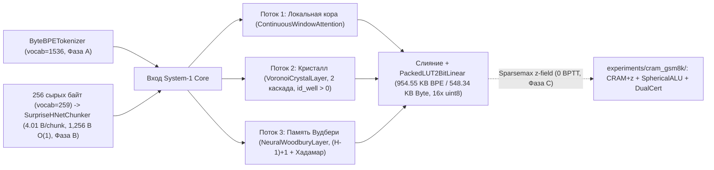

# `Calcite-5` (`SimVQ-Split v5`): Пост-трансформерная архитектура с `O(1)` кэшем, `548 KB` байтовым `2-bit LUT` и `CRAM+z`

> **English Summary:** Pure neural post-Transformer `System-1 + System-2` architecture (`Calcite-5` / `SimVQ-Split v5`) verified across all 4 roadmap phases (**Phases A–D**). Combines a local continuous window cortex (`W = 12` BPE / `W = 8` chunked bytes), a 2-stage pointer-addressed Birkhoff–Voronoi permutation crystal on $S_G$ with an `id_well > 0` self-consistency attractor, a hybrid `(H-1)+1` RLS Neural Woodbury phrase latch with analytic hallucination brake $u_t = \lambda q_t^\top P_t q_t$, and multiplication-free `PackedLUT2BitLinear` (`2-bit uint8 T-MAC LUT`, `16.00x` matrix compression):
> - **Phase A (`ByteBPE-1536`):** `1,742,477` params, strictly `O(1)` `89.0 KB` inference state cache at `L = 2048` (`57.5x` smaller than `RoPETransformerLM`), **`954.55 KB`** full `2-bit LUT` footprint.
> - **Phase B (`SurpriseHNetChunker` over `256` raw UTF-8 bytes, `vocab = 259`):** `1,483,841` params, word-scale pre-compression (`4.01` B/chunk) strictly before the core with constant `O(1)` **`82.72 KB`** total cache (`1,256 B` chunker buffer on `L = 64..2048`), **`548.34 KB`** full `2-bit LUT` footprint via frozen `FP16`-aligned router & two-group `500`-step `STE QAT`.
> - **Phase C (`Open-Graph CRAM+z` + `SphericalBase10RegisterALU` + `DualCert`):** zero regex/`ast`/`288`-template host code, `0`-BPTT contrastive Besag PL equilibrium inference achieving **`63.23%`** `Oracle@Pool` and **`13.57%`** exact `Sealed Test` (`0.00` pp parity between `FP` and `954.55 KB` `2-bit LUT`).
> - **Phase D (`Zero-Cheat & Invariant Gates`):** **`22`** automated pytest laws (`16/16` in `tests/test_anti_cheat.py` + `6/6` in `tests/test_cram_phase_c.py`), 7-model QA validators for Phases A and B, and Russian lexical quarantine across all Markdown docs.

## Архитектура трёх потоков, байтовый чанкер и мост `System-2`

Ядро `SimVQSplitLM v5` разделяет речевую плавность, обратимые групповые переходы, точную фактологическую перезапись и контроль незнания по трём параллельным каузальным контурам — поверх `ByteBPETokenizer` (`vocab = 1536`, Фаза A) либо побайтового `SurpriseHNetChunker` (`vocab = 259`, Фаза B) со связкой к открытому энергетическому графу `CRAM+z` (Фаза C):



- **Байтовый нарезчик ([`chunker.py`](simvq_split/chunker.py), `SurpriseHNetChunker`, Фаза B):** сжимает `256` сырых UTF-8 байтов (`vocab = 259`, опциональный флаг `use_byte_chunker=False` по умолчанию для обратной совместимости Фазы A/C) в чанки масштаба слова (`4.01` байт/чанк) **строго до входа** в `cortex_pre`, `VoronoiCrystalLayer` и `NeuralWoodburyLayer` с постоянным кэшем `1,256 B` на `L = 64..2048` и побайтово-каузальным декодером.
- **Поток 1 — Локальная кора (`ContinuousWindowAttention`):** удерживает синтаксис и связную речь на скользящем окне (`W = 12` в `BPE-1536`, `W = 8` чанков по `~4` байта в `ByteHNet`) без глобального `KV`-кэша.
- **Поток 2 — Операторный кристалл ([`crystal.py`](simvq_split/crystal.py), `VoronoiCrystalLayer`, `2` каскада, `2` головы $S_G$):** указательная перестановка слотов Биркгофа с проекцией на центроиды Вороного (дрейф `1.19e-07` / `3.58e-07` на `L = 1024` в Фазе A и `1.19e-07` / `1.79e-07` на `L = 2048` байт в Фазе B) и ямой `id_well > 0` на `perm_gate_proj.bias` для отслеживания неабелевых перестановок $S_5$.
- **Поток 3 — Фразовая память Вудбери ([`woodbury.py`](simvq_split/woodbury.py), `NeuralWoodburyLayer`, гибрид `(H-1)+1` + 3-факторный скетч Хадамара):** точное RLS-затирание устаревших фактов (`Overwrite`, `DH = 144.0`, мягкий возврат `rho_rec = 0.002`) и аналитический тормоз галлюцинаций $u_t = \lambda q_t^\top P_t q_t$ (`" Unknown."`).
- **Квантование и физический LUT ([`quant_lut.py`](simvq_split/quant_lut.py)):** 2-шаговое `LS`-квантование (`quantize_ternary_weights_ls`), прогрессивный `STE QAT` (включая двухгрупповой график `CORE_LR = 1.5e-4`, `CHUNK_LR = 9.0e-4` с заморозкой роутера на `FP16`-решётке в Фазе B) и табличный слой без умножений `PackedLUT2BitLinear` (`2-bit uint8 T-MAC LUT`: `16.00x` сжатие матриц к `FP32`, `954.55 KB` в `BPE-1536` и `548.34 KB` в `ByteHNet`).
- **Изолированный `System-2` ([`experiments/cram_gsm8k/`](experiments/cram_gsm8k/), Фаза C):** `6`-модульный конвейер без `re`/`ast` и закрытых шаблонов: data-driven экстрактор чисел `TrainInducedQuantityExtractor`, `12`-разрядный `SphericalBase10RegisterALU`, выпуклое поле операций `CRAMzOperatorGraphEBM` (`0` шагов BPTT, запас Гершгорина `4.10 >= 4.0`) и двойной сертификат доверия `DualCert`.

---

## Фаза A — Турнир 7 BPE-моделей (`ByteBPE-1536`, `954.55 KB` `2-bit LUT`)

Все 7 моделей с паритетом параметров (`~1.74M`, разброс `<= 5%`) обучены на побитово идентичном неповторяющемся потоке (`2,000` шагов × батч `64`, `seq_len = 192`, `seed = 2026`, `BF16` на GPU). Подробности: [`SimVQ_Split_Benchmark_Report.md`](SimVQ_Split_Benchmark_Report.md), [`06_phase_a_calcite5_ledger.md`](research/post_transformer_synthesis/06_phase_a_calcite5_ledger.md), JSON: [`benchmarks/simvq_split_results.json`](benchmarks/simvq_split_results.json).

### Таблица 1A — Язык (`GSM8K PPL`), кэш состояния (`L = 2048`) и неабелева группа `S_5` (`Exact Match %, Wilson 95% CI`)

| Модель | Параметры | Кэш (`L=2048`) | `GSM8K PPL` | `S_5` (`k=2`) | `S_5` (`k=4`) | `S_5` (`k=8`, 2x OOD) | `S_5` (`k=16`, 4x OOD) |
| :--- | ---: | ---: | ---: | ---: | ---: | ---: | ---: |
| `SimVQSplitLM` | `1,742,477` | `89.0 KB` | `18.58` | `85.0% [79.4, 89.3]` | `65.5% [58.7, 71.7]` | `61.5% [54.6, 68.0]` | `33.5% [27.3, 40.3]` |
| `SimVQSplit_CrystalOnly` | `1,736,976` | `40.2 KB` | `19.99` | `11.0% [7.4, 16.1]` | `2.5% [1.1, 5.7]` | `1.5% [0.5, 4.3]` | `1.0% [0.3, 3.6]` |
| `SimVQSplit_WoodburyOnly` | `1,757,820` | `71.3 KB` | `18.40` | `78.5% [72.3, 83.6]` | `25.0% [19.5, 31.4]` | `3.0% [1.4, 6.4]` | `1.5% [0.5, 4.3]` |
| `HouseholderDeltaNetLM` | `1,736,176` | `65.0 KB` | `20.50` | `41.5% [34.9, 48.4]` | `12.0% [8.2, 17.2]` | `1.0% [0.3, 3.6]` | `0.0% [0.0, 1.9]` |
| `RoPETransformerLM` | `1,732,000` | `5120.0 KB` | `20.01` | `2.5% [1.1, 5.7]` | `1.5% [0.5, 4.3]` | `0.0% [0.0, 1.9]` | `0.0% [0.0, 1.9]` |
| `LoopedTransformerLM` | `1,734,240` | `7680.0 KB` | `22.24` | `0.0% [0.0, 1.9]` | `0.0% [0.0, 1.9]` | `0.0% [0.0, 1.9]` | `0.0% [0.0, 1.9]` |
| `SlidingWindowTransformerLM` | `1,732,000` | `30.0 KB` | `18.66` | `0.5% [0.1, 2.8]` | `3.0% [1.4, 6.4]` | `2.0% [0.8, 5.0]` | `0.5% [0.1, 2.8]` |

### Таблица 2A — Контрфактическая перезапись (`Overwrite`) и тормоз галлюцинаций (`Trap -> " Unknown."`)

| Модель | `Overwrite` (In-Dist) | `Overwrite` (OOD-Med) | `Overwrite` (OOD-Long) | `Trap Unknown` (In-Dist) | `Trap Unknown` (OOD-Long) | `Selective F1` (In-Dist) | `Selective F1` (OOD-Long) |
| :--- | ---: | ---: | ---: | ---: | ---: | ---: | ---: |
| `SimVQSplitLM` | `100.0% [98.1, 100.0]` | `98.5% [95.7, 99.5]` | `96.0% [92.3, 98.0]` | `100.0% [98.1, 100.0]` | `97.5% [94.3, 98.9]` | `100.0%` | `96.7%` |
| `SimVQSplit_CrystalOnly` | `58.5% [51.6, 65.1]` | `47.5% [40.7, 54.4]` | `42.5% [35.9, 49.4]` | `43.5% [36.8, 50.4]` | `20.5% [15.5, 26.6]` | `49.9%` | `27.7%` |
| `SimVQSplit_WoodburyOnly` | `100.0% [98.1, 100.0]` | `98.5% [95.7, 99.5]` | `97.0% [93.6, 98.6]` | `100.0% [98.1, 100.0]` | `98.5% [95.7, 99.5]` | `100.0%` | `97.7%` |
| `HouseholderDeltaNetLM` | `54.5% [47.6, 61.2]` | `44.0% [37.3, 50.9]` | `22.5% [17.3, 28.8]` | `0.0% [0.0, 1.9]` | `0.5% [0.1, 2.8]` | `0.0%` | `1.0%` |
| `RoPETransformerLM` | `27.5% [21.8, 34.1]` | `7.0% [4.2, 11.4]` | `7.5% [4.6, 12.0]` | `4.5% [2.4, 8.3]` | `24.0% [18.6, 30.4]` | `7.7%` | `11.4%` |
| `LoopedTransformerLM` | `23.0% [17.7, 29.3]` | `14.0% [9.9, 19.5]` | `14.0% [9.9, 19.5]` | `55.5% [48.6, 62.2]` | `27.5% [21.8, 34.1]` | `32.5%` | `18.6%` |
| `SlidingWindowTransformerLM` | `11.0% [7.4, 16.1]` | `9.5% [6.2, 14.4]` | `8.0% [5.0, 12.6]` | `5.0% [2.7, 9.0]` | `6.5% [3.8, 10.8]` | `6.9%` | `7.2%` |

### Таблица 3A — Тернарное `1.58-bit LS/QAT` квантование и физический `2-bit uint8 T-MAC LUT` (`1,485,920` весов)

| Режим `SimVQSplitLM v5` | `GSM8K PPL` | `S_5` (`k=2`) | `S_5` (`k=8`, 2x OOD) | `Overwrite` (OOD-Med) | `Overwrite` (OOD-Long) | `Trap Unknown` (OOD-Long) |
| :--- | ---: | ---: | ---: | ---: | ---: | ---: |
| Базовая точность (`BF16/FP32`) | `18.58` | `85.0%` | `61.5%` | `98.5%` | `96.0%` | `97.5%` |
| 2-шаговый `0-QAT LS PTQ` | `30.02` | `—` | `55.0%` | `96.5%` | `—` | `31.5%` |
| Тернарный `STE QAT` (`300` шагов) | `20.82` | `87.0%` | `64.0%` | `97.5%` | `95.0%` | `92.0%` |
| Табличный `2-bit uint8 T-MAC LUT` (`16.00x`, `954.55 KB`) | `20.83` | `87.0%` | `62.5%` | `98.0%` | `95.0%` | `92.0%` |

---

## Фаза B — Побайтовый турнир без словаря BPE (`256` сырых байт, `548.34 KB` `2-bit LUT`)

Отказ от таблицы `BPE-1536` через `SurpriseHNetChunker` (`153,600` последовательностей по `768` сырых байтов, `2,400` шагов × батч `64`, коэффициент пересчёта `2.936448` байт/BPE на `te_docs[:500]`). Подробности: [`Phase_B_Byte_Chunker_Report.md`](Phase_B_Byte_Chunker_Report.md), [`08_phase_b_byte_chunker_ledger.md`](research/post_transformer_synthesis/08_phase_b_byte_chunker_ledger.md), JSON: [`benchmarks/phase_b_byte_chunker_results.json`](benchmarks/phase_b_byte_chunker_results.json).

| Модель | Параметры | Кэш (`L=2048`) | Байт/чанк | `BPB` (`EqPPL`) | `S_5` (`k=2/4/8/16`) | `OV` (`In/Med/Long`) | `Trap` (`In/Long`) | `SelF1` (`In/Long`) |
| :--- | ---: | ---: | ---: | ---: | ---: | ---: | ---: | ---: |
| `SimVQSplitLM (FP)` | `1,483,841` | `82.72 KB` | `4.01` | `1.7488` (`35.14`) | `82.5 / 47.5 / 8.0 / 1.0` | `100.0 / 100.0 / 99.0` | `100.0 / 99.0` | `100.0% / 99.0%` |
| `SimVQSplitLM (2-bit LUT)` | `1,483,841` (`548.34 KB`) | `82.72 KB` | `4.01` | `1.8625` (`44.29`) | `80.5 / 34.5 / 4.5 / 2.5` | `100.0 / 99.5 / 99.0` | `100.0 / 98.5` | `100.0% / 98.8%` |
| `SimVQSplit_CrystalOnly` | `1,478,340` | `33.92 KB` | `4.47` | `1.6316` (`27.69`) | `11.5 / 3.5 / 1.0 / 0.5` | `0.0 / 0.0 / 0.0` | `100.0 / 100.0` | `0.0% / 0.0%` |
| `SimVQSplit_WoodburyOnly` | `1,468,464` | `65.03 KB` | `4.61` | `1.7762` (`37.16`) | `99.0 / 75.5 / 26.0 / 0.0` | `75.5 / 41.0 / 36.5` | `23.0 / 27.0` | `35.3% / 31.0%` |
| `HouseholderDeltaNetLM` | `1,470,416` | `80.00 KB` | `1.00` | `1.6546` (`29.01`) | `41.5 / 10.0 / 1.0 / 0.0` | `59.5 / 42.0 / 24.0` | `0.0 / 17.5` | `0.0% / 20.2%` |
| `RoPETransformerLM` | `1,496,960` | `5120.00 KB` | `1.00` | `1.7676` (`36.51`) | `2.0 / 0.5 / 0.0 / 0.0` | `55.5 / 0.0 / 0.0` | `1.5 / 0.0` | `2.9% / 0.0%` |
| `LoopedTransformerLM` | `1,483,840` | `7680.00 KB` | `1.00` | `1.9077` (`48.56`) | `2.5 / 0.0 / 0.0 / 0.0` | `53.0 / 0.5 / 0.5` | `0.0 / 0.0` | `0.0% / 0.0%` |
| `SlidingWindowTransformerLM` | `1,496,960` | `60.00 KB` | `1.00` | `1.5446` (`23.19`) | `2.0 / 0.5 / 0.5 / 2.0` | `0.0 / 0.0 / 0.0` | `100.0 / 100.0` | `0.0% / 0.0%` |

- **Ключевой вывод Фазы B:** `SimVQSplitLM (FP)` опережает по `BPB` глобальные `RoPETransformerLM` (`1.7676`) и `LoopedTransformerLM` (`1.9077`), уступая по локальному `BPB` без-памятевому `SlidingWindowTransformerLM` (`1.5446`, `OV = 0.0%`) и `HouseholderDeltaNetLM` (`1.6546`, `Selective F1 = 0.0% / 20.2%`), при сжатии полной модели в `PackedLUT2BitLinear` до **`548.34 KB`** (`70` слоёв, `16.00x`, расхождение с `STE QAT` `<= 1.00 п.п.`).

---

## Фаза C — Открытый граф `CRAM+z` + `SphericalBase10RegisterALU` + `DualCert` на `GSM8K`

Без `288` шаблонов и без `BPTT` (`0` регулярных выражений/`ast`), старт с не-предобученной `1.74M` `SimVQSplitLM`: открытый поиск по графу операций, вычисление на `12`-разрядном сферическом АЛУ (`100.00%` на `ADD/SUB/MUL/DIV`, `max_norm_drift = 1.19e-07`), калибровка Гершгорина `4.10 >= 4.0` и одноразовое запечатанное вскрытие `test.jsonl`. Подробности: [`07_phase_c_cram_gsm8k_ledger.md`](research/post_transformer_synthesis/07_phase_c_cram_gsm8k_ledger.md), JSON: [`benchmarks/phase_c_cram_gsm8k_results.json`](benchmarks/phase_c_cram_gsm8k_results.json).

| Режим моста `System-1 -> CRAM+z` | `Oracle@Pool` | `BlindDev Pass@1` (`N = 737`) | `Sealed Test Pass@1` (`N = 1,319`) | `Sealed Test Pass@5` | Прирост к `Unary-Only` | `DualCert Precision` (`Coverage`) |
| :--- | ---: | ---: | ---: | ---: | ---: | ---: |
| `SimVQSplitLM (FP)` | `63.23%` | `16.01%` | **`13.57%`** (`179/1319`) | `30.71%` | `2.49x` (`5.46%`) | `37.56%` (`16.15%`) |
| `SimVQSplitLM (2-bit LUT, 954.55 KB)` | `62.24%` | `16.42%` | **`13.57%`** (`179/1319`) | `30.86%` | `2.18x` (`6.22%`) | `39.59%` (`14.94%`) |

---

## Анти-читерские гейты (Фаза D: `16 + 6 = 22` законов)

1. **[`tests/test_anti_cheat.py`](tests/test_anti_cheat.py) (`16/16` законов ядра `simvq_split/`):** AST-запрет хост-эвристик по всем `7` файлам пакета, `100%` живых градиентов (включая `snap_alpha = 1.0`, `1.58-bit STE QAT` и границы `SurpriseHNetChunker`), строгая каузальность, изоляция окна коры, паритет параметров `<= 5%`, биекция $S_G$ и `id_well > 0` (`Law 14`), `BF16` SPD на `L = 2048` (`Law 13`), `PackedLUT2BitLinear` (`Law 15`) и постоянный буфер чанкера `1,256 B` на `L = 64..2048` (`Law 16`).
2. **[`tests/test_cram_phase_c.py`](tests/test_cram_phase_c.py) (`6/6` законов `c1..c6` Фазы C):** AST-чистота всех `6` модулей `experiments/cram_gsm8k/`, точность и дрейф `SphericalBase10RegisterALU`, диагональная доминантность `m - ||W_zz||_1 >= 4.0` + `0` BPTT + `20` живых параметров Бесага, data-driven экстрактор, `Sparsemax` якобиан и отсев ловушек `DualCert`.

## Быстрый старт и воспроизводимость (`Quickstart`)

1. Запустить единый гардрейл репозитория (`baselines.py` `0`-дифф, `ruff`, `16/16` тестов и карантин документов):
   ```bash
   python scripts/repo_guardrail.py
   ```
2. Запустить полный пакет `Zero-Cheat` автотестов (ядро Фаз A/B + конвейер Фазы C, `22 passed`):
   ```bash
   python -m pytest tests/test_anti_cheat.py tests/test_cram_phase_c.py -q
   ```
3. Проверить артефакты, чекпоинты и пересобрать отчёты Фазы A и Фазы B без обучения:
   ```bash
   python -u validate_simvq_split_results.py
   python -u validate_phase_b_byte_results.py
   python -u run_simvq_split_benchmark.py --report-only
   python -X utf8 -u run_phase_b_byte_benchmark.py --report-only
   ```
4. Повторить полный 7-модельный прогон (Фаза A BPE или Фаза B ByteHNet) и проверку выравнивания адаптера Фазы C:
   ```bash
   python -u run_simvq_split_benchmark.py
   python -X utf8 -u run_phase_b_byte_benchmark.py
   python -X utf8 -u experiments/cram_gsm8k/simvq_cram_adapter.py --verify-alignment
   ```
5. Проверить ранних чемпионов `SimVQCoprimeGPT` (`v10.4` из `checkpoints/simvq_champions_compact.pt.xz`):
   ```bash
   python -u run_champion_local.py
   ```

## Карта репозитория (`Calcite-5` и архив `v1`–`v36`)

- **Ядро `simvq_split/` (`Calcite-5`):** [`models.py`](simvq_split/models.py) (`SimVQSplitLM`), [`chunker.py`](simvq_split/chunker.py) (`SurpriseHNetChunker`), [`crystal.py`](simvq_split/crystal.py) (`VoronoiCrystalLayer`), [`woodbury.py`](simvq_split/woodbury.py) (`NeuralWoodburyLayer`), [`quant_lut.py`](simvq_split/quant_lut.py) (`PackedLUT2BitLinear`, `quantize_ternary_weights_ls`), фасад реэкспорта [`memory.py`](simvq_split/memory.py), [`baselines.py`](simvq_split/baselines.py), [`tasks.py`](simvq_split/tasks.py), [`tokenizer.py`](simvq_split/tokenizer.py), [`eval_utils.py`](simvq_split/eval_utils.py).
- **Архитектура `Calcite-5` и журналы:** [`Post_Transformer_Architecture_v5_Blueprint.md`](Post_Transformer_Architecture_v5_Blueprint.md), [`research/post_transformer_synthesis/`](research/post_transformer_synthesis/) (доклады `01`–`05` и журналы Фаз A/C/B: `06`–`08`).
- **Конвейер `System-2` (`CRAM+z`, Фаза C) и прототипы:** [`experiments/cram_gsm8k/`](experiments/cram_gsm8k/) (`spherical_alu.py`, `slot_extractor.py`, `system1_encoder.py`, `cram_open_graph.py`, `gsm8k_cram_solver.py`, `simvq_cram_adapter.py`) и [`experiments/v5_proto/`](experiments/v5_proto/) (`smoke_v5_invariants.py`, `smoke_phase_b_chunker.py`, `probe_phase_b_byte_hnet.py`).
- **Тесты, гардрейлы и стандарты:** [`tests/test_anti_cheat.py`](tests/test_anti_cheat.py), [`tests/test_cram_phase_c.py`](tests/test_cram_phase_c.py), [`scripts/repo_guardrail.py`](scripts/repo_guardrail.py), [`CODING_STANDARDS.md`](CODING_STANDARDS.md), [`AGENTS.md`](AGENTS.md), [`.agents/skills/calcite-phase-runner/SKILL.md`](.agents/skills/calcite-phase-runner/SKILL.md).
- **Отчёты и метрики:** [`SimVQ_Split_Benchmark_Report.md`](SimVQ_Split_Benchmark_Report.md), [`Phase_B_Byte_Chunker_Report.md`](Phase_B_Byte_Chunker_Report.md), [`benchmarks/simvq_split_results.json`](benchmarks/simvq_split_results.json), [`benchmarks/phase_b_byte_chunker_results.json`](benchmarks/phase_b_byte_chunker_results.json), [`benchmarks/phase_c_cram_gsm8k_results.json`](benchmarks/phase_c_cram_gsm8k_results.json).
- **Раннее ядро `v10.4` и архив `v12`–`v36`:** [`simvq_coprime_gpt.py`](simvq_coprime_gpt.py), [`run_champion_local.py`](run_champion_local.py), [`dream_rsi_simvq.py`](dream_rsi_simvq.py), [`archive_v12_v36/`](archive_v12_v36/), [`Полный_отчет_исследования_SimVQ_v1_v21.md`](Полный_отчет_исследования_SimVQ_v1_v21.md), [`Architecture_Freeze_Report_v28.md`](Architecture_Freeze_Report_v28.md).

> **Примечание по крупным бинарным файлам:** `4` ранних чекпоинта `checkpoints/v13`–`v16`, распакованные дубли `c4_b0_a4_coprime_lock.pt` / `m_nl_transfer_ru_en_py.pt`, тяжёлые веса Фазы C (`phase_c_*.pt`) и авто-генерируемые кэши признаков `experiments/cram_gsm8k/checkpoints/*.npz` исключены через `.gitignore`; в репозитории для воспроизведения сохранены `checkpoints/simvq_champions_compact.pt.xz` (`5.13 MB`), веса Фазы A `checkpoints/simvq_split_tournament.pt` (`15.27 MB`), веса Фазы B `checkpoints/simvq_split_byte_hnet.pt` (`11.75 MB`) и мост `experiments/cram_gsm8k/checkpoints/simvq_cram_bridge.pt` (`108.9 KB`).
