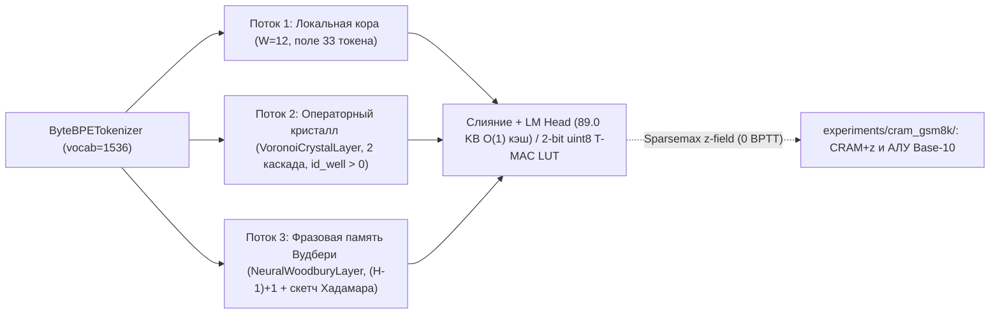

# SimVQ-Split v5 (`Calcite-5`): Трёхпоточная пост-трансформерная архитектура со строгим O(1) кэшем

> **English Summary:** Pure neural 3-stream post-Transformer language model (`SimVQSplitLM v5`, `Calcite-5 System-1 Core`, `1,742,477` parameters, strictly `O(1)` `89.0 KB` inference state cache — `57.5x` smaller than `RoPETransformerLM` at `L = 2048`). Combines a local continuous window cortex (`W = 12`), a 2-stage pointer-addressed Birkhoff–Voronoi permutation crystal on $S_G$ with an `id_well > 0` self-consistency attractor, a hybrid `(H-1)+1` RLS Neural Woodbury phrase latch with analytic hallucination brake $u_t = \lambda q_t^\top P_t q_t$, 2-step `1.58-bit` LS/STE QAT + multiplication-free `PackedLUT2BitLinear` (`2-bit uint8 T-MAC LUT`, `16.00x` matrix compression, `954.55 KB` full footprint), and an isolated BPTT-free `Sparsemax z-field` bridge to `CRAM+z` (`experiments/cram_gsm8k/`). Verified by a 15-law `Zero-Cheat` AST & gradient gate (`pytest tests/test_anti_cheat.py -q`).

## Архитектура трёх потоков и мост System-2

Ядро `SimVQSplitLM v5` разделяет речевую плавность, обратимые групповые переходы, точную фактологическую перезапись и контроль незнания по трём параллельным каузальным контурам поверх общего `ByteBPETokenizer` (`vocab_size = 1536`):



- **Поток 1 — Локальная кора (`ContinuousWindowAttention`, `W = 12`, рецептивное поле `33` токена):** удерживает синтаксис и связную речь на коротком скользящем окне без глобального `KV`-кэша.
- **Поток 2 — Операторный кристалл ([`crystal.py`](simvq_split/crystal.py), `VoronoiCrystalLayer`, `2` каскада, `2` головы $S_G$):** указательная перестановка слотов Биркгофа с проекцией на центроиды Вороного (`дрейф нормы 1.192093e-07`, `дрейф решётки 3.576279e-07` на `L = 1024`) и положительной ямой самосогласования `id_well > 0` на `perm_gate_proj.bias` для отслеживания неабелевых перестановок $S_5$ на горизонтах в `20x` длиннее окна коры.
- **Поток 3 — Фразовая память Вудбери ([`woodbury.py`](simvq_split/woodbury.py), `NeuralWoodburyLayer`, гибрид `(H-1)+1` + 3-факторный скетч Хадамара):** точное RLS-затирание устаревших фактов по коррелированным ключам (`Overwrite`, `DH = 144.0`, мягкий возврат `rho_rec = 0.002`) и аналитический тормоз галлюцинаций $u_t = \lambda q_t^\top P_t q_t$ (`" Unknown."`).
- **Квантование и физический LUT ([`quant_lut.py`](simvq_split/quant_lut.py)):** 2-шаговое `LS`-квантование (`quantize_ternary_weights_ls`), `300`-шаговый `STE QAT` и табличный слой без умножений `PackedLUT2BitLinear` (`2-bit uint8 T-MAC LUT`: сжатие весовых матриц `16.00x`, с учётом `FP16`-шкал `12.80x`, полный размер модели `954.55 KB`).
- **Прототипированный мост `System-2` ([`experiments/cram_gsm8k/`](experiments/cram_gsm8k/)):** изолированный переходник `Sparsemax z-field` (`0` шагов BPTT, без влияния на 15 законов чистоты ядра `simvq_split/`) к графу операций `CRAM+z` и сферическому АЛУ `Base-10`.

## Результаты честного турнира `SimVQ-Split v5` (`Calcite-5`)

Все 7 моделей с паритетом параметров (`~1.74M`, разброс `<= 5%`) обучены на побитово идентичном неповторяющемся потоке (`2,000` шагов × батч `64`, `seq_len = 192`, `seed = 2026`, `BF16` на GPU) без флагов задач. Подробности: [SimVQ_Split_Benchmark_Report.md](SimVQ_Split_Benchmark_Report.md), сырые метрики: [benchmarks/simvq_split_results.json](benchmarks/simvq_split_results.json).

### Таблица 1 — Язык (`GSM8K PPL`), кэш состояния (`L = 2048`) и неабелева группа `S_5` (`Exact Match %, Wilson 95% CI`)

| Модель | Параметры | Кэш (`L=2048`) | `GSM8K PPL` | `S_5` (`k=2`) | `S_5` (`k=4`) | `S_5` (`k=8`, 2x OOD) | `S_5` (`k=16`, 4x OOD) |
| :--- | ---: | ---: | ---: | ---: | ---: | ---: | ---: |
| `SimVQSplitLM` | `1,742,477` | `89.0 KB` | `18.58` | `85.0% [79.4, 89.3]` | `65.5% [58.7, 71.7]` | `61.5% [54.6, 68.0]` | `33.5% [27.3, 40.3]` |
| `SimVQSplit_CrystalOnly` | `1,736,976` | `40.2 KB` | `19.99` | `11.0% [7.4, 16.1]` | `2.5% [1.1, 5.7]` | `1.5% [0.5, 4.3]` | `1.0% [0.3, 3.6]` |
| `SimVQSplit_WoodburyOnly` | `1,757,820` | `71.3 KB` | `18.40` | `78.5% [72.3, 83.6]` | `25.0% [19.5, 31.4]` | `3.0% [1.4, 6.4]` | `1.5% [0.5, 4.3]` |
| `HouseholderDeltaNetLM` | `1,736,176` | `65.0 KB` | `20.50` | `41.5% [34.9, 48.4]` | `12.0% [8.2, 17.2]` | `1.0% [0.3, 3.6]` | `0.0% [0.0, 1.9]` |
| `RoPETransformerLM` | `1,732,000` | `5120.0 KB` | `20.01` | `2.5% [1.1, 5.7]` | `1.5% [0.5, 4.3]` | `0.0% [0.0, 1.9]` | `0.0% [0.0, 1.9]` |
| `LoopedTransformerLM` | `1,734,240` | `7680.0 KB` | `22.24` | `0.0% [0.0, 1.9]` | `0.0% [0.0, 1.9]` | `0.0% [0.0, 1.9]` | `0.0% [0.0, 1.9]` |
| `SlidingWindowTransformerLM` | `1,732,000` | `30.0 KB` | `18.66` | `0.5% [0.1, 2.8]` | `3.0% [1.4, 6.4]` | `2.0% [0.8, 5.0]` | `0.5% [0.1, 2.8]` |

### Таблица 2 — Контрфактическая перезапись (`Overwrite`) и тормоз галлюцинаций (`Trap -> " Unknown."`)

| Модель | `Overwrite` (In-Dist) | `Overwrite` (OOD-Med) | `Overwrite` (OOD-Long) | `Trap Unknown` (In-Dist) | `Trap Unknown` (OOD-Long) | `Selective F1` (In-Dist) | `Selective F1` (OOD-Long) |
| :--- | ---: | ---: | ---: | ---: | ---: | ---: | ---: |
| `SimVQSplitLM` | `100.0% [98.1, 100.0]` | `98.5% [95.7, 99.5]` | `96.0% [92.3, 98.0]` | `100.0% [98.1, 100.0]` | `97.5% [94.3, 98.9]` | `100.0%` | `96.7%` |
| `SimVQSplit_CrystalOnly` | `58.5% [51.6, 65.1]` | `47.5% [40.7, 54.4]` | `42.5% [35.9, 49.4]` | `43.5% [36.8, 50.4]` | `20.5% [15.5, 26.6]` | `49.9%` | `27.7%` |
| `SimVQSplit_WoodburyOnly` | `100.0% [98.1, 100.0]` | `98.5% [95.7, 99.5]` | `97.0% [93.6, 98.6]` | `100.0% [98.1, 100.0]` | `98.5% [95.7, 99.5]` | `100.0%` | `97.7%` |
| `HouseholderDeltaNetLM` | `54.5% [47.6, 61.2]` | `44.0% [37.3, 50.9]` | `22.5% [17.3, 28.8]` | `0.0% [0.0, 1.9]` | `0.5% [0.1, 2.8]` | `0.0%` | `1.0%` |
| `RoPETransformerLM` | `27.5% [21.8, 34.1]` | `7.0% [4.2, 11.4]` | `7.5% [4.6, 12.0]` | `4.5% [2.4, 8.3]` | `24.0% [18.6, 30.4]` | `7.7%` | `11.4%` |
| `LoopedTransformerLM` | `23.0% [17.7, 29.3]` | `14.0% [9.9, 19.5]` | `14.0% [9.9, 19.5]` | `55.5% [48.6, 62.2]` | `27.5% [21.8, 34.1]` | `32.5%` | `18.6%` |
| `SlidingWindowTransformerLM` | `11.0% [7.4, 16.1]` | `9.5% [6.2, 14.4]` | `8.0% [5.0, 12.6]` | `5.0% [2.7, 9.0]` | `6.5% [3.8, 10.8]` | `6.9%` | `7.2%` |

### Таблица 3 — Тернарное `1.58-bit LS/QAT` квантование и табличный `2-bit uint8 T-MAC LUT` (`1,485,920` весов)

| Режим `SimVQSplitLM v5` | `GSM8K PPL` | `S_5` (`k=2`) | `S_5` (`k=8`, 2x OOD) | `Overwrite` (OOD-Med) | `Overwrite` (OOD-Long) | `Trap Unknown` (OOD-Long) |
| :--- | ---: | ---: | ---: | ---: | ---: | ---: |
| Базовая точность (`BF16/FP32`) | `18.58` | `85.0%` | `61.5%` | `98.5%` | `96.0%` | `97.5%` |
| 2-шаговый `0-QAT LS PTQ` | `30.02` | `—` | `55.0%` | `96.5%` | `—` | `31.5%` |
| Тернарный `STE QAT` (`300` шагов) | `20.82` | `87.0%` | `64.0%` | `97.5%` | `95.0%` | `92.0%` |
| Табличный `2-bit uint8 T-MAC LUT` (`16.00x`, `954.55 KB`) | `20.83` | `87.0%` | `62.5%` | `98.0%` | `95.0%` | `92.0%` |

## Анти-читерский гейт (`Zero-Cheat Gate`, `15/15` законов)

Автоматический набор [`tests/test_anti_cheat.py`](tests/test_anti_cheat.py) проверяет ядро `simvq_split/` до любого запуска бенчмарка:
- **AST-чистота всех 6 файлов ядра:** запрет питоновских словарей и регулярных выражений внутри `nn.Module`.
- **100% живых градиентов:** все обучаемые параметры получают ненулевые градиенты при `snap_alpha = 0.35`, `snap_alpha = 1.0` и под `1.58-bit STE QAT` (`Law 12`).
- **Строгая каузальность и изоляция коры:** нулевая утечка будущих токенов и строгое ограничение рецептивного поля коры (`<= 33` токена при `W = 12`).
- **Инварианты кристалла, Вудбери и физического LUT (`Laws 10–15`):** биективное сохранение мультимножества слотов $S_G$ на `L = 1024`, монотонность Вудбери и спектр `BF16` SPD на `L = 2048` (`Law 13`), ортогональность скетча Хадамара на двойниках (`Law 11`), положительная яма `id_well > 0` (`Law 14`) и побитовая эквивалентность `PackedLUT2BitLinear` (`Law 15`).

## Быстрый старт и воспроизводимость (`Quickstart`)

1. Запустить единый гардрейл репозитория (`baselines.py` `0`-дифф, `ruff`, `15/15` тестов и карантин документов):
   ```bash
   python scripts/repo_guardrail.py
   ```
2. Запустить независимую QA-валидацию отчёта и сохранённых весов (и мгновенную пересборку отчёта без обучения):
   ```bash
   python -u validate_simvq_split_results.py
   python -u run_simvq_split_benchmark.py --report-only
   ```
3. Повторить полный турнир 7 моделей или быстрый точечный прогон одной модели на GPU:
   ```bash
   python -u run_simvq_split_benchmark.py
   python -u run_simvq_split_benchmark.py --only SimVQSplitLM --steps 200 --skip-qat --no-save-ckpt
   ```
4. Проверить базовых чемпионов `SimVQCoprimeGPT` (`m_c4` и `m_nl` из `checkpoints/simvq_champions_compact.pt.xz`):
   ```bash
   python -u run_champion_local.py
   ```

## Карта репозитория и архив (`v1`–`v36` & `Calcite-5`)

- **Ядро `simvq_split/` (`Calcite-5`):** [`models.py`](simvq_split/models.py) (`SimVQSplitLM`), [`crystal.py`](simvq_split/crystal.py) (`VoronoiCrystalLayer`), [`woodbury.py`](simvq_split/woodbury.py) (`NeuralWoodburyLayer`), [`quant_lut.py`](simvq_split/quant_lut.py) (`PackedLUT2BitLinear`, `quantize_ternary_weights_ls`), фасад реэкспорта [`memory.py`](simvq_split/memory.py), [`baselines.py`](simvq_split/baselines.py), [`tasks.py`](simvq_split/tasks.py), [`tokenizer.py`](simvq_split/tokenizer.py), [`eval_utils.py`](simvq_split/eval_utils.py).
- **Архитектура `Calcite-5` и синтез:** [`Post_Transformer_Architecture_v5_Blueprint.md`](Post_Transformer_Architecture_v5_Blueprint.md), [`research/post_transformer_synthesis/`](research/post_transformer_synthesis/) (доклады `01`–`05` и журнал Фазы A `06`).
- **Эксперименты `CRAM+z` и прототипы `v5`:** [`experiments/cram_gsm8k/`](experiments/cram_gsm8k/) (`simvq_cram_adapter.py`, `gsm8k_cram_solver.py`, веса моста `simvq_cram_bridge.pt`) и [`experiments/v5_proto/`](experiments/v5_proto/).
- **Гардрейлы, тесты и стандарты:** [`tests/test_anti_cheat.py`](tests/test_anti_cheat.py), [`scripts/repo_guardrail.py`](scripts/repo_guardrail.py), [`CODING_STANDARDS.md`](CODING_STANDARDS.md), [`AGENTS.md`](AGENTS.md) и скилл фаз [`.agents/skills/calcite-phase-runner/SKILL.md`](.agents/skills/calcite-phase-runner/SKILL.md).
- **Отчёты и метрики турнира:** [`SimVQ_Split_Benchmark_Report.md`](SimVQ_Split_Benchmark_Report.md) и [`benchmarks/simvq_split_results.json`](benchmarks/simvq_split_results.json).
- **Раннее ядро `v10.4` и архив поколений `v12`–`v36`:** [`simvq_coprime_gpt.py`](simvq_coprime_gpt.py), [`run_champion_local.py`](run_champion_local.py), [`dream_rsi_simvq.py`](dream_rsi_simvq.py), [`archive_v12_v36/`](archive_v12_v36/), [`Полный_отчет_исследования_SimVQ_v1_v21.md`](Полный_отчет_исследования_SimVQ_v1_v21.md), [`Architecture_Freeze_Report_v28.md`](Architecture_Freeze_Report_v28.md).

> **Примечание по крупным бинарным файлам:** `4` ранних чекпоинта `checkpoints/v13`–`v16`, распакованные дубли `c4_b0_a4_coprime_lock.pt` / `m_nl_transfer_ru_en_py.pt` и авто-генерируемый кэш признаков `experiments/cram_gsm8k/checkpoints/simvq_gsm8k_slot_cache.npz` (`23.51 MB`) исключены через `.gitignore`; для воспроизведения оставлены `checkpoints/simvq_champions_compact.pt.xz` (`5.13 MB`), турнирные веса `checkpoints/simvq_split_tournament.pt` (`15.27 MB`) и веса моста `experiments/cram_gsm8k/checkpoints/simvq_cram_bridge.pt` (`108.9 KB`).
