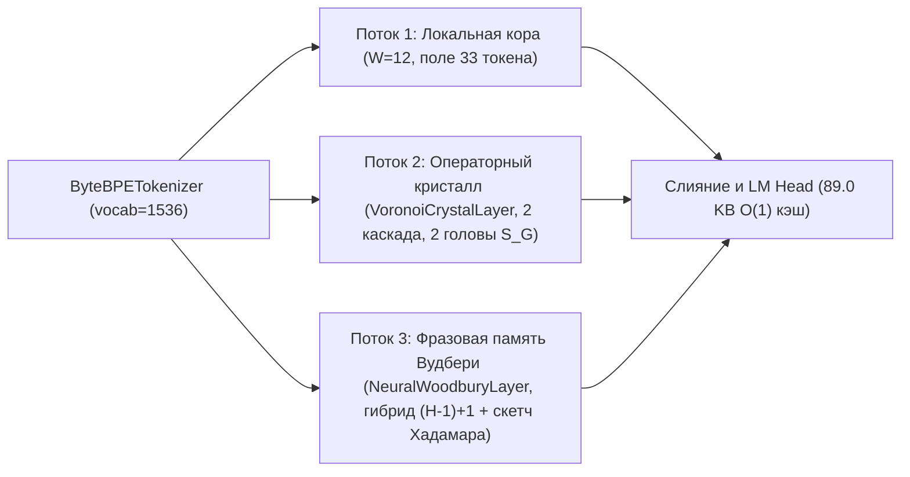

# SimVQ-Split: Трёхпоточная пост-трансформерная архитектура со строгим O(1) кэшем

> **English Summary:** Pure neural 3-stream post-Transformer language model (`SimVQSplitLM v4`, `1,742,477` parameters, strictly `O(1)` `89.0 KB` inference state cache — `57.5x` smaller than `RoPETransformerLM` at `L = 2048`). Combines a local continuous window cortex (`W = 12`), a 2-stage pointer-addressed Birkhoff–Voronoi permutation crystal on $S_G$, and a hybrid `(H-1)+1` RLS Neural Woodbury phrase latch with an analytic epistemic hallucination brake $u_t = \lambda q_t^\top P_t q_t$. Verified by a 12-law `Zero-Cheat` AST & gradient test suite (`pytest tests/test_anti_cheat.py -q`).

## Архитектура трёх потоков

`SimVQSplitLM` разделяет связную генерацию текста, строго обратимые групповые переходы и точную фактологическую перезапись с контролем незнания по трём параллельным каузальным контурам поверх общего `ByteBPETokenizer` (`vocab_size = 1536`):



- **Поток 1 — Локальная кора (`ContinuousWindowAttention`, `W = 12`, рецептивное поле `33` токена):** удерживает синтаксис и связную речь на коротком скользящем окне без глобального `KV`-кэша.
- **Поток 2 — Операторный кристалл (`VoronoiCrystalLayer`, `2` каскада, `2` головы $S_G$):** указательная перестановка слотов Биркгофа с проекцией на центроиды Вороного (`дрейф нормы 1.19e-07`, `дрейф решётки 3.58e-07` на `L = 1024`) для отслеживания неабелевых перестановок $S_5$ на горизонтах в `20x` длиннее окна коры.
- **Поток 3 — Фразовая память Вудбери (`NeuralWoodburyLayer`, гибрид `(H-1)+1` + 3-факторный скетч Хадамара):** точное RLS-затирание устаревших фактов по коррелированным ключам (`Overwrite`) и аналитический датчик неопределённости $u_t = \lambda q_t^\top P_t q_t$ для тормоза галлюцинаций (`" Unknown."`).

## Результаты честного турнира `SimVQ-Split v4`

Все 7 моделей с паритетом параметров (`~1.74M`, разброс `<= 5%`) обучены на побитово идентичном неповторяющемся потоке из `128,000` уникальных последовательностей (`2,000` шагов × батч `64`, `seq_len = 192`, `seed = 2026`, устройство `NVIDIA GeForce RTX 5060`) без флагов задач. Подробности: [SimVQ_Split_Benchmark_Report.md](SimVQ_Split_Benchmark_Report.md), сырые метрики: [benchmarks/simvq_split_results.json](benchmarks/simvq_split_results.json).

### Таблица 1 — Язык (`GSM8K PPL`), кэш состояния (`L = 2048`) и неабелева группа `S_5` (`Exact Match %, Wilson 95% CI`)

| Модель | Параметры | Кэш (`L=2048`) | `GSM8K PPL` | `S_5` (`k=2`) | `S_5` (`k=4`) | `S_5` (`k=8`, 2x OOD) | `S_5` (`k=16`, 4x OOD) |
| :--- | ---: | ---: | ---: | ---: | ---: | ---: | ---: |
| `SimVQSplitLM` | `1,742,477` | `89.0 KB` | `18.58` | `80.0% [73.9, 85.0]` | `62.5% [55.6, 68.9]` | `57.0% [50.1, 63.7]` | `32.0% [25.9, 38.8]` |
| `SimVQSplit_CrystalOnly` | `1,736,654` | `40.2 KB` | `20.76` | `3.5% [1.7, 7.0]` | `1.0% [0.3, 3.6]` | `0.0% [0.0, 1.9]` | `1.0% [0.3, 3.6]` |
| `SimVQSplit_WoodburyOnly` | `1,757,820` | `71.3 KB` | `18.40` | `78.5% [72.3, 83.6]` | `25.0% [19.5, 31.4]` | `3.0% [1.4, 6.4]` | `1.5% [0.5, 4.3]` |
| `HouseholderDeltaNetLM` | `1,736,176` | `65.0 KB` | `20.50` | `41.5% [34.9, 48.4]` | `12.0% [8.2, 17.2]` | `1.0% [0.3, 3.6]` | `0.0% [0.0, 1.9]` |
| `RoPETransformerLM` | `1,732,000` | `5120.0 KB` | `18.36` | `0.0% [0.0, 1.9]` | `0.5% [0.1, 2.8]` | `0.0% [0.0, 1.9]` | `0.0% [0.0, 1.9]` |
| `LoopedTransformerLM` | `1,734,240` | `7680.0 KB` | `23.35` | `1.5% [0.5, 4.3]` | `0.5% [0.1, 2.8]` | `0.0% [0.0, 1.9]` | `0.0% [0.0, 1.9]` |
| `SlidingWindowTransformerLM` | `1,732,000` | `30.0 KB` | `18.66` | `0.5% [0.1, 2.8]` | `3.0% [1.4, 6.4]` | `2.0% [0.8, 5.0]` | `0.5% [0.1, 2.8]` |

### Таблица 2 — Контрфактическая перезапись (`Overwrite`) и тормоз галлюцинаций (`Trap -> " Unknown."`)

| Модель | `Overwrite` (In-Dist) | `Overwrite` (OOD-Med) | `Overwrite` (OOD-Long) | `Trap Unknown` (In-Dist) | `Trap Unknown` (OOD-Long) | `Selective F1` (In-Dist) | `Selective F1` (OOD-Long) |
| :--- | ---: | ---: | ---: | ---: | ---: | ---: | ---: |
| `SimVQSplitLM` | `100.0% [98.1, 100.0]` | `98.5% [95.7, 99.5]` | `96.0% [92.3, 98.0]` | `100.0% [98.1, 100.0]` | `97.5% [94.3, 98.9]` | `100.0%` | `96.7%` |
| `SimVQSplit_CrystalOnly` | `33.5% [27.3, 40.3]` | `27.5% [21.8, 34.1]` | `23.0% [17.7, 29.3]` | `41.0% [34.4, 47.9]` | `18.5% [13.7, 24.5]` | `36.9%` | `20.5%` |
| `SimVQSplit_WoodburyOnly` | `100.0% [98.1, 100.0]` | `98.5% [95.7, 99.5]` | `97.0% [93.6, 98.6]` | `100.0% [98.1, 100.0]` | `98.5% [95.7, 99.5]` | `100.0%` | `97.7%` |
| `HouseholderDeltaNetLM` | `54.5% [47.6, 61.2]` | `44.0% [37.3, 50.9]` | `22.5% [17.3, 28.8]` | `0.0% [0.0, 1.9]` | `0.5% [0.1, 2.8]` | `0.0%` | `1.0%` |
| `RoPETransformerLM` | `9.5% [6.2, 14.4]` | `6.0% [3.5, 10.2]` | `5.5% [3.1, 9.6]` | `50.0% [43.1, 56.9]` | `30.5% [24.5, 37.2]` | `16.0%` | `9.3%` |
| `LoopedTransformerLM` | `8.0% [5.0, 12.6]` | `13.5% [9.4, 18.9]` | `10.5% [7.0, 15.5]` | `12.0% [8.2, 17.2]` | `20.5% [15.5, 26.6]` | `9.6%` | `13.9%` |
| `SlidingWindowTransformerLM` | `11.0% [7.4, 16.1]` | `9.5% [6.2, 14.4]` | `8.0% [5.0, 12.6]` | `5.0% [2.7, 9.0]` | `6.5% [3.8, 10.8]` | `6.9%` | `7.2%` |

### Таблица 3 — Тернарное `1.58-битное` квантование (`1,485,920` линейных весов в `{-1, 0, +1}`, `<= 3` уровней на 32-группу)

| Режим `SimVQSplitLM v4` | `GSM8K PPL` | `S_5` (`k=2`) | `S_5` (`k=8`, 2x OOD) | `Overwrite` (OOD-Med) | `Overwrite` (OOD-Long) | `Trap Unknown` (OOD-Long) |
| :--- | ---: | ---: | ---: | ---: | ---: | ---: |
| Базовая точность (`BF16/FP32`) | `18.58` | `80.0%` | `57.0%` | `98.5%` | `96.0%` | `97.5%` |
| Прямое округление `0-QAT PTQ` | `63.23` | `—` | `11.5%` | `96.5%` | `—` | `3.5%` |
| Тернарный `STE QAT` (`300` шагов) | `20.81` | `77.0%` | `24.5%` | `99.0%` | `89.5%` | `71.5%` |

## Анти-читерский гейт (`Zero-Cheat Gate`, `12/12` законов)

Автоматический набор [`tests/test_anti_cheat.py`](tests/test_anti_cheat.py) проверяет архитектуру до любого запуска бенчмарка:
- **AST-чистота модулей:** запрет питоновских словарей и регулярных выражений внутри `nn.Module`.
- **100% живых градиентов:** все обучаемые параметры получают ненулевые градиенты при `snap_alpha = 0.35`, `snap_alpha = 1.0` и под `1.58-bit STE QAT` (`Law 12`).
- **Строгая каузальность и изоляция коры:** нулевая утечка будущих токенов и строгое ограничение рецептивного поля локальной коры (`<= 33` токена при `W = 12`).
- **Математические инварианты памяти:** `BF16` SPD-устойчивость, биективное сохранение мультимножества слотов $S_G$ на `L = 1024`, монотонность эпистемического датчика Вудбери и ортогональность 3-факторного скетча Хадамара на двойниках (`Law 11`).

## Быстрый старт и воспроизводимость (`Quickstart`)

1. Установить зависимости:
   ```bash
   pip install -r requirements.txt
   ```
2. Запустить `12`-законный анти-читерский гейт и независимую QA-валидацию отчёта и сохранённых весов (`~6` с):
   ```bash
   python -m pytest tests/test_anti_cheat.py -q
   python -u validate_simvq_split_results.py
   ```
3. Повторить полный турнир обучения всех 7 моделей с нуля (на GPU):
   ```bash
   python -u run_simvq_split_benchmark.py
   ```
4. Проверить базовых чемпионов `SimVQCoprimeGPT` (`m_c4` и `0-SGD` запись 2,000 нелинейных правил `m_nl` с автоматической распаковкой `checkpoints/simvq_champions_compact.pt.xz`):
   ```bash
   python -u run_champion_local.py
   ```

## Карта репозитория и исследовательский архив (`v1.0`–`v36.0`)

- [`simvq_split/`](simvq_split/) — чистое нейронное ядро v4: [`models.py`](simvq_split/models.py) (`SimVQSplitLM`), [`memory.py`](simvq_split/memory.py) (`VoronoiCrystalLayer`, `NeuralWoodburyLayer`, `quantize_ternary_ste`), [`baselines.py`](simvq_split/baselines.py), [`tasks.py`](simvq_split/tasks.py), [`tokenizer.py`](simvq_split/tokenizer.py).
- [`tests/test_anti_cheat.py`](tests/test_anti_cheat.py) — 12 автоматических законов проверки без читов.
- [`SimVQ_Split_Benchmark_Report.md`](SimVQ_Split_Benchmark_Report.md) и [`benchmarks/simvq_split_results.json`](benchmarks/simvq_split_results.json) — итоговый отчёт и JSON-артефакт турнира `SimVQ-Split v4`.
- [`simvq_coprime_gpt.py`](simvq_coprime_gpt.py), [`run_champion_local.py`](run_champion_local.py), [`dream_rsi_simvq.py`](dream_rsi_simvq.py) — базовый чемпион `SimVQCoprimeGPT` (`v10.4` + циклы `Dream-RSI`).
- [`archive_v12_v36/`](archive_v12_v36/) — полный исследовательский архив поколений `v10.7` и `v12`–`v36` (сферическое АЛУ, `CLUTRR-10K`, `H-JEPA/V-JEPA 2`, `ARC-AGI`, `GSM8K`, `16.00x` 2-bit LUT).
- [`Полный_отчет_исследования_SimVQ_v1_v21.md`](Полный_отчет_исследования_SimVQ_v1_v21.md) и [`Architecture_Freeze_Report_v28.md`](Architecture_Freeze_Report_v28.md) — сводные научно-инженерные отчёты по ранним и промежуточным этапам.

> **Примечание по крупным чекпоинтам:** 4 устаревших/дублирующих файла `checkpoints/v13`–`v16` (`50–118 MB`) и авто-распаковываемые веса `c4_b0_a4_coprime_lock.pt` / `m_nl_transfer_ru_en_py.pt` (`62 MB` каждый) исключены через `.gitignore`, чтобы уложиться в лимиты GitHub; для запуска `run_champion_local.py` в репозитории оставлен исходный компактный архив `checkpoints/simvq_champions_compact.pt.xz` (`5.13 MB`), а для `validate_simvq_split_results.py` — чекпоинт `checkpoints/simvq_split_tournament.pt` (`15.27 MB`).
