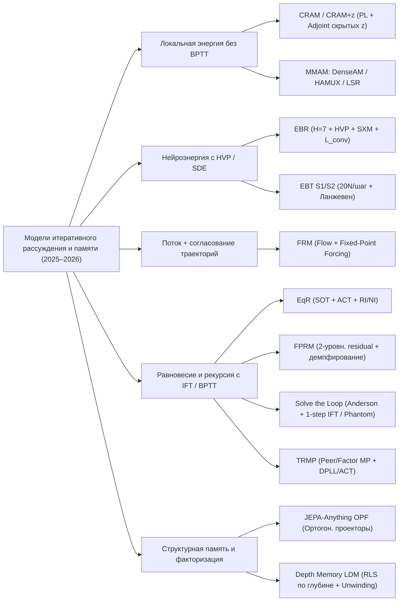

# Энергетические, равновесные и без-BPTT модели рассуждения (2025–2026): первоисточники, уравнения и механика отказов

**Локальное вероятностное обучение (Pseudolikelihood, Masked PL, Minimum Probability Flow) на явной энергии Поттса/Изинга с физическим порогом остановки $E \le \tau$ даёт ускорение до `≥ 1,000×` по времени и до `40,000×–128,000×` по FLOPs относительно `BPTT`, `EqProp` и `Implicit Diff`, тогда как сквозное дифференцирование через дискретную релаксацию системно рушится из-за не-сжимаемости поиска ($\rho(J_z) \ge 1$), экспоненциального обрезания горизонта кредита и ложных фиксированных точек.** `[VERIFIED: CRAM pp. 5, 20–21 Table 2 & 6–7; EqR Eq. 7–8; Solve the Loop App. B.3; FRM p. 4 Eq. 6 & Fig. 6c]`

---

## 1. Реестр проверенных первоисточников

| № | Код | Название работы | Авторы и дата | Идентификатор / Путь |
|---|---|---|---|---|
| 1 | `CRAM` / `CRAM+z` | Classical Energies Learn to Reason 1,000× Faster than Looped Models | Benjamin Hoover, Hugh Blayney, James C. R. Whittington (`Prefrontal`, 12 Nov 2026) | [`Classical Energies Learn to Reason 1,000× Faster than.pdf`](file:///C:/Users/vanya/Downloads/Classical%20Energies%20Learn%20to%20Reason%201,000%C3%97%20Faster%20than.pdf) (`arXiv:2611.17309v1`) |
| 2 | `EBR` | Energy-Based Reasoners: Your Recurrent Reasoner Should Be an Energy-Based Model | Chen, Gladstone, Li, Ji, Du (6 Nov 2026) | `https://arxiv.org/abs/2611.08977` |
| 3 | `EBT` | Energy-Based Transformers are Scalable Learners and Thinkers | Gladstone et al. (2 Jul 2025) | `https://arxiv.org/abs/2507.02092` |
| 4 | `FRM` | Flow Reasoning Models (Fixed-Point Forcing) | Helbling et al. (28 Jun / v3 1 Sep 2026) | `https://arxiv.org/abs/2606.29150` |
| 5 | `EqR` | Equilibrium Reasoners: Learning Attractors Enables Scalable Reasoning | Huang, Geng, Kolter (20 May 2026) | `https://arxiv.org/abs/2605.21488` |
| 6 | `FPRM` | Fixed-Point Reasoners | Movahedi et al. (16 Jun 2026) | `https://arxiv.org/abs/2606.18206` |
| 7 | `Solve the Loop` | Solve the Loop: Attractor Models for Language and Reasoning | Fein-Ashley, Rashidinejad (12 May 2026) | `https://arxiv.org/abs/2605.12466` |
| 8 | `TRMP` | Tiny Recursive Message Passing | Salvatori, Forasassi, Toumi, de Felice (13 Oct 2026) | `https://arxiv.org/abs/2610.18649` |
| 9 | `MMAM` | Modern Methods in Associative Memory | Krotov, Hoover, Ram, Pham (8 Jul 2025) | `https://arxiv.org/abs/2507.06211` |
| 10 | `OPF` / `JEPA-Anything` | JEPA-Anything: Learning Predictive Representations (Orthogonal Projection Factorization) | Cui et al. (17 Sep 2026) | [`JEPA-Anything Learning Predictive.pdf`](file:///e:/эксперименты/Новая%20нейронка/JEPA-Anything%20Learning%20Predictive.pdf) (`arXiv:2609.20800v1`) |
| 11 | `LDM` / `Depth Memory` | Depth Memory: Learning Fast Associative Memory Across Depth | González-Martínez, Nazari, Rusch, Liu (13 Oct 2026) | [`DEPTH MEMORY.pdf`](file:///e:/эксперименты/Новая%20нейронка/DEPTH%20MEMORY.pdf) (`arXiv:2610.18809v1`) |

> [!NOTE]
> Авторы и название `CRAM` (`arXiv:2611.17309v1`) приведены по титульному листу локального PDF (`p. 1`). Все `arXiv`-идентификаторы внешних статей перепроверены напрямую на `arxiv.org` в текущей сессии. `[VERIFIED: CRAM p. 1; curl arxiv.org/abs/*]`

---

## 2. Таксономия архитектур и сводное сравнение

Поле 2025–2026 годов распадается на пять несовместимых по градиентному контуру классов: от чисто локальной вероятностной оценки энергии без прохода назад по времени до явных потоковых и неявно-равновесных решателей.

| Модель (`arXiv`) | Принцип обновления состояния | Градиентный контур (BPTT-free?) | Остановка | Параметры | FLOPs / пазл (H200 / тест) | Sudoku-Extreme | Maze-Unique | Maze-Hard | Другие ключевые бенчмарки | Главный потолок |
|---|---|---|---|---|---|---|---|---|---|---|
| `CRAM` (`2611.17309v1`) | Классич. Поттс ODE на симплексе `Eq. (1)–(3)` | **Да** (`PL` / `MPF` / `Masked PL`) | Порог энергии $E \le \tau + 10^{-3}$ | `7.7K` (Sudoku), `18` (Maze-U), `113/181` (NQ) | `2.02e9` (Sudoku), `8.37e5` (Maze-U) | **`100.00%`** (`99.996%`, `42 ms`) | **`100.00%`** (`132 ms`) | Требует `CRAM+z` | NQ8/10: `99.95 / 99.45%` (`N=1`), GC8/10: `0.0 / 0.3` конфл. (`N=1`) | Билинейные связи $W_{ij}$ бессильны на глобальной связности без скрытых `z` |
| `CRAM+z` (`2611.17309v1`) | Видимые `v` + линейный диффузионный `z` (`App. F`) | **Да** (`PL` + `Adjoint` для `z`) | Порог $E$ + фикс. точка `z` (`<=152` ш.) | **`29`** (Maze-Hard) | **`1.41e7`** (Maze-Hard, `~30s`) | — | — | **`99.90±0.00%`** (`999/1000`) | — | При попытке выучить по-токенный вход или ненорм. вентиль: `0/300` |
| `EBR` (`2611.08977`) | Сферический PGD по нейроэнергии на RMS-многообразии | **Нет** (`H=7` + 2nd-order `HVP`) | $\lVert \nabla_{\mathcal{M}} E_\theta \rVert < 0.2$ (`64 -> 5.6` шагов) | `1.8M` (S/M), `7.1M` (NQ/GC) | `3.37e11` (S), `1.93e13` (M); `0.61 TF` (`N=8`) | `99.41%` (`N=1`) / `99.92%` (`N=8`) | `89.80%` (`CRAM T2`) | `87.37%` (`N=1`) / `88.27%` (`N=5`; `94.77%` any) | NQ8/10: `100 / 99.99%` (`N=20`), GC8/10: `0 / 0` конфл. | $\lVert \nabla E_\theta \rVert$ не ловит остановку на Maze-Hard (`~2.0`); линейная `E` поощряет петли |
| `EBT` (`2507.02092`) | Град. спуск + шум Ланжевена на непрерывных токенах | `S1`: **Да** (detach); `S2`: **Нет** (trunc BPTT) | Фикс. число шагов ($N$ внутр.) | Разл. (масштаб. до LLM/ViT) | `20N` FLOPs/токен/шаг (`3.33×` от `6N`) | — | — | — | OOD GSM8K PPL `43.3` vs `49.6` (Transf.); COCO OOD `23.29` vs `19.56` при `3` vs `300` NFE | Высокая цена `HVP` (`20N`); `S2` нестабилен при длинных цепочках |
| `FRM` (`2606.29150v3`) | Поток (Flow Matching) с удерживаемым `state s_t` | **Да** (`FPF` через `sg`, без BPTT) | `D_SKL(p_k, p_{k-1})` (`AUROC=1.00`) | `7M` (S), `8M` (M), `25M` (Zebra) | `3.91e12` (S), `4.70e12` (M) (`44×` < EqR) | `99.2±0.3%` (пик `99.5%`) | `98.0±1.8%` (пик `99.9%`) | — | Zebra: `99.9±0.2%` (`100%` пик) | Без `FPF` — катастрофа `exposure bias` (`AUROC=0.50`, `32.6%`) |
| `EqR` (`2605.21488`) | Рекурсия в равновесие (`RI` + `NI` ландшафт) | **Нет** (`SOT` + иерархия + trunc BPTT) | `ACT` (halting head; сертиф. $L<1$) | `5.03M` (S), `2.64M` (M-U) | `2.11e14` (S), `1.16e14` (M-U) | `99.8%` (`D=64, B=128`), `99.49%` (`CRAM T2`) | `93.0%` | Падение на `Maze-1k` (`App. C.2`) | Mini-ARC: `55.28%` vs TRM `48.35%` | Огромные FLOPs (`10^14`); оракул-остановка ломает `(z_L,z_H)` (`75.4 -> 13.6%`) |
| `FPRM` (`2606.18206`) | Pre-norm + 2-уровневое сжатие $\alpha_1,\alpha_2$ + демпфирование $\eta$ | Частично (окно $k$ шаг. ряда Неймана) | Относит. невязка $L_\infty < \tau$ | `7M` (однопетлевая) | `4.78e14` (Maze-Hard по `CRAM T8`) | `94.2%` (`94.23%`) | — | `87.0%` | ARC-1/2: `47.5 / 6.2%`; $A_5/S_5$ len-128: `98.1 / 98.8%` | Медленный ряд Неймана при $\lVert J \rVert_2 \to 1$; без иерархии уступает `CRAM+z` |
| `Solve the Loop` (`2605.12466`) | Warm-start $\tilde{y}_0$ + инъекция в аттрактор + Anderson `m=5` | Смешанно (`1-step IFT` на LM; `Phantom` на пазлах) | Невязка Андерсона $< 1.5\dots 3\cdot 10^{-4}$ | `140M–770M` (LM), `7M/27M` (пазлы) | `-25..31%` FLOPs vs Transf.; $O(1)$ аттрактор | `91.4%` (`27M`, репрод. `71.4%` в FPRM), `54.3%` (`7M`) | — | `93.1%` (`27M`), `46.7%` (`7M`) | FineWeb-Edu `770M` PPL `12.09` (Lambada `15.21`) | `1-step IFT` роняет TRM на Судоку `87.4 -> 56.5%`; полюс $(I-J_g)^{-1}$ при $\rho\to 1$ |
| `TRMP` (`2610.18649`) | 3-уровн. MP (ребро/узел + $\mathrm{GRU}_a$) | **Нет** (BPTT через горизонт $h=TR$) | Smooth-min `ACT` или решётка DPLL | `32.8K–65K` | `4.57e12` (S), `1.80e13` (M-U) | `99.87%` (ACT), `99.1%` (DPLL), `99.9%` (Bo64) | `99.23%` | — | NQ10→16 zero-shot `63%`; 3/4-SAT `95.6 / 72.9%` | Градиенты с тяжёлым хвостом; фактор-граф падает, если $h < \text{перебор}$ |
| `MMAM` (`2507.06211`) | Непрерывный спуск (DenseAM, HAMUX, LSE, LSR) | Теория / локальный градиент энергии | Минимум $E$ (`dE/dt <= 0`) | Теоретический обзор | От $O(KD)$ до $O(1)$ через RFF | — | — | — | Эквивалент диффузии ($\beta=1/(2\sigma^2 t)$); сжатие через RFF/LSR | В экспоненциальной DenseAM при росте $K$ возникают ложные минимумы |
| `OPF` (`2609.20800v1`) | Ортогональная факторизация латентов JEPA ($P_k^\top$) | **Да** (1-шаг проброс, без релаксации) | — | Надстройка над JEPA | Детерминированная проекция `(P^T)^+` | — | — | — | CITRIS Pong: `-34.83%` MSE интервенции; Kepler slope `-1.4991` ($R^2=0.9999999$) | Не решает комбинаторику сам по себе; задаёт геометрию латента |
| `LDM` (`2610.18809v1`) | Онлайн-запись дельт слоёв через Sherman–Morrison `RLS` по глубине | Без хранения матриц $M_l$: `State Unwinding` | Фиксированная глубина $L$ | `+1.07%` к базе (`400M`, `1.5B`) | Почти равно базовому Transf. + $O(G D_k^2)$ | — | — | — | FineWeb-Edu `1.5B@100B` PPL `9.15` vs `9.48` PreLN; zero-shot `59.71%` | Внутрислойная линейная память не заменяет дискретный перебор |

---

## 3. Детальный разбор первоисточников

### 3.1 `CRAM` и `CRAM+z` (`arXiv:2611.17309v1`)

Авторы возвращаются к дискретно-непрерывной модели Поттса на симплексе $\Delta^C$ для $N$ токенов с $C$ состояниями: $p_i = \operatorname{softmax}(\beta v_i) \in \Delta^C$, где $v_i \in \mathbb{R}^C$ — логиты переменной $i$ `[VERIFIED: CRAM p. 3]`.

**Функция энергии и ODE-динамика:**
$$E_\theta(p) = \beta^{-1}\sum_{i=1}^N p_i^\top \log p_i + \frac{1}{2}\sum_{i\neq j} p_i^\top K_{ij} p_j + \sum_{i=1}^N B_i^\top p_i \tag{Eq. 1}$$
$$\tau_i \frac{dv_i}{dt} = -v_i - \sum_j W_{ij} p_j - B_i \simeq -\nabla_{p_i} E_\theta(p), \qquad W_{ij} = \frac{K_{ij} + K_{ji}^\top}{2} \ (i\neq j), \ W_{ii}=0 \tag{Eq. 2}$$
$$v_i \leftarrow (1-\eta)v_i - \eta\left(\sum_j W_{ij} p_j + B_i\right), \qquad \eta = \frac{\Delta t}{\tau} \tag{Eq. 3}$$
`[VERIFIED: CRAM pp. 3–4, Eq. 1–3]`

Для $\mathcal{L}(v_i) = \beta^{-1}\log\sum_a \exp(\beta v_{ia})$ преобразование Лежандра даёт $v_i^\top p_i - \mathcal{L}(v_i) = \beta^{-1}\sum_a p_{ia}\log p_{ia}$, а положительно полуопределённый гессиан $H_i = \frac{\partial^2 \mathcal{L}}{\partial v_i \partial v_i^\top} = \beta(\operatorname{diag}(p_i) - p_i p_i^\top) \succeq 0$ гарантирует строгое убывание энергии при непрерывной релаксации:
$$\frac{dE_\theta}{dt} = -\sum_{i\in \mathcal{F}} \tau_i \dot{v}_i^\top H_i \dot{v}_i \le 0 \tag{App. E Eq. 7–10}$$
`[VERIFIED: CRAM pp. 21–22, App. E Eq. 7–10]`

**Правило обучения без BPTT (Pseudolikelihood вместо Больцмановского ML):**
Полное правдоподобие требует глобальной нормировки $Z_\theta$ и распадается на контрастивное сэмплирование:
$$\nabla_\theta J_{\mathrm{ML}}(\theta) = \mathbb{E}_{x\sim P_{\mathrm{data}}}[\nabla_\theta E_\theta(x)] - \mathbb{E}_{x^-\sim P_\theta}[\nabla_\theta E_\theta(x^-)] \tag{Eq. 4}$$
Вместо MCMC-цепей `CRAM` использует точное локальное псевдоправдоподобие (`PL`) на свободных индексах $\mathcal{F}$:
$$J_{\mathrm{PL}}(\theta; x) = E_\theta(x) + \frac{1}{|\mathcal{F}|}\sum_{i\in\mathcal{F}} \log\sum_a \exp\!\left(-E_\theta(x^-_{i\leftarrow a})\right) \tag{App. D.1 Eq. 5}$$
В силу дискретности состояний энергия замены одной ячейки $i$ в состояние $a$ сводится к линейному логиту $z_{ia} = -E_\theta(y_{i\leftarrow a})$, откуда вероятности $q_i(a) = \frac{\exp z_{ia}}{\sum_b \exp z_{ib}}$ дают точный градиент кросс-энтропии $\frac{\partial \ell_i}{\partial z_{ia}} = q_i(a) - y_{ia}$ без единого прогона рекуррентной динамики на обучении `[VERIFIED: CRAM p. 4 Eq. 4; p. 19 App. D.1 Eq. 5–6]`.

**Ключевые эксперименты на 1× H200 (`Table 1–3, 5`):**
- **Sudoku-Extreme** ($81\times 9$): `4` параллельные цепи из равномерного шума $U(C)$, `PL` + $L_1$ ($\lambda = 3.33\cdot 10^{-4}$), `32` полнобатчевых шага с `lr = 540`, график температуры $T: 0.40\bar{h}\to 0.31\bar{h}$, остановка при $E \le \tau + 10^{-3}$ ($\tau\in[-1.7\cdot 10^{-4}, -3\cdot 10^{-6}]$). Результат: **`100.00±0.00%`** (`99.996%`), **`7.7K`** параметров, **`2.02e9 FLOPs/пазл`**, обучение за **`42 мс` (`0.04 с`)** против `2.8 ч` у `EBR` (`1.8M`, `3.37e11`), `2.0 ч` у `EqR` (`5.0M`, `2.11e14` — **`128,000×` дороже по FLOPs**), `9.0 ч` у `TRMP` (`32.8K`, `4.57e12`). Ручная настройка сводит модель к **1 параметру** при `100.00%` (`1.08e8` FLOPs). Для достижения `98%` `CRAM` хватает **30 различных пазлов** против **700** у `EBR`. `[VERIFIED: CRAM pp. 4–5, 8, 16; Table 1, 2, 5, Fig. 3b]`
- **Maze-Unique** ($900\times 2$): `18` параметров общего $3\times 3$ свёрточного окна, `1` цепь (все открытые клетки ON), `20` шагов `PL` (`bs=64`), $T=0$ (заполнение тупиков), остановка в фиксированной точке ($\le 290$ шагов). Итог: **`100.00±0.00%`**, **`8.37e5 FLOPs`**, **`132 мс`** (`0.13 с`) обучения. `[VERIFIED: CRAM pp. 5, 16; Table 1, 2, 5]`
- **N-Queens и Graph Coloring (`Table 3`):** NQ $8\times 8$ — `99.95%` (`N=1`) / `100.00%` (`N=20`), покрытие мод `Cov@20 = 97.9%` (`113` пар., `2.9 с`); NQ $10\times 10$ — `99.45 / 99.99%`, `Cov@20 = 93.6%` (`181` пар., `6.8 с`); GC-8 / GC-10 — `0.0 / 0.3` конфликта при `N=1` (`0.0 / 0.0` при `N=20`), `Cov@20 = 88.9% / 52.6%` (`869 / 475` ненулевых пар., `1.3 с / 0.3 с`). `[VERIFIED: CRAM pp. 4, 7; Table 1, 3]`

**`CRAM+z`: скрытые переменные для глобальной связности (`App. F Eq. 11–15`, `Table 8`):**
Прямые связи $W_{ij}$ между видимыми переменными слепы к нелокальной топологии графа на `Maze-Hard`. `CRAM+z` добавляет непрерывное скрытое поле $z \in \mathbb{R}^N$ с квадратичной выпуклой энергией ($m > 4$, параметризация через $\log(m-4)$):
$$E_z(z) = \sum_i \left[\frac{m}{2}z_i^2 - \frac{1}{2}\sum_{j\in\mathcal{N}(i)} z_i z_j\right] - z_G \tag{Eq. 11}$$
$$\tau \dot{z}_i = -m z_i + \sum_{j\in\mathcal{N}(i)} z_j + \mathbf{1}_{i=G} \implies z_i \leftarrow \frac{1}{m}\left(\sum_{j\in\mathcal{N}(i)} z_j + \mathbf{1}_{i=G}\right) \ (\text{при }\tau=m,\ \Delta t=1) \tag{Eq. 12–13}$$
При $m>4$ гессиан строго положительно определён, коэффициент сжатия $\le 4/m < 1$, а равновесие $z^\star > 0$ строго отделяет компоненту связности цели $G$ (сходимость за $\le 152$ итераций). Поле $z$ направляет вентили рёбер и локально-осевой лапласиан $L_{ij}(z)$ в видимой релаксации:
$$\alpha_{ij}(z) = \frac{e^{\beta_{j-i} z_j}}{\sum_{k\in M(i)} e^{\beta_{k-i} z_k}}, \qquad L_{ij}(z) = \kappa_{j-i}\alpha_{ij}(z) + \kappa_{i-j}\alpha_{ji}(z) \tag{Eq. 14}$$
$$v_i \leftarrow (1-\eta)v_i - \eta\left(\sum_j \left[W_{ij} - L_{ij}(z)\operatorname{diag}(0, 1)\right]p_j + B_i\right) \tag{Eq. 15}$$
Обучение обходится **нулевым сквозным дифференцированием** через обе релаксации: видимые параметры учит `PL`, а параметры поля `z` — сопряжённый решатель (`adjoint solver`). На **Maze-Hard** (`Table 8`): `CRAM+z` набирает **`99.90±0.00%`** (`999/1000` на 3 сидах; единственный отказ — тупик из 6 клеток у границы) при **`29` параметрах**, **`1.41e7 FLOPs/пазл`** и **`~30 с`** обучения на H200 против `88.30%` у `EBR` (`1.77e6` пар., `1.93e13` FLOPs) и `87.00%` у `FPRM` (`6.83e6` пар., `4.78e14` FLOPs). Критическая граница: попытка выучить по-токенный вход или ненормированный парный вентиль без локального симплексного ограничения обрушила обучение до **`0/300`** и **`0/100`**. `[VERIFIED: CRAM pp. 22–24, App. F Eq. 11–15, Table 8]`

---

### 3.2 `EBR` — Energy-Based Reasoners (`arXiv:2611.08977`)

`EBR` заменяет произвольный рекуррентный блок на явную нейросетевую энергию $E_\theta(z; x)$ на единичной RMS-сфере $\mathcal{M}$:
$$z_{t+1} = \Pi_{\mathcal{M}}\!\left(z_t - \alpha \nabla_z E_\theta(z_t; x) + \text{noise}\right), \qquad E_\theta(z; x) = \sum_{i=1}^N \phi(e_i), \quad e_i = w^\top \operatorname{SiLU}(W h_i + b) \tag{Eq. 2, 7}$$
где $h = f_\theta(z + \operatorname{emb}(x))$, а $\phi = \mathrm{id}$ всюду, кроме `Maze-Hard`: на лабиринтах линейное суммирование отрицательных энергий `e_i` поощряет длинные обходные пути с меньшей суммарной энергией, поэтому там обязателен `softplus` `[VERIFIED: EBR Eq. 2, 7]`.

**Обучение и диверсификация мод:**
$$\mathcal{L}(Z, y) = \sum_{t=n-H+1}^n w_t \ell_\theta(z_t, y) + \lambda \mathcal{L}_{\mathrm{conv}}(Z, y), \qquad r_n = \frac{1}{H}\sum_{t=n-H+1}^n \frac{\|z_t - z_{t-1}\|}{\|z_{t-1}\|} \tag{Eq. 3–5}$$
Внешняя оптимизация берёт $H=7$ последних шагов ($n \in [15, 21]$) со `stablemax CE` и требует **гессиан-векторных произведений второго порядка (`HVP`)** $\nabla_\theta \nabla_z E_\theta$. Вспомогательная цель $\mathcal{L}_{\mathrm{conv}} = \mathrm{BCE}(p_n, \mathbf{1}[\hat{y}_\theta(z_n)=y])$ с $p_n = \sigma((\delta - r_n)/\kappa)$ калибрует саму сходимость. Начальное состояние смешивает решение с шумом `Eq. (8)`: $z_0 = (I-P)\epsilon + \sqrt{1-a^2}P\epsilon + a s(y)$. Для многозначных задач `SXM` (`Eq. 6`) строит двустороннее соответствие между $K$ траекториями и множеством допустимых решений $\mathcal{Y}(x)$:
$$k_{\mathrm{F}}^\star(y) = \arg\min_{1\le k\le K} \ell_\theta(z_n^{(k)}, y), \qquad y_{\mathrm{R}}^\star(k) = \arg\min_{y'\in\mathcal{Y}(x)} \ell_\theta(z_n^{(k)}, y') \tag{Eq. 6}$$
`[VERIFIED: EBR Eq. 3–6, 8–9]`

**Числа и абляции (`Tables 1, 3, 4, A.2–A.3, B.1, C.1–C.2, D.1`):**
- Параметры: `1.8M` (`256d`, Sudoku/Maze), `7.1M` (`512d`, NQ/GC).
- Sudoku-Extreme: `99.41±0.12%` (`N=1`, `1.92 EFLOPs` на обучение против `2.26 EFLOPs` у GRAM), `99.92±0.05%` (`N=8`, 64 шага); `0.0129 TFLOPs/итер`. Ранняя остановка $\|\nabla_{\mathcal{M}} E_\theta\| < 0.2$ режет число итераций `64 -> 5.6` (`10.8×` экономия: `6.60 -> 0.61 TFLOPs/пазл` при 8 семплах; `0.076 TFLOPs` при `N=1`). `[VERIFIED: EBR Tables 1, A.2–A.3, C.2]`
- Отказ градиентного критерия на лабиринте: на `Maze-Hard` (`87.37%` `N=1`, `88.27%` `N=5`; `94.07 / 94.77%` по любому кратчайшему пути) норма градиента застревает в районе `~2` даже на верных решениях, делая остановку невозможной. `[VERIFIED: EBR Table 1; CRAM Table 4]`
- Абляции (`Tables 3–4`): отключение энергетической головы роняет Судоку `98.96% -> 60.05%`; удаление $\mathcal{L}_{\mathrm{conv}}$ — до `45.32%`; замена на `q-head` — `92.42%`. Введение `F-SXM` и `R-SXM` на NQ-8 поднимает точность `65.40 -> 72.18 -> 100.00%` (`Cov@20: 75.9 -> 87.5 -> 97.9%`), а конфликты на GC-8 падают `18 -> 3 -> 0`. `[VERIFIED: EBR Tables 3–4]`

---

### 3.3 `EBT` — Energy-Based Transformers (`arXiv:2507.02092`)

`EBT` переносит скалярную оценку согласованности $E_\theta(x, \hat{y})$ в авторегрессионное и мультимодальное обучение через оптимизацию Ланжевена на непрерывных предсказаниях:
$$\hat{y}_{i+1} = \hat{y}_i - \alpha \nabla_{\hat{y}_i} E_\theta(x, \hat{y}_i) + \eta_i, \qquad \eta_i \sim \mathcal{N}(0, \sigma) \tag{Eq. 1–2}$$
Для авторегрессии (`AR-EBT`) независимые шаги предсказания на последовательности длины $S$ упаковываются в матрицу размера $2S-2$ с супердиагональной маской внимания $\tilde{S}_{z_p\leftarrow z_p}$ (`Sec. C.3`). `[VERIFIED: EBT Eq. 1–2, Sec. C.3]`

**Точная стоимость HVP и два режима обучения (`Sec. C.2, D.5, App. I.1–I.3`):**
- Прямой + обратный проход внутренней оптимизации второго порядка требует $(2N + 4N + 4N)\times 2 = \mathbf{20N}$ FLOPs/токен за один шаг (`3.33×` от стандартного Transformer++ `6N`; при 2 шагах в `S1` — `6.66×`). `[VERIFIED: EBT Sec. D.5]`
- **`S1` (BPTT-free / detached):** отцепляет градиент между внутренними шагами, считает loss на каждом шаге, учит шаг $\alpha$ и дискретный эмбеддинг шага — самый устойчивый вариант.
- **`S2` (truncated BPTT):** сохраняет граф между шагами, считает loss только в финале, рандомизирует не-обучаемый $\alpha$ на элемент батча/последовательности с шумом Ланжевена и буфером повторов (`replay buffer`), но теряет стабильность при увеличении числа внутренних шагов. `[VERIFIED: EBT Sec. C.2, App. I.1–I.3]`

**Масштабирование и OOD (`Tables 2–4`):**
Темп масштабирования на тексте (`RedPajamaV2`) выше до `35%`, на видео (`SSV2`) — выше `33%`. Показательно расхождение ID vs OOD (`Table 3`, метрика ↓ — меньше значит лучше): при более высокой ID-перплексии на предобучении (`33.43` против `31.36` у Transformer++) `EBT` выигрывает `3` из `4` OOD-задач: `GSM8K` (`43.3` vs `49.6`), `BB Math QA` (`72.6` vs `79.8`), `BB Dyck` (`125.3` vs `131.5`), слегка уступая Transformer++ лишь на `SQuAD` (`53.1` vs `52.3`), и даёт до `29%` прироста от «времени на размышление». На шумоподавлении изображений `COCO` (`Table 4`): OOD ($\sigma=0.2$) PSNR `23.29` (`MSE 305.2`) против `19.56` (`718.7`) у `DiT` при `3` NFE вместо `300` (`99%` меньше шагов), а линейный зонд ImageNet-1k вырастает до `5.32% / 13.2%` против `0.31% / 1.36%`. `[VERIFIED: EBT Tables 2–4, Sec. 4–5]`

---

### 3.4 `FRM` — Flow Reasoning Models и Fixed-Point Forcing (`arXiv:2606.29150v3`)

`FRM` строит линейный поток от шума к данным $x_t = (1-t)\varepsilon + t x_1$ ($t\in[0,1]$) с дискретным денойзером $D_\theta^t(x_t\mid c, s)$, скоростью $v_\theta^t = (D_\theta^t - x_t)/(1-t)$ и по-токенной кросс-энтропией $\mathcal{L}_{\mathrm{CE}}$. Между шагами потока пробрасывается скрытое состояние $s_t^{(k+1)} = D_\theta^t(x_t\mid c, s_t^{(k)})$ начиная с $s_t^{(0)} = \emptyset$ `[VERIFIED: FRM pp. 3–4, Eq. 1–5]`.

**Диагноз `Exposure Bias` (`Eq. 6`) и метод `FPF`:**
Стандартное 1-проходное само-кондиционирование $\tilde{s} = \operatorname{sg}[D_\theta^t(x_t\mid c,\emptyset)]$ порождает рассогласование распределений $p_{\mathrm{train}}(s \mid x_t, c, t) \neq p_{\mathrm{infer}}^{(k)}(s \mid \hat{x}_t, c, t)$: на тесте с ростом глубины логиты деградируют, а итерации сваливаются в самосогласованные ложные аттракторы — метрика остановки $r_k = D_{\mathrm{SKL}}(p_k, p_{k-1})$ даёт случайный **`AUROC = 0.50`**.
**`Fixed-Point Forcing` (`FPF`)** устраняет этот разрыв **без BPTT**: сначала модель делает свободный роллаут от случайной точки $t_{\mathrm{start}}\sim U(0, t)$ до $t$, порождая распределение состояния $s_{\mathrm{FPF}}$ как на реальном инференсе, и лишь затем учит $D_\theta^t(x_t\mid c, \operatorname{sg}(s_{\mathrm{FPF}}))$ на каноническом $x_t$. `[VERIFIED: FRM p. 4 Eq. 6, Fig. 6c]`

**Результаты (`Tables 1–2, Fig. 5–6`):**
- **Sudoku-Extreme** (`7M` пар.): `13.1±0.7%` (Base) $\to$ `32.6±3.7%` (+Self-Cond) $\to$ **`99.2±0.3%`** (`+FPF`, пик `99.5%`), требуя на **`44×` меньше FLOPs**, чем `EqR` (`98.7%`; `3.91e12` FLOPs/пазл по таблице `CRAM`).
- **Zebra** (`25M` пар.): `62.3±29.1%` $\to$ `36.9±18.0%` $\to$ **`99.9±0.2%`** (пик `100.0%`).
- **Maze-Unique** (`8M` пар.): `77.6±16.7%` $\to$ `96.2±3.0%` $\to$ **`98.0±1.8%`** (пик `99.9%`).
- **`AUROC` детектора остановки** $r_k = D_{\mathrm{SKL}}(p_k, p_{k-1})$ подскакивает с **`0.50`** до **`1.00`**. `[VERIFIED: FRM pp. 5–8, Tables 1–2, Fig. 5–6; CRAM Table 2]`

---

### 3.5 `EqR` — Equilibrium Reasoners (`arXiv:2605.21488`)

`EqR` учит весо-связанный остаточный аттрактор с инерцией релаксации (`RI`, $\lambda=0.05$) и инъекцией шума (`NI`, $\beta=0.01$):
$$\mathbf{z}_{k+1} = \mathbf{z}_k + (1-\lambda)r_\theta(\mathbf{z}_k; \mathbf{x}) + \beta\varepsilon_k, \qquad \frac{d\mathbf{z}^\star}{d\theta} = (I - J_{\mathbf{z}})^{-1} J_\theta \tag{Eq. 1–3, 8}$$
Для сжимающих отображений ($L < 1$) верна строгая липшицева граница остановки `Eq. (6)–(7)`:
$$\|R_\theta(\mathbf{z}; \mathbf{x})\| < \frac{(1-L)\gamma(\mathbf{z}^\star)}{G_{\mathrm{gap}}} \implies \hat{\mathbf{y}}_\theta(\mathbf{z}; \mathbf{x}) = \mathbf{y} \tag{Eq. 6–7}$$
`[VERIFIED: EqR Eq. 1–3, 6–8]`

**Критичные открытия по динамике обучения (`Tables 2–8, App. C.2`):**
- Прямой `42`-слойный FF-трансформер на Судоку даёт `2.6%`, весо-связанный `2×21` — `32.6%`, `16×` глубина падает в `OOM`.
- Оффлайн-траекторная супервизия (`Eq. 9`) ухудшает точность `51.8% -> 47.1%` из-за рассинхрона со свежей политикой, тогда как **Self-Organizing Trajectories (`SOT`)** поднимает её до `74.7%`.
- **Провал оракула остановки (`Table 8`):** подстановка идеального (`oracle GT`) критерия остановки в иерархическую схему `(z_L, z_H)` обрушивает точность с **`75.4%` до `13.6%`**, доказывая, что модель полагается на саму механику пересчёта/динамику неполной остановки, а не на семантический сигнал ответа.
- Формирование ландшафта аттрактора (`Tables 3–4`): прогрессия `84.8% (+ACT)` $\to$ `86.0% (+RI)` $\to$ `86.4% (+NI)` $\to$ `93.0% (D=64, B=1)` $\to$ **`99.8%` (`D=64, B=128`, `5.03M` пар., `344,064` эффективных слоёв)** на Sudoku-Extreme и `44.9 -> 68.6 -> 82.2 -> 88.9 -> 93.0%` (`2.64M`) на Maze-Unique. `Mini-ARC`: `55.28%` против `48.35%` у `TRM` и `44.85%` у `HRM`.
- `ACT` (`Table 5`) сжимает `(1024, 1)` NFE `1024 -> 58.7` (`96.1 -> 95.3%`) и `(64, 128)` `8192 -> 1400.6` (`97.9 -> 97.4%`), однако суммарные FLOPs на пазл в `CRAM Table 2` остаются на уровне `2.11e14`.
- **`App. C.2` диагноз `Maze-1k`:** неоднозначность разметки (`one-to-many` кратчайших путей) разрушает монотонную сходимость при росте глубины, в отличие от однозначного `Maze-Unique`. `[VERIFIED: EqR Tables 2–8, 14–16, App. C.2; CRAM Table 2]`

---

### 3.6 `FPRM` — Fixed-Point Reasoners (`arXiv:2606.18206`)

`FPRM` устраняет разбегание `pre-norm` и узкие гребни `post-norm` двухуровневым сжимающим масштабированием остатков:
$$\mathbf{z}^\ell = \alpha_1\mathbf{z}^{\ell-1} + \beta_1 f_{\theta^\ell}^\ell(\mathrm{Norm}_{\mathrm{pre}}(\mathbf{z}^{\ell-1})) \ (\ell=1\dots 2L), \qquad \mathbf{z}_{i+1}^0 = \alpha_2\mathbf{z}_i^{2L} + \beta_2\mathbf{x} \tag{Eq. 2–3}$$
где $\beta_2 = 1 - \alpha_2\alpha_1^{2L}$, $\beta_1 = \frac{\beta_2(1-\alpha_1)}{1-\alpha_1^{2L}}$. **Теоремы 1–2** доказывают глобальную ограниченность $\|\mathbf{z}_\infty^0\| \le \|\mathbf{x}\| + \alpha_2 c_f$ и линейную скорость сжатия со скоростью $(\alpha_2\lambda_f)^i$ при $\alpha_2\lambda_f < 1$. `[VERIFIED: FPRM Eq. 2–3, Thm 1–2]`

**Осцилляции, остановка и граница ряда Неймана:**
- Если собственные числа Якобиана лежат в $\Re(\lambda_i) < 1$ при $|\lambda_i| \ge 1$ (предельные циклы), **Теорема 3** вводит демпфированное отображение $g_{\eta,\theta}(\mathbf{z};\mathbf{x}) = \eta f_\theta(\mathbf{z};\mathbf{x}) + (1-\eta)\mathbf{z}$ с $\eta\in(0, \eta_0)$, сохраняющее точное множество фиксированных точек; $\eta$ экспоненциально затухает ($\eta \leftarrow \gamma\eta$) после $P$ стагнирующих шагов.
- Остановка — по относительной норме $L_\infty$: $r_i = \frac{\lVert \mathbf{z}_i - f_\theta(\mathbf{z}_i;\mathbf{x})\rVert_\infty}{\lVert f_\theta(\mathbf{z}_i;\mathbf{x})\rVert_\infty + \epsilon} < \tau$.
- **Предложение 1 (`Eq. 4–5`):** усечение ряда Неймана $\frac{d\mathbf{z}^\star}{d\theta} \approx \sum_{j=0}^{k-1} \mathbf{J}^j\mathbf{P}$ даёт ошибку Фробениуса $\le \sqrt{D}\frac{\sigma^k}{1-\sigma}$ при $\|\mathbf{J}\|_2 = \sigma < 1$. Модель учится $k$-шаговыми усечёнными окнами (`k=1` на тесте, без иерархии). `[VERIFIED: FPRM Eq. 4–5, Thm 3, Prop. 1]`

**Числа (`Table 1, Sec. 4.3`):** `7M` параметров (однопетлевая модель): Sudoku-Extreme **`94.2%`** (`94.23%` при $\alpha_1=0.75, \alpha_2=0.25$), Maze-Hard **`87.0%`**, ARC-1 **`47.5%`**, ARC-2 **`6.2%`**, композиционные перестановки $A_5/S_5$ длины `128` — **`98.1±2.2% / 98.8±0.9%`** против `45.8±3.9% / 39.4±1.9%` у `TRM`. При попытке воспроизвести `Attractor Model 27M` авторы `FPRM` получили `71.4%` против заявленных `91.4%`. `[VERIFIED: FPRM Table 1, Sec. 4.3]`

---

### 3.7 `Solve the Loop` — Attractor Models (`arXiv:2605.12466`)

Модель переносит равновесный цикл прямо в пространство привязанных выходных эмбеддингов: бэкбон формирует «тёплый старт» $\tilde{y}_0 = \mathcal{T}_{\theta_b}(E(x))$, а весо-связанный аттрактор итерирует $\tilde{y}_{t+1} = \mathcal{T}_{\theta_a}(\tilde{y}_t, \tilde{y}_0)$ с ускорением Андерсона (`m=5`) до относительной невязки $\|\mathcal{A}_{\theta_a}\|_2 / \|\tilde{y}_t\|_2 < \varepsilon$ ($\varepsilon \in [1.5, 3]\cdot 10^{-4}$). **Теорема 1** и **Следствие 1** выписывают точный IFT-градиент $\frac{\partial y^\star}{\partial \theta} = (I - J_F(y^\star))^{-1}\frac{\partial f_\theta}{\partial\theta}\big|_{y^\star}$ и доказывают устранение остаточной ошибки `LoopLM` длины $T$, равной $L^T\|E(x)-y^\star\|$, а условие $\mathcal{T}_{\theta_a^\star}(\tilde{y}_0,\tilde{y}_0)=\tilde{y}_0$ фиксирует интернализацию аттрактора в бэкбон `[VERIFIED: Solve the Loop Eq. 1–10, Thm 1, Cor 1]`.

**Язык против дискретных пазлов (`Tables 1–5, Sec. 4.2, App. B.3`):**
- На FineWeb-Edu (`140M / 370M / 770M`) модель снижает Val PPL до **`18.30 / 14.03 / 12.09`** против `21.48 / 15.79 / 13.08` у Transformer при **`25–31%` меньших FLOPs** и $O(1)$ памяти аттрактора; `770M` превосходит `1.3B` Transformer (`11.95`) на Lambada PPL (`15.21` vs `17.26`) и Core (`26.83` vs `25.45`). `1-step IFT` ($u \approx v$, `Table 5`, `60.3M`) даёт `34.05` vs `33.91` PPL при `4.8×` меньшей памяти и `2.7×` скорости.
- **Провал `1-step IFT` на комбинаторике (`Sec. 4.2, App. B.3`):** в дискретном рассуждении `1-step IFT` обваливает `TRM` на Судоку с `87.4%` до `56.5%`. Поэтому для Sudoku (`91.4%` при `27M`, `54.3%` при `7M`) и Maze-Hard (`93.1%` при `27M`, `46.7%` при `7M`) авторы вынужденно возвращаются к `phantom`-градиенту. `App. B.3` прямо доказывает расходимость $(I - J_g)^{-1}$ при приближении спектрального радиуса $\rho(J_g)\to 1$, запирающую IFT внутри строго сжимающих областей $\{\rho(J_g) < 1\}$. `[VERIFIED: Solve the Loop Tables 1–5, Sec. 4.2, App. B.3]`

---

### 3.8 `TRMP` — Tiny Recursive Message Passing (`arXiv:2610.18649`)

`TRMP` заменяет глобальное внимание графовым обменом сообщениями по схеме `Edge/Node MP + GRU_a` с тремя вложенными циклами ($R$ раундов, $K$ циклов $\mathrm{GRU}_a$, шаги глубокой супервизии), задающими горизонт кредита $h = TR = (C-D)R$ `[VERIFIED: TRMP Eq. 1–5]`.

**Критерии остановки:**
1. Непрерывный `smooth-min ACT` по всем узлам `v` (`Eq. 13–14`): $q_v = w_q\operatorname{sg}(a_v) + b_h$, $q = -\log\sum_v \exp(-q_v)$ (плюс шум при `P=64` роллаутах).
2. Дискретная монотонная решётка DPLL (`Eq. 4`): $L_{\ell+1} = \Pi(p_\theta(\cdot\mid L_\ell), L_\ell)$, фиксирующая уже доказанные литералы. `[VERIFIED: TRMP Eq. 4, 13–14]`

**Топология графа, горизонт и тяжёлые хвосты (`Sec. 4–5, B.3`):**
- **Sudoku-Extreme:** полносвязный Peer-граф (`diam=2`, `20` соседей) достигает **`99.1%`** (DPLL, `<24K` пар.), **`98.7±0.06%`** (`32K`), **`99.9±0.1%`** (`Bo64`) и удерживает **`98.5±0.2%`** даже при коротком горизонте $h=5$ (`12K` пар., обучение `~10 мин` на H100). Фактор-граф (`diam=4`, 4 порта на клетку) при $h=10$ падает с `97.6%` (`32K`) до **`82.9±2.2%`** (`12K`) и требует вдвое длиннее горизонт.
- **Обобщение по размеру (`N-Queens` и `SAT`):** фактор-граф с `0-shot` переносится на `N-Queens 10x10 -> 16x16` (**`63%`** против `2% / 26%` у `RRN`, у которого `T=256` уходит в `OOM`) и с `65K` параметров даёт **`95.6±0.5% / 72.9±2.1%`** на RandCSPBench 3/4-SAT против `363K` `QuerySAT` (`92.38 / 66.57%`) и `430K` `NeuroSAT` (`84.48 / 47.52%`); на `G4SATBench` (Easy/Med/Hard): `99.7% / 72.5% / 12.3%` (`ACT Bo64` на Hard — `26.7% / 44.8%`).
- **Тяжёлые хвосты градиентов (`Sec. B.3`):** при длинном `h` редкие доски порождают всплески нормы, ломающие экспоненциальный 2-й момент Adam. Необходимы покадровый клиппинг по отношению к медиане батча $\min(1, \kappa\bar{r}/r_b)$ ($\kappa\in\{5, 50\}$) и жёсткий пропуск шага при превышении порога. `[VERIFIED: TRMP Sec. 4–5, B.3]`

---

### 3.9 `Modern Methods in Associative Memory` (`arXiv:2507.06211`)

Монография систематизирует ёмкость и конструкцию современных энергетических ассоциативных сетей:
- **Плотная память Хопфилда (`DenseAM`, `Eq. 2.13–2.22`):** функция взаимодействия $F(x)=\frac{1}{n}x^n$ расширяет ёмкость с линейного предела Хопфилда ($n=2 \implies 0.14 D$) до полиномиальной $K^{\max} = \frac{1}{\alpha^2(2n-3)!!}D^{n-1}$, а экспоненциальная функция даёт $K^{\max}\sim 2^{D/2}$. `[VERIFIED: MMAM Eq. 2.13–2.22]`
- **`HAMUX` и `Energy Transformer` (`Eq. 3.4–3.5, 3.13–3.21`):** выпуклый лагранжиан $\mathcal{L}_x$ порождает сопряжённую переменную $\hat{\mathbf{x}}=\nabla\mathcal{L}_x(\mathbf{x})$, гарантируя функцию Ляпунова $\frac{dE_{\mathrm{total}}}{dt} = -\sum_\ell \tau_\ell \dot{\mathbf{x}}_\ell^\top (\nabla^2\mathcal{L}_x)\dot{\mathbf{x}}_\ell \le 0$. `Energy Transformer` объединяет `LayerNorm` лагранжиан `Eq. (3.14)`, лог-сум-эксп энергию внимания $E^{\mathrm{ATT}}=-\frac{1}{\beta}\sum_{h,C}\log\sum_{B\neq C}\exp(\beta A_{hBC})$ (`Eq. 3.15`) и Хопфилд-MLP $E^{\mathrm{HN}}=-\sum_B\sum_\mu G(\sum_j \xi_{\mu j}\hat{x}_{jB})$ (`Eq. 3.17`). `[VERIFIED: MMAM Eq. 3.4–3.5, 3.13–3.21]`
- **Диффузия = `DenseAM` (`Eq. 4.5–4.15`):** точное совпадение $E^{\mathrm{DM}}(\mathbf{x}_t, t) = -2\sigma^2 t \log\sum_\mu \exp\!\left(-\frac{\|\mathbf{x}_t-\boldsymbol{\xi}^\mu\|_2^2}{2\sigma^2 t}\right)$ при обратной температуре $\beta = \frac{1}{2\sigma^2 t}$ объясняет три фазовых перехода по мере роста числа образцов $K$: чистое запоминание ($K=2$) $\to$ ложные минимумы ($K=9$) $\to$ гладкое многообразие ($K=1000$, $E^{\mathrm{AM}}(R,\phi)=R^2+1-\beta^{-1}\log I_0(2\beta R)\approx (R-1)^2$). `[VERIFIED: MMAM Eq. 4.5–4.15]`
- **`RFF` и `Log-Sum-ReLU (LSR)` (`Eq. 5.51, 5.58`):** случайные Фурье-признаки (`RFF`) сжимают $K$ паттернов в вектор фиксированного размера $\mathbf{T}=\sum_\mu\Phi(\boldsymbol{\xi}^\mu)$ с ошибкой $O(\sqrt{D/Y})$, а минимизация MISE через ядро Епанечникова порождает разреженную локальную энергию с конечным носителем:
$$E_\beta(\mathbf{v};\Xi) = -\log\sum_\mu \operatorname{ReLU}\!\left(1 - \frac{\beta}{2}\|\mathbf{v} - \boldsymbol{\xi}^\mu\|^2\right) \tag{Eq. 5.58}$$
`[VERIFIED: MMAM Eq. 5.51, 5.58]`

---

### 3.10 `JEPA-Anything` — `OPF` (`arXiv:2609.20800v1`)

Если энергетические модели задают правила рассуждения поверх состояния, `OPF` решает структурную проблему самой репрезентации без пиксельного декодирования: латент $z \in \mathbb{R}^d$ раскладывается на $K$ ортогональных проекционных подпространств $P = [P_1, \dots, P_K] \in \mathbb{R}^{d\times d}$ ($K r = d$):
$$z_t^{(k)} = P_k^\top \operatorname{sg}(z_t), \qquad \hat{z}_t^{(k)} = q_k(z_c, s_t), \qquad \hat{z}_t = (P^\top)^\dagger \hat{u}_t \tag{Eq. 3–5}$$
$$\mathcal{L}_{\mathrm{OPF}} = \mathcal{L}_{\mathrm{pred}} + \lambda_{\mathrm{orth}}\mathcal{L}_{\mathrm{orth}} + \lambda_{\mathrm{fac}}\mathcal{L}_{\mathrm{fac}} + \lambda_{\mathrm{enc}}\mathcal{L}_{\mathrm{enc}} \tag{Eq. 10}$$
где $\mathcal{L}_{\mathrm{pred}}$ регрессирует факторы (`Eq. 6`), $\mathcal{L}_{\mathrm{orth}} = \sum_k \|P_k^\top P_k - I_r\|_F^2 + \sum_{i<j}\|P_i^\top P_j\|_F^2$ (`Eq. 7`), а члены $\mathcal{L}_{\mathrm{fac}}, \mathcal{L}_{\mathrm{enc}}$ (`Eq. 9`) удерживают сингулярные числа выше порога $\gamma$ через `hinge` $\max(0, \gamma - \sigma)$ от коллапса. **Предложение 1 (`Eq. 8`) и Следствие 1** гарантируют при $P^\top P = I_d$ единичное число обусловленности $\kappa_2(P)=1$ и изометрию ошибки: $\|\hat{z}-z\|_2 = \|e\|_2$. На тесте **CITRIS Pong** (`Table 5`) перекрёстное просачивание факторов падает с **`0.4550` до `5.18e-16`**, $\sigma_{\min}(P)$ поднимается **`0.00513 -> 0.999989`**, $\kappa_2(P)$ — **`438.52 -> 1.00005`**, MSE 1-шаговой интервенции падает на **`-34.83%`** (`0.009541 -> 0.006218`), 6-шаговой — на **`-8.58%`**, а на орбитальной физике восстанавливается наклон закона Кеплера **`-1.4991`** ($R^2 = 0.9999999$). `[VERIFIED: JEPA-Anything pp. 4–16, Eq. 3–10, Prop. 1, Cor. 1, Table 5]`

---

### 3.11 `Depth Memory` (`LDM`, `arXiv:2610.18809v1`)

`LDM` переносит быстрые ассоциативные матрицы (`DeltaNet / RLS`) из оси последовательности **в ось глубины сети**, пробрасывая через слои $l=1\dots L$ тройку потоков $(x_l, M_l, P_l)$ ($G=16$ групп, $D_k=8$): вентилированное чтение и точное обновление Шермана–Моррисона:
$$x_{l-1} + \gamma_{l-1}\odot M_{l-1}(g_{l-1}\odot q_{l-1}), \qquad \kappa_l = \frac{P_{l-1}k_l}{\lambda_l + k_l^\top P_{l-1}k_l} \tag{Eq. 6–7}$$
$$u_l = v_l - M_{l-1}k_l, \qquad M_l = M_{l-1} + u_l\kappa_l^\top, \qquad P_l = \frac{P_{l-1} - \kappa_l k_l^\top P_{l-1}}{\lambda_l} \tag{Eq. 8}$$
где ключи и значения масштабированы забыванием ($k_l = \sqrt{\omega_l}\tilde{k}_l$, $v_l = \sqrt{\omega_l}\tilde{v}_l$), а для обратного прохода без хранения матриц $M_l$ на каждом слое применена обратимая **раскрутка состояния (`State Unwinding`, `Eq. 9`)**:
$$M_{l-1} = M_l - u_l\kappa_l^\top \tag{Eq. 9}$$
в связке с оконной записью ($E=4$, `Eq. 10, 14–16`). На `FineWeb-Edu` (`Table 2`) `LDM` выигрывает у `PreLN`, `mHC` и `AttnRes` ценой `+1.07%` параметров (`Table 4`): на `400M@50B` Val PPL **`12.08`** (vs `12.73 / 12.23 / 12.12`), на `1.5B@100B` Val PPL **`9.15`** (vs `9.48 / 9.25 / 9.26`) и лучший средний `zero-shot` **`59.71%`**. Абляции на `400M @ 15B` (`Table 3, p. 9` — дельта `PPL ↓`; `Table 8, p. 29` — дельта кросс-энтропии `Loss ↓` в натах) доказывают, что критично сохранять прямой остаточный поток $x_l$ (переход на $F_l(r_{l-1})$ ухудшает loss на `+0.1310` и перплексию на `+1.88` PPL) и записывать в память **дельту слоя** $v_l = \delta_l$, а не $x_l$ (`+0.0241` к loss и `+0.33` к PPL). `[VERIFIED: DEPTH MEMORY pp. 4–11, 19, 28–34, Eq. 6–16, Tables 1, 2, 3, 4, 8]`

---

## 4. Сравнение 12 методов обучения без/с BPTT и новых суррогатов

В едином синхронизированном стенде `CRAM` (`Table 6–7`, стр. 20–21) напрямую сопоставлены **12 правил обучения** одной и той же энергетической модели на Sudoku-Extreme и Maze-Unique (`T99` — время до `99%`, `FLOPs99` — затраты, `Solved%` — итог на финальном бюджете). Ниже объединены эти 12 методов и новейшие схемы 2026 года (`FPF`, `SOT`, `1-step IFT / Phantom`).

| Группа / Метод | Математический механизм градиента | Без BPTT? | Sudoku `T99` | Sudoku `FLOPs99` | Sudoku `Solved%` | Maze-U `T99` | Maze-U `FLOPs99` | Maze-U `Solved%` |
|---|---|---|---|---|---|---|---|---|
| `[L] Pseudolikelihood (PL)` | $\nabla_\theta [E_\theta(x) + \frac{1}{\lvert \mathcal{F}\rvert}\sum_i \log\sum_a e^{-E_\theta(x^-_{i\leftarrow a})}]$ (`CRAM Eq. 5`) | **Да** | `50 мс` | `3.42e10` | **`100.00±0.00%`** | `43 мс` | `6.15e7` | **`100.00±0.00%`** |
| `[L] Masked PL` ($q\in\{0.1,0.3\}$) | Случайная маска входов (`hidden=0`) в условной `PL` | **Да** | `198 мс` | `1.95e11` | `99.99±0.00%` | **`22 мс`** | **`3.11e7`** | **`100.00±0.00%`** |
| `[L] Minimum Probability Flow` | Минимизация потока переходов $\exp(-\Delta E/2)$ | **Да** | `225 мс` | `1.95e11` | `99.99±0.00%` | `30 мс` | `4.22e7` | `100.00±0.00%` |
| `[L] Denoising Score Matching` | Шумовая регрессия $3(y_i-1/C)+\sigma\varepsilon$ | **Да** | `1.6 с` | `2.20e12` | `99.98±0.01%` | `23 мс` | `3.44e7` | `100.00±0.00%` |
| `[S] Contrastive Divergence` | MCMC (`324` Sudoku / `256` Maze-U ходов, $T=1$) | **Да** | `33.7 с` | `1.26e14` | `99.99±0.00%` | `258 мс` | `3.37e9` | `100.00±0.00%` |
| `[S] Persistent CD` | Постоянные MCMC-цепи негативной фазы | **Да** | `30.2 с` | `1.26e14` | `99.96±0.06%` | `262 мс` | `3.37e9` | `100.00±0.00%` |
| `[S] Contrastive Hebbian` | $n$ шагов Эйлера ($\eta=0.5$) без BPTT | **Да** | `348 мс` | `1.92e12` | **`100.00±0.00%`** | `111 мс` | `2.15e9` | `100.00±0.00%` |
| `[D] Equilibrium Propagation` | Разность 2 фаз ($\beta=0.01 \to 0.99999$ косин. сходство с BPTT; $\beta=0.5$ взорвался) | Формально да | Не достигнуто | — | **`16.05±8.75%†`** (`240k` ш., `50 мин`; `1.10%` на `2k`) | `3.7 с` | `6.66e10` | `100.00±0.00%` |
| `[D] Implicit Differentiation` | $n$ прямых шагов + $n$ шагов сопряжённой системы $(I-J_z)^{-1}$ | Без хранения графа | Не достигнуто | — | **`0.45±0.50%`** ($\le 0.6\%$ на `60k`) | `2.3 с` | `4.23e10` | `100.00±0.00%` |
| `[D] Truncated BPTT (t=1)` | Градиент только последнего шага (`1-step`) | Да (1 шаг) | `4.6 с` | `2.35e13` | `99.57±0.29%` | `1.1 с` | `7.41e9` | `100.00±0.00%` |
| `[D] Truncated BPTT (t=5)` | Усечённый BPTT глубиной 5 шагов | Частично | `2.9 мин` | `1.37e15` | `99.89±0.07%†` (`60k`, `5.4 мин`; `98.51%` на `2k`) | `4.0 с` | `1.24e10` | `100.00±0.00%` |
| `[D] Full BPTT (T=10)` | Полный проход назад через $T=10$ шагов | **Нет** | Не достигнуто | — | **`48.82±3.73%†`** (`3.84M` ш., `4.8–5.0 ч`; `0.72%` на `2k`) | `7.7 с` | `1.86e10` | `100.00±0.00%` |
| `Fixed-Point Forcing` (`FRM`) | Rollout $t_{\mathrm{start}}\to t$ в режиме инференса, далее $\operatorname{sg}(s_{\mathrm{FPF}})$ | **Да** | — | `3.91e12` (весь цикл `FRM`) | **`99.2±0.3%`** (`99.5%` пик) | — | `4.70e12` (`FRM`) | `98.0±1.8%` |
| `SOT` + landscape shaping (`EqR`) | Само-организующиеся траектории + `RI/NI` + `ACT` + 2-уровн. усечение | Частично | — | `2.11e14` | `99.49–99.8%` | — | `1.16e14` | `93.0%` |
| `1-step IFT` / `Phantom` (`Solve the Loop`) | $u \approx v$ для LM / усечённый граф для дискретных задач | На LM да; на пазлах нет | — | `[UNKNOWN]` | `1-step IFT` роняет TRM `87.4 -> 56.5%`; Phantom `91.4%` (`27M`) | — | — | — |

`[VERIFIED: CRAM pp. 20–21 Tables 6–7; FRM Table 1–2; EqR Table 2–5; Solve the Loop Sec. 4.2 & Table 5]`

**Главный численный контраст:** на одной и той же задаче `Sudoku-Extreme` локальный `PL` достигает `100.00%` за **`50 мс` и `3.42e10 FLOPs`**, тогда как `Truncated BPTT (t=5)` тратит **`2.9 мин` и `1.37e15 FLOPs` (`40,058×` больше вычислений)**, а `Full BPTT (T=10)` за **`5 часов`** выбивает лишь **`48.82%`**. `[VERIFIED: CRAM Table 6–7]`

---

## 5. Пять доказанных причин краха `BPTT`, `EqProp` и `Implicit Diff` на дискретных задачах

1. **Конфликт диаметра графа/перебора и горизонта усечения (`TRMP` + `CRAM`):**
   Чтобы распространить сигнал ограничения на глубину бэктрекинга, горизонт BPTT $h = TR$ обязан превосходить диаметр графа распространения и длину переборной цепочки. На `TRMP` при коротком $h=5$ полносвязный `Peer`-граф (`diam=2`) держит **`98.5%`**, но разреженный `Factor`-граф (`diam=4`) обрушивается с **`97.6%`** (`h=32k`) до **`82.9%`** даже при $h=10$. С другой стороны, попытка удлинить полный `BPTT` до $T=10$ в `CRAM Table 7` парализует оптимизацию: `0.72%` за первые `2k` обновлений и `48.82%` после `3.84M` шагов (`5 часов`). `[VERIFIED: TRMP Sec. 4–5; CRAM Table 7]`

2. **Полюс резольвенты $(I - J_z)^{-1}$ и не-сжимаемость дискретного поиска (`Solve the Loop App. B.3`, `EqR`, `FPRM`):**
   Неявное дифференцирование требует обратимости $(I - J_z)$ и сжимаемости $\rho(J_z) < 1$ (в `EqR Eq. 7` и `FPRM Prop. 1` ошибка ряда Неймана $\le \sqrt{D}\frac{\sigma^k}{1-\sigma}$ взрывается при $\sigma \to 1$). В `Solve the Loop App. B.3` формально показано, что при $\rho(J_g) \to 1$ норма резольвенты $(I - J_g)^{-1}$ расходится, запирая оптимизацию внутри строго сжимающих областей. Но дискретный поиск и переключение веток на Судоку принципиально имеют граничные собственные значения $\approx 1$ или кусочно-постоянные скачки! Отсюда прямой эмпирический крах в трёх независимых работах:
   - в `CRAM Table 7` **Implicit Diff даёт `0.45±0.50%`** на Судоку ($\le 0.6\%$ за `60k` шагов);
   - в `Solve the Loop Sec. 4.2` переход на **`1-step IFT` роняет `TRM` с `87.4%` до `56.5%`**;
   - в `CRAM Table 7` **`EqProp` с малым сдвигом $\beta=0.01$** с точностью `0.99999` воспроизводит градиент умирающего BPTT и за `50 мин` даёт жалкие **`16.05%`**, а при увеличении $\beta=0.5$ числово **взрывается**. `[VERIFIED: Solve the Loop Sec. 4.2, App. B.3; EqR Eq. 7–8; FPRM Prop. 1; CRAM Table 7]`

3. **Тяжёлые хвосты Якобианов, порча 2-го момента `Adam` и квадратичная цена `HVP` (`TRMP Sec. B.3`, `EBT Sec. D.5`):**
   Длинные дискретные развёртки порождают степенное распределение редких экстремальных градиентов. `TRMP Sec. B.3` фиксирует: единичные всплески отравляют экспоненциально сглаженный 2-й момент $v_t$ в `Adam`, делая обязательным покадровый клиппинг к медиане батча и **полный пропуск шагов** выше порога. Для энергетических моделей с внутренним спуском `EBT/EBR` пропуск внешнего градиента через $\nabla_z E_\theta$ стоит **второй производной (`HVP`)**, что поднимает цену каждого шага в `EBT` до **`20N FLOPs/токен` (`3.33×` от Transformer++)** и разрушает устойчивость `S2-EBT` при росте числа внутренних шагов. `[VERIFIED: TRMP Sec. B.3; EBT Sec. C.2, D.5, App. I]`

4. **Расхождение траекторий (`Exposure Bias`) и ложные аттракторы (`FRM`, `EqR`, `EBR`):**
   Если обучение проходит на одношаговой оффлайн-траектории или по одиночному прогону (`1-pass self-conditioning`), распределение состояний $p_{\mathrm{train}}(s)$ расходится с реальной мультишаговой траекторией теста $p_{\mathrm{infer}}^{(k)}(s)$. Следствия зафиксированы трижды:
   - в `FRM` глубина теста начинает **ухудшать кросс-энтропию**, а сходимость потока даёт **`AUROC = 0.50`** из-за коллапса в ложные неподвижные точки (`32.6%` вместо `99.2%` с `FPF`);
   - в `EqR` оффлайн-буфер `Eq. (9)` снижает качество `51.8 -> 47.1%`, а подстановка **идеального оракула остановки** на иерархии `(z_L, z_H)` рушит точность **`75.4% -> 13.6%`** (`Table 8`);
   - в `EBR Table 3` удаление штрафа сходимости $\mathcal{L}_{\mathrm{conv}}$ срывает Судоку с **`98.96%` до `45.32%`**. `[VERIFIED: FRM Eq. 6, Fig. 6c, Table 1; EqR Eq. 9 & Table 8; EBR Table 3]`

5. **Парадокс линейной энергии, нормализационные гребни и неоднозначность меток (`EBR`, `FPRM`, `EqR App. C.2`):**
   - **Неограниченная отрицательная энергия (`EBR Eq. 7`):** сумма линейных энергий клеток $\sum e_i$ на `Maze-Hard` стимулирует сеть удлинять траекторию (прокладывать петли), чтобы накопить более глубокий отрицательный минимум энергии; проблема исчезает только при неотрицательном `softplus`.
   - **Нормализационная развилка (`FPRM Sec. 3.1`):** `post-norm` образует узкие угловые гребни потерь с разрывом при переходе, а чистый `pre-norm` экспоненциально взрывает норму при росте глубины — оба дефекта снимаются лишь двухуровневым сжимающим масштабированием $\alpha_1, \alpha_2$.
   - **`One-to-Many` крах на `Maze-1k` (`EqR App. C.2`):** когда лабиринт имеет несколько кратчайших путей, по-клеточная супервизия усредняет несовместимые траектории и разрушает масштабирование по глубине (эффект полностью исчезает на `Maze-Unique`). `[VERIFIED: EBR Eq. 7; FPRM Sec. 3.1; EqR App. C.2]`

---

## 6. Таксономия критериев ранней остановки и их калибровка

| Модель | Формула / правило остановки | Ложные срабатывания (Wrong halts) / AUROC | Доля остановки (`Halted%`) | Адаптация вычислений и ограничения |
|---|---|---|---|---|
| `CRAM` (`Table 4`) | Физический порог энергии: $E_\theta(p) \le \tau + 10^{-3}$ (Sudoku) или фикс. точка (Maze) | **`0.00%` / `0.00%`** (Sudoku / Maze-U) | **`99.996%`** / **`100.00%`** (`51 / 1,238,358` цепей упёрлись в бюджет) | **`22×`** рост шагов от лёгких к самым трудным Судоку (`Fig. 3a`); ноль обучаемых параметров остановки `[VERIFIED: CRAM Table 4, Fig. 3a]` |
| `EBR` (`Table 4, C.2`) | Риманова норма градиента: $\lVert\nabla_{\mathcal{M}} E_\theta(z_t; x)\rVert < 0.2$ | `0.21%` (Sudoku), **провал на Maze-Hard** | `99.35%` (Sudoku) / `no stopping rule` (Maze) | Режет `64 -> 5.6` итер. (`10.8×` экономия FLOPs), но на Maze-Hard градиент держится на уровне `~2` даже в ответе `[VERIFIED: EBR Table C.2; CRAM Table 4]` |
| `FRM` (`Fig. 6c`) | Симметризованная `KL` соседних шагов: $r_k = D_{\mathrm{SKL}}(p_k, p_{k-1})$ | `AUROC`: `0.50` (Self-Cond) $\to$ **`1.00` (+FPF)** | Зависит от порога | Без выравнивания распределений `FPF` фиксированные точки ложные, невязку отличить нельзя `[VERIFIED: FRM Fig. 6c]` |
| `EqR` (`Eq. 7, Table 4–5`) | `Halting head` (или сертиф. $R_\theta < \frac{(1-L)\gamma}{G_{\mathrm{gap}}}$ при $L<1$) | `1.61%` (Sudoku), `1.06%` (Maze-U) | `87.5%` / `66.0%` | `ACT` снижает NFE `1024 -> 58.7` (`-0.8%` точности); сертификат не работает при $L \ge 1$ `[VERIFIED: EqR Eq. 7, Table 5; CRAM Table 4]` |
| `FPRM` (`Sec. 3`) | Относительная норма сдвига $\frac{\lVert\mathbf{z}_i - f_\theta(\mathbf{z}_i;\mathbf{x})\rVert_\infty}{\lVert f_\theta(\mathbf{z}_i;\mathbf{x})\rVert_\infty + \epsilon} < \tau$ | `[UNKNOWN]` | `[UNKNOWN]` | Защищена демпфированием `Thm 3` от осцилляций, но без `FPF` не отделяет ложный аттрактор `[VERIFIED: FPRM Sec. 3, Thm 3]` |
| `Solve the Loop` | Невязка Андерсона: $\lVert\mathcal{A}_{\theta_a}\rVert_2 / \lVert\tilde{y}_t\rVert_2 < 1.5\dots 3\cdot 10^{-4}$ | `[UNKNOWN]` | `[UNKNOWN]` | Устойчива в LM-пространстве при сжимающем аттракторе; требует $m=5$ буфера `[VERIFIED: Solve the Loop Sec. 3]` |
| `TRMP` (`Eq. 4, 13–14`) | `Smooth-min ACT` $q = -\log\sum_v e^{-q_v}$ или монотонная решётка DPLL | `0.05%` (Sudoku), `0.73%` (Maze-U) | `93.8%` / `91.2%` | Обучаемые головы (`HRM 0.62%`, `TRM 2.37%`, `TRMP 0.05%`) всё равно допускают ненулевой брак раннего выхода `[VERIFIED: TRMP Eq. 4, 13–14; CRAM Table 4]` |

---

## 7. Практический остаток для пост-трансформерного синтеза

1. **Убирайте сквозной градиент через дискретный цикл там, где известен явный потенциал или локальное условие согласованности:** связка `PL / MPF + непрерывная симплексная релаксация` (`CRAM`) и `FPF` с `stop_gradient` (`FRM`) полностью исключают взрыв Якобианов, `HVP` и обрезание горизонта, обгоняя `BPTT` и `IFT` на `3–5` порядков по FLOPs `[VERIFIED: CRAM Table 2, 6–7; FRM Table 1]`.
2. **Не используйте `1-step IFT` и `EqProp` на комбинаторной логике:** на языке они экономят память (`Solve the Loop Table 5`, `4.8×` меньше памяти), но при приближении к границам переключения ($\rho(J_z)\to 1$) резольвента взрывается, давая `0.45%` у `Implicit Diff` (`CRAM Table 7`) и падение `87.4 -> 56.5%` на Судоку (`Solve the Loop Sec. 4.2`). Для нелинейных скрытых полей без явной вероятностной факторизации надёжнее гибрид: `PL` на видимых + `adjoint` на строго выпуклом скрытом поле `z` (`CRAM+z`: `99.90%` на `Maze-Hard` при `29` параметрах) `[VERIFIED: CRAM App. F, Table 7–8; Solve the Loop Sec. 4.2]`.
3. **Если нужен плотный латентный аттрактор в непрерывных весах, обязательно гасите осцилляции и разделяйте факторы:** в глубине сети работают сжимающее масштабирование `FPRM` ($\alpha_1,\alpha_2$ + демпфирование $\eta$), `RI+NI` из `EqR`, `RLS`-запись дельт слоёв через `State Unwinding` (`LDM`), а ортогональные проекторы `OPF` ($\kappa_2(P)=1$) удерживают факторную геометрию без пиксельного декодера `[VERIFIED: FPRM Thm 1–3; EqR Table 3–4; JEPA-Anything Table 5; DEPTH MEMORY Eq. 6–9, Table 8]`.
4. **Доверяйте термодинамике энергии больше, чем отдельной голове остановки:** любая нейросетевая `halting head` даёт `0.05%–3.54%` ложных остановок и способна обрушить иерархическую модель даже в оракуле (`EqR Table 8`: `75.4% -> 13.6%`), тогда как нормированный энергетический порог (для дискретных ограничений) или `D_SKL` после `FPF` калибруются практически без брака (`0.00%` у `CRAM`, `AUROC = 1.00` у `FRM`) `[VERIFIED: CRAM Table 4; EqR Table 8; FRM Fig. 6c]`.
