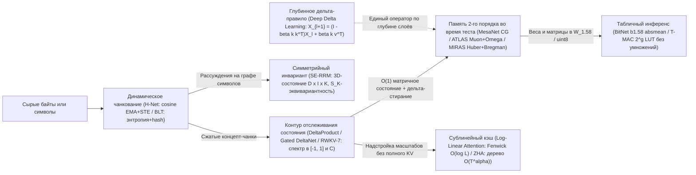

**Вердикт:** субквадратичная память со строго постоянным объёмом $O(1)$ физически преодолевает барьер класса $\mathsf{TC}^0$ и отслеживает неабелевы перестановки $S_5$ лишь тогда, когда спектр матрицы перехода $\mathbf{A}_t$ выходит на отрицательную полуось $[-1, 1]$ или в комплексную область через произведения обобщённых отражений Хаусхолдера (`DeltaProduct`, `RWKV-7`, `DDL`), а принудительная защита от деградации на длинных дистракторах требует не одиночного затухания, а совокупности четырёх механизмов: быстрого глобального забывания поверх точечного стирания (`Gated DeltaNet`), локально-оптимальной оптимизации второго порядка (`MesaNet` CG, `ATLAS` Newton–Schulz / Omega-правило), устойчивых к выбросам функций потерь и дивергенций (`MIRAS`: Huber, $\ell_p/\ell_q$, KL) и логарифмической иерархии корзин $O(\log L)$ (`Log-Linear Attention`) либо иерархического байтового чанкования без фиксированного BPE (`H-Net`, `BLT`).

Отчёт подготовлен по первоисточникам: трём локальным PDF и пятнадцати статьям arXiv (2024–2026) с проверкой формул, теорем, спектров и таблиц метрик. Все ссылки на локальные документы и первоисточники приведены с явными статусами `[VERIFIED: ...]` и `[UNKNOWN]`.

---

## Содержание
1. [Таксономия пост-трансформерных механизмов состояния, памяти и чанкования](#1-таксономия-пост-трансформерных-механизмов-состояния-памяти-и-чанкования)
2. [Локальные первоисточники: глубина, иерархический кэш и скейлинг при повторе данных](#2-локальные-первоисточники-глубина-иерархический-кэш-и-скейлинг-при-повторе-данных)
3. [Кластер 1: Субквадратичное отслеживание состояния ($\mathsf{NC}^1$ против $\mathsf{TC}^0$, неабелевы группы и $S_n$)](#3-кластер-1-субквадратичное-отслеживание-состояния-nc1-против-tc0-неабелевы-группы-и-sn)
4. [Кластер 2: Память второго порядка во время теста (TTT) и иерархия масштабов $O(1)$ против $O(\log L)$ и $O(L^\alpha)$](#4-кластер-2-память-второго-порядка-во-время-теста-ttt-и-иерархия-масштабов-o1-против-olog-l-и-olalpha)
5. [Кластер 3: Динамическое чанкование без BPE и табличный 1.58-bit/2-bit инференс](#5-кластер-3-динамическое-чанкование-без-bpe-и-табличный-158-bit2-bit-инференс)
6. [Сводные сравнительные матрицы: формулы, спектры, $O(1)$ против $O(\log L)$, сложность на токен и защита от дистракторов](#6-сводные-сравнительные-матрицы)
7. [Открытые пробелы первоисточников (`UNKNOWN`) и инженерные выводы для синтеза архитектуры](#7-открытые-пробелы-первоисточников-unknown-и-инженерные-выводы-для-синтеза-архитектуры)

---

## 1. Таксономия пост-трансформерных механизмов состояния, памяти и чанкования

Классические диагональные SSM и линейное внимание с неотрицательными затворами ($\lambda \in [0, 1]$) заперты внутри класса $\mathsf{TC}^0$: они проваливают даже чётность (`PARITY`) и модульный счёт, пока не расширят спектр переходов на отрицательные и комплексные числа (`arXiv:2411.12537`, Thm 1–2). Над этой алгебраической базой развиваются четыре дополняющих контура: глубина по остаточному потоку (`DDL`), онлайн-оптимизация второго порядка на окне или всём префиксе (`MesaNet`, `Titans`, `MIRAS`, `ATLAS`), многомасштабная агрегация префиксов (`Log-Linear Attention`, `ZHA`) и бестокенизаторная компрессия + LUT-арифметика (`H-Net`, `BLT`, `BitNet b1.58`, `T-MAC`).

---

## 2. Локальные первоисточники: глубина, иерархический кэш и скейлинг при повторе данных

### 2.1 Deep Delta Learning (DDL)
*Первоисточник:* Yifan Zhang, Yifeng Liu, Mengdi Wang, Quanquan Gu — *Deep Delta Learning* (`arXiv:2601.00417v5`, 25 Sep 2026) — [Deep Delta Learning.pdf](file:///e:/эксперименты/Новая%20нейронка/Deep%20Delta%20Learning.pdf).

Вместо аддитивного остаточного соединения $\mathbf{X}_{l+1} = \mathbf{X}_l + \mathbf{F}_l(\mathbf{X}_l)$ или рекуррентного дельта-правила вдоль времени $t$, `DDL` переносит обобщённый оператор Хаусхолдера вдоль **глубины слоёв** $l$ над матричным скрытым состоянием $\mathbf{X}_l \in \mathbb{R}^{d \times d_v}$ (либо тензором $B \times T \times d \times d_v$, где $d_v = 1$ даёт стандартный векторный поток, а $d_v = 4$ расширяет его до «пространства значений») `[VERIFIED: Deep Delta Learning.pdf / Sec. 2.1, 3.1, pp. 3, 5]`:

$$\mathbf{X}_{l+1} = \mathbf{A}_l \mathbf{X}_l + \beta_l \mathbf{k}_l \mathbf{v}_l^\top = \mathbf{X}_l + \beta_l \mathbf{k}_l \left(\mathbf{v}_l^\top - \mathbf{k}_l^\top \mathbf{X}_l\right), \quad \mathbf{A}_l = \mathbf{I} - \beta_l \mathbf{k}_l \mathbf{k}_l^\top \qquad [\text{VERIFIED: Eq. 2.1–2.2, p. 3}]$$

где направление отражения $\mathbf{k}_l = \widetilde{\mathbf{k}}_l / \|\widetilde{\mathbf{k}}_l\|_2$ получается нормировкой выхода базового подслоя $\widetilde{\mathbf{k}}_l = \mathbf{F}_l(\mathbf{c}_l)$ (в низкой точности используется RMSNorm $\widehat{\mathbf{k}}_l = \operatorname{RMSNorm}(\widetilde{\mathbf{k}}_l; \epsilon_k^2/d)$, $\mathbf{k}_l = \widehat{\mathbf{k}}_l/\sqrt{d}$ с $\epsilon_k=10^{-5}$ `[VERIFIED: pp. 5, 16]`), целевое значение задаётся веткой $\mathbf{v}_l = 4\sigma(\mathbf{W}_{v,l}\mathbf{x}_l^{\text{in}} + \mathbf{b}_{v,l}) \in (0, 4)^{d_v}$ (или более глубоким проектором), а размер шага $\beta_l = 2\sigma(\mathbf{W}_{\beta,l}\mathbf{c}_l + b_{\beta,l}) \in (0, 2)$ с инициализацией $b_{\beta,l}=0$ (что даёт $\beta_l \approx 1$ на старте). Эти две ветки добавляют ровно $(d_v + 1)(d + 1)$ параметров на подслой `[VERIFIED: Sec. 3.1, p. 5]`.

**Ключевые теоретические свойства и спектр:**
- **Proposition 2.1 (Frozen Shortcut Spectrum):** для $\mathbf{A} = \mathbf{I} - \beta \mathbf{k}\mathbf{k}^\top$ ($\|\mathbf{k}\|_2=1$, $\beta \neq 0$) собственное число $1$ имеет кратность $d-1$ на ортогональном дополнении $\mathbf{k}^\perp$, а вдоль направления $\mathbf{k}$ лежит единственное неединичное собственное число $1 - \beta \in (-1, 1)$ кратностью $1$; определитель $\det \mathbf{A} = 1 - \beta$, а векторизованный переход над $d_v$ столбцами задаётся Кронекеровым произведением $\mathbf{I}_{d_v} \otimes \mathbf{A}$ `[VERIFIED: Deep Delta Learning.pdf / Prop. 2.1, p. 4]`.
  - При $\beta \to 0$: $\mathbf{A} \to \mathbf{I}$ (чистый ResNet skip);
  - При $\beta = 1$: $\mathbf{A} = \mathbf{I} - \mathbf{k}\mathbf{k}^\top$ (ортогональный проектор на $\mathbf{k}^\perp$: старая компонента вдоль $\mathbf{k}$ полностью стирается и заменяется на $\mathbf{v}_l^\top$);
  - При $\beta \to 2$: $\mathbf{A} \to \mathbf{I} - 2\mathbf{k}\mathbf{k}^\top$ (классическое унитарное отражение Хаусхолдера с $\det \mathbf{A} = -1$ и $\lambda = -1$, способное поворачивать знак/ориентацию признаков без потери нормы) `[VERIFIED: Sec. 2.2, Prop. 2.1, pp. 4–5]`.
- **Точечное стирание ошибки по глубине:** условно на $(\mathbf{k}_l, \mathbf{v}_l, \beta_l)$ проекционная ошибка $\mathbf{e}_l^{\text{pre}} = \mathbf{k}_l^\top \mathbf{X}_l - \mathbf{v}_l^\top$ сжимается строго в $\mathbf{e}_l^{\text{post}} = (1 - \beta_l)\mathbf{e}_l^{\text{pre}}$ `[VERIFIED: Sec. 2.1, p. 3]`. Авторы прямо сопоставляют (2.1) с временным DeltaNet Eq. (2.3) $\mathbf{S}_t = (\mathbf{I}-\beta_t\mathbf{k}_t\mathbf{k}_t^\top)\mathbf{S}_{t-1} + \beta_t\mathbf{k}_t\mathbf{v}_t^\top$ (`Sec. 2.4`).
- **Compress–Process–Rewrite (Sec. 3.2, pp. 5–6):** перед входом добавляется Embedding Conv (`EC`, ядро $k_e = 4$); `DDL-TC` (token+channel compressor) требует $O(k d d_v)$ вычислений и хранит $k-1$ предыдущих состояний + $k_e-1$ эмбеддингов, тогда как `DDL-CC` (channel compressor) работает за $O(d d_v)$ на токен без истории предыдущих токенов `[VERIFIED: pp. 5–6]`.

**Эмпирика на FineWeb-Edu (49.15B токенов, 4×H200, Tables 3, 6, 7, 8, p. 10):**
- *GPT-2 Small (123.6M):* Val loss / PPL у Baseline `2.8543 / 17.3616` (`2.94 GB`, `1509.6K tok/s`), `DDL (d_v=1)` даёт `2.8482 / 17.2562` (`1.00×` памяти, `1330.8K tok/s`), `DDL-CC` — `2.8329 / 16.9947` (`1.05×` памяти, `1158.0K tok/s`, 1-shot avg `49.29` против `48.56`), `DDL-TC` — `2.8299 / 16.9438` (`1.15×` памяти, 1-shot avg `49.47`) `[VERIFIED: Tables 6–7, p. 10]`.
- *GPT-2 Medium (353.5M):* Val loss / PPL у Baseline `2.6053 / 13.5356` (`7.06 GB`, `537.1K tok/s`, 1-shot avg `53.96`), `DDL (d_v=1)` — `2.6039 / 13.5161` (1-shot `54.69`), `DDL-CC` — `2.5758 / 13.1420` (`7.20 GB` = `1.02×` памяти, `422.3K tok/s`, 1-shot avg `55.14`, $+1.18$ п.) `[VERIFIED: Tables 3, 6, 8, p. 10]`.
- *Оговорка авторов (`Sec. 4.2, 6`):* прогоны одиночные (без усреднения по сидам), не выровнены строго по iso-FLOPs, и эксперимент **не изолирует** вклад термина стирания $-\beta_l \mathbf{k}_l \mathbf{k}_l^\top \mathbf{X}_l$ от увеличения ёмкости только за счёт записи `[VERIFIED: Sec. 4.2, 6]` — конкретный раздельный вклад стирания против write-only в статье `[UNKNOWN]`.

---

### 2.2 Zyphra Hierarchical Attention (ZHA): $O(T^\alpha)$ иерархический KV-поиск
*Первоисточник:* Leon Lufkin\*, Cutter Dawes\*, Alexander Speicher, Kamesh Krishnamurthy, Tomás Figliolia, Beren Millidge — *Subquadratic Attention with a Hierarchical Tree-Structured Indexer* (`arXiv:2610.42112v2`, 2 Nov 2026) — [Subquadratic Attention with a Hierarchical.pdf](file:///C:/Users/vanya/Downloads/Subquadratic%20Attention%20with%20a%20Hierarchical.pdf).

В отличие от линейных RNN с $O(1)$ памятью, `ZHA` показывает фундаментальную границу *безвозвратного вытеснения* KV-кэша: доля ключей, покрывающих массу внимания $\ge p$ для **одного** запроса, растёт сублинейно (степенной закон $T^\alpha$ на Qwen3.6-35B-A3B с partial RoPE, Fig. 1 p. 2; на NoPE Nemotron-3.5 эффект слабее и искривлён, Fig. 12 p. 19), а **объединение** $U_p(W)$ нужных ключей над будущим окном из $W$ запросов быстро сходится к **100% всего KV-кэша** `[VERIFIED: ZHA PDF / Sec. II, Fig. 1–2, pp. 2–3]`. Следовательно, сжимать/выбрасывать KV необратимо нельзя — нужно хранить полный кэш на дешёвой памяти, но **адресовать** его в рантайме иерархическим деревом за сублинейное время $O(T^\alpha)$.

**Механика дерева касательных (Sec. III.A–C, pp. 4–6):**
1. KV-кэш разбивается на дерево чанков размера $C$ и глубины $L$ ($R$ общих обучаемых референсных запросов $\hat{q}_r$ на каждую KV-группу).
2. Значение функции агрегации чанка $F_C(q) := \operatorname{LSE}_{j\in[C]}(q^\top k_j / \sqrt{d})$ аппроксимируется максимумом линейных касательных первого порядка вокруг $\hat{q}_r$:
   $$t_r(q) = \frac{q^\top \hat{k}_r}{\sqrt{d}} + \hat{b}_r, \qquad \hat{k}_r = \operatorname{Attn}(\hat{q}_r, K_C, K_C), \qquad \hat{b}_r = F_C(\hat{q}_r) - \frac{\hat{q}_r^\top \hat{k}_r}{\sqrt{d}} \qquad [\text{VERIFIED: ZHA PDF / Sec. III.A, p. 4}]$$
   При слиянии дочерних узлов в родительский при наличии RoPE вводится явная коррекция угла поворота $\frac{1}{\sqrt{d}}\langle \hat{k}_{r,c}, \hat{q}_{r,P} - \hat{q}_{r,c}\rangle$ `[VERIFIED: Sec. III.A, p. 5]`.
3. **Дистилляция с замороженным бэкбоном (Sec. III.B, App. B-A, pp. 5, 19):** веса Qwen3.6-35B-A3B (`34.66B`) полностью замораживаются; обучаются **только** $81,920$ параметров $\hat{q}_r$ (`0.00024%` модели) за 1,900 шагов (`0.996B` $\approx 1\text{B}$ токенов на длине 32K) минимизацией послойного $D_{\text{KL}}$ распределений внимания $\mathcal{L}_{\text{KL}} = \sum_{\ell=1}^L \mathbb{E}_q[D_{\text{KL}}(p_\ell(q) \| \hat{p}_\ell(q))]$.
4. **Адаптивный top-$p$ роутинг и закон скейлинга (Sec. III.C, IV–V, pp. 6–10):** на каждом уровне $\ell = L\dots 2$ оставляется минимальный префикс узлов, дающий массу $\ge p$ (ключ 0 — attention sink — и текущий чанк $C_{\text{cur}}(q)$ удерживаются принудительно). Число открытых ключей на уровне $\ell$ масштабируется степенным законом:
   $$\hat{S}_\ell(T) = c_\ell T^{\alpha_\ell}, \qquad \hat{\alpha}_\ell = \prod_{k=\ell}^L \beta_k, \qquad \beta_\ell = \beta + 2\varepsilon(1 - 2^{-(L-\ell)}) \qquad [\text{VERIFIED: Eqs. 6–7, pp. 9–10}]$$
   где линейная аппроксимация сверху имеет вид $\hat{\beta}_{\text{lin}}(L,p) = 0.3429 + 0.4129p + [0.007697 + 0.03518p]L$ `[VERIFIED: Eq. 8 p. 10, Eq. 58 p. 34]`.

**Эмпирика на Qwen3.6-35B-A3B (`p=0.95, R=16`, Sec. IV–V, Figs. 5, 13, 20, pp. 6–8, 21, 25):**
- Dense vs Deep (`C4 L6`) vs Wide (`C256 L1`) vs MSA (обучен 40B токенов, top-16×128):
  - **AIME 2026:** `93.1 / 91.2 / 90.8 / 89.6`;
  - **SWE-bench Verified:** `67.4 / 67.4 / 68.4 / 65.6`;
  - **RULER-13 (256K):** `96.0 / 93.3` (при всего `2.8%` ключей!) `/ 96.2` (`42%` ключей) `/ 77.1`;
  - **LongBench v2:** `58.0 / 63.4` (`1.1%` ключей) `/ 62.4` (`21%` ключей) `/ 50.7`.
- На Парето-фронте RULER 256K `R16 C4 L2 (p=0.7)` набирает `95.8%` при `0.38%` ключей; `R4 C16 L1` — `96.4%` при `1.93×` модельного ускорения декодинга; `R1 C8 L2` — `92.7%` при `2.28×` `[VERIFIED: Fig. 20, p. 25]`.
- *Ограничения и `UNKNOWN`:* в `Sec. VII` (p. 13) указано, что фиксированный порог $p<1$ на $L$ уровнях даёт затухающее эффективное покрытие $p_{\text{eff}} = p^L \to 0$, если $p$ не увеличивать с глубиной. Модельный roofline (`App. D`, Eqs. 21–43) обещает точку перегиба быстрее Dense от `~48K` (L1) и быстрее MSA от `~0.48M` (L2), достигая `373–417×` над Dense и `52–58×` над MSA при $T=10^9$ (`R1 C8 p=0.75`, L5, Fig. 8 p. 10), но реальная точность и латентность `ZHA` **за пределами 256K эмпирически не измерены** `[UNKNOWN beyond 256K]`.

---

### 2.3 Улучшение data-constrained скейлинга через HP-перенос, ансамбли и Value-LUT
*Первоисточник:* Ethan Baron, Shmuel Berman, Anirudh Satheesh, Akshay Vegesna, Samip Dahal, Andrew Gordon Wilson — *Improving Data-Constrained Scaling with Hyperparameter Transfer and Ensembling* (`arXiv:2610.37842v1`, 27 Oct 2026) — [IMPROVING DATA-CONSTRAINED SCALING WITH.pdf](file:///C:/Users/vanya/Downloads/IMPROVING%20DATA-CONSTRAINED%20SCALING%20WITH.pdf).

При обучении на ограниченном уникальном корпусе $U$ (с $R$ повторами эпох и $N$ параметрами) наивные рецепты с фиксированным LR $\eta$ и weight decay $\lambda$ (Lovelace et al. 2026, Eq. 2: $L(U,N,R) = E + A/N^\alpha + B/(UR)^\beta + P(R-1)^\delta(N/U^\gamma)^\kappa$) приводят к немонотонной патологии: оптимальные по FLOPs потери начинают **расти** после $10^{18}$–$10^{19}$ FLOPs из-за переобучения под повторы `[VERIFIED: PDF Figs. 1, 6, pp. 2, 11]`.

**Ключевые результаты и архитектурная деталь из Приложения B.1:**
- **Архитектура со встроенными Value-LUT (App. B.1, p. 15):** декодерный Трансформер (на базе Slowrun) добавляет **обучаемые таблицы поиска значений (value lookup-tables)** к каждому второму слою ($\lceil d/2\rceil$ таблиц): разреженный lookup прибавляется к вектору values и обновляется/регуляризуется вместе с AdamW + Muon; выходные логиты масштабируются как $15\tanh(\dots \cdot 384/d_{\text{model}})$ `[VERIFIED: App. B.1, p. 15]`.
- **Степенной перенос гиперпараметров по 110 точкам $(U,N,R)$ (Sec. 4.1, p. 5):**
  $$\text{eLR}^* = \eta\lambda^* = 3.95\times 10^4\, U^{-1.014}\, N^{0.273}\, R^{0.120}, \qquad \lambda^* = 1.08\times 10^2\, U^{-0.870}\, N^{0.398}\, R^{0.660} \qquad [\text{VERIFIED: Sec. 4.1, p. 5}]$$
  С ростом эпох повтора $R$ оптимальный weight decay $\lambda^*$ растёт сублинейно как $R^{0.660}$, сглаживая запоминание повторяющихся примеров.
- **Закон скейлинга ансамблей и snapshot-циклов (Eq. 3, p. 7):** для ансамбля из $M$ моделей:
  $$L(U,N,R,M) = E + \frac{A}{N^\alpha} + \frac{B}{(UR)^\beta} + P(R-1)^\delta\left(\frac{N}{U^\gamma}\right)^\kappa - F\,N^{-\nu}U^{-\epsilon}R^{-\rho}\left(1 - \frac{1}{M}\right)^\mu \qquad [\text{VERIFIED: Eq. 3, p. 7}]$$
  с параметрами подгонки $E=2.18, A=165, \alpha=0.298, B=1759, \beta=0.408, P=117, \delta=0.0791, \kappa=0.162, \gamma=3.04, F=192, \mu=1.12, \nu=0.224, \epsilon=0.137, \rho=0.263$ `[VERIFIED: p. 7]`.
- На $U=100\text{M}$ токенов FineWeb метод снижает val loss на $>0.15$ нат относительно рецепта Lovelace (`3.35` $\to$ `3.27` при $10^{19}$ FLOPs = $-8\%$ PPL; `<3.20` при $10^{20}$ FLOPs = $-14\%$ PPL), экстраполировано при $12\times$ бюджете свипа `[VERIFIED: pp. 1–2, 9]`.

---

## 3. Кластер 1: Субквадратичное отслеживание состояния ($\mathsf{NC}^1$ против $\mathsf{TC}^0$, неабелевы группы и $S_n$)

### 3.1 Алгебраический прорыв: почему $\lambda \in [0, 1]$ застревает в $\mathsf{TC}^0$
*Первоисточник:* Riccardo Grazzi, Julien Siems, Arber Zela, Jörg K. H. Franke, Frank Hutter, Massimiliano Pontil — *Unlocking State-Tracking in Linear RNNs Through Negative Eigenvalues* (`arXiv:2411.12537v5`, 18 Mar 2025).

Линейная рекуррентная сеть (LRNN) задаётся переходом $\mathbf{H}_i = \mathbf{A}(\mathbf{x}_i)\mathbf{H}_{i-1} + \mathbf{B}(\mathbf{x}_i)$ (`Eq. 1`). В базовых версиях Mamba ($\mathbf{A}=\mathrm{Diag}(\exp(-\mathbf{\Delta}_t \odot \exp(\mathbf{w}_{1,i})))$), GLA ($\mathrm{Diag}(\mathbf{\alpha}_t)$) и стандартного DeltaNet ($\mathbf{I}-\beta_t\mathbf{k}_t\mathbf{k}_t^\top$ при $\beta_t \in [0,1]$) все собственные числа матриц перехода $\mathbf{A}(\mathbf{x}_i)$ лежат строго на неотрицательном отрезке $[0, 1]$ `[VERIFIED: 2411.12537 / Sec. 3.1, Table 1]`.

- **Теорема 1 (`PARITY`):** никакая LRNN конечной точности (при любом числе слоёв) не способна распознавать регулярный язык чётности $(11)^*$ на произвольной длине последовательности, если хотя бы в одном слое матрицы $\mathbf{A}(\mathbf{x})$ не обладают собственными числами $\lambda \notin \mathbb{R}_{\ge 0}$ `[VERIFIED: 2411.12537 / Sec. 4.1, Thm 1]`.
- **Теорема 2 (Модульный счёт $\bmod\, m$, $m \ne 2^k$):** чтобы $L$-слойная LRNN конечной точности могла считать по модулю $m \ne 2^k$ (например, $\bmod\, 3$), необходимо существование длины $2^{i-1}$ произведения матриц $\mathbf{A}(\mathbf{x}_1)\cdots\mathbf{A}(\mathbf{x}_{2^{i-1}})$, обладающего **недействительным (комплексным)** собственным числом $\lambda \notin \mathbb{R}$. Диагональные и треугольные матрицы над $\mathbb{R}$ с любыми вещественными знаками здесь математически бессильны `[VERIFIED: 2411.12537 / Sec. 4.1, Thm 2]`.
- **Расширение спектра до $[-1, 1]$ (`Eq. 2–3`, Prop. 1, Thm. 3–4):**
  $$\mathbf{A}_{\text{diag}}^-(\mathbf{x}) := \mathrm{Diag}(2\mathbf{s}(\mathbf{x})-1), \qquad \mathbf{A}_{\text{GH}}^-(\mathbf{x}) := \mathbf{I} - 2\phi(\mathbf{x})\mathbf{v}(\mathbf{x})\mathbf{v}(\mathbf{x})^\top \qquad [\text{VERIFIED: 2411.12537 / Eq. 2}]$$
  Обозначим $\mathcal{M}_k^n(\Omega)$ множество произведений $k$ обобщённых матриц Хаусхолдера (GH) размера $n\times n$ с $(1-\beta_i) \in \Omega$. При $\Omega \subseteq [-1, 1]$ выполнено $\|\mathbf{N}\|_2 \le 1$ (гарантия устойчивости при любой длине!); любая матрица с $\|\mathbf{M}\|_2 \le 1$ лежит в $\mathcal{M}_{3n}^n([-1,1])$, любая ортогональная — в $\mathcal{M}_n^n(\{-1,1\})$, любая перестановка — в $\mathcal{M}_{n-1}^n(\{-1,1\})$ `[VERIFIED: Prop. 1]`. При $\Omega=[0,1]$ и $k \le 2$ все собственные числа остаются действительными в $[0,1]$ (`PARITY` недоступен). По **Теореме 3**, любой групповой автомат вкладывается в 1 слой $\mathcal{M}_{k-1}^n(\{-1,1\})$ (циклическая группа $\mathbb{Z}_m$ требует лишь $n=k=2$ вращений $\mathcal{M}_2^2([-1,1])$); по **Теореме 4**, через каскадную декомпозицию Крона–Роудса LRNN конечной точности с произведениями GH $\mathcal{M}_n^n([-1,1])$ (и линейным декодером, при числе слоёв $s \le 2^{|Q|}$) распознаёт **любой регулярный язык** `[VERIFIED: Sec. 4.3, Thm 3–4]`.

---

### 3.2 DeltaProduct: произведения Хаусхолдера за шаг токена
*Первоисточник:* Julien Siems, Timur Carstensen, Arber Zela, Frank Hutter, Massimiliano Pontil, Riccardo Grazzi — *DeltaProduct: Improving State-Tracking in Linear RNNs via Householder Products* (`arXiv:2502.10297v7`, 22 Oct 2025).

Для одного токена $\mathbf{x}_i$ выполняется $n_h \ge 1$ шагов градиентного спуска по виртуальной микро-последовательности ключей и значений $\mathcal{L}_{i,j}(\mathbf{H}) = \frac{1}{2}\|\mathbf{H}^\top \mathbf{k}_{i,j} - \mathbf{v}_{i,j}\|_2^2$ с $\|\mathbf{k}_{i,j}\|_2 = 1$ и $\beta_{i,j} = 2\sigma(\dots) \in [0, 2]$ `[VERIFIED: 2502.10297 / Sec. 4, Eq. 3]`:

$$\mathbf{A}(\mathbf{x}_i) = g_i^{\text{opt}} \prod_{j=1}^{n_h} \left(\mathbf{I} - \beta_{i,j} \mathbf{k}_{i,j}\mathbf{k}_{i,j}^\top\right), \qquad \mathbf{B}(\mathbf{x}_i) = \sum_{j=1}^{n_h} \beta_{i,j} \left(\prod_{l=j+1}^{n_h} \left(\mathbf{I} - \beta_{i,l}\mathbf{k}_{i,l}\mathbf{k}_{i,l}^\top\right)\right) \mathbf{k}_{i,j} \mathbf{v}_{i,j}^\top \qquad [\text{VERIFIED: Sec. 4, Eq. 3}]$$

где $g_i^{\text{opt}} \in (0,1]$ — опциональный скалярный затвор забывания (`Gated DeltaProduct`), дающий обновление $\mathbf{I}$ ранга не выше $n_h$ при спектральной норме $\|\mathbf{A}(\mathbf{x}_i)\|_2 \le 1$ `[VERIFIED: Sec. 4, Eq. 3]`.

**Спектральный анализ (`Appendix A, Prop. 1`):**
1. *Коллинеарные ключи ($\mathbf{k}_j = \mathbf{k}$):* произведение схлопывается к одному отражению $\mathbf{I} - \beta^*\mathbf{k}\mathbf{k}^\top$ с действительным спектром;
2. *Ортонормированные ключи ($\mathbf{k}_j^\top \mathbf{k}_l = \delta_{jl}$):* множители коммутируют, $\mathbf{A} = \mathbf{I} - \sum_{j=1}^{n_h} \beta_j \mathbf{k}_j\mathbf{k}_j^\top$ симметрична с чисто действительным спектром $\{1-\beta_1,\dots,1-\beta_{n_h}\}\cup\{1\}^{(n-n_h)}$ (блочный рефлектор при $\beta_j=2$);
3. *Неортогональные, но линейно независимые ключи ($0 < |\mathbf{k}_1^\top \mathbf{k}_2| < 1$):* $\mathbf{A}$ становится **несимметричной** и порождает **комплексные сопряжённые пары собственных чисел**, как только $\beta_1, \beta_2 > \beta^*(\theta) < 2$ (наоборот, при $0 \le \beta_1 \le 1$ или $0 \le \beta_2 \le 1$ спектр в 2D-подпространстве остаётся действительным) `[VERIFIED: App. A, Prop. 1.1–1.3]`.

**Теоретическая выразительность (`Sec. 4, Thm. 1–2, Table 1`):**
- **Теорема 1 ($S_n$ word problem — выход за пределы $\mathsf{TC}^0$ при $n \ge 5$):** перестановки $S_n$ в конечной точности решаются через: (i) **1 слой** при $n_h = n-1$ (любой $n$-перестановочный автомат без промежуточного MLP!), (ii) **3 слоя** при $n_h > 1$ с табличным MLP размера $2m\times(n!)^{2m}$ где $m=\lceil(n-1)/n_h\rceil$, или (iii) **4 слоя** при $n_h = 1$ (DeltaNet).
- **Теорема 2:** `Gated DeltaProduct` ($n_h \ge 1$) распознаёт **любой регулярный язык** за конечное число слоёв $f(|Q|)$ через декомпозицию Крона–Роудса `[VERIFIED: Thm. 1–2, Table 1]`.
- **Эмпирика (`Sec. 5.1–5.3, Tables 3–5`):** реализован через Triton chunkwise-ядро длиной $n_h \times T$. На группах $S_3, S_4, A_5, S_5$ (обучение на длине 128, тест на 512) вариант $[0,1]$ проваливается на любой глубине и $n_h$; вариант $[-1,1]$ решает $S_3$ в 1 слое при $n_h=2$ (DeltaNet $n_h=1$ требовал 3 слоя), $S_5$ в 1 слое при $n_h=4$, а $S_4$ и $A_5$ эмпирически при $n_h=2$. На языке (FineWeb, 805M params, 55B tokens, Table 3, head-dim scaling): `DeltaNet [-1,1]` даёт Wiki PPL `20.81` / LMB PPL `20.57` / Avg `48.55`, тогда как `DeltaProduct_3 [-1,1]` улучшает до `20.01` / `15.56` / `49.95` и резко стабилизирует экстраполяцию длины с 4,096 токенов вверх (эффективный ранг состояния в слое 20/24 быстро очищается между парами QA при $n_h=3$) `[VERIFIED: Sec. 5.2–5.3, Table 3]`.

---

### 3.3 Gated DeltaNet
*Первоисточник:* Songlin Yang, Jan Kautz, Ali Hatamizadeh — *Gated Delta Networks: Improving Mamba2 with Delta Rule* (`arXiv:2412.06464v3`, 6 Mar 2025).

Mamba2 обладает быстрым **глобальным затвором забывания** $\alpha_t \mathbf{S}_{t-1}$, способным мгновенно очищать память при смене контекста, но лишён точечного стирания и терпит коллапс ключей на длинных текстах (`S-NIAH-1`: падение с `99.2%` до `30.4%` на 8K). Напротив, DeltaNet точечно замещает старую ассоциацию вдоль $\mathbf{k}_t$, но не умеет быстро сбрасывать устаревший мусор. `Gated DeltaNet` объединяет оба механизма в едином шаге онлайн-оптимизации $\|\mathbf{S}_t - \alpha_t\mathbf{S}_{t-1}\|_F^2 - 2\langle \mathbf{S}_t \mathbf{k}_t, \beta_t(\mathbf{v}_t - \alpha_t \mathbf{S}_{t-1}\mathbf{k}_t)\rangle$ `[VERIFIED: 2412.06464 / Sec. 3.1, Eq. 10, Table 1]`:

$$\mathbf{S}_t = \mathbf{S}_{t-1}\left(\alpha_t\left(\mathbf{I} - \beta_t \mathbf{k}_t \mathbf{k}_t^\top\right)\right) + \beta_t \mathbf{v}_t \mathbf{k}_t^\top, \qquad \alpha_t \in (0, 1) \qquad [\text{VERIFIED: Sec. 3.1, Eq. 10}]$$

- **Спектр:** $\mathbf{A}_t = \alpha_t(\mathbf{I}-\beta_t \mathbf{k}_t\mathbf{k}_t^\top)$ имеет собственные числа $\alpha_t$ (кратность $d-1$) и $\alpha_t(1-\beta_t)$ (кратность $1$), сжатые в круг радиуса $\alpha_t < 1$ `[INFERRED из Eq. 10; в статье явно зафиксировано сжатие скалярного забывания поверх дельта-матрицы]`.
- **Параллельная WY-форма (`Sec. 3.3`):** для быстрой параллелизации на GPU в пределах чанка решается строго нижнетреугольная система $\widetilde{\mathbf{U}}_{[t]} = \left[\mathbf{I} + \operatorname{strictLower}\left(\operatorname{diag}(\beta_{[t]})\left(\Gamma_{[t]} \odot \mathbf{K}_{[t]}\mathbf{K}_{[t]}^\top\right)\right)\right]^{-1}\operatorname{diag}(\beta_{[t]})\mathbf{V}_{[t]}$ `[VERIFIED: Sec. 3.3]`.
- **Эмпирика (`Table 2`, 1.3B, длины 1K / 2K / 4K / 8K):**
  - *S-NIAH-2:* DeltaNet `98.4 / 45.6 / 18.6 / 14.4`, Mamba2 `99.4 / 98.8 / 56.2 / 17.0`, **Gated DeltaNet** `100.0 / 99.8 / 92.2 / 29.6`;
  - *S-NIAH-3 (1K / 2K / 4K):* DeltaNet `85.2 / 47.0 / 22.4`, Mamba2 `64.4 / 47.6 / 4.6`, **Gated DeltaNet** `86.6 / 84.2 / 27.6`.
  Также предложены гибриды `H1` (Gated DeltaNet + SWA) и `H2` (Mamba2 + Gated DeltaNet + SWA) `[VERIFIED: Sec. 3.3, Table 2]`.

---

### 3.4 RWKV-7 «Goose»
*Первоисточник:* Bo Peng, Ruichong Zhang, Daniel Goldstein, Eric Alcaide, Xingjian Du, Haowen Hou, Jiaju Lin, Jiaxing Liu, Janna Lu, William Merrill, Guangyu Song, Kaifeng Tan, Saiteja Utpala, Nathan Wilce, Johan S. Wind, Tianyi Wu, Daniel Wuttke, Christian Zhou-Zheng — *RWKV-7 "Goose" with Expressive Dynamic State Evolution* (`arXiv:2503.14456v2`, 30 Mar 2025).

`RWKV-7` формулирует векторнозначное обобщённое дельта-правило (Dynamic State Evolution), **разделяя ключ удаления $\kappa_t$ и ключ записи $\tilde{k}_t$** и добавляя покоординатный вектор затухания $w_t$ и векторный ICLR $a_t$ `[VERIFIED: 2503.14456 / Sec. 4.1, Eqs. 3–21]`:

$$\mathbf{wkv}_t = \mathbf{wkv}_{t-1}\left(\mathrm{diag}(w_t) - \hat{\kappa}_t^\top (a_t \odot \hat{\kappa}_t)\right) + v_t^\top \tilde{k}_t \qquad [\text{VERIFIED: Eq. 17; матрица } G_t \text{ в Eq. 19}]$$

где $\hat{\kappa}_t = \kappa_t / \|\kappa_t\|_2$, $\kappa_t = k_t \odot \xi$, $\tilde{k}_t = k_t \odot \mathrm{lerp}(1, a_t, \alpha)$, $w_t = \exp(-e^{-0.5}\sigma(d_t)) \in (u, 1)$ с $u = \exp(-e^{-1/2}) \approx 0.5452$, $a_t \in (0, 1)$, прямой токен-бонус $u_t = (r_t \cdot (\rho \odot \tilde{k}_t)^\top) v_t$, выход $p_t = \operatorname{LayerNorm}(r_t\mathbf{wkv}_t^\top) + u_t$ и финальная выходная проекция $o_t = (g_t \odot p_t)\mathbf{W}_o$ `[VERIFIED: Sec. 4.1, Eqs. 4–22, App. C]`.

**Спектральная теорема и сравнение с `DeltaProduct`:**
- **Теорема 1 (`Appendix C`):** пусть $A = \mathrm{diag}(w) - c\hat{\kappa}^\top(a \odot \hat{\kappa})$ (в языковой модели $c=1$, в доказательстве выразительности $c=2$). Для любого $c \in (0, 1 + u)$ матрица $A$ подобна симметричной $B = \mathrm{diag}(a)^{1/2} A \mathrm{diag}(a)^{-1/2}$; следовательно, **все её собственные числа вещественны и лежат строго в $(-1, 1)$**, а по закону инерции Сильвестра **отрицательным может быть не более одного собственного числа** `[VERIFIED: App. C, Thm 1]`.
- **Теоремы 2–3 (`Appendix D.1–D.2`):** при $c=2$ (`Lemma 1`, $w=1, \hat{\kappa}=(e_x-e_y)/\sqrt{2}, a=1$) `RWKV-7` строит произвольную матрицу обмена двух элементов и решает 5-элементную перестановку $S_5$ ($\mathsf{NC}^1$-полную относительно $\mathsf{AC}^0$, вне $\mathsf{TC}^0$) в **1 слое** (5 голов размерности 5). По **Теореме 3**, 4-слойный `RWKV-7` распознаёт **любой регулярный язык** `[VERIFIED: App. D, Thm 2–3]`.
- **Критический инженерный нюанс (`DeltaProduct` Table 1 & Remark 1):** конструкция `Thm 3` в `RWKV-7` опирается на ненормированные *матрицы копирования* со спектральной нормой $\|\mathbf{A}\|_2 = \sqrt{2} > 1$, что в произвольной глубине/длине несёт риск расходимости по норме, тогда как `Gated DeltaProduct` сохраняет $\|\mathbf{A}\|_2 \le 1$ строго `[VERIFIED: 2502.10297 / Sec. 4, Table 1 & Remark 1]`.
- **Производительность на H100 (`Sec. 8`, `B=8, D=4096, 64 heads × 64, L=16k`):** `fwd w/o state = 7.9 ms`, `fwd w/ state = 11.2 ms`, `bwd = 22.5 ms` против `33.9 ms` только за forward у FlashAttention-3; память обучения эквивалентна 18 `bf16`-переменным (24 для `fp32`-состояния) против 10 у FA-3, а декодирование — строго $O(1)$ на токен `[VERIFIED: Sec. 8]`.

---

### 3.5 Symbol-Equivariant Recurrent Reasoning Models (SE-RRM)
*Первоисточник:* Richard Freinschlag, Timo Bertram, Erich Kobler, Andreas Mayr, Günter Klambauer — *Symbol-Equivariant Recurrent Reasoning Models* (`arXiv:2603.02193`, 2 Mar 2026; тегировано к ICML 2026 в шаблоне).

В дискретных задачах вывода (Sudoku, ARC-AGI, лабиринты) модели с фиксированной таблицей токенов заучивают конкретные идентификаторы символов и полностью теряют обобщение при изменении алфавита или размера сетки. `SE-RRM` заменяет 2D-состояние на **3D латентный тензор** $\mathbf{Z}^t \in \mathbb{R}^{D \times I \times K}$ ($D$ каналов признаков, $I$ пространственных позиций, $K$ символов) `[VERIFIED: 2603.02193 / Sec. 2.1–2.3, Eqs. 8–11]`.

- **Механизм перестановочной эквивариантности по $S_K$:** вход инициализируется единым разделяемым вектор-эмбеддингом $\mathbf{d}$ в ячейках присутствующих символов и нулём там, где символ отсутствует (вместо разных векторов для цифр/цветов), а позиция кодируется через `RoPE2d` только вдоль оси $I$ (`0` позиционных сдвигов вдоль оси символов $K$) `[VERIFIED: Sec. 2.2]`. Каждый рекурсивный блок $\mathcal{G}$ (свёрнутый на циклах $H=3, L=6$) выполняет факторизованное **аксиальное самовнимание**:
  1. $\mathbf{H}'_l = \operatorname{Norm}(\mathbf{H}_l + T^{D,I}(\mathbf{H}_l))$ — внимание вдоль позиций $I$ (разделяемо по каждому символу);
  2. $\mathbf{H}''_l = \operatorname{Norm}(\mathbf{H}'_l + T^{D,K}(\mathbf{H}'_l))$ — внимание вдоль символов $K$ (взаимоисключение кандидатов в ячейке);
  3. $\mathbf{H}_{l+1} = \operatorname{Norm}(\mathbf{H}''_l + m^D(\mathbf{H}''_l))$ — SwiGLU-MLP по оси признаков $D$ `[VERIFIED: Eqs. 8–11]`.
  Благодаря этому перестановка любых $K$ символов во входе коммутирует с прямым проходом ($\mathcal{G}(\pi \cdot \mathbf{Z}) = \pi \cdot \mathcal{G}(\mathbf{Z})$), а сама модель способна переноситься на произвольное число символов $|C'| \neq |C|$ и новую геометрию решётки без дообучения (`zero-shot`) `[VERIFIED: Sec. 2.2–2.3]`.
- **Эмпирика (`Sec. 3, Tables 1–3, Table A2`, 2M параметров, $D=256$, 4 слоя: 2 на каждую ось):**
  - *Sudoku 9×9 test-time scaling (`1 → 128` шагов, Table 2):* HRM (27M) `2.01% → 68.15%`, TRM (7M) `2.51% → 79.78%`, **SE-RRM (2M)** `16.05% → 98.84%` (`93.73%` на 16 шагах);
  - *Zero-shot перенос с 9×9 на другие размерности (Table 1):* 4×4 Mini Sudoku — HRM/TRM `0%` FSR, SE-RRM **`95.46%` FSR / `99.15%` GPA**; 16×16 Maxi Sudoku — `51.95%` GPA; 25×25 Ultra Sudoku — `31.49%` GPA;
  - *ARC-AGI и Maze (Table 3):* ARC-AGI-1 pass@2 **`45.3%`** (при всего 8 диэдральных аугментациях против 1000 у базовых работ; HRM `40.3%`, TRM `44.6%`), ARC-AGI-2 `7.1%` (HRM `5.0%`, TRM `7.8%`), Maze 30×30 FSR `88.8%` (HRM `74.5%`, TRM `85.3%`) `[VERIFIED: Tables 1–3, A2]`.
  *Недостаток/ограничение:* сложность одного шага по осям составляет $\mathcal{O}(K I^2 + I K^2)$ (квадратичная отдельно по $I$ и по $K$, хоть и не по $(IK)^2$), что ограничивает прямую линейность на сверхбольших сетках `[INFERRED из Eq. 8–11; точная асимптотика в тексте Sec. 2.3 не выписана — формальная оценка complexity в разделе 2.3 [UNKNOWN]]`.

---

## 4. Кластер 2: Память второго порядка во время теста (TTT) и иерархия масштабов $O(1)$ против $O(\log L)$ и $O(L^\alpha)$

### 4.1 MesaNet: локально-оптимальный тест-тайм решатель второго порядка (RLS / CG)
*Первоисточник:* Johannes von Oswald, Nino Scherrer, Seijin Kobayashi, Luca Versari, Songlin Yang, Sarthak Mittal, Maximilian Schlegel, Kaitlin Maile, Yanick Schimpf, Oliver Sieberling, Alexander Meulemans, Rif A. Saurous, Guillaume Lajoie, Charlotte Frenkel, Razvan Pascanu, Blaise Agüera y Arcas, João Sacramento — *MesaNet: Sequence Modeling by Locally Optimal Test-Time Training* (`arXiv:2506.05233v2`, 3 Jun 2026).

`MesaNet` доказывает, что `GLA`, `Mamba2`, `DeltaNet` и `Titans` выполняют лишь **один** шаг градиентного спуска (первого порядка) по мгновенной ошибке $\mathcal{L}_t(\Phi) = l_t(\Phi) + \frac{1}{2}\operatorname{Tr}(\Phi\Lambda_t\Phi^\top)$ (`Eq. 3`), из-за чего им требуется многократный повтор паттерна для сходимости. Напротив, **Mesa-слой** решает *кумулятивную* регуляризованную задачу наименьших квадратов **до оптимума** на каждом токене $t$ `[VERIFIED: 2506.05233 / Sec. 2, Eqs. 4–8]`:

$$\hat{\Phi}_t^{\text{mesa}} = \arg\min_{\Phi}\left[\frac{1}{2}\sum_{t'=1}^{t}\zeta_{tt'}\|v_{t'} - \Phi k_{t'}\|_2^2 + \frac{1}{2}\operatorname{Tr}(\Phi \Lambda \Phi^\top)\right], \qquad \zeta_{tt'} = \mathbb{1}_{t\ge t'}\prod_{s=t'+1}^{t}\gamma_s \qquad [\text{VERIFIED: Eq. 4}]$$

Чтобы обойти экспоненциальную нестабильность и непараллелизуемость классической RLS с забыванием, модель распространяет **два** линейных матричных состояния $S_t = \{G_t, H_t\}$ и вычисляет оптимальный запрос методом сопряжённых градиентов (CG) `[VERIFIED: Sec. 2, Eqs. 6–8, Table 1, App. C]`:

$$G_t = \gamma_t G_{t-1} + \beta_t v_t k_t^\top, \qquad H_t = \gamma_t H_{t-1} + \beta_t k_t k_t^\top, \qquad \Delta e_t^{\text{mesa}} = G_t (H_t + \Lambda)^{-1} q_t = G_t \operatorname{linsolve}(H_t + \Lambda, q_t) \qquad [\text{VERIFIED: Eqs. 7–8}]$$

- **Эквивалентность GLA и параллельное обучение (`Eq. 9–10, Sec. 3, App. C–D`):** узкое место одной итерации CG — умножение $(H_t + \Lambda)p = \sum_{i=1}^t \zeta_{ti} k_i k_i^\top p + \Lambda p$, что структурно идентично обычному forward-проходу `GLA` и целиком параллелизуется по чанкам. При $k=0$ шагов CG `Mesa` вырождается в `GLA` (`q_t^* = q_t`); при $k>0$ число FLOPs примерно в $k$ раз выше, чем у `GLA`/`Mamba2`, и в $k-1$ раз выше, чем у `DeltaNet`, но при декодировании всё остаётся memory-bound (`O(1)` памяти: $2n_a^2$ против $n_a^2$, что $<1\%$ полного бюджета весов+состояний) `[VERIFIED: Sec. 2, 3, Table 5]`.
- **Защита от вырождения на «кричащих» дистракторах (`App. G.5`):** повторяющиеся токены (например, пробелы в коде — *"screaming at your language model"*) накапливают в $H_{h,t} = K_{h,t}K_{h,t}^\top$ сингулярный пик вдоль одного направления и взрывают число обусловленности. `MesaNet` предотвращает коллапс тремя мерами: (1) L2-нормировка $k_t, q_t$; (2) жёсткая нижняя граница регуляризации $\Lambda = 0.25 + \operatorname{softplus}(\Lambda) \ge 0.25$; (3) верхняя отсечка забывания $\gamma_t \le b_\gamma = 0.9975$ `[VERIFIED: App. G.5]`.
- **Динамические test-time вычисления (`Sec. 5`):** числа обусловленности $H_{h,t}+\Lambda_h$ бимодальны (1–2 головы на слой требуют всё больше итераций с ростом $t$). Динамический критерий остановки CG по невязке $\epsilon = 10^{-4}$ сохраняет качество фиксированных 30 шагов CG, снижая средние траты до $\approx 9$ шагов `[VERIFIED: Sec. 5]`.
- **Эмпирика (1B / 50B SlimPajama, `Table 10, 11, Sec. 4.2`):** средний PPL на 2048 токенах `13.79` у `Mesa` и `13.75` у `Hawk-Mesa` (против `13.79` у Transformer, `13.87` у Gated DeltaNet и `14.58` у Mamba2); при экстраполяции 145M моделей на 4K Transformer разваливается до `56.25` PPL, тогда как `Hawk-Mesa` удерживает `17.91` (`Mesa 18.14`, `Gated-DeltaNet 18.25`, `Mamba2 25.93`). В задачах `400M / 50B` In-Context Recall `Mesa` даёт `39.30%` (лучший среди всех RNN, против `35.96%` Gated DeltaNet и `49.95%` Transformer), на `1B / 50B` — `41.79%` (и `10.10%` Scramble Global против `8.90%` GDN) `[VERIFIED: Sec. 4.2, Tables 10–11]`.

---

### 4.2 Линия Titans → MIRAS → ATLAS: метрика сюрприза, моментум, робастные дивергенции и Omega + Muon
*Первоисточники:*
1. Ali Behrouz, Peilin Zhong, Vahab Mirrokni — *Titans: Learning to Memorize at Test Time* (`arXiv:2501.00663v1`, 31 Dec 2024).
2. Ali Behrouz, Meisam Razaviyayn, Peilin Zhong, Vahab Mirrokni — *It's All Connected: A Journey Through Test-Time Memorization, Attentional Bias, Retention, and Online Optimization* (`arXiv:2504.13173v1`, 17 Apr 2025).
3. Ali Behrouz, Zeman Li, Praneeth Kacham, Majid Daliri, Yuan Deng, Peilin Zhong, Meisam Razaviyayn, Vahab Mirrokni — *ATLAS: Learning to Optimally Memorize the Context at Test Time* (`arXiv:2505.23735v1`, 29 May 2025).

**1. Titans (`2501.00663`):** заменяет матричную память на **глубокий MLP** $\mathcal{M}_t$ ($L_{\mathcal{M}}\ge 1$ слоёв), обновляемый во время теста по градиентной **метрике сюрприза** с моментумом (чтобы удерживать контекст сразу после неожиданного события) и адаптивным **затвором забывания** (weight decay $\alpha_t \in [0,1]$) `[VERIFIED: 2501.00663 / Sec. 3.1, Eqs. 8–14]`:

$$\ell(\mathcal{M}_{t-1}; x_t) = \|\mathcal{M}_{t-1}(\mathbf{k}_t) - \mathbf{v}_t\|_2^2, \qquad S_t = \eta_t S_{t-1} - \theta_t \nabla \ell(\mathcal{M}_{t-1}; x_t), \qquad \mathcal{M}_t = (1-\alpha_t)\mathcal{M}_{t-1} + S_t \qquad [\text{VERIFIED: Eqs. 10, 12–14}]$$

Здесь $\eta_t$ — затухание «прошлого сюрприза» ($\eta_t \to 0$ сбрасывает инерцию на смене контекста), дополненное обучаемой вход-независимой «постоянной памятью» $P=[p_1,\dots,p_{N_p}]$. Выделены три схемы интеграции: `MAC` (Memory as a Context: сегментирует последовательность и подаёт выход $\mathcal{M}^*_{t-1}(\mathbf{q}_t)$ в внимание), `MAG` (параллельная ветка SWA и $\mathcal{M}$ через нелинейное вентилирование), `MAL` (последовательный слой памяти перед SWA) `[VERIFIED: Sec. 3.3, 4.1–4.3]`. На RULER `S-NIAH-PK / N / W` при длине `16K` (`Table 2`): `Mamba2` падает до `5.4 / 0.0 / 0.0`, `DeltaNet` — до `71.4 / 5.4 / 0.0`, `TTT` — до `88.4 / 4.4 / 0.0`, тогда как `Titans (MAC)` удерживает **`98.4 / 97.4 / 95.2`** (а чистая память `Titans (LMM)` — `96.2 / 80.2 / 80.6`) `[VERIFIED: Table 2]`. На `BABILong` авторы сообщают о превосходстве `Titans (MAC)` над `Mamba2.8B`, `GPT-4`, `Qwen2.5-72B` и `Llama3.1-8B + RAG` (в 70 раз крупнее), но точные числовые баллы на графиках Fig. 6 в тексте HTML не приведены `[UNKNOWN numeric points beyond qualitative Fig. 6 text]`.

**2. MIRAS (`2504.13173`):** сводит обновление любой ассоциативной памяти к унифицированной FTRL / проксимальной оптимизационной задаче `W_t = argmin_{W \in \mathcal{W}} \widetilde{\ell}_t(W; \mathbf{k}_t, \mathbf{v}_t) + \operatorname{Ret}_t(W, W_{t-1})` по 4 осям: (1) структура памяти, (2) **Attentional Bias** $\mathcal{L}$, (3) **Retention Gate** $\operatorname{Ret}_t$ (дивергенция Брэгмана / $f$-дивергенция), (4) алгоритм оптимизации `[VERIFIED: 2504.13173 / Sec. 3.3–3.4, 4]`. Это даёт три новых защищённых от выбросов и перегрузки модели (2-слойный MLP, расширение $4\times$, GELU + LN):
- **Moneta** ($(p,q)=(3,4)$): $\ell_p$-функция потерь + гибридный $\ell_q$-регуляризатор удерживают норму состояния на обобщённом шаре, защищая от взрыва градиента:
  $$A_t = \alpha_t A_{t-1} - \eta_t \nabla \ell_p(W_{t-1}; \mathbf{k}_t, \mathbf{v}_t), \qquad W_t = \frac{A_t}{\|A_t\|_q^{q-2}} \qquad [\text{VERIFIED: Sec. 5.3, Eqs. 24–25}]$$
  *(Примечание: в формуле (24) первоисточника индекс у $W_{i-1}$ — явная опечатка типографики вместо $W_{t-1}$, по контексту Eq. 25.)*
- **Yaad (защита от шоковых токенов/дистракторов):** $\operatorname{Huber}$-потери с адаптивным порогом $\delta_t$ переключают шаг между квадратичной $\ell_2$ и линейной $\ell_1$ (ограниченный градиент на экстремальном шуме):
  $$W_t = \alpha_t W_{t-1} - \begin{cases} \eta_t \nabla\ell_2(W_{t-1}; \mathbf{k}_t, \mathbf{v}_t), & \text{если } \|\mathcal{M}(\mathbf{k}_t) - \mathbf{v}_t\| \le \delta_t, \\ \eta_t \delta_t \nabla\ell_1(W_{t-1}; \mathbf{k}_t, \mathbf{v}_t), & \text{иначе.} \end{cases} \qquad [\text{VERIFIED: Sec. 5.3, Eq. 26}]$$
- **Memora (масштабированный симплекс + KL):** жесткая проекция на вероятностный симплекс через KL-дивергенцию:
  $$W_t = \operatorname{Softmax}\left(\alpha_t \log(W_{t-1}) - \eta_t \nabla\ell_2(W_{t-1}; \mathbf{k}_t, \mathbf{v}_t)\right) \qquad [\text{VERIFIED: Sec. 5.3, Eq. 27}]$$
На RULER NIAH (`Table 3`, 1K–8K) средний балл: `Mamba2 52.0`, `DeltaNet 57.9`, `TTT 66.1`, `Gated DeltaNet 75.8`, тогда как **Moneta `93.5`** (`99.4/98.8/98.8` PK, `99.4/99.4/92.8` N), **Yaad `92.9`**, **Memora `92.1`** `[VERIFIED: Table 3]`.

**3. ATLAS (`2505.23735`):** устраняет три главных потолка `Titans` и `DeltaNet`:
- *Ёмкость памяти:* матричная память с $\ell_2$ и линейными ключами хранит не более $\mathcal{O}(d_k)$ линейно независимых пар (`Prop. 1`); $\mathcal{L}_{\mathcal{M}}$-слойный MLP хранит до $\mathcal{O}(d_k d_v \sum_i \min\{d_h^{(j)}\}_{j\ge i} d_h^{(j+1)})$ (`Thm. 1`); полиномиальное ядро признаков степени $p$ $\phi_p(x) = [x^\beta]_{|\beta|\le p}$ поднимает ёмкость до **суперлинейной $\mathcal{O}(d_k^p)$** без раздувания числа проекционных параметров (приближая $\exp$-ядро Softmax через ряд Тейлора $\phi^*(x)$) `[VERIFIED: 2505.23735 / Sec. 3.1, 4.2, Prop. 1–2, Thm. 1]`.
- *Omega-правило (локально-контекстная оптимизация вместо жадного $c=1$):* минимизируется взвешенная ошибка на скользящем окне длины $c \ge 1$ с вход-зависимыми **прямыми затворами отсева** $\gamma_i^{(t)} \in [0, 1]$ (`in-context pruning`: нерелевантный токен получает $\gamma_i^{(t)}\to 0$):
  $$\min_{\mathcal{M}} \sum_{i=t-c+1}^{t} \gamma_i^{(t)} \|\mathcal{M}(\phi(\mathbf{k}_i)) - \mathbf{v}_i\|_2^2 \qquad [\text{VERIFIED: Sec. 3.2, Eq. 9}]$$
- *Второпорядковый оптимизатор Muon на время теста (`Sec. 5, Eqs. 32–33, App. D.4 Eqs. 57–58`):* вместо скалярного GD импульс $\mathcal{S}_t$ ортогонализуется $k$ шагами матричной итерации Ньютона–Шульца (`Newton–Schulz-k`, $k$ выступает регулятором тест-тайм вычислений):
  $$\mathcal{M}_t = \alpha_t \mathcal{M}_{t-1} - \eta_t \operatorname{NewtonSchulz-}k(\mathcal{S}_t), \qquad \mathcal{S}_t = \theta_t \mathcal{S}_{t-1} + \nabla \sum_{i=t-c+1}^{t} \gamma_i^{(t)}\|\mathcal{M}(\phi^*(\mathbf{k}_i)) - \mathbf{v}_i\|_2^2 \qquad [\text{VERIFIED: Sec. 5, Eqs. 32–33}]$$
На RULER S-NIAH при 16K (`Table 3`) чистый `Atlas` достигает `97.0 / 84.0` (выше `Titans LMM 96.2 / 80.2`), а гибрид `Dot` (`Deep Omega Transformer`) — `98.6 / 96.8`; на BABILong (`Sec. 6.3, Fig. 4`), где точность `Titans` падает при переходе к 10M, `Atlas` **удерживает $>80\%$ (`+80%`) точности на контексте в 10M токенов** `[VERIFIED: Sec. 6.3, Table 3]` (точные пошаговые значения для всех промежуточных точек графика Fig. 4 не табулированы `[UNKNOWN]`).

---

### 4.3 Log-Linear Attention: иерархический префикс Фенвика $O(\log L)$ против $O(1)$
*Первоисточник:* Han Guo, Songlin Yang, Tarushii Goel, Eric P. Xing, Tri Dao, Yoon Kim — *Log-Linear Attention* (`arXiv:2506.04761v3`, 1 Mar 2026).

Любое внимание записывается как структурная матрица $\mathbf{P} = \mathbf{A} \odot \mathbf{M}$. Полусепарабельные маски (`RetNet`, `Mamba-2`, `Gated DeltaNet`) сводят весь префикс $[0, t)$ в **единственную** корзину — один скрытый вектор/матрицу $O(1)$, что неизбежно затирает детали при росте контекста. `Log-Linear Attention` заменяет полусепарабельную маску на **иерархическую $\mathcal{H}$-матричную маску $\mathbf{M}^{\mathcal{H}}$** с помощью **разбиения дерева Фенвика (Fenwick tree)** на не более чем $L = \lceil \log_2 t + 1\rceil + 1 = \mathcal{O}(\log T)$ непересекающихся корзин степеней двойки ($|\mathcal{B}_t^{(\ell)}| = 2^{\ell-1}$ для $\ell \ge 1$ и $\mathcal{B}_t^{(0)}=\{t\}$), управляемых младшим значащим единичным битом $\operatorname{lssb}(t) = \max\{\ell \in \mathbb{N} \mid 2^\ell \text{ делит } t\}$ `[VERIFIED: 2506.04761 / Sec. 3.1–3.2]`.

- **Индуктивный уклон и точное обновление состояний (`Sec. 3.1–3.2, Eq. 3`):** недавние токены хранятся с высоким разрешением (мелкие корзины), далёкие сливаются экспоненциально более крупными блоками; на каждом шаге корзины до $\operatorname{lssb}(t)$ объединяются и продвигаются на уровень вверх:
  $$\mathbf{S}_t^{(\ell)} = \begin{cases} \mathbf{v}_t \mathbf{k}_t^\top, & \ell = 0 \\ 0, & 0 < \ell \le \operatorname{lssb}(t) \\ \sum_{\ell'=0}^{\ell-1} \mathbf{S}_{t-1}^{(\ell')}, & \ell = \operatorname{lssb}(t)+1 \\ \mathbf{S}_{t-1}^{(\ell)}, & \ell > \operatorname{lssb}(t)+1 \end{cases}, \qquad \mathbf{o}_t = \sum_{\ell=0}^{L-1} \lambda_t^{(\ell)} \mathbf{q}_t^\top \mathbf{S}_t^{(\ell)} \qquad [\text{VERIFIED: Sec. 3.1–3.2, Eq. 3}]$$
  Здесь $\lambda_t^{(\ell)}$ — вход-зависимый вес масштаба (если все $\lambda_t^{(\ell)}$ одинаковы или линейно связаны во времени, модель вырождается в обычное $O(1)$ линейное внимание).
- **Композиция с Mamba-2 и Gated DeltaNet (`Sec. 3.3–3.4, Eq. 5`):** для обучения на GPU маска раскладывается по чанкам размера $C$ как $\mathbf{M}^{\mathcal{H}} = \mathbf{D} + \sum_{\ell=\ell_C}^{L-1} \mathbf{M}^{(\ell)}$ (блочно-низкоранговые межчанковые вклады), что позволяет «поднять» любой полусепарабельный оператор простым поэлементным произведением $\mathbf{M} = \mathbf{M}^{\mathcal{S}} \odot \mathbf{M}^{\mathcal{H}}$:
  $$\mathbf{O}_{\text{LL-Mamba2}} = \left(\mathbf{Q}\mathbf{K}^\top \odot \mathbf{M}^{\mathcal{S}} \odot \mathbf{M}^{\mathcal{H}}\right)\mathbf{V}, \qquad \mathbf{O}_{\text{LL-GDN}} = \left(\left(\mathbf{Q}\mathbf{K}^\top \odot \mathbf{L}\right)\left(\mathbf{I} + \mathbf{K}\mathbf{K}^\top \odot (\mathbf{L}-\mathbf{I})\right)^{-1} \odot \mathbf{M}^{\mathcal{S}} \odot \mathbf{M}^{\mathcal{H}}\right)\mathbf{V} \qquad [\text{VERIFIED: Sec. 3.4}]$$
- **Сложность и эмпирика (`Sec. 3.5, 4.1–4.2, Tables 1–4`):**
  - *Асимптотика:* обучение $\mathcal{O}(T\log T)$, время и память декодирования на токен — **$\mathcal{O}(\log T)$** (`+ <3%` параметров для LL-Mamba2 и `+ <0.4%` для LL-GDN); кастомный Triton-скан со слиянием уровней обгоняет FlashAttention-2 (fwd+bwd) при $T > 8\text{K}$, а вся модель целиком — при $T > 32\text{K}$ `[VERIFIED: Sec. 3.5, 4.2, Table 1]`.
  - *MQAR (`Table 2`, $d=16/32/64$):* Mamba-2 `46.9 / 75.1 / 89.6` $\to$ Log-Linear **`55.9 / 76.5 / 92.9`**; Gated DeltaNet `38.4 / 79.0 / >=99` $\to$ Log-Linear **`40.0 / 84.4 / >=99`**.
  - *50B Long-Data-Collections (16K, `Table 3`):* Gated DeltaNet LMB PPL `19.71` $\to$ LL-GDN **`18.09`** (лучше 24-слойного Transformer `21.17`); Mamba-2 `24.14` $\to$ **`21.86`**.
  - *NIAH на дистракторах до 16K (`Table 4`):*
    - *S-NIAH-1 (4K/8K/16K):* Mamba-2 `90.4 / 56.8 / 21.6` $\to$ LL-Mamba2 **`100.0 / 99.8 / 72.4`**;
    - *S-NIAH-2 (4K/8K/16K):* Gated DeltaNet `95.8 / 46.8 / 5.0` $\to$ LL-GDN `95.6 / 59.6 / 9.2`;
    - *MK-NIAH-1 (4K/8K/16K):* Mamba-2 `27.2 / 18.6 / 13.6` $\to$ **`43.2 / 39.8 / 21.2`**; Gated DeltaNet `23.0 / 21.2 / 5.2` $\to$ **`49.4 / 27.8 / 10.2`**;
    - *MV-NIAH (4K/8K/16K):* Gated DeltaNet `16.2 / 14.5 / 7.0` $\to$ **`31.4 / 25.0 / 13.3`** `[VERIFIED: Tables 2–4]`.

---

## 5. Кластер 3: Динамическое чанкование без BPE и табличный 1.58-bit/2-bit инференс

### 5.1 H-Net: рекурсивное динамическое чанкование (Dynamic Chunking)
*Первоисточник:* Sukjun Hwang, Brandon Wang, Albert Gu — *Dynamic Chunking for End-to-End Hierarchical Sequence Modeling* (`arXiv:2507.07955v2`, 15 Jul 2025). *(Примечание: авторы — Hwang, Wang и Gu; Tri Dao среди соавторов не значится `[VERIFIED: arXiv:2507.07955]`.)*

`H-Net` отказывается от статического BPE и эвристик вроде пробелов, строя авторегрессионную U-Net иерархию $\mathcal{E}^s \to \mathsf{Chunk} \to \mathcal{M} \to \mathsf{Dechunk} \to \mathcal{D}^s$, где главная сеть $\mathcal{M}$ сама способна рекурсивно заменяться следующим уровнем `H-Net` `[VERIFIED: 2507.07955 / Sec. 2.1–2.4]`.

- **Маршрутизатор границ через косинусное сходство (`Sec. 2.2.1, Eq. 4`):** граница ставится при падении сходства между соседними выходами энкодера (семантический сдвиг):
  $$q_t = W_q \hat{x}_t, \quad k_t = W_k \hat{x}_t, \qquad p_t = \frac{1}{2}\left(1 - \frac{q_t^\top k_{t-1}}{\|q_t\|\|k_{t-1}\|}\right) \in [0, 1], \qquad b_t = \mathds{1}_{\{p_t \ge 0.5\}} \qquad [\text{VERIFIED: Eq. 4}]$$
- **Сглаживающий модуль, STE-апсемплер и Ratio Loss (`Sec. 2.2.2–2.2.3, Eqs. 5–10`):**
  1. *EMA-сглаживание:* дискретное прореживание ломает градиенты и смещает выравнивание; модуль сглаживания превращает декомпрессию в непрерывную по $P_t$ фильтрацию $\bar{z}_t = P_t \hat{z}_t + (1 - P_t)\bar{z}_{t-1}$ (`Eq. 5`), корректируя неуверенные границы ($P_t \approx 0.5$).
  2. *Confidence-weighted Straight-Through Estimator (STE):*
     $$c_t = p_t^{b_t}(1-p_t)^{1-b_t}, \quad \mathsf{STE}(c_t) = c_t + \operatorname{stopgradient}(1 - c_t), \quad \tilde{z}_t = \bar{z}_{\sum_{k=1}^t b_k}, \quad \mathsf{Upsampler}(\bar{z}, c)_t = \mathsf{STE}(c_t)\cdot \tilde{z}_t \qquad [\text{VERIFIED: Eqs. 6–9}]$$
  3. *Ratio Loss (управление коэффициентом сжатия $N$, вдохновлено MoE-балансировкой):* при $F = G = 1/N$ достигает оптимума $1$:
     $$\mathcal{L}_{\text{ratio}} = \frac{N}{N-1}\left((N-1)FG + (1-F)(1-G)\right), \qquad F = \frac{1}{L}\sum_{t=1}^L b_t, \quad G = \frac{1}{L}\sum_{t=1}^L p_t \qquad [\text{VERIFIED: Eq. 10}]$$
  4. *Стабилизация норм:* в конце каждого блока $\mathcal{E}^s, \mathcal{D}^s, \mathcal{M}$ ставится `RMSNorm`, предотвращая монотонное расхождение норм между внешними (`M4` Mamba-2) и внутренними (`T26`/`T27` Transformer) потоками `[VERIFIED: Sec. 2.3]`.
- **Эмпирика при строгом выравнивании FLOPs и байтов данных (`Tables 1–5, Sec. 3.1–3.2`):**
  - *Английский (GPT-3 XL FLOP-matched, $0.69–0.72\text{ GFLOPs/Byte}$, `Table 2`):* BPE `Transformer (1.3B)` — `0.730` BPB, avg `55.5%`; `H-Net (1-stage, 1.3B)` — `0.728` BPB, `56.2%`; **`H-Net (2-stage, 1.6B, BPIC 6.9)`** — **`0.715` BPB, `58.2%`**;
  - *Устойчивость к байтовому шуму (`Table 3`, HellaSwag XL):* Robustness Score `22.2` у BPE Transformer против **`42.8`** у `H-Net (2-stage)` (`+20.6` п., при Drop `30.7→34.7`, RandomCase `28.0→44.1`, UpperCase `43.0→61.7`);
  - *Языки без пробелов и код (`Table 4`):* Китайский (3 байта/иероглиф, без пробелов) — BPE Transformer (Llama-3) `0.7404` BPB / `0.599` XWinograd-zh $\to$ `H-Net (2-stage)` **`0.7032` BPB / `0.663`**; Код — `0.3376` $\to$ **`0.3161`** BPB;
  - *ДНК HG38 (`Table 5, Fig. 6, Sec. 3.2`):* `H-Net (M3T1 + M15 + M4)` (`2.697` PPL против `2.769` у M9/T9) достигает того же pre-decay perplexity, используя примерно **`3.6×` меньше данных**, чем изотропные байтовые Transformer/Mamba-2 `[VERIFIED: Tables 2–5, Fig. 6]`.

---

### 5.2 Byte Latent Transformer (BLT)
*Первоисточник:* Artidoro Pagnoni, Ram Pasunuru, Pedro Rodriguez, John Nguyen, Benjamin Muller, Margaret Li, Chunting Zhou, Lili Yu, Jason Weston, Luke Zettlemoyer, Gargi Ghosh, Mike Lewis, Ari Holtzman, Srinivasan Iyer — *Byte Latent Transformer: Patches Scale Better Than Tokens* (`arXiv:2412.09871v1`, 13 Dec 2024).

`BLT` динамически группирует сырые байты в патчи переменной длины по предсказательной неопределённости (энтропии) малой байтовой модели $p_e$, направляя тяжёлые FLOPs глобального трансформера только на границы трудных смысловых переходов `[VERIFIED: 2412.09871 / Sec. 2.3, 3.1–3.3]`.

- **Два критерия энтропийного чанкования (`Sec. 2.3, Eq. 1`):** по $H(x_i) = -\sum_{v\in\mathcal{V}} p_e(x_i=v\mid \mathbf{x}_{<i})\log p_e(x_i=v\mid \mathbf{x}_{<i})$ (в статье знак суммы написан без явного минуса с инверсной трактовкой знака, смысл — шенноновская энтропия распределения байтов):
  - *Глобальный порог:* $H(x_t) > \theta_g$;
  - *Приближённо-монотонный порог (разрыв спада неопределённости внутри слова):* $H(x_t) - H(x_{t-1}) > \theta_r$ `[VERIFIED: Sec. 2.3]`.
- **Локальные энкодер/декодер и Rolling Polynomial Hashing (`Sec. 3.2–3.3, Eqs. 2–12, App. C Eq. 23`):** чтобы дёшево обогатить локальный энкодер $\mathcal{E}$ контекстом, к эмбеддингу байта $x_i$ добавляются хэш-эмбеддинги $n$-грамм $g_{i,n} = \{b_{i-n+1},\dots,b_i\}$ для всех $n \in \{3,\dots,8\}$:
  $$e_i = x_i + \sum_{n=3}^{8} E_n^{\text{hash}}\left(\operatorname{Hash}(g_{i,n}) \bmod |E_n^{\text{hash}}|\right), \qquad \operatorname{Hash}(g_{i,n}) = \sum_{j=1}^n b_{i-j+1} a^{j-1} \quad [\text{VERIFIED: Eqs. 3–4, 23}]$$
  где $a$ — 10-значное простое число. Далее байты сжимаются в патчи $P_j$ блоками Perceiver-кросс-внимания (`Encoder Cross-Attn`, запросы — патчи), обрабатываются в Латентном Глобальном Трансформере $\mathcal{G}$ (где сосредоточены основные FLOPs), а `Local Decoder` обращает роли (`Q` — байтовые состояния $d_{l-1,i}$, `K,V` — глобальные выходы патчей $o_j$) `[VERIFIED: Sec. 3.2–3.3, Eqs. 9–12]`.
- **Скейлинг и робастность (`Tables 1–4, Sec. 5–6`):**
  - *FLOP-matched 8B на BLT-1T (`Table 1`):* `BLT-Entropy (4.5T Bytes, 4.5 B/patch)` превосходит `Llama 3 (1T Tokens, 4.4 B/tok)` — средний балл `61.1` против `60.0` (Arc-E `79.6 vs 77.6`, HellaSwag `80.6 vs 79.1`, MBPP `41.8 vs 40.2`, HumanEval `35.4 vs 31.1`).
  - *Фиксированный бюджет FLOPs инференса (`Table 2`):* удлинение патча до `ps=8` позволяет растить параметры $\mathcal{G}$ в $1.6\times$–$1.7\times$ (`3.9B → 6.6B`) при тех же `2.1E9` FLOPs на байт и том же токене пересечения `1T Bytes`.
  - *Посимвольные тесты CUTE & Noisy HellaSwag (`Table 3`):* `CUTE` avg `54.1` у `BLT` против `27.5` у Llama 3 и `20.0` у Llama 3.1; `Spelling` `99.9` против `1.1`, `Contains Char` `55.9` против `0.0`, `Noisy HellaSwag` `64.3` против `56.9` `[VERIFIED: Tables 1–3]`.
  *Недостаток относительно H-Net:* границы `BLT` не обучаются end-to-end (фиксируются внешней моделью энтропии при загрузке данных), и локальный энкодер всё ещё использует квадратичное оконное внимание с хэш-таблицами $n$-грамм, требующими доп. памяти на таблицы $E_n^{\text{hash}}$ `[VERIFIED: Sec. 2.3, 3.2.1]`.

---

### 5.3 BitNet b1.58 (и 2B4T) и табличный LUT-инференс T-MAC
*Первоисточники:*
1. Shuming Ma, Hongyu Wang, Lingxiao Ma, Lei Wang, Wenhui Wang, Shaohan Huang, Li Dong, Ruiping Wang, Jilong Xue, Furu Wei — *The Era of 1-bit LLMs: All Large Language Models are in 1.58 Bits* (`arXiv:2402.17764v1`, 27 Feb 2024).
2. Shuming Ma, Hongyu Wang, Shaohan Huang, Xingxing Zhang, Ying Hu, Ting Song, Yan Xia, Furu Wei — *BitNet b1.58 2B4T Technical Report* (`arXiv:2504.12285v2`, 25 Apr 2025).
3. Jianyu Wei, Shijie Cao, Ting Cao, Lingxiao Ma, Lei Wang, Yanyong Zhang, Mao Yang — *T-MAC: CPU Renaissance via Table Lookup for Low-Bit LLM Deployment on Edge* (`arXiv:2407.00088v2`, 25 Mar 2025).

**1. BitNet b1.58 & 2B4T (`2402.17764`, `2504.12285`):** заменяет все `nn.Linear` на `BitLinear` со строго тернарными весами $\widetilde{W} \in \{-1, 0, +1\}$ (`log_2(3) = 1.58` бит/вес) через `absmean`-квантование и симметричное 8-битное пер-токенное масштабирование активаций на `[-Q_b, Q_b]` (без zero-point) `[VERIFIED: 2402.17764 / Sec. 2, Eqs. 1–3]`:

$$\widetilde{W} = \operatorname{RoundClip}\left(\frac{W}{\gamma + \epsilon}, -1, 1\right), \qquad \operatorname{RoundClip}(x, a, b) = \max(a, \min(b, \operatorname{round}(x))), \qquad \gamma = \frac{1}{nm}\sum_{ij}|W_{ij}| \qquad [\text{VERIFIED: Eqs. 1–3}]$$

- На 7нм техпроцессе замена `FP16` умножения-сложения (`ADD 0.16 pJ, MUL 0.34 pJ`) на `INT8` сложение (`0.007 pJ` при умножении `0.07 pJ` или **нуле умножений** в чистом сложении-вычитании тернарных весов!) экономит **`71.4×` энергии матричных вычислений** (`2402.17764 / Sec. 3 Energy`) `[VERIFIED: 2402.17764 Sec. 3; 2504.12285 Table 4]`. В размере 3B–3.9B модель превосходит FP16 LLaMA 3B по PPL (`9.91 / 9.62` против `10.04`), будучи в `2.71× / 2.40×` быстрее и в `3.55× / 3.32×` экономнее по VRAM (`Table 1`).
- **BitNet b1.58 2B4T (`2504.12285`, 4T токенов, SFT + DPO):** использует архитектуру `SubLN`, разреженную активацию **$\operatorname{ReLU}^2$** (вместо SwiGLU), RoPE, ноль bias-членов и 2-стадийный cooldown LR. При весе всего **`0.4 GB`** (non-emb, против `2.6 GB` у Qwen2.5 1.5B и `2.0 GB` у LLaMA 3.2 1B) даёт CPU latency **`29 ms` TPOT** и энергию **`0.028 J`** (против `0.186–0.649 J`), набирая `49.91%` ARC-C, `58.38%` GSM8K (выше Qwen2.5 1.5B bf16 `56.79%`), `80.18%` BoolQ, `53.48%` IFEval (`Tables 1–2`) `[VERIFIED: 2504.12285 / Sec. 2–4, Tables 1–2]`. *(Важно: сама `BitNet b1.58 2B4T` опирается на 128,256-словный BPE-токенизатор LLaMA 3, а не динамическое чанкование `[VERIFIED: Sec. 2]`.)*

**2. T-MAC (`2407.00088`):** устраняет главную проблему деквантования в смешанных матричных произведениях (`mpGEMM`), где CPU/GPU тратят циклы на распаковку битов и умножения (`llama.cpp` даже замедлялся на `15%` при переходе с 4-бит на 3-бит). Вместо «тип за типом» веса декомпозируются побитово (`Eq. 1`) и объединяются в группы по $g$ бит (например, $g=4 \implies 2^g=16$ комбинаций):

$$A \times W = A \times \left(\sum_{i=0}^{n-1} 2^i W_i\right) = \sum_{i=0}^{n-1} 2^i (A \times W_i) \qquad [\text{VERIFIED: 2407.00088 / Sec. 3, Eq. 1}]$$

- **Механизм LUT (без единого умножения в ядре):** для каждой четвёрки активаций $(A_1, A_2, A_3, A_4)$ в L1/регистрах предварительно считается LUT размера $[1, 16]$ от $-A_1-A_2-A_3-A_4$ до $+A_1+A_2+A_3+A_4$, а упакованные 4-битные группы веса (например `0101`) служат прямым индексом выборки + сложения `[VERIFIED: Sec. 3.1–3.2]`.
- **Сжатие LUT в 4 раза (`Sec. 3.3`):**
  1. *Mirror Consolidation (без потерь):* поскольку каждая положительная сумма в таблице симметрична своей отрицательной (знаковая инверсия), хранится ровно **половина таблицы** ($2^{g-1} = 8$ записей), а вторая половина восстанавливается инверсией знака;
  2. *Table Quantization:* значения предвычисленных таблиц сжимаются из `fp16` в `int8` динамически по группе (квантуя 8 значений при $k=4$), давая суммарное сокращение LUT до $4\times$ при пренебрежимой ошибке (`Sec. 3.3, 5.6`) `[VERIFIED: Sec. 3.3]`. Точная алгебраическая формула FLOPs на токен для LUT-ядра в виде закрытой $O(\dots)$ не вынесена в сводную таблицу `[UNKNOWN closed-form per-token FLOPs formula]`, но измерен прорыв в скорости:
- **Эмпирика (`Sec. 5.2–5.4`):** на однопоточном GEMV ускорение к `llama.cpp` линейно по битности — до **`11.2× / 5.8× / 4.7× / 3.1×`** для `1/2/3/4` бит; сквозная генерация на `BitNet-3B` достигает **`11 tok/s`** на Raspberry Pi 5 (`5.8×` vs `llama.cpp`, `6.7×` для 2-bit Llama-2-7B) и **`71 tok/s`** на Apple M2-Ultra (`1.7×` и `2.3×` multi-thread) при снижении **полного энергопотребления** на **`51.3%`** (`BitNet-3B`) и **`61.2%`** (`Llama-2-7B-2bit`) `[VERIFIED: Sec. 5.2–5.4]`.

---

## 6. Сводные сравнительные матрицы

### Таблица 1. Алгебраические законы перехода, спектр $\mathbf{A}_t$ и выразительность ($\mathsf{TC}^0$ против $\mathsf{NC}^1$)

| Модель / Источник | Точная формула перехода состояния / шага | Спектр собственных чисел $\mathbf{A}_t$ и норма | Группа / формальный класс | Предел глубины / оговорки |
| :--- | :--- | :--- | :--- | :--- |
| **Mamba / GLA / DeltaNet $[0,1]$** (`2411.12537`) | $\mathbf{H}_i = \mathbf{A}(\mathbf{x}_i)\mathbf{H}_{i-1}+\mathbf{B}(\mathbf{x}_i)$, $\mathbf{A} \in \{\mathrm{Diag}(\alpha), \mathbf{I}-\beta\mathbf{k}\mathbf{k}^\top\}$ | $\lambda \in [0, 1]$, действительные (`Thm 1–2`) | Внутри $\mathsf{TC}^0$ (`PARITY` невозможен) | Диагональная с $\lambda \in \mathbb{R}$ также не решает $\bmod\, 3$ `[VERIFIED: 2411.12537 / Thm 1–2]` |
| **Deep Delta Learning (DDL)** (`2601.00417v5`) | $\mathbf{X}_{l+1} = (\mathbf{I}-\beta_l \mathbf{k}_l \mathbf{k}_l^\top)\mathbf{X}_l + \beta_l \mathbf{k}_l \mathbf{v}_l^\top$ (по **глубине** $l$) | $1$ (кратн. $d-1$) и $1-\beta_l \in (-1, 1)$ (`Prop. 2.1`); $\det = 1-\beta_l$ | Оператор отражения/проекции вдоль $l$ | Не тестировано на $S_n$; изоляция erase vs write-only в опытах `[UNKNOWN]` `[VERIFIED: Prop. 2.1, Sec. 4.2]` |
| **DeltaProduct$_{n_h}[-1,1]$** (`2502.10297`) | $\mathbf{A}(\mathbf{x}_i) = g_i^{\text{opt}}\prod_{j=1}^{n_h}(\mathbf{I}-\beta_{i,j}\mathbf{k}_{i,j}\mathbf{k}_{i,j}^\top)$, $\beta_{i,j}\in[0,2]$ | $|\lambda|\le 1$, $\|\mathbf{A}\|_2\le 1$; комплексные пары при неортогональных $\mathbf{k}$ и $\beta>\beta^*(\theta)$ (`App. A`) | $S_n$ (вне $\mathsf{TC}^0$ при $n\ge 5$); с $g_i$ — любой рег. язык (`Thm 1–2`) | 1 слой при $n_h=n-1$; 3 слоя при $n_h>1$ + LUT `[VERIFIED: 2502.10297 / Thm 1–2, App. A]` |
| **Gated DeltaNet** (`2412.06464`) | $\mathbf{S}_t = \mathbf{S}_{t-1}(\alpha_t(\mathbf{I}-\beta_t\mathbf{k}_t\mathbf{k}_t^\top)) + \beta_t\mathbf{v}_t\mathbf{k}_t^\top$, $\alpha_t \in (0,1)$ | $\alpha_t$ (кратн. $d-1$) и $\alpha_t(1-\beta_t)$ (`Eq. 10`) | Если $\beta_t \in [0,2]$ — охватывает 1-шаговый Хаусхолдер; с $\alpha_t$ — быстрый сброс | Сильно теряет на S-NIAH-2/3 при 8K–16K (`29.6%` S-NIAH-2 на 8K) `[VERIFIED: 2412.06464 / Eq. 10, Table 2]` |
| **RWKV-7 «Goose»** (`2503.14456`) | $\mathbf{wkv}_t = \mathbf{wkv}_{t-1}(\mathrm{diag}(w_t)-\hat{\kappa}_t^\top(a_t\odot\hat{\kappa}_t)) + v_t^\top\tilde{k}_t$ | Для $c\in(0,1+u)$: $\lambda \in (-1,1) \subset \mathbb{R}$, **$\le 1$ отрицательное** (`App. C Thm 1`) | $S_5$ ($\mathsf{NC}^1$-полн.) в 1 слое ($c=2$); любой рег. язык в 4 слоях (`App. D`) | Доказательство `Thm 3` требует матриц копирования $\|\mathbf{A}\|_2=\sqrt{2}>1$ `[VERIFIED: 2503.14456 App. C–D; 2502.10297 Remark 1]` |
| **SE-RRM** (`2603.02193`) | $\mathbf{Z}^t \in \mathbb{R}^{D\times I\times K}$, аксиальные $T^{D,I}$ (`RoPE2d`), $T^{D,K}$ (без pos-enc), $m^D$ | Нелинейное внимание (спектр оператора не матрично-рекуррентный: `[UNKNOWN]`) | Точная $S_K$-перестановочная эквивариантность символов | Квадратично отдельно по $I$ и $K$; точная оценка $\mathcal{O}$ в тексте не выписана `[UNKNOWN]` `[VERIFIED: 2603.02193 / Eqs. 8–11]` |

---

### Таблица 2. Парадигмы памяти и масштабирования: $O(1)$ против $O(\log L)$ против $O(L^\alpha)$ и $O(L)$

| Архитектура | Режим хранения прошлого | Состояние / кэш на токен | FLOPs / время на токен (декод) | Время обучения по длине $T$ | Характерная пропускная способность / метрика |
| :--- | :--- | :--- | :--- | :--- | :--- |
| **Transformer (MHA)** (`2506.04761`, `2506.05233`) | Полный KV-кэш всех прошлых токенов | $\mathcal{O}(T)$ ($2n_a T$ на голову) | $\mathcal{O}(T)$ ($\mathcal{O}(n_a T)$) | $\mathcal{O}(T^2)$ | Идеальный точечный поиск внутри обученного окна, крах OOD длины (`56.25` PPL на 4K в `MesaNet Table 11`) `[VERIFIED: MesaNet Table 5, 11]` |
| **Gated DeltaNet / DeltaProduct** (`2412.06464`, `2502.10297`) | Единственная матрица / произведение $n_h$ шагов | $\mathcal{O}(1)$ ($n_a^2$) | $\mathcal{O}(1)$ ($\mathcal{O}(n_h n_a^2)$) | $\mathcal{O}(T)$ (chunk WY / $n_h T$) | Устойчивая экстраполяция, но плотное стирание ограничивает multi-needle recall при росте $T$ `[VERIFIED: Table 2, LL Table 4]` |
| **MesaNet** (`2506.05233`) | Две матрицы $S_t=\{G_t, H_t\}$ + решатель CG | $\mathcal{O}(1)$ ($2n_a^2$, $<1\%$ веса модели) | $\mathcal{O}(1)$ ($\mathcal{O}((k+1)n_a^2)$, адаптивно $k\approx 9$ при $\epsilon=10^{-4}$) | $\mathcal{O}(T)$ (chunk-GLA + CG) | Совпадает с Transformer 1B по PPL (`13.79`), 4K OOD PPL `17.91` (`Hawk-Mesa`) `[VERIFIED: Table 5, Sec. 5, Tables 10–11]` |
| **Titans / MIRAS / ATLAS** (`2501.00663`, `2504.13173`, `2505.23735`) | Параметры глубокого MLP $\mathcal{M}_t$ (+ полин. признаки $\phi_p$ / окно $c$ в ATLAS) | $\mathcal{O}(1)$ от $T$ ($\mathcal{O}(d^2)$ до MLP-весов) | $\mathcal{O}(1)$ от $T$ (зависит от числа слоёв MLP, окна $c$ и $k$ шагов NS в ATLAS) | $\mathcal{O}(T)$ (chunkwise matmul по мини-батчам) | `Atlas` $\mathcal{O}(d_k^p)$ пар емкости; `>80%` BABILong при $T=10\text{M}$; `Moneta 93.5%` на RULER S-NIAH avg `[VERIFIED: ATLAS Prop 2, Sec 6.3; MIRAS Table 3]` |
| **Log-Linear Attention (Mamba-2 / GDN)** (`2506.04761`) | Иерархия из $L = \lceil\log_2 t + 1\rceil + 1$ корзин дерева Фенвика | **$\mathcal{O}(\log T)$** ($\lceil\log_2 t + 1\rceil + 1$ матриц) | **$\mathcal{O}(\log T)$** | **$\mathcal{O}(T\log T)$** | Triton обгоняет FA-2 $>8\text{K}$, всю модель $>32\text{K}$; LL-GDN обгоняет GDN во всех multi-needle тестах `Table 4` `[VERIFIED: Sec. 3.1–3.5, Tables 1, 4]` |
| **Zyphra Hierarchical Attention (ZHA)** (`2610.42112v2`) | Полный KV-кэш + дерево касательных ($C, L, R$) с динамич. top-$p$ | $\mathcal{O}(T)$ в хранении, активная выборка **$\mathcal{O}(T^\alpha)$** ($\alpha_\ell = \prod_{k=\ell}^L \beta_k$) | **$\mathcal{O}(T^\alpha)$** + $\le 1\%$ амортизация дерева | $\mathcal{O}(T)$ амортиз. при дистилляции | `93.3%` на 256K RULER (`2.8%` ключей), `95.8%` при `0.38%` ключей (`L2`); свыше 256K `[UNKNOWN empirical]` `[VERIFIED: Sec. III–V, Figs. 8, 20]` |
| **H-Net (1/2-stage) & BLT** (`2507.07955`, `2412.09871`) | Сжатые динамич. чанки длины $L^S = L^0 / \text{BPIC}$ (напр., $1/7$ в 2-stage) | Зависит от $\mathcal{M}$: $\mathcal{O}(L/\text{BPIC})$ у Transformer, $\mathcal{O}(1)$ у SSM | Редкие вызовы тяжёлого $\mathcal{M}$ ($\approx 1/\text{BPIC}$ раз на байт) | $\mathcal{O}((L/\text{BPIC})^2)$ или линейно | `H-Net 2-stage`: `58.2%` vs `55.5%` BPE XL при равных FLOPs; `BLT`: $1.7\times$ крупнее модель на том же бюджете `[VERIFIED: H-Net Table 1–2; BLT Table 1–2]` |

---

### Таблица 3. Механизмы защиты памяти от затирания и коллапса на длинных дистракторах

| Механизм защиты | Где реализован | Математическая или системная суть защиты | От какого класса деградации спасает |
| :--- | :--- | :--- | :--- |
| **Совмещение $\alpha_t \in (0,1)$ + рангово-1 дельта-стирания** | `Gated DeltaNet` (`2412.06464`), `Gated DeltaProduct` (`2502.10297`) | Глобальный затвор $\alpha_t$ гасит устаревший фон; $\mathbf{I}-\beta_t\mathbf{k}_t\mathbf{k}_t^\top$ стирает конкретный старый ключ до записи $\mathbf{v}_t$ | Одновременно лечит коллизию ключей (`Mamba2` без дельты) и засорение матрицы мусором (`DeltaNet` без сброса) `[VERIFIED: 2412.06464 / Sec. 3.1]` |
| **Точная 2nd-order инверсия + демпфирование $(\Lambda \ge 0.25, \gamma_t \le 0.9975)$** | `MesaNet` (`2506.05233`, `App. G.5`) | Решает $G_t(H_t+\Lambda)^{-1}q_t$ через CG-итерации с нормировкой $q,k$, полом регуляризатора $\Lambda$ и потолком забывания $b_\gamma$ | Предотвращает *one-shot недоучивание* (`DeltaNet`) и сингулярный взрыв числа обусловленности от «кричащих» повторов (`" "` в коде) `[VERIFIED: 2506.05233 / Sec. 2, App. G.5]` |
| **Метрика сюрприза + моментум $(\eta_t)$ + затухание веса $(1-\alpha_t)$** | `Titans` (`2501.00663`, `Eqs. 9–14`) | $\mathcal{M}_t = (1-\alpha_t)\mathcal{M}_{t-1} + S_t$; при смене топика $\eta_t \to 0$ обнуляет прошлый градиентный импульс | Защищает редкое важное событие от вымывания градиентным плато на следующих дистракторах и чистит ненужное через $\alpha_t \to 1$ `[VERIFIED: Sec. 3.1]` |
| **Робастный Attentional Bias (Huber, $\ell_p$) и $\ell_q$ / KL-регуляризация** | `MIRAS`: `Moneta`, `Yaad`, `Memora` (`2504.13173`, `Eqs. 24–27`) | `Yaad` переключает градиент в линейный $\ell_1$ при ошибке $> \delta_t$; `Moneta` нормирует $A_t / \|A_t\|_q^{q-2}$; `Memora` сдерживает веса в симплексе через KL | Блокирует перезапись памяти одиночными «шоковыми» шумовыми токенами и выбросами в дистракторных потоках `[VERIFIED: Sec. 5.3, Table 3]` |
| **Оконный отсев $\gamma_i^{(t)}$ (Omega) + ядро $\phi_p$ + Newton–Schulz-$k$** | `ATLAS` (`2505.23735`, `Eqs. 9, 32–33, Prop. 2`) | Затворы $\gamma_i^{(t)} \to 0$ отфильтровывают мусорные токены прямо внутри локального окна $c$; $\phi_p$ поднимает ёмкость до $\mathcal{O}(d_k^p)$ | Убирает близорукость онлайн-шага ($c=1$) и линейный потолок вместимости матрицы (`BABILong 10M >80%`) `[VERIFIED: Sec. 3.1–3.2, 5, 6.3]` |
| **Экспоненциальные корзины масштабов Фенвика** | `Log-Linear Attention` (`2506.04761`, `Sec. 3.1–3.2`) | Недавнее прошлое изолировано в мелких корзинах $\mathcal{B}_t^{(\ell)}$ отдельно от древних сводок, взвешенных входным $\lambda_t^{(\ell)}$ | Длинный поток локальных дистракторов не способен затереть далёкие глобальные ключи в грубых корзинах `[VERIFIED: Sec. 3.1, Table 4]` |
| **Удержание полного KV с динамической выборкой $O(T^\alpha)$** | `ZHA` (`2610.42112v2`, `Sec. II–III`) | Отказывается от необратимого сброса KV (так как $\bigcup_W$ стремится к $100\%$), отбирая ветки дерева касательных по запросу | Полностью исключает необратимую потерю нужных токенов при резкой смене будущих запросов `[VERIFIED: Sec. II, Fig. 2]` |
| **Семантическое сжатие дистракторов в чанки на входе** | `H-Net` (`2507.07955`), `BLT` (`2412.09871`) | Низкоинформативные фрагменты (пробелы, предсказуемые суффиксы) сливаются в 1 вектор концепта до входа в главную сеть $\mathcal{M}$ | Кратно уменьшает число шагов $L^S$, на которых дистракторы могли бы размывать состояние памяти `[VERIFIED: H-Net Sec. 2.2, Table 3; BLT Sec. 2.3]` |

---

## 7. Открытые пробелы первоисточников (`UNKNOWN`) и инженерные выводы для синтеза архитектуры

### 7.1 Строгий реестр `UNKNOWN` (не найдено или не проверено в первоисточниках)
1. **ZHA за пределами 256K токенов (`ZHA PDF`, Sec. V–VII):** ускорения `373–417×` (до $T=10^9$) получены только по аналитической roofline-модели при условии идеального масштабирования точности; фактическая точность при $T > 256\text{K}$ и при динамическом росте порога $p(L)$ не измерена `[UNKNOWN]`.
2. **Изоляция термина стирания от ёмкости записи в DDL (`Deep Delta Learning.pdf`, Sec. 4.2, 6):** эксперименты на FineWeb-Edu не включают ablate-контроль вида $\mathbf{X}_{l+1} = \mathbf{X}_l + \beta_l \mathbf{k}_l \mathbf{v}_l^\top$ (без $-\beta_l\mathbf{k}_l\mathbf{k}_l^\top\mathbf{X}_l$) и не проверяют `DDL` на задачах неабелевых групп $S_5$ / регулярных языков `[UNKNOWN]`.
3. **Точные табличные координаты кривых `BABILong` в `Titans` и `ATLAS` (`2501.00663 Fig. 6`, `2505.23735 Fig. 4`):** в HTML-версиях статей присутствуют лишь словесные резюме (включая `>80%` для `ATLAS` на 10M), но численная матрица оценок по каждому шагу контекста не опубликована в тексте `[UNKNOWN]`.
4. **Асимптотика и спектральный анализ оператора в `SE-RRM` (`2603.02193`):** в разделе 2.3 отсутствует явная замкнутая формула временной/пространственной сложности шага аксиального внимания и спектральная характеристика переходов `[UNKNOWN]`.
5. **Закрытая формула FLOPs на токен для LUT-ядер в `T-MAC` (`2407.00088`) и `Value-LUT` в (`2610.37842v1`):** `T-MAC` даёт точные схемы тайлинга и эмпирические ускорения на CPU, а локальная статья `2610.37842v1` использует Value-LUT лишь как фиксированный компонент бэкбона без изолированной абляции самой таблицы `[UNKNOWN]`.

### 7.2 Инженерные выводы для синтеза следующей гибридной архитектуры
1. **Стартовая геометрия перехода состояния должна допускать отрицательные и комплексные собственные числа при $\|\mathbf{A}_t\|_2 \le 1$:** чисто неотрицательные затворы $\lambda \in [0,1]$ отсекают $\mathsf{NC}^1$-рассуждения (`PARITY`, $\bmod\, 3$, $S_5$). Наиболее чистая параметризация с доказанной норменной устойчивостью — $n_h \ge 2$ нормированных Хаусхолдер-шагов (`DeltaProduct` $[-1,1]$) с внешним скалярным или векторным затвором забывания (`Gated DeltaNet`), без использования ненормированных копирующих матриц со спектром $\sqrt{2}$.
2. **Иерархия масштабов дешевле полного $O(T)$ кэша и прочнее одиночного $O(1)$ состояния:** при необходимости удерживать редкие факты сквозь длинные дистракторы надстраивать ядро лучше двумя взаимодополняющими слоями: (а) **до** памяти — обучаемое EMA+STE динамическое чанкование (`H-Net`) сжимает избыточные байты/дистракторы и повышает устойчивость к посимвольному шуму без статического словаря; (б) **внутри** памяти — корзины дерева Фенвика $O(\log L)$ (`Log-Linear`) или полиномиальная/2nd-order оптимизация (`MesaNet` CG + `ATLAS` Omega-оконный отсев с Huber-порогом `Yaad` + пол регуляризации $\Lambda \ge 0.25$) защищают от перезаписи шумом и повторными токенами.
3. **Экономика памяти и инференса стыкуется через 1.58-bit `absmean` + табличный `T-MAC`:** разделение ролей позволяет держать основные матричные проекции в `{-1, 0, +1}` (с `SubLN`, $\operatorname{ReLU}^2$ и 4-кратно сжатыми симметричными таблицами по 4 бита на группу), оставляя в повышенной точности (`fp32`/`bf16`) только узкие рекуррентные состояния, роутинг границ чанков и регуляризатор $(\Lambda, \gamma_t)$ — это согласуется с необходимостью высокого разрешения для самого состояния при сжатии тяжелых весов без умножений.
