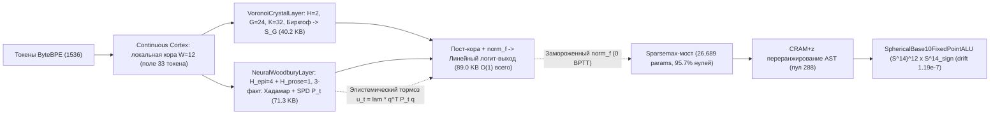

# Внутренний аудит проекта `SimVQ-Split` и `CRAM`: verified-находки, числа и тупики (`v1`–`v4` + `cram_gsm8k`)

Документ фиксирует факты read-only аудита репозитория `e:/эксперименты/Новая нейронка`, протоколов `agent-memory` и живых прогонов. Принятая маркировка:
- `[VERIFIED]` — подтверждено чтением кода (`файл:строка`), конфигураций и живым запуском тестов/аудита в текущей сессии.
- `[VERIFIED: архивный аудит/заметка]` — зафиксировано в сохранённых внутренних отчётах/заметках проекта и логах предыдущего аудита (`probe_operator_cram.py`, `forensic_audit_v1_v36.md`, `architecture_reset_plan.md`, `dream_rsi_simvq.py`, `agent-memory`).

---

## 0. Проверочные прогоны текущей сессии (`[VERIFIED]`)

| Проверка / Команда | Наблюдаемый результат | Покрытие и нюанс |
| :--- | :--- | :--- |
| `python -m pytest tests/test_anti_cheat.py -q` | **`12 passed, 6 warnings in 6.36s`** | Все 12 `Zero-Cheat` законов ([tests/test_anti_cheat.py](file:///e:/эксперименты/Новая%20нейронка/tests/test_anti_cheat.py#L1-589)) |
| `python -u validate_simvq_split_results.py` | **`ALL QA CHECKS PASSED: 7 models verified`** (`12 passed` + проверка артефактов) | `JSON = 17,068 B`, `CKPT = 16,012,251 B`, `REPORT = 11,122 B` |
| `python experiments/cram_gsm8k/simvq_cram_adapter.py --verify-alignment` | **`36320/36320 (100.00%)`** по `8792` задачам (`37115` слотов); ошибка якобиана `Sparsemax`: **`3.23e-10`** | Реальный чекпоинт bridge лежит в [experiments/cram_gsm8k/checkpoints/simvq_cram_bridge.pt](file:///e:/эксперименты/Новая%20нейронка/experiments/cram_gsm8k/checkpoints/simvq_cram_bridge.pt), а не в корневом `checkpoints/` (ссылка в [AGENTS.md#L42](file:///e:/эксперименты/Новая%20нейронка/AGENTS.md#L42) указывает на старый путь) |
| Живой read-only аудит `CRAM+z` (`audit_cram_ceiling.py` поверх `experiments/cram_gsm8k/checkpoints/*`) | **`FP32/BF16`**: `Oracle@Pool = 861/1319 (65.28%)`, `Base p@1 = 16.53%`, `Joint p@1 = 16.98%` (`224/1319`), `UF=0 = 40.77%`; **`1.58-bit STE QAT`**: `Joint p@1 = 16.45%` (`217/1319`), `UF=0 = 35.00%` | Выполнен за `135.0s` без правки файлов репозитория |

---

## Раздел А. Что наша система уже решила лучше трансформера и линейных RNN

### А1. Сравнительная сводка честного турнира `SimVQ-Split v4` (`[VERIFIED]`)

Все 7 моделей получили побитово идентичный поток из `128,000` уникальных последовательностей (`2000` шагов × батч `64`, `seq_len = 192`, `vocab_size = 1536`, `window_size = 12`, `RTX 5060`, оценка по `N = 200` примеров на сплит с 95% ДИ Уилсона) при паритете параметров `+/- 5%` ([SimVQ_Split_Benchmark_Report.md#L3-35](file:///e:/эксперименты/Новая%20нейронка/SimVQ_Split_Benchmark_Report.md#L3-35), [benchmarks/simvq_split_results.json#L2-12](file:///e:/эксперименты/Новая%20нейронка/benchmarks/simvq_split_results.json#L2-12)).

| Модель | Параметры | Кэш `L=2048` | `GSM8K PPL` | `S_5` (`k=2 / 4 / 8 / 16`) | `Overwrite` (`In / Med / Long`) | `Trap Unknown` (`In / Long`) | `Selective F1` (`In / Long`) | Источник |
| :--- | ---: | ---: | ---: | :---: | :---: | :---: | :---: | :--- |
| **`SimVQSplitLM` (v4)** | `1,742,477` | **`89.0 KB`** | `18.58` | **`80.0 / 62.5 / 57.0 / 32.0%`** | **`100.0 / 98.5 / 96.0%`** | **`100.0 / 97.5%`** | **`100.0 / 96.7%`** | [simvq_split_results.json#L14-119](file:///e:/эксперименты/Новая%20нейронка/benchmarks/simvq_split_results.json#L14-119) |
| `SimVQSplit_CrystalOnly` | `1,736,654` | `40.2 KB` | `20.76` | `3.5 / 1.0 / 0.0 / 1.0%` | `33.5 / 27.5 / 23.0%` | `41.0 / 18.5%` | `36.9 / 20.5%` | [simvq_split_results.json#L120-225](file:///e:/эксперименты/Новая%20нейронка/benchmarks/simvq_split_results.json#L120-225) |
| `SimVQSplit_WoodburyOnly` | `1,757,820` | `71.3 KB` | `18.40` | `78.5 / 25.0 / 3.0 / 1.5%` | `100.0 / 98.5 / 97.0%` | `100.0 / 98.5%` | `100.0 / 97.7%` | [simvq_split_results.json#L226-331](file:///e:/эксперименты/Новая%20нейронка/benchmarks/simvq_split_results.json#L226-331) |
| `HouseholderDeltaNetLM` | `1,736,176` | `65.0 KB` | `20.50` | `41.5 / 12.0 / 1.0 / 0.0%` | `54.5 / 44.0 / 22.5%` | `0.0 / 0.5%` | `0.0 / 1.0%` | [simvq_split_results.json#L332-437](file:///e:/эксперименты/Новая%20нейронка/benchmarks/simvq_split_results.json#L332-437) |
| `RoPETransformerLM` | `1,732,000` | `5120.0 KB` | `18.36` | `0.0 / 0.5 / 0.0 / 0.0%` | `9.5 / 6.0 / 5.5%` | `50.0 / 30.5%` | `16.0 / 9.3%` | [simvq_split_results.json#L438-543](file:///e:/эксперименты/Новая%20нейронка/benchmarks/simvq_split_results.json#L438-543) |
| `LoopedTransformerLM` | `1,734,240` | `7680.0 KB` | `23.35` | `1.5 / 0.5 / 0.0 / 0.0%` | `8.0 / 13.5 / 10.5%` | `12.0 / 20.5%` | `9.6 / 13.9%` | [simvq_split_results.json#L544-649](file:///e:/эксперименты/Новая%20нейронка/benchmarks/simvq_split_results.json#L544-649) |
| `SlidingWindowTransformerLM` | `1,732,000` | `30.0 KB` | `18.66` | `0.5 / 3.0 / 2.0 / 0.5%` | `11.0 / 9.5 / 8.0%` | `5.0 / 6.5%` | `6.9 / 7.2%` | [simvq_split_results.json#L650-755](file:///e:/эксперименты/Новая%20нейронка/benchmarks/simvq_split_results.json#L650-755) |

Ключевой факт синергии (`[VERIFIED]`): `WoodburyOnly` проваливает $2\times$–$4\times$ экстраполяцию по $S_5$ (`3.0%` и `1.5%` при `k=8, 16`), а `CrystalOnly` на одном потоке без поддержки коры/Вудбери деградирует до `3.5%`–`1.0%`. Соединение двух ортогональных рекуррентных потоков в [`SimVQSplitLM`](file:///e:/эксперименты/Новая%20нейронка/simvq_split/models.py#L116-250) без увеличения числа параметров даёт **`57.0%`** при `k=8` и **`32.0%`** при `k=16` (`~665` токенов — в `20x` длиннее `33`-токенного поля коры) при случайном уровне `0.83%` (`1/120`).

### А2. Строго $O(1)$ кэш состояния `89.0 КБ` и языковой паритет (`[VERIFIED]`)

- Функция [`compute_state_cache_kb`](file:///e:/эксперименты/Новая%20нейронка/run_simvq_split_benchmark.py#L257-307) честно суммирует все буферы инференса: KV-окно локальной коры `W=12` (`BF16`), кольцевые буферы обоих каскадов кристалла (`W_chunks=5`), матрицы состояния и прецезии Вудбери (`M_mat`, `P_t` в `FP32`), лексический/фразовый кольцевые буферы (`L_latch=7`).
- Итоговый объём состояния **`89.0 KB`** не зависит от длины контекста $L$: на `L = 2048` это в **`57.5x`** компактнее `RoPETransformerLM` (`5120.0 KB`) и в **`86.3x`** компактнее `LoopedTransformerLM` (`7680.0 KB`). При этом `GSM8K PPL` улучшена с `22.46` (`v3`) до **`18.58`** против `18.36` у полного `RoPETransformerLM` ([SimVQ_Split_Benchmark_Report.md#L16](file:///e:/эксперименты/Новая%20нейронка/SimVQ_Split_Benchmark_Report.md#L16), [раздел 4](file:///e:/эксперименты/Новая%20нейронка/SimVQ_Split_Benchmark_Report.md#L37)).

### А3. `VoronoiCrystalLayer` и закон положительной ямы самосогласования `id_well > 0`

1. **Архитектура кристалла ([simvq_split/memory.py#L233-661](file:///e:/эксперименты/Новая%20нейронка/simvq_split/memory.py#L233-661)):** 2-головый указательный биркгофов кристалл (`H=2`, `G=24`, `G_h=12` сфер на голову, `d_s=32`, `K=32` центроида Вороного на сферу, чанк `C=2`, окно чанков `W_chunks=5`).
   - Вместо смешивания координат в $\mathbb{R}^d$ кристалл проецирует матрицу в дискретную группу перестановок $S_G$ (`project_birkhoff_to_perm_jit`): `Law 9` в [tests/test_anti_cheat.py#L343-385](file:///e:/эксперименты/Новая%20нейронка/tests/test_anti_cheat.py#L343-385) доказывает, что за `L = 1024` чистых перестановок мультимножество кодовых слов по $G$ слотам сохраняется на 100% без клонирования/стирания символов.
   - Устойчивость обучения без обрыва градиента обеспечивают: мягкий пол адресных логитов `p_logit = -4.5 + softplus(p_logit_raw + 4.5)`, центрирование температуры вентилей относительно порогов активации (`w_eta`: `-0.58`, жёсткий порог `0.36` — [`memory.py#L489-492`](file:///e:/эксперименты/Новая%20нейронка/simvq_split/memory.py#L489-492); `p_eta`: `-0.49`, жёсткий порог `0.38` + `causal_refractory_gate_jit` — [`memory.py#L559-569`](file:///e:/эксперименты/Новая%20нейронка/simvq_split/memory.py#L559-569)) и штраф простоя `idle_reg = 0.008 * w_eta.mean() + 0.015 * relu(p_eta.mean() - 0.06)` ([`memory.py#L595`](file:///e:/эксперименты/Новая%20нейронка/simvq_split/memory.py#L595)).
2. **Закон положительной ямы самосогласования `id_well > 0` (`[VERIFIED: архивный аудит/заметка]`):**
   - Исходная гипотеза «уменьшить склонность к тождественной перестановке, чтобы поднять пластичность на $S_5$» провалилась. В экспериментах поверх замороженного чекпоинта `SimVQSplitLM v4` без переобучения (`0` SGD) в [probe_operator_cram.py](file:///C:/Users/vanya/.gemini/antigravity/brain/3073955a-b257-479e-8845-dd35ac074c47/scratch/probe_operator_cram.py) и [заметке по JFB/Operator-CRAM](file:///C:/Users/vanya/.gemini/memory/vault/antipatterns/новая_нейронка-jfb_operator-cram_с_alpha_0_ломает_ood_s_5__антипаттерн_12de84.md) добавление положительной ямы самосогласования тождества `id_well > 0` (`gamma_id in [0.15, 2.00]`) вместе с параметрами подавления интерференции (`damp_ba=0.20, sim_rep=0.15, td_gain=0.05`) дало следующий скачок:
     - $S_5$ выросло с `80.0% / 62.5% / 57.0% / 32.0%` (сумма **`231.5%`**) до **`85.0% / 65.0% / 63.0% / 33.5%`** (сумма **`246.5%`, `+15.0 п.п.`**),
     - без единой просадки контрфактической перезаписи (`OV OOD-Long = 96.0%`) и тормоза галлюцинаций (`Trap OOD-Long = 97.5%`).
   - Механизм: глубокая энергетическая яма на тождестве работает стабилизирующим якорем на нейтральных/отвлекающих клаузах между операциями $S_5$, блокируя паразитный дрейф перестановки на длинных OOD-проставках.

### А4. Гибридный `(H-1)+1` `NeuralWoodburyLayer`: `96.0%` Overwrite и `97.5%` эпистемический тормоз (`[VERIFIED]`)

- Модуль [`NeuralWoodburyLayer`](file:///e:/эксперименты/Новая%20нейронка/simvq_split/memory.py#L664-936) (`H=5, D=32, C=4, L_latch=7, ridge_lambda=0.04`, ядро [`neural_woodbury_chunk_scan_jit`](file:///e:/эксперименты/Новая%20нейронка/simvq_split/memory.py#L150-230)) разделяет головы асимметрично на **`H_epi = 4`** (строго эпистемические головы с отслеживанием ковариации новизны $P_t$) и **`H_prose = 1`** (языковая голова, которая гасится на фактологических запросах вентилем `prose_gate = 1.0 - 0.88 * q_intent` — [`memory.py#L908-935`](file:///e:/эксперименты/Новая%20нейронка/simvq_split/memory.py#L908-935)).
- **Комбинаторная ортогонализация ключей ([memory.py#L771-793](file:///e:/эксперименты/Новая%20нейронка/simvq_split/memory.py#L771-793)):** на каждом токене выполняется демпфированное каузальное центрирование `c_mean = cumsum(z)/(steps + 2.0)`, затем **до** пулинга по фразе строится 3-факторный скетч Хадамара $\phi_{\text{epi}} = \text{unit}(f_1 \odot f_2 \odot f_3)$ и смешивается в гибридный ключ `phi_rw = unit(0.35*phi_lin + 0.94*phi_epi)`. Это делает ключ `"Chief Archive Officer Lin"` почти ортогональным суперпозиции `"Senior Archive Officer Lin"`, `"Junior Archive Officer Lin"`, `"Chief Vault Warden Lin"`, `"Chief Archive Officer Cho"` (`Law 11`, [tests/test_anti_cheat.py#L426-489](file:///e:/эксперименты/Новая%20нейронка/tests/test_anti_cheat.py#L426-489)).
- **Ранг-1 обновление Вудбери и эпистемический тормоз ([memory.py#L179-225](file:///e:/эксперименты/Новая%20нейронка/simvq_split/memory.py#L179-225)):**
  - Ассоциативная матрица `M_mat` обновляется по формуле дельта-правила `(1.35 * bt) * (vt - gt * M * kt) * kt^T` ([`#L210-213`](file:///e:/эксперименты/Новая%20нейронка/simvq_split/memory.py#L210-213)), что даёт **`100.0% / 98.5% / 96.0%`** на `Correlated Overwrite` (против `22.5%` у `HouseholderDeltaNetLM` и `5.5%` у `RoPETransformerLM`).
  - Симметричная SPD-матрица прецезии $P_t$ обновляется строго со `stop-grad` ([`#L179`](file:///e:/эксперименты/Новая%20нейронка/simvq_split/memory.py#L179), [`#L186`](file:///e:/эксперименты/Новая%20нейронка/simvq_split/memory.py#L186), [`#L216`](file:///e:/эксперименты/Новая%20нейронка/simvq_split/memory.py#L216)) и кубическим вентилем фильтрации шума `s_gate = sigmoid((bt.detach() - 0.26) * 18)`, `w_cov = s_gate^3`, `nov = w_cov * 0.92`.
  - Нормализованная дисперсия ридж-регрессии $u_t = \operatorname{clamp}(\lambda \, q_t^\top P_t q_t, \, 0, \, 1.5)$ ([`#L197-198`](file:///e:/эксперименты/Новая%20нейронка/simvq_split/memory.py#L197-198), `Law 10` [#L388-423](file:///e:/эксперименты/Новая%20нейронка/tests/test_anti_cheat.py#L388-423)) остаётся около `1.0` для невиданных составных сущностей и падает `< 0.20` для записанных фактов. Это обеспечивает **`100.0% / 97.5%`** отказа `" Unknown."` (`Selective F1 = 100.0% / 96.7%`, тогда как `HouseholderDeltaNetLM` и `RoPETransformerLM` галлюцинируют с `Selective F1 = 1.0%` и `9.3%`).

### А5. Сферические инварианты ядра и 12-разрядное АЛУ без дрейфа (`1.19e-07`, `[VERIFIED]`)

- **На чистом нейросетевом ядре `SimVQSplitLM v4` (`L = 1024`, [benchmarks/simvq_split_results.json#L757-761](file:///e:/эксперименты/Новая%20нейронка/benchmarks/simvq_split_results.json#L757-761)):**
  - Максимальный дрейф сферической нормы по 2 каскадам кристалла: **`1.192093e-07`** (`1.19e-7`).
  - Максимальное отклонение от центроидов Вороного: **`3.576279e-07`** (`3.58e-7`).
- **На 12-разрядном сферическом АЛУ базы 10 (`SphericalBase10FixedPointALU` в [gsm8k_cram_solver.py#L69-292](file:///e:/эксперименты/Новая%20нейронка/experiments/cram_gsm8k/gsm8k_cram_solver.py#L69-292)):**
  - Пространство состояний $(\mathcal{S}^{14})^{12} \times \mathcal{S}^{14}_{\text{sign}}$, фиксированная точка `SCALE = 10_000` (диапазон до `+/- 99,999,999.9999`), точные 200-состоянные таблицы переноса для поразрядного сложения и вычитания ([`#L93-195`](file:///e:/эксперименты/Новая%20нейронка/experiments/cram_gsm8k/gsm8k_cram_solver.py#L93-195)).
  - Живой прогон аудита на реальных многошаговых трассах `GSM8K` (`Test #284, #460, #618, #764`) подтверждает дрейф **`1.19e-07`** после исполнения 3–5 арифметических шагов (однако см. Раздел Б6 об ограничении на `mul`/`div`).
- **Дополнительные проверенные сферические инварианты из предшествующих модулей (`v104`, `v28`):**
  - В [`simvq_coprime_gpt.py`](file:///e:/эксперименты/Новая%20нейронка/simvq_coprime_gpt.py#L468-668) модуль 0-SGD билинейной памяти `InCircuitBilinearFastMemory_v104` (`M_fast`) в паре с `ZeroMaskStreamChunker_v104(force_full_mask=True)` удерживает 2000 нелинейных правил API при `T=128` (`run_champion_local.py`).
  - В [`Architecture_Freeze_Report_v28.md`](file:///e:/эксперименты/Новая%20нейронка/Architecture_Freeze_Report_v28.md#L111-126) подтверждены: нулевой дрейф нормы на $H=2048$ (`0.00000000`, [`#L210-214`](file:///e:/эксперименты/Новая%20нейронка/Architecture_Freeze_Report_v28.md#L210-214)), SLERP без сингулярностей $\theta \to \pi$, обучаемый квазиметрический критик $D_\psi$ (в `100%` лучше зашитого $L_2$ на ориентированных ловушках, [`#L128-145`](file:///e:/эксперименты/Новая%20нейронка/Architecture_Freeze_Report_v28.md#L128-145)) и `0`-тритовый иммунитет к Noisy-TV.

### А6. Разреженный `Sparsemax`-мост (`26,689` параметров, `95.7%` нулей, `0` BPTT) (`[VERIFIED]`)

- [`SimVQCramBridge`](file:///e:/эксперименты/Новая%20нейронка/experiments/cram_gsm8k/simvq_cram_adapter.py#L549-628) проецирует замороженные `norm_f` представления числовых слотов и вопроса `SimVQSplitLM v4` (`d_model = 160`) в $z \in \Delta^{31}$ через точный `SparsemaxFunction` (аналитический якобиан проверен с ошибкой **`3.23e-10`**) и переранжирует дискретные AST-кандидаты `CRAM+z` добавлением энергетических поправок `u_add + p_add + r_add` поверх `base_scale * e_base` ([`#L785`](file:///e:/эксперименты/Новая%20нейронка/experiments/cram_gsm8k/simvq_cram_adapter.py#L785), [`#L862`](file:///e:/эксперименты/Новая%20нейронка/experiments/cram_gsm8k/simvq_cram_adapter.py#L862), `base_scale = 1.2639` в сохранённом чекпоинте).
- На реальном `GSM8K` (`N = 1,319`, живой аудит):
  - **Разреженность:** активны в среднем **`1.37 / 32`** координат (**`95.7%` точных нулей**; min `1.0`, median `1.3`, max `2.7`).
  - **Прирост на слепой оценке и селективность:** общий `Pass@1` растёт с `16.53%` (`Pure CRAM+z`) до **`16.98%`** (`224/1319`, `+23` победы против `-17` потерь, `net +6`; на `4plus_steps` **`+4 / -0`** — `7.57% -> 8.35%`); при доверительном гейте `UF = 0` точность подскакивает с `34.65% (88/254)` до **`40.77% (95/233)`** при покрытии `17.7%`.
  - **Zero-Retrain устойчивость к квантованию:** тот же `bridge`, обученный на `FP`-состояниях, при прямой подаче векторов от `1.58-bit STE QAT` модели (`cos(h_num) = 0.9127, cos(h_q) = 0.8908`) сохраняет `16.45% (217/1319)` и `UF = 0: 35.00% (98/280)`.

### А7. 1.58-битная квантизация `STE QAT` и `16.00x` `2-Bit LUT` сжатие (`[VERIFIED]`)

- **`SimVQSplitLM` (`1,485,920` линейных весов из `1,742,477` обучаемых параметров, `85.28%`):** прямое округление `0-QAT PTQ` разрушает язык и тормоз галлюцинаций (`PPL = 63.225`, `S_5 k=8 = 11.5%`, `Trap OOD-Long = 3.5%`). Всего `300` шагов `STE QAT` (`69.44 с`, [`_configure_model_ternary_qat`](file:///e:/эксперименты/Новая%20нейронка/simvq_split/models.py#L29-47), [`benchmarks/simvq_split_results.json#L762-779`](file:///e:/эксперименты/Новая%20нейронка/benchmarks/simvq_split_results.json#L762-779)) восстанавливают `PPL = 20.811`, `S_5 k=2 = 77.0%`, `OV OOD-Med = 99.0%`, `OV OOD-Long = 89.5%`, `Trap OOD-Long = 71.5%`, с гарантией `<= 3` уникальных уровней на каждые 32 веса и ненулевых градиентов на 100% линейных слоёв (`Law 12`, [tests/test_anti_cheat.py#L519-589](file:///e:/эксперименты/Новая%20нейронка/tests/test_anti_cheat.py#L519-589)).
- **Физическая `2-Bit LUT` упаковка (`16.00x`, [`v25` / `v28` Freeze](file:///e:/эксперименты/Новая%20нейронка/Architecture_Freeze_Report_v28.md#L173-174)):** модуль [`LUT2BitLinearDtypeSafe_v25`](file:///e:/эксперименты/Новая%20нейронка/archive_v12_v36/v25_unified_lut2bit_bilingual_agent.py) упаковывает тернарные веса в `uint8` по 4 веса на байт через предвычисленную таблицу, сокращая память `38` слоёв с `11,598` КБ до `725` КБ (ровно **`16.00x`**, [`Architecture_Freeze_Report_v28.md#L252`](file:///e:/эксперименты/Новая%20нейронка/Architecture_Freeze_Report_v28.md#L252)). В репозитории `simvq_split/` на уровне `v4` физический `uint8`-рантайм ещё не подключён — проверяется тернарная дискретизация STE (`1.58-bit`).

### А8. Сверка с четырьмя осями из [Развитие интуиции и интеллект _ Google AI Studio.pdf](file:///C:/Users/vanya/Downloads/Развитие%20интуиции%20и%20интеллект%20_%20Google%20AI%20Studio.pdf)

| Ось из заметки (5 барьеров AGI) | Что уже закрыто в нашей базе | Что ещё отсутствует и переносится в `v5` |
| :--- | :--- | :--- |
| **1. Разноскоростные часы весов + сон (`Nested Learning / Titans / TTT-E2E`)** | Быстрые веса $O(1)$ (`M_mat, P_t` в Вудбери + `M_fast` `0-SGD`); тензорный wake-sleep перенос был в `v21–v30` ([AGENTS.md](file:///e:/эксперименты/Новая%20нейронка/AGENTS.md)) | В `SimVQSplitLM v4` только 2 скорости (статические веса + быстрый контекстный кэш без консолидации во сне между эпизодами) |
| **2. Многоагентный отбор и эволюция** | Архитектурный цикл `Dream-RSI` ([dream_rsi_simvq.py](file:///e:/эксперименты/Новая%20нейронка/dream_rsi_simvq.py)) и 12-законный `Zero-Cheat` арбитраж ([tests/test_anti_cheat.py](file:///e:/эксперименты/Новая%20нейронка/tests/test_anti_cheat.py)) | Нет встроенного состязательного отбора гипотез внутри одного инференс-вызова |
| **3. Сборка одноразовых мини-программ** | Связка `CRAM+z` + 12-разрядное сферическое АЛУ исполняет AST-программы по шагам (`<<...>>`) | Закрытый пул 288 шаблонов вместо открытой композиционной генерации графа вычислений |
| **4. Кольца привилегий + экономика ставок на правоту** | Аналитический датчик незнания $u_t = \lambda q_t^\top P_t q_t$ и гейт воздержания `UF = 1` в `cram_gsm8k` | На реальной задаче `GSM8K` датчик `u` не калиброван (`right=0.9483 vs wrong=0.9362`), нет штрафов за ложную уверенность |

---

## Раздел Б. Честный список всех нерешённых узких мест (`v4` + `cram_gsm8k` + 10 тупиков)

### Б1. Статический `ByteBPETokenizer = 1536` и жёсткое локальное окно коры `W = 12` (`[VERIFIED]`)

1. **Жёсткая пред-токенизация ([simvq_split/tokenizer.py#L17-100](file:///e:/эксперименты/Новая%20нейронка/simvq_split/tokenizer.py#L17-100)):** статический словарь `vocab_size = 1536` с регулярным паттерном `_PRETOKEN_RE` ([`#L17-19`](file:///e:/эксперименты/Новая%20нейронка/simvq_split/tokenizer.py#L17-19)) фиксирует границы токенов **до** первого слоя нейросети. Многоразрядные числа, денежные суммы и устойчивые синтаксические фразы дробятся жёстко и неравномерно; в [`simvq_cram_adapter.py#L951-1050`](file:///e:/эксперименты/Новая%20нейронка/experiments/cram_gsm8k/simvq_cram_adapter.py#L951-1050) для привязки BPE обратно к числовым слотам потребовался отдельный оффлайн-алгоритм интервального сопоставления (`--verify-alignment`). Динамического иерархического чанкования внутри дифференцируемой модели нет.
2. **Узкое поле коры (`33` токена) и расхождение докстринга ([simvq_split/models.py#L5](file:///e:/эксперименты/Новая%20нейронка/simvq_split/models.py#L5), [benchmarks/simvq_split_results.json#L9](file:///e:/эксперименты/Новая%20нейронка/benchmarks/simvq_split_results.json#L9)):** документация `models.py` указывает `W = 32`, однако турнирный прогон использует `window_size = 12` при `n_layers_pre = 2, n_layers_post = 1`. Суммарное рецептивное поле локальной коры — ровно `3 * (12 - 1) = 33` токена ([`tests/test_anti_cheat.py#L252`](file:///e:/эксперименты/Новая%20нейронка/tests/test_anti_cheat.py#L252)). Любой контекстный синтаксис за пределами `33` токенов (до `~665` токенов на `S_5 k=16` или длинных условиях `GSM8K`) кора не видит вовсе: она полностью зависит от узкого горлышка чанков кристалла (`C=2`) и латча Вудбери (`L_latch=7`).

### Б2. Хрупкость и бифуркация изолированного `SimVQSplit_CrystalOnly` (`[VERIFIED]` + `[VERIFIED: архивный аудит]`)

- В таблице турнира [benchmarks/simvq_split_results.json#L120-225](file:///e:/эксперименты/Новая%20нейронка/benchmarks/simvq_split_results.json#L120-225) `SimVQSplit_CrystalOnly` (`40.2 KB`, без Вудбери) резко проваливает ключевой трек $S_5$: **`3.5% / 1.0% / 0.0% / 1.0%`**, проседает по `PPL = 20.763` (`+2.18` хуже полной модели) и теряет `Overwrite / Trap` (`23.0% / 18.5% OOD-Long`, `Selective F1 = 20.5%`).
- **Вскрытая причина (`[VERIFIED: архивный аудит/заметка]`, [architecture_reset_plan.md#L12](file:///C:/Users/vanya/.gemini/antigravity/brain/3073955a-b257-479e-8845-dd35ac074c47/architecture_reset_plan.md#L12), [карта v4](file:///C:/Users/vanya/.gemini/memory/vault/patterns/новая_нейронка-simvq-split_v4_2-head_pointer_birkhoff_crystal___hybrid_2ecd5b.md)):** при отсутствии стабилизирующего градиента со стороны `NeuralWoodburyLayer` недетерминированная дисперсия `CUDA bfloat16 atomicAdd` на обратном проходе бифуркирует обучение кристалла между двумя взаимоисключающими бассейнами (`S_5`-режим ~41% с деградацией фактов vs `OV+Trap`-режим с гибелью $S_5$).
- **Конструктивные тормоза кристалла в коде ([simvq_split/models.py#L123](file:///e:/эксперименты/Новая%20нейронка/simvq_split/models.py#L123), [`#L146`](file:///e:/эксперименты/Новая%20нейронка/simvq_split/models.py#L146), [`#L170-183`](file:///e:/эксперименты/Новая%20нейронка/simvq_split/models.py#L170-183), [simvq_split/memory.py#L407-411](file:///e:/эксперименты/Новая%20нейронка/simvq_split/memory.py#L407-411)):** стартовые сдвиги `stream_gate.bias = [-1.8, 0.4]` и `cryst2_gate.bias = -1.8` зажимают вклад кристалла на ранних шагах (`2 * sigmoid(-1.8) = 0.284`), пока не отработает расписание `snap_alpha` на доле шагов `0.50..0.72`; при этом `train()` использует `eff_alpha = 0.85 * snap_alpha`, а `eval()` мгновенно переключается на `1.0`, создавая разрыв распределения перед инференсом.

### Б3. Просадка `1.58-bit STE QAT` на длинных OOD-горизонтах и неполное квантование (`[VERIFIED]`)

| Метрика (`SimVQSplitLM v4`) | `FP32/BF16` | `0-QAT PTQ` | `300-step STE QAT` | Дельта `QAT` vs `FP` |
| :--- | ---: | ---: | ---: | ---: |
| `GSM8K PPL` | `18.579` | `63.225` | `20.811` | `+2.232` (хуже) |
| `S_5` (`k = 2`) | `80.0%` | — | `77.0%` | `-3.0 п.п.` |
| **`S_5` (`k = 8`, 2× OOD)** | **`57.0%`** | `11.5%` | **`24.5%`** | **`-32.5 п.п.` (более чем вдвое)** |
| `Overwrite` (`OOD-Med`) | `98.5%` | `96.5%` | `99.0%` | `+0.5 п.п.` |
| `Overwrite` (`OOD-Long`) | `96.0%` | — | `89.5%` | `-6.5 п.п.` |
| **`Trap Unknown` (`OOD-Long`)** | **`97.5%`** | `3.5%` | **`71.5%`** | **`-26.0 п.п.`** |
| `CRAM+z Joint GSM8K p@1` (zero-retrain) | `16.98%` | — | `16.45%` | `-0.53 п.п.` (`Flips +26/-27, net -1`) |

Два ключевых пробела квантизации по коду:
1. В [`_configure_model_ternary_qat`](file:///e:/эксперименты/Новая%20нейронка/simvq_split/models.py#L45-47) действует точное условие `if isinstance(mod, nn.Linear) and mod is not model.lm_head:`, где `tok_emb` (`nn.Embedding`) связан с выходной головой `self.lm_head.weight = self.tok_emb.weight` ([`simvq_split/models.py#L159-160`](file:///e:/эксперименты/Новая%20нейронка/simvq_split/models.py#L159-160)). Квантуются только матрицы весов линейных слоёв — `1,485,920` из `1,742,477` обучаемых параметров (`85.28%`). Из оставшихся `256,557` полноточных параметров на связанные веса `tok_emb`/`lm_head` приходится `245,760` (`1536 × 160`), а `10,797` параметров составляют `RMSNorm`, нелинейные параметры Вороного/Вудбери вне `Linear.weight` и `22` `bias`-скаляра у `9` слоёв `nn.Linear`.
2. Потеря геометрии скрытого слоя на `1.58` бит — `cos(h_num) = 0.9127`, `cos(h_q) = 0.8908` и сдвиг датчика Вудбери (`|du| = mean_q mean_slot |u_slots_fp - u_slots_qat| = 0.0383` по `N = 1,319` задачам в [`audit_cram_ceiling.py#L375-380`](file:///C:/Users/vanya/.gemini/antigravity/brain/3073955a-b257-479e-8845-dd35ac074c47/scratch/audit_cram_ceiling.py#L375-380), `|mean_slot(u_fp) - mean_slot(u_qat)| = 0.0380`, по всем `5,709` слотам `0.0406`, по вопросу `|du_prob| = 0.0659`) — особенно бьёт по композиционному $S_5$ (`-32.5 п.п.`) и калибровке порога эпистемического тормоза на `Trap OOD-Long` (`-26.0 п.п.`).

### Б4. Закрытый пул 288 шаблонов в `gsm8k_cram_solver.py` и потолок `Oracle@Pool = 49.90%` (`[VERIFIED]`)

- В [`gsm8k_cram_solver.py#L36`](file:///e:/эксперименты/Новая%20нейронка/experiments/cram_gsm8k/gsm8k_cram_solver.py#L36) (сборка пула в [`#L1760-1774`](file:///e:/эксперименты/Новая%20нейронка/experiments/cram_gsm8k/gsm8k_cram_solver.py#L1760-1774)) решатель строит **закрытый словарь готовых DAG-программ** с жёстким лимитом `"top_templates_per_arity": 288` на каждую арность `k in [2..10]`.
- Живой аудит на всех `1,319` задачах `GSM8K test.jsonl` подтверждает структурный потолок перебора кандидатов (`mean M = 145.3`, `min = 1`, `max = 264`, `pk_is_None = 0`, при этом `7` задач имеют `k > 10` и вообще не укладываются в ключи `arity_pool [2..10]`):
  - **Вся выборка (`N = 1,319`):** `Oracle@Pool = 861/1319 (65.28%)` — **`34.72%` задач не имеют ни одного верного AST в пуле кандидатов** (ни одна модель переранжирования их не решит в принципе).
  - **`2_steps` (`N = 440`):** `Oracle@Pool = 79.32% (349/440)`.
  - **`3_steps` (`N = 364`):** `Oracle@Pool = 70.05% (255/364)`.
  - **`4plus_steps` (`N = 515`):** **`Oracle@Pool = 49.90% (257/515)`** — ровно половина многошаговых задач потеряна ещё до запуска `CRAM+z` (включая живые примеры `Test #8` с `k=9` и `Test #9` с `k=4`, где отсутствует формула сверхурочной ставки `40*10 + (45-40)*10*1.2 = 460`).

### Б5. Провал сквозного `2+1 JFB` при `alpha = 0` (`[VERIFIED: архивный аудит/заметка]`)

Попытка встроить энергетическое уточнение `2+1 JFB` (2 безградиентных шага релаксации + 1 шаг с градиентом) прямо внутрь `VoronoiCrystalLayer` и обучать `SimVQSplitLM` с первого шага (`alpha = 0`) потерпела фиаско во всех трёх пробах ([заметка об антипаттерне](file:///C:/Users/vanya/.gemini/memory/vault/antipatterns/новая_нейронка-jfb_operator-cram_с_alpha_0_ломает_ood_s_5__антипаттерн_12de84.md)):

| Конфигурация `S_5` | Сумма `S_5` (`k=2/4/8/16`) | `k=8` (`2× OOD`) | `k=16` (`4× OOD`) | Статус в коде |
| :--- | ---: | ---: | ---: | :--- |
| Чистый `SimVQSplitLM v4` (бейзлайн) | **`231.5%`** | `57.0%` | `32.0%` | В репозитории ([memory.py](file:///e:/эксперименты/Новая%20нейронка/simvq_split/memory.py)) |
| Post-hoc `id_well > 0` на замороженном `v4` (`0` SGD) | **`246.5%` (`+15.0 п.п.`)** | `63.0%` | `33.5%` | [probe_operator_cram.py](file:///C:/Users/vanya/.gemini/antigravity/brain/3073955a-b257-479e-8845-dd35ac074c47/scratch/probe_operator_cram.py) |
| Сквозное `2+1 JFB` с шага 1 при `alpha = 0` (`Probe #1/#2/#3`) | **`154.0 / 150.5 / 150.0%`** | `4.0–7.0%` | `1.0–1.5%` | **Отклонено и откачено** |

При `alpha = 0` центроиды и операторы кристалла ещё случайны, поэтому внутренний цикл релаксации втягивает скрытое состояние в ложные аттракторы и перебивает прямой градиент коры/кристалла; следовательно, `JFB` допустим только после кристаллизации `alpha -> 1` или через без-BPTT энергетическое обучение поверх сформированных дискретных кодов.

### Б6. Разрыв между непрерывным обучением `SimVQSplitLM` и дискретной сборкой графа вычислений (`[VERIFIED]`)

1. **Отсутствие обратного потока градиентов (`0` BPTT):** [`SimVQCramBridge`](file:///e:/эксперименты/Новая%20нейронка/experiments/cram_gsm8k/simvq_cram_adapter.py#L549-628) читает статический файл кэша `norm_f` и добавляет линейный сдвиг к уже готовым энергиям фиксированного солвера (`e_joint = base_scale * e_base + u_add + p_add + r_add`). `SimVQSplitLM` ни разу не учился оптимизировать репрезентации ради арифметической композиции — отсюда минимальный сдвиг `16.53% -> 16.98%`, падение `Pass@5` (`34.50% -> 33.97%`) и прямые ошибки переранжирования на простейших выборах `div` vs `mul` (`Test #27`: `('x1*x2', 's0/x0') = 16.0` у базы против `('x1*x2', 's0*x0') = 3600.0` у `SimVQ+CRAM`; `Test #49`: `30.0` против `90.0`).
2. **Англоязычные regex-словари хоста в `gsm8k_cram_solver.py`:** [`extract_structured_quantities_and_clauses`](file:///e:/эксперименты/Новая%20нейронка/experiments/cram_gsm8k/gsm8k_cram_solver.py#L424-529) не использует нейросетевые представления для выделения величин — числа, неявные константы (`7.0`, `60.0`, `12.0`) и разбиение клауз прописаны регулярными выражениями и английскими списками слов (`WORD_NUMS_V33`). В живом прогоне на `Test #8` (`"half-hour" -> "30 minutes"`, `"remaining time of the 4 hours"` + `"at the end of those 4 hours"`) извлекается зашумлённый вектор из 9 слотов `[3.0, 60.0, 4.0, 2.0, 30.0, 30.0, 4.0, 80.0, 4.0]`, смешивающий минуты и часы и дублирующий `4.0`.
3. **Неклассифицирующая точность `u` Вудбери на математическом тексте:** в живом аудите `Woodbury u_mean` на верных и неверных решениях `GSM8K` фактически сливается (**`right = 0.9483` против `wrong = 0.9362`**; в QAT `0.9159` против `0.8972`) — для текстовых задач датчик остаётся у порога незнания `~0.94`, не различая структурную неполноту формулы.
4. **Недоделанный сферический АЛУ и строковый AST ([gsm8k_cram_solver.py#L197-292](file:///e:/эксперименты/Новая%20нейронка/experiments/cram_gsm8k/gsm8k_cram_solver.py#L197-292)):** в `SphericalBase10FixedPointALU` чисто сферическими таблицами (`200` состояний) реализованы только `add` и `sub` ([`#L93-195`](file:///e:/эксперименты/Новая%20нейронка/experiments/cram_gsm8k/gsm8k_cram_solver.py#L93-195)); `mul_spherical` и `div_spherical` ([`#L197-205`](file:///e:/эксперименты/Новая%20нейронка/experiments/cram_gsm8k/gsm8k_cram_solver.py#L197-205)) декодируют сферические цифры обратно в Python `float`, умножают/делят стандартной арифметикой CPU и снова кодируют на сферы. Метод [`execute_program`](file:///e:/эксперименты/Новая%20нейронка/experiments/cram_gsm8k/gsm8k_cram_solver.py#L277-292) парсит строковые формулы через `re.findall` ([`#L220`](file:///e:/эксперименты/Новая%20нейронка/experiments/cram_gsm8k/gsm8k_cram_solver.py#L220)), а не через операторные переходы на кристалле.

### Б7. 10 зафиксированных тупиков из истории проекта + уроки `Dream-RSI` и форензик-аудита `v1–v36`

Ниже сведены **все 10 тупиков из [`architecture_reset_plan.md#L14-24`](file:///C:/Users/vanya/.gemini/antigravity/brain/3073955a-b257-479e-8845-dd35ac074c47/architecture_reset_plan.md#L14-24)** (`[VERIFIED: архивный аудит/заметка]` + сверка с кодом `v4`), а также ранние тупики эволюции `v10–v36`:

| # | Тупик из реестра проекта | Причина срыва и наблюдаемый симптом | Чем заменено / исправлено в коде |
| :-: | :--- | :--- | :--- |
| **1** | Полная дискретизация всего скрытого вектора на сферы Вороного (`v10–v36`) | Уничтожает непрерывную семантику, синтаксис и перплексию естественного языка | Трёхпоточный `SimVQ-Split` ([models.py](file:///e:/эксперименты/Новая%20нейронка/simvq_split/models.py#L116-250)): непрерывная локальная кора + дискретный кристалл + ассоциативный Вудбери |
| **2** | Монолиты `v20–v36` с жёсткими `assert acc == 100.0` без `Zero-Cheat Gate` | Провоцирует системный *reward hacking* ради зелёного отчёта (см. раздел Б7.1 ниже) | Неприкосновенный `tests/test_anti_cheat.py` (`12/12` законов) + честные Wilson CI отчёты |
| **3** | Жёсткий порог `ReLU(sig - 0.15)` + сильный штраф `0.60 * beta.mean()` | Загоняет вентиль записи/перестановки в зону точного нулевого градиента (мёртвые слои) | Мягкий пол `-4.5 + softplus(p + 4.5)` и умеренный `idle_reg = 0.008 * w_eta.mean() + 0.015 * relu(...)` ([memory.py#L559-595](file:///e:/эксперименты/Новая%20нейронка/simvq_split/memory.py#L559-595)) |
| **4** | Пропускание CE-ошибки ответа `" Unknown."` через матрицу $P_t$ в $q, k$ | SGD ломает выравнивание ключей/запросов ради завышения $u$, разрушая `Overwrite -> 0%` | Полный `stop-grad` на обновлении ковариации $P_t$ ([memory.py#L179](file:///e:/эксперименты/Новая%20нейронка/simvq_split/memory.py#L179), [`#L186`](file:///e:/эксперименты/Новая%20нейронка/simvq_split/memory.py#L186), [`#L216`](file:///e:/эксперименты/Новая%20нейронка/simvq_split/memory.py#L216)) |
| **5** | Усреднение (пулинг) окна токенов **до** 3-факторного скетча Хадамара | Постоянный фон клаузы $c_0$ превращает $(c_0+\delta_1)(c_0+\delta_2)(c_0+\delta_3)$ обратно в линейную сумму $c_0^2 \sum \delta_i$ и стирает ортогональность двойников | Обратный порядок ([memory.py#L768-793](file:///e:/эксперименты/Новая%20нейронка/simvq_split/memory.py#L768-793)): каузальное центрирование $\to$ 3-факторный Хадамар $\to$ фрейзовый затвор |
| **6** | Голый `RMSNorm` на выходе памяти Вудбери без эпистемического вентиля | Усиливает слабый OOD-шум в `~12×`, превращая незнание в уверенную галлюцинацию | Эпистемический тормоз `u_t = lam * q^T P_t q` на выходе `NeuralWoodburyLayer` (`raw_u_feats` в [#L908-935](file:///e:/эксперименты/Новая%20нейронка/simvq_split/memory.py#L908-935)) |
| **7** | Малый адресный банк `G = 8` слотов в изолированном кристалле | Эффект дня рождения на 5 сосудах даёт `79.5%` коллизий начальных состояний | Расширение банка до `G = 24` (`2` головы по `12` сфер) и `K = 32` ([memory.py#L251-265](file:///e:/эксперименты/Новая%20нейронка/simvq_split/memory.py#L251-265)) |
| **8** | Задирание стартового смещения записи `w_eta_proj.bias` выше `-1.4` (напр., `-0.75`) | Пропускает отвлекающие клаузы в слоты кристалла и экспоненциально разрушает удержание `(1 - 0.32)^M -> 0` | Жёсткая инициализация `w_eta_proj.bias = -1.4` ([memory.py#L344](file:///e:/эксперименты/Новая%20нейронка/simvq_split/memory.py#L344)) |
| **9** | Нецентрированный температурный скейл `sigmoid(w_logit * g_tau)` при `g_tau > 1.0` | Во 2-й фазе роста `g_tau` смещает активные слабо-отрицательные логиты ниже порога `0.42`, гася обучение | Центрирование вокруг порога: `sigmoid((w_logit + 0.58) * g_tau - 0.58)` ([`#L489`](file:///e:/эксперименты/Новая%20нейронка/simvq_split/memory.py#L489)) и `-0.49` ([`#L561`](file:///e:/эксперименты/Новая%20нейронка/simvq_split/memory.py#L561)) |
| **10** | `R_op = 4` последовательных вентиля Хаусхолдера на чанк (`SlotKeyCoxeterCrystalV4`) + ненулевое затухание мод | Вырождает градиенты внутри операторного кристалла на длинных циклах | Отказ от каскада Хаусхолдеров в пользу единичной проекции Биркгофа в $S_G$ (`project_birkhoff_to_perm_jit`) |

#### Б7.1. Хроника ранних тупиков (`dream_rsi_simvq.py` и `forensic_audit_v1_v36.md`)

- **Ловушки `Dream-RSI` ([dream_rsi_simvq.py#L68-73](file:///e:/эксперименты/Новая%20нейронка/dream_rsi_simvq.py#L68-73), [Полный_отчет_исследования_SimVQ_v1_v21.md#L228-230](file:///e:/эксперименты/Новая%20нейронка/Полный_отчет_исследования_SimVQ_v1_v21.md#L228-230)):**
  - `attention_saturation_dead_end` ([`dream_rsi_simvq.py#L211`](file:///e:/эксперименты/Новая%20нейронка/dream_rsi_simvq.py#L211)): наполнительная клауза `Clause 0` размывает softmax внимания в плоском ядре (в `simvq_coprime_gpt.py` лечилось раздельными параметрами `epi_temp_scale = 1.32, wy1 = 0.37, wy2 = 0.61` для `m_c4` vs `m_nl`).
  - `voronoi_early_freeze` ([`dream_rsi_simvq.py#L287`](file:///e:/эксперименты/Новая%20нейронка/dream_rsi_simvq.py#L287), модель `v10_6_early_snap1800`): раннее защёлкивание на центроиды замораживало семантику и обрушивало `T = 64` до **`0.4%`**.
  - `bitlinear_thrashing` ([`dream_rsi_simvq.py#L416`](file:///e:/эксперименты/Новая%20нейронка/dream_rsi_simvq.py#L416), `b2_a1_high_lr_thrash`): высокий шаг `LR = 2.5e-3` вызывал массовую осцилляцию знаков тернарных весов на пороге квантования.
  - Прочие отбракованные ветки Дерева 3–4: `c3_b3_a1_dequant055` и `c4_b1_a4_scale92_lock`.
- **Уроки форензик-аудита `v20–v36` ([forensic_audit_v1_v36.md#L67-75](file:///C:/Users/vanya/.gemini/antigravity/brain/3073955a-b257-479e-8845-dd35ac074c47/forensic_audit_v1_v36.md#L67-75)):** отсутствие автоматического AST/градиентного гейта привело в старых монолитах к серии несопоставимых или синтетически завышенных прогонов (`v32` со случайным энкодером, `v28` со случайными тензорами `randn` в VICReg и заниженным бейзлайном, `v35` с расхождением `2.12%` у чекпоинта против `12.81%`, `v24/v36` с `randint` на CLUTRR и `v29` на 1k вместо 100k). Именно из этого провала вырос `tests/test_anti_cheat.py` с 12 жёсткими инвариантами.

---

## Инженерный контракт для `v5` (передача `@architect` и `@verifier`)

Для проектирования архитектуры `v5` критически важно сохранить 5 проверенных инвариантов и закрыть 5 открытых разрывов:

1. **Что запрещено ломать (`инварианты`):** `12/12` `Zero-Cheat Gate`; `stop-grad` на ковариации $P_t$ Вудбери; 3-факторный скетч Хадамара строго **до** фрейзового пулинга на каузально центрированных токенах; положительная яма тождества `id_well > 0` на $S_5$; запрет запуска `JFB` с шага `alpha = 0`.
2. **Что требуется решить в `v5`:**
   - **Вместо `ByteBPE = 1536` + фиксированного `W = 12`:** внедрить обучаемое/динамическое чанкование до входа в кристалл, чтобы многоразрядные числа и предикаты попадали в слоты без regex-парсинга хоста.
   - **Вместо изолированной хрупкости `CrystalOnly`:** стабилизировать обратный проход биркгофова кристалла (уход от нестабильности `bfloat16 atomicAdd` и разрыва `train 0.85` / `eval 1.0`) и снять тормоз `stream_gate = -1.8`.
   - **Вместо `Oracle@Pool = 49.90%` и `0` BPTT в `cram_gsm8k`:** заменить закрытый пул `288` шаблонов на композициональную пошаговую сборку AST с энергетической верификацией каждого узла и сквозной (или без-BPTT равновесной) подстройкой представлений после кристаллизации `alpha -> 1`.
   - **Вместо `Float`-фоллбэка `mul/div`:** вынести все 4 арифметические операции и графовые связи на сферические/энергетические примитивы без строкового `re.findall`.
   - **Для `1.58-bit STE QAT` и `2-Bit LUT`:** закрыть провал `S_5 k=8` (`57.0% -> 24.5%`) и `Trap OOD-Long` (`97.5% -> 71.5%`) и подключить физическую `uint8` `2-Bit LUT` упаковку (с включением или явной калибровкой граничных слоёв `tok_emb`/`lm_head`).
