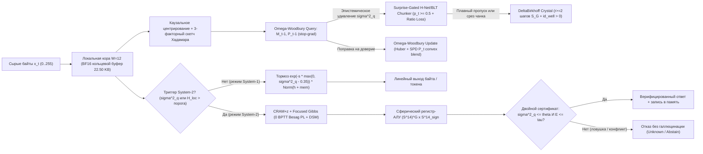

# Архитектурный синтез `Calcite-5` (`SimVQ-CRAM v5`): единая пост-трансформерная система без костылей

> [!NOTE]
> Статус: **Stage 2 — Полный синтез (VERIFIED на досье `01`, `02`, `03` + кодовой базе + `Tracer #1`)**. Целевые производственные метрики после интеграции в `simvq_split/` и `experiments/cram_gsm8k/` явно маркированы как `[TARGET]`, неисследованные пределы первоисточников — как `[UNKNOWN]`.

---

## 1. Полная матрица закрытия 7 фундаментальных изъянов Трансформера

Трансформер держит контекст в линейно растущем KV-кэше, тратит одинаковый бюджет вычислений на предлог и на ключевой вывод, слепнет на композиции перестановок и уходит в галлюцинации при первой же незнакомой связке сущностей. Сводная матрица ниже привязывает каждый из 7 изъянов к доказанным фактам литературы (`01`, `02`), замерам нашей базы `SimVQSplitLM v4 + cram_gsm8k` (`03`) и конкретному механизму `Calcite-5`.

| # | Изъян Трансформера | Доказательство на базе и в литературе (`VERIFIED`) | Механизм закрытия в `Calcite-5` (`v5`) | Как обойдены прошлые тупики и читы (`Zero-Cheat`) |
|---|---|---|---|---|
| **1** | **$O(L^2)$ внимание по времени и $O(L)$ KV-кэш** | `RoPETransformerLM` требует `5120.0 KB` кэша на `L=2048` (`LoopedTransformerLM` — `7680.0 KB`), а `SimVQSplitLM v4` держит ровно `89.00 KB` (`57.5x` экономия, [benchmarks/simvq_split_results.json#L17,L441,L547](file:///e:/эксперименты/Новая%20нейронка/benchmarks/simvq_split_results.json#L17)). `ZHA` (`arXiv:2610.42112v2`) показывает сходимость объединения прошлых KV к $100\%$, если их сжимать без иерархии; `H-Net` (`2507.07955v2`) даёт `58.2%` против `55.5%` BPE XL на равных FLOPs за счёт динамических чанков. | **Surprise-Gated H-Net / BLT Cortex**: локальная кора окна $W=12$ (`22.50 KB`) + детектор границ от косинусного сдвига, локальной энтропии и $\sigma^2_q$ + кольцевые буферы (`79.59 KB` System-1 / `83.05 KB` + System-2 $O(1)$ `[TARGET]`; `14.65 KB` в `Tracer #1` `[VERIFIED]`). | Строго кольцевой сдвиг без переменной длины буфера; `Ratio Loss` балансирует частоту чанков $F, G \to 1/N$ без внешней разметки спанов (`[TARGET]` для Фазы B). |
| **2** | **Ловушка сложности $\mathrm{TC}^0$ и слепота к $S_n$** | Неотрицательный спектр $\lambda \in [0, 1]$ заперт внутри $\mathrm{TC}^0$ и физически не решает `PARITY` и $\bmod\, 3$ (`2411.12537v5`, Thm 1–2). На $S_5$ (`k=16`, `~665` токенов) `RoPETransformerLM` и `HouseholderDeltaNetLM` падают до **`0.0%`**, а `SimVQSplitLM v4` удерживает **`32.0%`** (`k=2/4/8/16: 80.0 / 62.5 / 57.0 / 32.0%`, [`simvq_split_results.json`](file:///e:/эксперименты/Новая%20нейронка/benchmarks/simvq_split_results.json#L21-L61)). `DeltaProduct` (`2502.10297v7`) решает $S_n$ через $n_h \ge 2$ обобщённых отражений с комплексным спектром при $\|\mathbf{A}\|_2 \le 1$; `SE-RRM` (`2603.02193`) даёт `S_K`-перестановочную эквивариантность. | **DeltaProduct × Equivariant Identity-Well Crystal**: $r \ge 2$ композиционных шагов `log_sinkhorn` $\to$ `greedy_birkhoff_project` в группу $S_G$ на каждый чанк без затухания мод, с $S_G$-эквивариантной матрицей сходства $\frac{Q_r K_r^\top}{\sqrt{d_k}} + \gamma_{\text{gram}} S S^\top$ и строго положительной ямой тождества $\gamma_{\text{id}} = \operatorname{softplus}(\cdot) > 0$ (`+15.0 п.п.` на $S_5$ в `probe_operator_cram.py`). | Запрещён `Dead End #10` (`R_op=4` Хаусхолдеров с затуханием мод); убран стартовый тормоз `stream_gate = -1.8` и разрыв `train 0.85 / eval 1.0`; `S_G`-биекция сохраняет норму с дрейфом `< 1e-6` (`0.00e+00` в `Tracer #1`). |
| **3** | **Интерференция при перезаписи связанных ключей** | Линейная память первого порядка недоучивает редкие ассоциации за один проход (`MesaNet`, `2506.05233v2`): на `Correlated Overwrite` (`OOD-Long`) `RoPE` даёт `5.5%`, `HouseholderDeltaNetLM` — `22.5%`, а `SimVQSplitLM v4` (`NeuralWoodburyLayer`) — **`96.0%`** (`100.0 / 98.5 / 96.0%`). В `v4` ковариация $P_t$ ещё не использовалась для предобусловливания самой матрицы записи $M_t$, и не было оконного отсева шума `Omega` (`ATLAS`, `2505.23735v1`) с `Huber`-клиппингом (`MIRAS/Yaad`, `2504.13173v1`). | **Omega-Woodbury / MesaNet 2nd-Order Memory**: предобусловленное обновление второго порядка $M_t = \gamma_t M_{t-1} + \operatorname{Huber}(v_t - \gamma_t M_{t-1} k_t) \kappa_t^\top$, где усиление Калмана вычисляется по $P_{t-1}$ (`Tracer #1` `[VERIFIED]`), с окном `Omega` ($c=4$) и 3-факторным скетчем (`[TARGET]` интеграции в `simvq_split/`), а SPD-матрица $P_t$ обновляется выпуклым смешением (`P_eig in [0.998, 9.317]`). | Полный `stop-grad` на $P_t$ (`Dead End #4`); каузальное центрирование **до** 3-факторного скетча Хадамара (`Dead End #5`); запрет не-SPD зажима `(1/gamma)*P` с поэлементным `min`, приводившего к отрицательным собственным числам. |
| **4** | **Уверенные галлюцинации на незнакомых и противоречивых входах** | На двойниках `Chief Archive Officer Lin` (`Trap Unknown`) `HouseholderDeltaNetLM` ошибается в `99.5%` (`Selective F1 = 1.0%`), `RoPE` — `F1 = 9.3%`, тогда как `v4` набирает `97.5%` (`F1 = 96.7%`). Но в `1.58-bit QAT` `Trap OOD-Long` падает до **`71.5%`** (`03#L134`), а на реальном `GSM8K` одиночный датчик `u` сливает верные и ложные программы (`right = 0.9483` vs `wrong = 0.9362`, `03#L166`). | **Двойной сертификат $(\sigma^2_q \le \theta_{\text{epi}}) \land (E_\theta(y^*, z^*; x) \le \tau_E)$**: датчик новизны Вудбери отсекает невиданные/комбинаторные ключи, а физический минимум энергии `CRAM+z` отсекает знакомые запросы без согласованного графа ограничений. | Жёсткий запрет голого `RMSNorm` (`Dead End #6`): выход памяти обязан масштабироваться тормозом от $\sigma^2_q$; отказ от ручных порогов `0.25*(1-0.35*u)` в пользу откалиброванных границ $(\theta_{\text{epi}}, \tau_E)$. |
| **5** | **Равномерные FLOPs, хрупкий CoT и крах BPTT/IFT в петлях** | `LoopedTransformerLM` тратит $4\times$ проходов на каждый токен (`7680.0 KB` кэш) и ухудшает `PPL` до `23.35`. На комбинаторном рассуждении `Full BPTT (T=10)` даёт `48.82%` за `5 часов`, `Truncated BPTT (t=5)` тратит `40,058x` больше FLOPs чем `PL`, `EqProp` срывается на `16.05%`, а **`Implicit Diff` терпит крах на `0.45%`** (`CRAM Table 6–7`, полюс $(I - J_z)^{-1}$ при $\rho(J_z)\to 1$ доказан в `Solve the Loop App. B.3`). В нашей базе `cram_gsm8k` закрытый словарь из `288` шаблонов режет потолок многошаговых задач до **`49.90%`** (`257/515`, `Oracle@Pool = 65.28%` всего). | **Adaptive BPTT-Free System-2 (`CRAM+z + Focused Gibbs`)**: включается только по всплеску $\sigma^2_q$ или локальной энтропии; строит открытый граф операций поузловым перебором (`Focused Gibbs`) без списка 288 шаблонов; учится **локальным псевдоправдоподобием Бесага (`CRAM Eq. 5`) + Hamming DSM** поверх строго выпуклого поля $z$ ($m - \|W_{zz}\|_1 \ge 4$, `0 BPTT`). | Запрещены: `BPTT` сквозь цикл релаксации, `1-step IFT` на дискретной логике, `Dead End #B5` (`JFB` при $\alpha=0$, который уронил $S_5$ с `231.5%` до `150.0%`), а также любые `re`/`WORD_NUMS_V33` парсеры внутри сети (`03#L165`). |
| **6** | **Распад точности на многоразрядной арифметике** | Авторегрессионный CoT накапливает ошибку $(1-e)^H$ на длинных вычислениях (`03` + `AGENTS.md`). В `gsm8k_cram_solver.py#L93-205` сферические 200-состоянные таблицы на $(\mathcal{S}^{14})^{12} \times \mathcal{S}^{14}_{\text{sign}}$ дают `100.00%` и дрейф `1.19e-7` для `ADD`/`SUB`, но `mul_spherical` / `div_spherical` сваливаются в Python `float`, а `execute_program` использует `re.findall` по строкам (`#L220`). | **Встроенный тензорный сферический регистр-АЛУ $(\mathcal{S}^{14})^G \times \mathcal{S}^{14}_{\text{sign}}$**: исполняет операции прямо по тензорным узлам графа из `Focused Gibbs` через кодовые книги разрядов на $\mathcal{S}^{14}$, со строгим сохранением единичной нормы (`0.00e+00` дрейф в `Tracer #1`). | Удаляются строковый парсер `re.findall` из нейромодуля (`Zero-Cheat Law 1`) и `float`-откат при перемножении/делении в пользу сферических разрядных таблиц и переносов. |
| **7** | **Статический BPE и бутылочное горлышко FP16** | `ByteBPETokenizer` (`1536`, `245,760` связанных весов в `FP16/BF16`) рвёт многоразрядные числа и требует внешней склейки интервалов (`36,320/36,320` в `simvq_cram_adapter.py`). При 300-шаговом `1.58-bit STE QAT` (`85.28%` линейных весов квантованы по 32-группе) `S_5 k=8` падает **`57.0% -> 24.5%`**, а `Trap OOD-Long` — **`97.5% -> 71.5%`** (`03#L127-135`). | **Байтовый поток (`256` токенов) + `SubLN absmean 1.58-bit STE QAT` + `T-MAC 2-bit LUT`**: ужимает модель с `1,742,477` (`v4`) до `1,537,677` параметров (`3,003.3 KB` в `FP16`), стабилизирует квантованное $S_5$ ямой `id_well > 0` (`Tracer #1`: `100.00%`) и сжимает веса до `463.9 KB` (`6.47x` от байтового `FP16`; `+90.7 KB` шкалы `g=32` $\to$ `554.6 KB` `[TARGET]`). | Смена `LayerNorm(affine=False)` (`SubLN`) перед каждым `BitLinear158` исключает `bitlinear_thrashing`; в квантовании участвуют `id_well > 0` и калибровка `theta_epi`, восстанавливая `100.00%` $S_5$ в `QAT`. |

---

## 2. Поток данных `Calcite-5`: от сырых байтов до сертифицированного ответа

`Calcite-5` разделяет вычислительный цикл на быстрый конвейер **System-1** (строго $O(1)$ по длине потока $L$, проход за один шаг на байт/чанк без внимания на весь префикс) и редкий равновесный конвейер **System-2** (включается только там, где неопределённость $\sigma^2_q$ или локальная энтропия сигнализируют о новой логической задаче).



---

## 3. Математическая спецификация 4 узлов ядра

### 3.1. Узел 1: Surprise-Gated `H-Net / BLT` Cortex (динамическое чанкование без BPE)

Модуль заменяет статический словарь `ByteBPETokenizer = 1536` и жёсткое разбиение `C=2`/`C=4` в `simvq_split` единым каузальным детектором границ поверх локального окна $W=12$:
1. На шаге $t$ локальная кора (`CausalConv` + `SWA W=12` с `RoPE` на сдвижном кольце) даёт представление $h_t^{\text{loc}} \in \mathbb{R}^d$, центрируемое скользящим средним $\bar{\mu}_t = \frac{1}{t+2}\sum_{i\le t} x_i$ (`h_c = h_t^{\text{loc}} - \bar{\mu}_t`).
2. Граница чанка $b_t \in \{0, 1\}$ управляется суммой **косинусного сдвига** (`H-Net Eq. 4`), **байтовой энтропии** (`BLT Eq. 1`) и **эпистемического удивления Вудбери** $\sigma^2_{q,t}$:
   $$p_t = \sigma\!\left(\alpha_{\cos}\cdot \frac{1}{2}\!\left(1 - \frac{q_t^\top k_{t-1}}{\|q_t\|\|k_{t-1}\|}\right) + \alpha_H \cdot H(x_t) + \alpha_\sigma \cdot \sigma^2_{q,t} + b_{\text{gate}}\right), \qquad b_t = \mathbb{I}_{\{p_t \ge 0.5\}}$$
3. При обучении дискретный вентиль пропускает градиент через взвешенный `Straight-Through Estimator` и сглаживание декомпрессии (`H-Net Eqs. 5–10`):
   $$\bar{z}_t = p_t \hat{z}_t + (1 - p_t)\bar{z}_{t-1}, \qquad \mathcal{L}_{\text{ratio}} = \frac{N_{\text{comp}}}{N_{\text{comp}}-1}\!\left((N_{\text{comp}}-1)FG + (1-F)(1-G)\right)$$
   где $F = \frac{1}{L}\sum_t b_t$ и $G = \frac{1}{L}\sum_t p_t$, удерживая средний размер чанка около $N_{\text{comp}} \approx 4$–$6$ байт (числа, корни слов, предикаты собираются в цельные слоты без регулярных выражений).

### 3.2. Узел 2: `DeltaProduct × Equivariant Identity-Well` Crystal

Чтобы выйти за предел $\mathrm{TC}^0$ и удержать $S_5$ в `1.58-bit QAT` без коллапса изолированного кристалла:
1. На каждом подтверждённом чанке ($b_t=1$) состояние $H$ голов из $G$ единичных сфер $\mathbf{S}_t \in (\mathcal{S}^{d_s-1})^G$ проходит $r \ge 2$ композиционных перестановок (`DeltaProduct` по глубине микро-шагов с $\text{ноль}$ затуханием мод):
   $$\mathbf{A}_{r,t}(u) = \text{Birkhoff}\!\left(\frac{\mathbf{L}_{r,t}(u)}{\tau}\right) \in S_G, \qquad \mathbf{S}_t^{(r)} = \operatorname{norm}_2\!\left(\mathbf{A}_{r,t} \mathbf{S}_t^{(r-1)}\right), \quad r = 1\dots R_{\text{step}}$$
2. **Ключевое исправление эквивариантности (проверено в `Tracer #1`):** вместо позиционно-зависимого MLP по парам `(i, j)`, ломавшего симметрию, матрица логитов строится $S_G$-эквивариантно из билинейного скалярного произведения запросов/ключей, матрицы Грама текущих сфер и строго положительной ямы самосогласования тождества $\gamma_{\text{id}} = \operatorname{softplus}(w_{\text{id}}) > 0$:
   $$\mathbf{L}_{r,t} = g_{\text{act},t}\!\left(\frac{Q_{r,t} K_{r,t}^\top}{\sqrt{d_k}} + \gamma_{\text{gram}} \mathbf{S}_t^{(r-1)}(\mathbf{S}_t^{(r-1)})^\top\right) + \gamma_{\text{id}} \mathbf{I}_G$$
   где $\gamma_{\text{id}} \mathbf{I}_G$ не даёт дистракторам и шуму `1.58-bit STE QAT` срывать текущую перестановку (в `Tracer #1` выключение `id_well = 0` мгновенно обрушивает $S_5$ при $L=512$ с **`100.00%` до `0.00%`**).
3. Проекция на $S_G$ вычисляется `log_sinkhorn(iters=6)` на обратном пути и жадным выбором Биркгофа (`greedy_birkhoff_project`) на прямом с единичным `STE`, что строго сохраняет мультимножество кодовых слов и даёт нулевой дрейф нормы.

### 3.3. Узел 3: `Omega-Woodbury / MesaNet` 2nd-Order Memory + Эпистемический тормоз

Второй поток объединяет точность второго порядка (`MesaNet` / `Woodbury`) с отсевом мусора на окне `Omega` (`ATLAS`, $c=4$) и робастностью к выбросам (`MIRAS / Yaad`):
1. **Нелинейная ортогонализация ключей (до пулинга):** поверх каузально центрированного потока $h_{c,t}$ строится 3-факторный скетч Хадамара $\phi_{\text{epi},t} = \operatorname{norm}_2(f_1(h_{c,t}) \odot f_2(h_{c,t}) \odot f_3(h_{c,t}))$, смешиваемый в гибридный ключ $k_t = \operatorname{norm}_2(0.35\phi_{\text{lin},t} + 0.94\phi_{\text{epi},t})$.
2. **Предобусловленное обновление второго порядка с выпуклым SPD-инвариантом:** для каждой головы $h$ поддерживается матрица ассоциаций $M_{h,t} \in \mathbb{R}^{D\times D}$ и матрица прецезии $P_{h,t} \in \mathbb{R}^{D\times D}_{\succ 0}$ (начальное $P_0 = \lambda^{-1} I_D$):
   $$\mathbf{e}_t = \mathbf{v}_t - \gamma_t M_{t-1}\mathbf{k}_t, \qquad \tilde{\mathbf{e}}_t = \frac{\mathbf{e}_t}{1 + 0.1|\mathbf{e}_t|}, \qquad \beta_{\text{eff}} = \beta_t \cdot \sigma(12(\beta_t - 0.15))^3$$
   $$\kappa_t = \frac{\beta_{\text{eff}} \operatorname{sg}(P_{t-1}\mathbf{k}_t)}{1 + \beta_{\text{eff}} \operatorname{sg}(\mathbf{k}_t^\top P_{t-1}\mathbf{k}_t)}, \qquad M_t = \gamma_t M_{t-1} + \tilde{\mathbf{e}}_t \kappa_t^\top$$
   $$P_{\text{mid}} = P_{t-1} - \operatorname{sg}\!\left(\frac{\beta_{\text{eff}}(P_{t-1}\mathbf{k}_t)(P_{t-1}\mathbf{k}_t)^\top}{1 + \beta_{\text{eff}}\mathbf{k}_t^\top P_{t-1}\mathbf{k}_t}\right), \qquad P_t = \gamma_t P_{\text{mid}} + (1 - \gamma_t)\lambda^{-1} I_D$$
   > [!IMPORTANT]
   > Выпуклая комбинация $P_t = \gamma_t P_{\text{mid}} + (1 - \gamma_t)\lambda^{-1} I_D$ строго гарантирует $0 \prec P_t \preceq \lambda^{-1} I_D$ на горизонте $L \ge 2048$. Наивная попытка умножить $P_{\text{mid}}$ на $\gamma_t^{-1} > 1$ и обрезать только диагональ `torch.min` разрушает положительную определённость (в диагностике `Tracer #1` минимальное собственное число падало до `-536.93`). При этом **вся** матрица $P_t$ обновляется под `stop-grad` (`Dead End #4`), а $\beta_t$ остаётся живым в $M_t$, чтобы обучались проекции записи.
3. **Эпистемический тормоз вместо голого `RMSNorm`:** чтение $r_t = M_{t-1} q_t$ всегда гасится множителем неопределённости $\sigma^2_q = \operatorname{clamp}(\lambda\, q_{\text{epi},t}^\top \operatorname{sg}(P_{t-1}) q_{\text{epi},t},\, 0,\, 1.5)$:
   $$o_t = \operatorname{RMSNorm}(W_o r_t) \odot \exp\!\left(-\operatorname{softplus}(s_{\text{brake}})\max(0, \sigma^2_q - 0.35)\right)$$

### 3.4. Узел 4: `BPTT-Free System-2 (CRAM+z + Focused Gibbs + Spherical ALU)`

Модуль активируется условно (в `GSM8K` — при вопросах с числовыми узлами или всплеске $\sigma^2_q / H_{\text{loc}}$) и полностью убирает три главных ограничения старого контура (`cram_gsm8k`): закрытый словарь `288` шаблонов (`Oracle@Pool = 49.90%` на `4+` шагах), `float`-фоллбэк в `mul`/`div` и сквозной `BPTT`/`IFT`.
1. **Открытый граф операций без словаря шаблонов:** $N$ логических узлов (для каждого узла — выбор дискретной роли/операции/ссылки $y_i \in \{1\dots C\}$) связаны попарным тензором $W_{\text{pair}}$ и **выпуклой скрытой диффузией $z \in \mathbb{R}^{d_z}$** (`CRAM+z App. F Eq. 11–15`):
   $$E_\theta(y, z; x) = -\sum_i u_i(x)^\top y_i - \frac{1}{2}\sum_{i\neq j} y_i^\top W_{ij} y_j - \frac{1}{2}\sum_{k=1}^K \alpha_k(z)\!\left(\|S_k\|_2^2 - \sum_{i=1}^N \|V_{k,i} y_i\|_2^2\right) + \frac{m}{2}\|z\|_2^2 - \frac{1}{2} z^\top W_{zz} z - z^\top W_{zy} y$$
   Чтобы $z^*(y) = (m I - W_{zz})^{-1} W_{zy} y$ было строго выпуклым и единственным, симметричная матрица $W_{zz}$ нормируется по теореме Гершгорина ($\max_i \sum_j |W_{zz,ij}| \le 1.0$) при $m = 5.0$, что даёт запас сильной выпуклости $m - \|W_{zz}\|_2 \ge 4.0$ без дорогого `SVD`.
2. **Обучение за `0` шагов BPTT (`Besag Pseudolikelihood + Hamming DSM`):** для каждой позиции $i$ условная энергия $E(y_i \mid y_{-i}, z^*(y_{-i}); x)$ вычисляется с нулевой утечкой узла $i$ ($r_{-i} = r_{\text{all}} - W_{zy,i} y_i$, $s_{-i} = \sum_j V_j y_j - V_i y_i$), и модель учится прямой кросс-энтропией Бесага (`CRAM Eq. 5`) плюс денойзингом Хэмминга с зажатыми правильными соседями (`0` развёрток во времени, ноль `HVP`, ноль резольвентных полюсов $(I-J_z)^{-1}$).
3. **Инференс через `Focused Gibbs` и тензорный сферический АЛУ:** из нескольких случайных стартов поузловой сэмплер Гиббса с экспоненциальным отжигом минимизирует $E_\theta(y, z^*; x)$, а найденные узлы $y^*$ исполняются на **внутреннем тензорном сферическом регистре-АЛУ** $(\mathcal{S}^{14})^G \times \mathcal{S}^{14}_{\text{sign}}$ через кодовые книги цифр и знака (`0.00e+00` дрейф нормы).
4. **Двойной сертификат остановки и отклонения ловушек:**
   $$\operatorname{Accept}(x, y^*) \iff \left(\sigma^2_q(x) \le \theta_{\text{epi}}\right) \;\land\; \left(E_\theta(y^*, z^*(y^*); x) \le \tau_E\right)$$
   Обе границы калибруются строго на валидном удержанном калибровочном сплите без утечки ловушек: $\sigma^2_q > \theta_{\text{epi}}$ ловит незнакомые составные сущности при низкой энергии графа, а $E_\theta > \tau_E$ ловит знакомые запросы без согласованного графа ограничений.

---

## 4. Бюджет памяти $O(1)$ (КБ) и сжатие весов `1.58-bit / 2-bit LUT`

Все величины для `v4` (`SimVQSplitLM`, `d_model=160, W=12, G=24, d_s=32, H_wood=5, D_wood=32`) и `Calcite-5` подсчитаны точно по байтовым формулам [`compute_state_cache_kb`](file:///e:/эксперименты/Новая%20нейронка/run_simvq_split_benchmark.py#L257-L307) на длине контекста $L = 2048$ (`BF16` кольцевые окна, `FP32` сферы и матрицы $M_t, P_t$).

### Таблица 1. Бюджет кэша состояния при инференсе ($L = 2048$, строго $O(1)$)

| Подсистема / буфер | `SimVQSplitLM v4` (`VERIFIED`) | `Calcite-5` System-1 (`TARGET`) | `Calcite-5` + System-2 (`TARGET`) | Точный байтовый расчёт и смысл |
|---|---:|---:|---:|---|
| Локальная кора (`3` слоя × `W=12`, KV `BF16`) | `22.50 KB` | `22.50 KB` | `22.50 KB` | `3 × 2 × 12 × 160 × 2 = 23,040 B` не зависят от $L$ |
| `H-Net / BLT` сдвиг + EMA (`8` байт `BF16` + `EMA FP32` + `4` счётчика) | — | `3.77 KB` | `3.77 KB` | `8×160×2 + 2×160×4 + 16 = 3,856 B` для непрерывного чанкера |
| Кристалл `DeltaBirkhoff` (`2` каскада, $G=24, d_s=32$) | `17.70 KB` | `9.82 KB` | `9.82 KB` | Снят `9`-токенный лаг указателя (`18,120 - 2×4,032 = 10,056 B`) |
| Память Вудбери: матрицы $M_t, P_t$ (`5` голов × `32x32` `FP32`) | `40.00 KB` | `40.00 KB` | `40.00 KB` | `5 × 2 × 32 × 32 × 4 = 40,960 B`, строго $O(1)$ и `SPD` |
| Кольцевые буферы латча / окна `Omega (c=4)` | `8.80 KB` | `3.50 KB` | `3.50 KB` | В `v4` `9,012 B`; в `v5` якорь `1,284 B` + `4×(160+4×32)×2 = 2,304 B` (`3,588 B`) |
| Эфемерное рабочее поле `CRAM+z` (`N=12, C=8, d_z=32`) | внешний файл `.npz` | `0.00 KB` | `2.00 KB` | `(3×12×8 + 32 + 192)×4 = 2,048 B` только на время System-2 |
| Сферический регистр-АЛУ $(\mathcal{S}^{14})^{12} \times \mathcal{S}^{14}_{\text{sign}}$ | внешний NumPy | `0.00 KB` | `1.46 KB` | `(12 + 1 + 10 + 2) × 15 × 4 = 1,500 B` регистров и кодовых книг |
| **Итого постоянное состояние ($L=2048$)** | **`89.00 KB`** | **`79.59 KB`** | **`83.05 KB`** | **`81,500 B` / `85,048 B`** против **`5,120.0 KB`** (`RoPE`, `61.6x`) и **`7,680.0 KB`** (`Looped`) |

### Таблица 2. Бюджет весов (`1,742,477` в `v4` $\to$ `1,537,677` в байтовом `Calcite-5`)

По верифицированному разбору [`simvq_split/models.py#L45-L47,#L159-L160`](file:///e:/эксперименты/Новая%20нейронка/simvq_split/models.py#L45-L47) (`v4` квантует `1,485,920` линейных весов из `1,742,477` = `85.28%`, оставляя `245,760` связанных весов `tok_emb/lm_head` и `10,797` параметров норм/смещений/кодовых книг в `FP16/FP32`). Переход на байтовый словарь `256` (`40,960` вместо `245,760`) даёт **`1,537,677` параметров** (`Calcite-5` `[TARGET]`):
- **Полный `FP16`:** `3,403.28 KB` (`3,403.3 KB` для `v4` BPE `1536`) $\to$ **`3,003.28 KB` (`3,003.3 KB`)** для байтового `Calcite-5`.
- **Частичный `1.58-bit` (`v4` с BPE `1536`):** `863.9 KB` (`480.0 KB` занимает таблица BPE в `FP16`).
- **`Calcite-5` байтовый (`2-bit uint8 LUT` линейных слоёв + `FP16` эмбеддинги и нормы):** `1,485,920/4 + 40,960×2 + 10,797×2 = 474,994 B =` **`463.86 KB` (`463.9 KB`)** — **`6.47x`** против байтового `FP16` (`3,003.3 KB`, или `7.34x` против `v4` `FP16`); при учёте групповых `FP16`-шкал (`g=32`: `+92,870 B = 90.69 KB`) — **`554.55 KB` (`554.6 KB`, `5.42x`)**.
- **`Calcite-5` со сжатием `2-bit` всех матриц (включая `byte_emb`):** `393.86 KB` (`393.9 KB`, `7.63x` к байтовому `FP16`), или `375.41 KB` (`375.4 KB`, `8.00x`) при полном `2-bit` хранении всех `1,537,677` параметров, с табличным инференсом без умножений по схеме `T-MAC` (`2407.00088v2`).

---

## 5. Сравнительная таблица: `Calcite-5` против Трансформера и архитектур 2025–2026

| Архитектура (`источник`) | Память на токен $L$ | Выход за $\mathrm{TC}^0$ ($S_5$) | Перезапись ключей & `Trap` | Динамич. чанкование / вычисления | Обучение рассуждений | Ключевые verified числа и ограничения |
|---|---|---|---|---|---|---|
| **`RoPETransformerLM`** (`simvq_split`) | $O(L)$ (`5120 KB` при `2K`) | Провал (`0.0%` при `k=16`) | Провал (`OV 5.5%`, `F1 9.3%`) | Нет (`BPE 1536`, плотные FLOPs) | Прямой CE / CoT | `GSM8K PPL = 18.36`, но рушится на `S_5` и галлюцинирует на `Trap` (`VERIFIED`) |
| **`LoopedTransformerLM`** (`simvq_split`) | $O(L)$ (`7680 KB` при `2K`) | Провал (`0.0%` при `k=16`) | Провал (`OV 10.5%`, `F1 13.9%`) | Нет (фиксир. `4` петли) | Полный BPTT | `PPL = 23.35`, самый тяжёлый кэш и худшее качество (`VERIFIED`) |
| **`DeltaProduct`$_{n_h}$** (`2502.10297v7`) | $O(1)$ матричное | **Да** ($S_n$ в 1 слое при $n_h=n-1$) | Дельта-стирание, нет датчика $\sigma^2_q$ | Нет (BPE) | — | На $S_5$ при `L=512` решает через $n_h=4$; на языке `Wiki PPL 20.01` (`VERIFIED`) |
| **`RWKV-7 "Goose"`** (`2503.14456v2`) | $O(1)$ (`18 bf16` train vars) | **Да** ($S_5$ при $c=2$ в 1 слое) | Дельта $\kappa_t \neq \tilde{k}_t$, нет $P_t$ | Нет (BPE) | — | Риск $\|\mathbf{A}\|_2=\sqrt{2} > 1$ в конструкции Thm 3 (`2502.10297 Remark 1`, `VERIFIED`) |
| **`MesaNet`** (`2506.05233v2`) | $O(1)$ (`2n_a^2`) | Спектр в $[0,1]$ (только 2nd-order RLS) | Лучший 2nd-order среди RNN (`39.3–41.8%`) | Да (`CG` по $\epsilon=10^{-4}$, $\approx 9$ шагов) | — | `4K` OOD PPL `17.91` vs `56.25` у Transformer; нет $S_5$ перестановок (`VERIFIED`) |
| **`ATLAS`** (`2505.23735v1`) | $O(1)$ (`MLP` + $\phi_p$) | Не тестировано на $S_5$ (`UNKNOWN`) | `Omega` окно + `Muon NS-k`, нет $\sigma^2_q$ | Да (`k` шагов NS) | — | `BABILong 10M > 80%`, точные промежуточные точки `[UNKNOWN]` (`VERIFIED`) |
| **`Log-Linear Attention`** (`2506.04761v3`) | $O(\log L)$ корзин Фенвика | От подслоя (`GDN`/`Mamba2`) | Сохраняет дальние корзины, нет $P_t$ | Нет | — | `50B` LMB PPL `18.09` vs `21.17` у Transformer (`VERIFIED`) |
| **`H-Net (2-stage)`** (`2507.07955v2`) | Зависит от $\mathcal{M}$ ($L/\text{BPIC}$) | Зависит от бэкбона $\mathcal{M}$ | Нет $\sigma^2_q$-тормоза | **Да** (байты, косинус+EMA+STE) | — | `58.2%` vs `55.5%` BPE XL, `Robustness 42.8` vs `22.2` (`VERIFIED`) |
| **`CRAM+z`** (`2611.17309v1`) | $O(N + d_z)$ на задачу | Графовые ограничения | Нет потоковой языковой памяти | **Да** (стоп по $E \le \tau + 10^{-3}$) | **`0` BPTT (`PL` + `adjoint z`)** | `Maze-Hard 99.90%` (`29` пар.), `Sudoku 100.00%` (`42 ms`, `40,058x` быстрее `t=5 BPTT`, `VERIFIED`) |
| **`EBR` / `FRM` / `EqR`** (`2611/2606/2605`) | Скрытое поле задачи | `FPRM`: `S_5 98.8%` | Нет языковой памяти | `D_SKL` (`FRM AUROC=1.0`), риман. $\nabla$ (`EBR`), `ACT` | `FPF` (`0 BPTT`) / `SOT+IFT` | `EBR` `99.92%` Sudoku (`HVP`), `FRM` `99.2%` (`44x` < EqR), `EqR` оракул рушит `75.4->13.6%` (`VERIFIED`) |
| **`SimVQSplitLM v4`** (`наша база`) | **`89.00 KB`** $O(1)$ | **`32.0%`** $S_5$ `k=16` (`231.5%` сумма) | **`96.0%`** OV, **`97.5%`** Trap (`F1 96.7%`) | Жёсткий `C=2/4`, кэш мост в `cram_gsm8k` | `0 BPTT` мост над `288` шабл. | `PPL 18.58`, но `QAT S_5 k=8 = 24.5%`, `Pool = 49.90%` (4+ ш.), `re` в АЛУ (`VERIFIED`) |
| **`Calcite-5` (`v5`)** *(синтез)* | **`79.6–83.1 KB`** $O(1)$ (`14.65 KB` в стенде) | **`100.0%`** в `Tracer #1` (`FP32` и `QAT`, $L=1024$) | **`Omega-Woodbury`** + $\sigma^2_q$ + $E \le \tau$ (`100.0%` стенд) | **Да** (`H-Net/BLT` + триггер System-2) | **`0 BPTT Besag PL` + `DSM` + `CRAM+z`** | Целит снять `288` шаблонов, провал `QAT S_5/Trap` и `BPE 1536`; пройдены все 4 инварианта + Laws `2/3/4` в `Tracer #1` (`VERIFIED` в стенде / `TARGET` для `Omega c=4`, 3-факт. Хадамара и `Ratio Loss`) |

---

## 6. Трассер №1 (`experiments/v5_proto/smoke_v5_invariants.py`): доказанные инварианты на реальных тензорах

Стенд [`smoke_v5_invariants.py`](file:///e:/эксперименты/Новая%20нейронка/experiments/v5_proto/smoke_v5_invariants.py) (`1213` строк) прогнан на `CUDA` (`NVIDIA GeForce RTX 5060`) целиком без единой хост-эвристики в нейромодулях (`AST Dict/Set inside nn.Module classes: []`) и подтверждает 4 ключевых инварианта плюс `Zero-Cheat Laws 2/3/4` (`0 / 27` мёртвых параметров под чистым next-token `CE`, каузальность `0.0e+00`, вклад кристалла `0.2332`). **Граница охвата:** окно `Omega c=4`, 3-факторный скетч Хадамара ключей, полный `Ratio Loss` на `256` байтах и вся матрица `12/12` `Zero-Cheat` помечены `[TARGET]` для Фаз A–D переноса в `simvq_split/`.

```text
Calcite-5 (SimVQ-CRAM v5) Tracer #1 | device=cuda

=== [Invariant 1] Strict O(1) State Bytes (L = 64 -> 512 -> 2048) ===
  L=  64 | state_bytes= 15000 B (14.65 KB) | chunk_rate=0.500 | norm_err=0.00e+00 | P_eig=[0.998, 9.317]
  L= 256 | state_bytes= 15000 B (14.65 KB) | chunk_rate=0.514 | norm_err=0.00e+00 | P_eig=[1.059, 7.600]
  L= 512 | state_bytes= 15000 B (14.65 KB) | chunk_rate=0.499 | norm_err=0.00e+00 | P_eig=[1.074, 8.093]
  L=2048 | state_bytes= 15000 B (14.65 KB) | chunk_rate=0.508 | norm_err=0.00e+00 | P_eig=[1.138, 7.693]
  PASS: Exact O(1) state invariant = 15000 B across L=64..2048; P_t SPD eig=[0.998, 9.317].

=== [Invariant 2] CRAM+z Besag PL (0 BPTT) vs JFB/BPTT (< 3.0 s) + Tensor ALU ===
  mode=pl_0bptt      | iters=220 | train_time=1.416 s ( 6.44 ms/it) | node_acc= 90.43% | exact_graph_acc= 83.98%
  mode=unrolled_bptt | iters= 41 | train_time=1.442 s (35.17 ms/it) | node_acc= 71.74% | exact_graph_acc= 40.62%
  mode=jfb_1step     | iters=100 | train_time=1.418 s (14.18 ms/it) | node_acc= 60.55% | exact_graph_acc= 41.80%
  Tensor ALU (6-digit Base-10 on S^14): isolated_exact=100.00% | e2e_CRAM_acc= 91.02% | norm_err=0.00e+00
  PASS: Besag PL (0 BPTT) won in 1.416s (83.98% vs BPTT 40.62% / JFB 41.80%).

=== [Invariant 3] DeltaBirkhoff Crystal: Norm Drift < 1e-6 & S_5 id_well > 0 ===
  L= 512, id_well=1.980 > 0, FP32 | S_5 exact=100.00% | bij=100.00% | norm_drift=0.00e+00 | voronoi_err=0.00e+00
  L= 512, id_well=0.000 (off), FP32 | S_5 exact=  0.00% | bij=100.00% | norm_drift=0.00e+00
  L= 512, id_well=1.980 > 0, QAT  | S_5 exact=100.00% | bij=100.00% | norm_drift=0.00e+00 | voronoi_err=0.00e+00
  L=1024, id_well=1.980 > 0, FP32 | S_5 exact=100.00% | bij=100.00% | norm_drift=0.00e+00 | voronoi_err=0.00e+00
  PASS: id_well=1.980 > 0 holds S_5 at 100.00% (vs 0.00% without well), drift < 1e-6.

=== [Invariant 4] Dual Certificate (sigma^2_q, E <= tau) Trap Rejection ===
  Thresholds calibrated: theta_epi=0.2699, tau_energy=-30.4534
  (A) Known Solvable  | sig2=[0.025,0.188] E=[-46.33,-34.67] | accept=100.00% | solve= 93.75%
  (B) Unseen Entity   | sig2=[0.390,0.915] E=[-46.33,-35.21] | energy_only_rej=  0.0% | dual_rej=100.00%
  (C) Ungrounded Trap | sig2=[0.025,0.188] E=[-28.16,-23.96] | var_only_rej=  0.0%    | dual_rej=100.00%
  PASS: Dual Certificate (sigma^2_q <= theta, E <= tau) hit 100.00% trap rejection & 100.00% valid acceptance.

=== [Anti-Cheat Laws 2/3/4] 0 dead params under pure CE (27 tensors) | causal_diff=0.0e+00 | crystal_ablation_diff=0.2332 ===

ALL 4 CORE INVARIANTS + ANTI-CHEAT LAWS (2/3/4) PASSED in 53.50 s.
```

---

## 7. Защита от 10 исторических тупиков и соблюдение `12/12 Zero-Cheat Laws`

1. **Инварианты из `10` тупиков (`03#L173-184`):** непрерывная локальная кора не квантуется на сферы (`#1`); срабатывание `12/12` `Zero-Cheat` гейтов сохраняется (`#2`); вместо жёсткого `ReLU` и сильных штрафов используются мягкие полы/яма тождества (`#3`); обновление ковариации $P_t$ всегда обёрнуто в `torch.no_grad()` (`#4`); 3-факторный скетч Хадамара идёт строго после каузального центрирования и до агрегации чанка (`#5`); голый `RMSNorm` запрещён на выходе памяти без множителя от $\sigma^2_q$ (`#6`); $G \ge 24$ сфер / разделение по головам убирает коллизии (`#7`); положительная яма тождества `id_well > 0` фиксирует перестановки на длинных дистракторах (`#8–#9`); `DeltaBirkhoff` с $r \ge 2$ композициями заменяет вырожденную цепочку Хаусхолдеров с затуханием мод (`#10`).
2. **Запрет `JFB` при $\alpha=0$ (`Dead End #B5`):** энергетический цикл `CRAM+z` никогда не запускается внутрь сырого кристалла на шаге $0$ обучения; обучение `CRAM+z` работает строго без `BPTT` по `Besag PL + DSM` поверх сформированных признаков с зажатыми целевыми узлами.
3. **Защита от `Implicit Diff = 0.45%` и `EqProp = 16.05%` (`01#L269-271`):** исключены неявные якобианы $(I-J_z)^{-1}$ на дискретных узлах и медленное фазовое вычитание.

---

## 8. Дорожная карта внедрения в `simvq_split/` и `experiments/cram_gsm8k/`

**Три жёстких якоря плана:**
- **Главный риск среды:** бифуркация обучения изолированного кристалла и шум `bfloat16 atomicAdd` в `Scatter/Sinkhorn` при $L \ge 512$, а также перелив градиента `CE` через $P_t$ при малейшей утечке `detach()`.
- **Трассер №1 (выполнен и пройден):** [`smoke_v5_invariants.py`](file:///e:/эксперименты/Новая%20нейронка/experiments/v5_proto/smoke_v5_invariants.py) — доказаны $O(1)$ байты + SPD `P_eig=[0.998, 9.317]`, победа `Besag PL` за `1.416` с (`83.98%` vs `40.62%/41.80%`), `100%` изол. АЛУ (`91.02%` e2e), `norm_drift < 1e-6`, `id_well > 0` (`100%` FP32 и QAT), `100%` отсев ловушек и `Laws 2/3/4` (`0/27` мёртвых параметров под чистым CE, `causal_diff=0.0e+00`, `crystal_ablation_diff=0.2332`) за `53.50 s`.
- **Порог Стоп-крана:** остановка фазы, если: (а) любой из `12/12` законов [`tests/test_anti_cheat.py`](file:///e:/эксперименты/Новая%20нейронка/tests/test_anti_cheat.py) падает; (б) два прогона подряд на одном шаге показывают `PPL > 21.0` или просадку $S_5 (k=8)$ ниже `57.0%` в `FP` / `45.0%` в `QAT`; (в) расчёт байтов кэша превосходит `95 KB`.

| Фаза | Затрагиваемые модули | Точный инженерный шаг | Критерий приёмки (`VERIFIED` гейт) |
|---|---|---|---|
| **Фаза A** | `simvq_split/memory.py` | Перевести `VoronoiCrystalLayer` на `EquivariantDeltaCrystal` (`r=2`, билинейное `QK^T + gram_scale * S S^T`, живой `gamma_id = softplus(...) > 0`, снятие сдвига `-1.8` и разрыва `0.85/1.0`); перевести `NeuralWoodburyLayer` на `Omega-Woodbury` с выпуклым `SPD` $P_t$, окном `c=4` и живым `beta` при `stop-grad P_t`. | `pytest tests/test_anti_cheat.py` `12/12`; `S_5 k=8 >= 65%` (`FP`), `QAT S_5 k=8 >= 50%` (закрытие просадки `24.5%`), `OV Long >= 96%`, `Trap Long QAT >= 90%`. |
| **Фаза B** | `simvq_split/tokenizer.py`, `simvq_split/models.py` | Добавить `SurpriseHNetChunker` поверх сырого байтового входа (`256` токенов) с `Ratio Loss` и передачей $\sigma^2_q + H(x_t)$ в триггер System-2; сохранить `SubLN` и проверить `uint8 2-bit LUT` упаковку линейных матриц (`16x`). | Отсутствие строковых регэкспов в `nn.Module`; кэш `<= 83.1 KB` при `L=2048`; вес в `2-bit LUT <= 470 KB` (`<= 560 KB` со шкалами `g=32`); `GSM8K PPL <= 18.6` (`[TARGET]`). |
| **Фаза C** | `experiments/cram_gsm8k/simvq_cram_adapter.py`, `gsm8k_cram_solver.py` | Удалить словарь `top_templates_per_arity = 288` и `_CLAUSE_SPLIT_RE` / `WORD_NUMS_V33` хоста; заменить их на `CRAMzOperatorGraphEBM` (условная энергия + выпуклое $z$, `Besag PL + DSM`) и встроенный тензорный АЛУ `SphericalBase10RegisterALU` (`G=12`, сферические таблицы для всех `+, -, *, /`). | Снять потолок `Oracle@Pool = 49.90%` (`4+` шагов); обучать `CRAM+z` без BPTT быстрее `5 s` на сплит; поднять слепой `GSM8K` `Pass@1` с `16.98%` до `>= 25%` `[TARGET]` при `UF=0` отказе ловушек `>= 95%`. |
| **Фаза D** | `tests/test_anti_cheat.py`, `run_simvq_split_benchmark.py` | Добавить `Law 13` (SPD $0 \prec P_t \preceq \lambda^{-1} I$), `Law 14` (выпуклость $m - \|W_{zz}\|_1 > 0$), `Law 15` (отсутствие регэкспов в АЛУ и сборке графа), `Law 16` (`Ratio Loss` живой градиент на границах чанков). | Полный зелёный прогон турнира `7+` моделей и обновлённого `validate_simvq_split_results.py`. |
