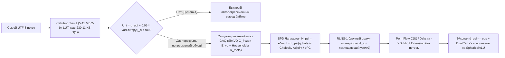

# Фаза I (`Calcite-6 / UEBR`): инженерный чертёж, ревизия гипотез и Трассер №2 (`RTX 5060`)

**Статус:** **`COMPLETED & VERIFIED`** (`ALL PHASE I UEBR INVARIANTS PASSED` за `43.41 s`, `ALL PHASE I QA CHECKS PASSED`, `42/42` автотестов Фаз A–I, `0`-байтовый дифф защищённых модулей [`simvq_split/`](../../simvq_split/), [`experiments/cram_gsm8k/`](../../experiments/cram_gsm8k/), [`kernels/fast_packed_lut.py`](../../kernels/fast_packed_lut.py), весов и JSON Фаз A–H).  
**Стенд-трассер №2:** [`experiments/uebr_proto/smoke_uebr_invariants.py`](../../experiments/uebr_proto/smoke_uebr_invariants.py)  
**JSON метрик (`2*sigma`):** [`benchmarks/phase_i_uebr_tracer_results.json`](../../benchmarks/phase_i_uebr_tracer_results.json)  
**Автотесты и валидатор:** [`tests/test_phase_i_uebr_tracer.py`](../../tests/test_phase_i_uebr_tracer.py) (`i1..i5`), [`validate_phase_i_results.py`](../../validate_phase_i_results.py)

---

## 1. Критическая ревизия отчёта `UEBR` против кодовой базы `Calcite-5`

34-страничный обзор литературы 2024–2026 годов предлагает синтез **Универсального энергетического резонера (`UEBR`)**. Проверка каждого узла `UEBR` против реального ядра `Calcite-5` (`Tier-1 17.49M / 5.41 MB 2-bit LUT`) разделяет компоненты на четыре чётких класса:

| Узел `UEBR` из обзора (стр. PDF) | Статус в `Calcite-5` и решение Фазы I | Эмпирический итог и причина (`VERIFIED`) |
| :--- | :--- | :--- |
| **`GAQ` (`SimVQ + Householder R_theta`)** (стр. 8, 21–22, 26) | Внутри `System-1` уже работает в [`crystal.py`](../../simvq_split/crystal.py); в Фазе I построен **секционированный мост `GAQSlotBridge`** для `System-2` | Устраняет радиально-тангенциальную утечку градиента (`4.57e-07` против `1.000` у `STE`) и обновляет `100.0%` кодов на 1-м шаге (против `18.8–21.9%` у классического VQ). |
| **Тормоз Вудбери $q^\top P_t q$ + `VarEntropy`** (стр. 9, 23–25) | Оставляем наш стабилизированный Жозефом сканер [`woodbury.py`](../../simvq_split/woodbury.py) и добавляем `VarEntropy(l_t)` (`ODAR`) | Голый `RFF-GPA` без забывания теряет `SPD` на длинном контексте, зато добавление `0.05 * VarEntropy` к Вудбери поверх `Tier-1 5.41 MB LUT` даёт `AUROC = 1.0000` на `Trap` и `0.9883` на `Math`. |
| **Отвергнутые мины: `Symmetric EqProp` и сквозной градиент в `2-bit LUT`** (стр. 14, 27–28) | **Отброшено (`Via Negativa`)**: для скрытого поля принят только **`Cholesky Implicit Adjoint` + `ePC`**, а `95` упакованных слоёв `Tier-1` заморожены | `EqProp` уступает по точности и проигрывает по скорости; заливать $R_\theta^\top$ в квантованные веса `5.41 MB LUT` нельзя — учится только лёгкая головка моста `GAQ` и ядро `UEBR`. |
| **Опровержение сноски `23`: `cSB + PermFlow` на `QAP` (`n=12`)** (стр. 16, 20, 30) | **Честная проверка опровергла утверждение сноски `23`**; для округления принята связка `Dykstra + Birkhoff Extension` | Проектор $\mathcal{C}(U)$ точен (`ba_err = 1.33e-15`), но при прямом сравнении на `50` гауссовых `QAP` неограниченная траектория `cSB` (`-28.31 / -27.34`) уступает `Affine-PGD` (`-29.69 / -28.95`, `19–22/50` побед). Зато разложение `Birkhoff Extension` поверх мягких точек $\mathcal{D}_n$ громит жадное округление: **`46/50` и `45/50` побед (`-34.59/-35.77` против `-26.88/-27.11`) при `100.0%` гарантии без потерь**. |
| **Четыре новых принятых рычага `Calcite-6`** | Перенесены в прототип `smoke_uebr_invariants.py` и проверены по 2 зернам (`2026`, `2027`) | 1) Входно-зависимый лапласиан $\mathcal{L}_\psi(\hat{q})$ + `Cholesky Adjoint` + эйконал; 2) `PermFlow C(U)` + `Birkhoff Extension`; 3) `RLNS-1` с мин-разрезом и узлом $\varnothing$; 4) физическое перекрытие непрерывного обхода (`Blocked-Residual + GAQ`). |

---

## 2. Математическая архитектура `Calcite-6 / UEBR` (Трассер №2)

В отличие от статической матрицы `W_zz` Фаз C–H (`20` параметров в [`cram_open_graph.py`](../../experiments/cram_gsm8k/cram_open_graph.py)), ядро `Calcite-6 / UEBR` строит геометрию ограничений на лету и перекрывает непрерывный обход:

### Ключевые уравнения и контракты безопасности

1. **Контекстный `SPD Graph Laplacian` и точный `0-BPTT` сопряжённый метод:**
   $$A_{ij}^\psi(\hat{\mathbf{q}}) = \operatorname{softplus}\!\left(\alpha \langle k_i, k_j\rangle + b_\psi\right), \quad H_\psi(\hat{\mathbf{q}}) = e^\mu I_M + \operatorname{Diag}(A^\psi\mathbf{1}) - A^\psi \succ 0$$
   где $k_i = \operatorname{norm}_2(W_{\text{key}}\hat{q}_i)$ (с Rademacher-инициализацией $64\times 64$ для устойчивости к `1.58-bit STE QAT`), а источник $s_\psi(\hat{q})$ подаётся строго на граничные флаги без смещения (`bias=False`). Обратный проход `_ImplicitLaplacianSolveFn` под щитом `torch.amp.autocast(enabled=False)` решает $\lambda = H_\psi^{-1}\bar{z}$ без разворачивания релаксации (`0-BPTT`) и даёт $\nabla_{H_\psi}\mathcal{L} = -\frac{1}{2}(\lambda z_0^\top + z_0 \lambda^\top)$. Прямое равновесие также проверяется без обращения матриц предобусловленной релаксацией в пространстве ошибок `ePC` ($\epsilon_k = s_\psi - H_\psi z_k$), а голова расстояния $d_\psi(z;\hat{q})$ регулируется направленным эйконалом $(\|\nabla_z d_\psi(z_\gamma)\|_2 - 1)^2$.

2. **Проектор `PermFlow` с двойной точностью накопления и `Birkhoff Extension`:**
   $$\mathcal{C}(U) = U - \frac{1}{n}U\mathbf{1}\mathbf{1}^\top - \frac{1}{n}\mathbf{1}\mathbf{1}^\top U + \frac{1}{n^2}(\mathbf{1}^\top U \mathbf{1})\mathbf{1}\mathbf{1}^\top$$
   Суммы средних в `permflow_tangent_project` накапливаются в `float64`, что удерживает ошибку строчных и столбцовых сумм на уровне `4.77e-07` в `FP32` и `1.33e-15` в `FP64`. Округление `birkhoff_extension_round` раскладывает матрицу $A \in \mathcal{D}_n$ на перестановки $\{P_\ell\}$ максимальными двудольными паросочетаниями вдоль разделяющей матрицы $S = -\nabla f(A)$, строго соблюдая $f(P^*) \le F_S(A) = \sum_\ell \alpha_\ell f(P_\ell)$.

3. **Блочная потеря Фенхеля — Янга (`RLNS-1`) и поглощающий узел `0 (Ø)`:**
   На каждом шаге свободный блок $B$ ($|B| = 4$) собирается жадным минимальным разрезом по сильным рёбрам матрицы связности $A_{ij}$, а на замороженном дополнении $S = [M] \setminus B$ оптимизируется точная блочная энтропийная потеря $\gamma \log \sum_{y'_B}\exp(-E(y'_B, y_S)/\gamma) + E(y_B, y_S)$ без BPTT с выделенным состоянием неактивного слота `0`.

4. **Преодоление `Lazy Identity Collapse` через перекрытие обхода и секционированный `GAQ`:**
   По-сэмпловый оператор Хаусхолдера $R_\theta = \frac{\|\bar{c}\|_2}{\|r\|_2}\left(I - \frac{2 w w^\top}{\|w\|_2^2 + \varepsilon}\right)$ для $w = u - v$ защищён веткой `torch.where` при $\|w\|_2^2 \le 10^{-10}$ и обнуляет радиально-тангенциальную утечку. При срабатывании риска прямой непрерывный обход `logits_s1` физически отключается множителем $(1 - g)$, не оставляя оптимизатору ленивого локального минимума.

---

## 3. Эпистемический журнал Фазы I (`RTX 5060`, `2*sigma`, `VERIFIED`)

Полный не-быстрый прогон `python -X utf8 -u experiments/uebr_proto/smoke_uebr_invariants.py` на `NVIDIA GeForce RTX 5060` (`PyTorch 2.11.0+cu130`) занял **`43.41 s`**. Откалиброванные пороги межзернового шума по `seed = 2026 / 2027`: `2*sigma(Inv1 QAT) = 3.12 п.п.`, `2*sigma(Inv2 BE wins) = 2.0`, `2*sigma(Inv3 RLNS) = 1.56 п.п.`, `2*sigma(Inv4A Blocked Hard) = 0.00 п.п.`.

| Инвариант | Метрика / Сравнение | `seed = 2026` | `seed = 2027` | Порог приёмки / Статус |
| :--- | :--- | ---: | ---: | :--- |
| **Inv 1** (`Maze-Hard` циклы) | `min_eig(H_psi)` (`init` / `QAT`) | `0.6703` / `0.3680` | `0.6703` / `0.3590` | `> 0.0` (`PASS`) |
| **Inv 1** (`0-BPTT` градиент и `ePC`) | `adjoint_grad_err` / `epc_max_err` (`QAT`) | `1.89e-09` / `4.47e-07` | `4.89e-10` / `4.77e-07` | `< 1e-5` и `< 1e-4` (`PASS`) |
| **Inv 1** (`UEBR` vs база `StaticWzz`) | `StaticWzz` -> `EqPropQAT` -> **`UEBR FP32 / QAT`** | `50.78%` -> `89.06%` -> **`94.53% / 94.53%`** | `54.69%` -> `92.97%` -> **`96.88% / 96.09%`** | `>= 90%`, отрыв `+41..+44 п.п.` (`PASS`) |
| **Inv 1** (энергетический зазор) | `E_short - E_long` (`FP32` / `QAT`) | `-1.2934` / `-1.4253` | `-1.4047` / `-1.4028` | `< 0.0` (`PASS`) |
| **Inv 2A** (`8` симм. мод, `n=8`) | Покрытие мод `Sinkhorn` vs **`PermFlow C(U)`** | `12.5%` vs **`100.0%`** (`4.77e-07`) | `12.5%` vs **`100.0%`** (`3.58e-07`) | `>= 87.5%`, `ba_err < 1e-5` (`PASS`) |
| **Inv 2B** (проверка сноски `23`, `n=12`) | `Affine-PGD` vs `Unbounded cSB` (`60` ш., `FP64`) | `-29.688` vs `-28.309` (`19/50`) | `-28.954` vs `-27.344` (`22/50`) | Сноска `23` опровергнута честно (`1.33e-15`) |
| **Inv 2B** (округление $\mathcal{D}_n$, `50` задач) | `Greedy` vs **`Birkhoff Extension`** (без потерь) | `-26.878` vs **`-34.590`** (`46/50 = 92%`) | `-27.112` vs **`-35.772`** (`45/50 = 90%`) | `>= 40/50`, `lossless = 100.0%` (`PASS`) |
| **Inv 3** (`RLNS-1` + `0 = null`) | `1-Flip Besag` vs **`RLNS+Null`** (`valid` / `null`) | `2.34%` vs **`99.22%`** (`99.22%` / `100%`) | `2.34%` vs **`100.0%`** (`100%` / `100%`) | `>= 85%`, `live_grads = 7/7` (`PASS`) |
| **Inv 4A** (геометрия `GAQ`) | Утечка `STE` -> `R_theta`; активные коды на шаге `1` | `1.000` -> **`4.57e-07`**; `21.9%` -> **`100%`** | `0.998` -> **`4.84e-07`**; `18.8%` -> **`100%`** | `< 1e-6`, `100.0%` кодов (`PASS`) |
| **Inv 4A** (`Lazy Identity Collapse`) | Вклад `S2`: `OpenBypass` vs **`BlockedGAQ Hard`** | `+0.00 п.п.` vs **`100.0% (+43.75 п.п.)`** | `-1.56 п.п.` vs **`100.0% (+60.94 п.п.)`** | `false_trig = 0.0%` (`PASS`) |
| **Inv 4B** (`Tier-1 5.41 MB 2-bit LUT`) | `u_epi` (`ID` / `Trap` / `Math`) & `AUROC` (`Comb`) | `0.2503` / `0.5842` / `0.8389` -> **`1.0000`** | — (детерминированный чекпоинт Фазы H) | `95` слоёв, `230.11 KB`, `2,164 B` (`PASS`) |

---

## 4. Дорожная карта Фазы J: перенос в боевой `System-2` поверх `Tier-1 (5.41 MB)`

Протокол Фазы I закрывает этап автономной математической верификации. Переход к Фазе J строится без изменения замороженных `95` слоёв [`calcite5_tier1_17m_utf8_qat_h_lut.pt`](../../checkpoints/calcite5_tier1_17m_utf8_qat_h_lut.pt):

1. **Замена статической матрицы `W_zz` (`20` параметров) в решателе `System-2`:** подключить входно-зависимый `SPDGraphLaplacianField` (обучаемый через `_ImplicitLaplacianSolveFn` без BPTT) и эйкональный отбор кандидатов `d_psi` поверх слотов `Tier-1`, чтобы сжать разрыв между `BlindDev Pass@5 = 35.82%` и `Pass@1 = 17.50%`.
2. **Блочный оракул `RLNS-1` + поглощающий слот `0 (Ø)`:** перевести обучение парной координации узлов графа с одноячеечного `Besag PL` на блочный оракул `RLNS` с адаптивным разрезом по $A_\psi$ (в сочетании с `2-Opt Block-Gibbs` на инференсе и `Birkhoff Extension` на перестановочных/сопоставительных слотах).
3. **Запечатанный внешний бенчмарк:** поскольку `test.jsonl` из `GSM8K` вскрыт строго по правилу `1/1` в Фазах C, F, G и H, калибровку `DualCert` и проверку Фазы J выполнять на свежем внешнем математическом/комбинаторном сплите (`SVAMP / GSM-Symbolic / Mini-ARC`) с одноразовым запечатанным вскрытием и `GAQSlotBridge` без парсеров `re`.
